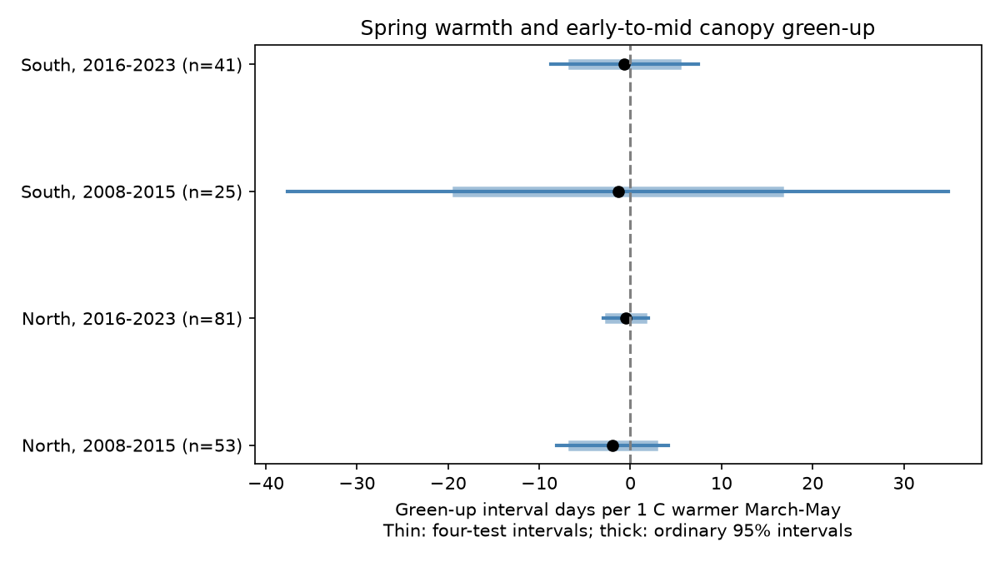

# Spring warmth slopes for early-to-mid green-up included zero in four eastern US camera samples in 2008-2023

## Result

Higher March-May temperature had negative estimated slopes for the time from 10 percent to 50 percent spring canopy green-up in four samples. All ordinary 95 percent intervals and all four-test intervals included zero. These data do not establish a repeated shortening of this interval in warm springs. They also do not establish that the link is absent.

We used 200 camera-years from 30 distinct cameras in two regions and two periods. A negative slope means fewer days from early to mid green-up per degree of warmer spring temperature.

| Sample | Records | Cameras | Slope, days per C | 95 percent interval | Four-test interval |
| --- | ---: | ---: | ---: | --- | --- |
| North, 2008-2015 | 53 | 10 | -1.951 | -6.293 to +2.391 | -8.075 to +4.173 |
| North, 2016-2023 | 81 | 12 | -0.515 | -2.251 to +1.221 | -2.963 to +1.934 |
| South, 2008-2015 | 25 | 5 | -1.364 | -18.961 to +16.233 | -37.601 to +34.872 |
| South, 2016-2023 | 41 | 7 | -0.655 | -6.270 to +4.960 | -8.736 to +7.426 |

## Question and prior work

Does warmth shorten the early-to-mid stage of spring canopy green-up after camera differences, year differences and winter temperature are held fixed? Leaf expansion changes light and habitat timing for other organisms. A short interval and an early start are different features of ecological timing.

Klosterman et al., “Later springs green-up faster: the relation between onset and completion of green-up in deciduous forests of North America” (2018), studied onset and completion. Its public paper is cited below. The present test uses a fixed seasonal weather predictor instead of a date that is also part of the interval outcome. It does not estimate a leaf growth mechanism. Young et al. (2025) describe PhenoCam V3 and the optical transition products used here. Fan and van den Dool (2008) describe the temperature product.

We searched the campaign before choosing this question. The saved search evidence lists prior studies. SCI publication 55541d9120adcdbb64b771ae3ac6723c4423d638c3a5c4e3311a669ce0241b7d tested spring-to-autumn timing. We reuse its camera frame and modify its camera build. We add a different outcome, independent monthly weather extraction, and date-range calculations. These source observations overlap the prior campaign work. This is not an independent validation of that work. Our two regions have separate cameras; the periods have separate years, but some cameras occur in both. All fits are exploratory. The plan was saved before the new fits, after source inspection. It was not externally registered.

## Sources and sample rules

The fixed frame has 59 US deciduous broadleaf camera locations at 30-49 N and 100-67 W. The prior study chose the smallest deciduous broadleaf ROI index per camera, required operation before 2016, screened US locations, and kept one camera per 0.1-degree location cell by earliest start then name. Our build reads this frame from the frozen manifest. It does not use live metadata.

For 2008-2023, we require exactly one rising GCC90 episode in the 3-day transition product per calendar year. The year is assigned from its 25 percent date. The seasonal GCC amplitude must be at least 0.02. Both the 10 and 50 percent dates must lie in days 32-181, inclusive, inside their source date intervals. The later date must be on or after the earlier date. Each source interval must be at most 14 days wide. At least 80 percent of the 61 days around each date must have nonmissing observed daily GCC90 and a positive image count. Interpolated spline values do not count as observed days. Each camera must have four eligible years within its eight-year period.

North means latitude at least 40 N; South means below 40 N. Periods are 2008-2015 and 2016-2023. There are 944 candidate camera-year slots, including years without camera operation. These are not 944 attempted field visits. The primary retained sample has 20 northern and 10 southern cameras across periods. The mean interval is 11.7-15.0 days across the four samples. Full camera-year evidence is regenerated outside this package.

Temperature comes from the nearest 0.5-degree GHCN-CAMS cell at each camera. March-May temperature is an equal-month mean. Winter temperature is the mean of prior December and current January-February. All three values must be present in each mean. The source units are kelvin; a one-unit change equals one C. Intercepts absorb the unit offset. This coarse monthly product does not measure daily extremes or local leaf temperature.

## Model and uncertainty

For each region and period, we fit ordinary least squares:

    days from 10 to 50 percent green-up =
        camera effect + year effect + b * March-May temperature
        + c * prior December-February temperature + error

The target is b. Models need at least five cameras, four years, full column rank, and positive residual degrees of freedom. These rules permit all four primary fits.

Uncertainty uses two-way cluster covariance by 2-degree spatial cell and year, with finite-sample corrections. Student t degrees of freedom equal the smaller cluster count minus one. There are 8, 11, 3 and 7 spatial clusters in table order, with eight years in each sample. Degrees of freedom are 7, 7, 2 and 6. Four-test intervals use Bonferroni correction for four primary slopes. Few clusters can make these intervals unreliable, especially in early South. Intervals do not prove equivalence to zero. No formal regional or period slope difference is tested.

All fitted sensitivity intervals include zero. Checks use at most seven-day date intervals, at least 90 percent observed coverage, camera-specific linear trends, and a 25-to-50 percent outcome. Trends use one omitted camera trend because year effects already contain the common trend. The threshold check rebuilds eligibility and changes the sample. Early South fails the five-camera rule under the precision and coverage checks; these fits are reported as unsupported, not as zero effects.

Every northern leave-one-camera point estimate remains negative. Southern ranges include both signs. These are influence checks, not separate replication.

## Date uncertainty and observation bias

With weather and model design fixed, we allow each endpoint to vary independently inside its source interval, subject to early date being no later than mid date. For early bounds [a,b] and mid bounds [c,d], the possible interval length is [max(0,c-b), d-a]. The observed ordering and intervals ensure feasibility. The temperature coefficient is a linear weighted sum of interval lengths. Assigning the smaller or larger allowed length according to the sign of its weight gives exact conditional coefficient limits under these assumptions.

The four coefficient ranges are -14.262 to +9.214, -10.127 to +8.529, -15.399 to +13.573, and -11.633 to +10.095 days per C. Each permits either sign. These are possibility ranges, not confidence intervals. Source date intervals are estimated and are not guaranteed bounds on true dates. Independent endpoint variation can be conservative because dates share a fitted curve. The ranges do not combine sampling error with date error.

Automated cameras reduce human visit bias. The coverage and precision filters address missing images and poorly located transitions. They do not make missingness random. Camera views, exposure, snow, species mix, curve fitting, and changes in operation can affect optical dates. Filtering can remove stress-related or multiple green-up events. Camera membership changes across periods. The selected views do not represent all US forests, individual species, or ecological communities.

The fixed March-May window overlaps and can extend beyond green-up. It is a seasonal exposure summary, not a causal forcing window. Rain, radiation, chilling hours and daily frost are not measured. Year effects remove common annual shifts and can reduce temperature variation and precision. These tests do not identify a human-caused climate trend. Air pollution, weather extremes, species distributions and biodiversity loss were not tested. The result concerns the ecological timing part of the assigned objective.

## Validation and reproduction

The source manifest records exact shared paths, URLs, archive-member hashes and source file hashes for all 59 camera archives and the temperature file. Raw sources are reused in place. No data were downloaded for this investigation. The camera build verifies each archive against its shared provenance and frozen manifest. Weather extraction verifies its exact file hash. Independent residual projection and coefficient weights reproduce every reported fitted slope within 1e-7. A separate cluster-score covariance calculation matches the fitted slope variance within 1e-5. Details are in validation.json. These checks test computation, not measurement accuracy or statistical assumptions.

Use Python 3.12 and packages listed in requirements.txt; exact numerical package versions are in environment.json. Set pkg to the verified extracted publication and run from a directory with access to the shared datasets:

    pkg=/absolute/path/to/extracted/publication
    python -B "$pkg/files/build_panel.py" --data-root ./datasets --scratch ./repro/records --summary ./repro/build --frozen-selection "$pkg/files/source_manifest.json"
    python -B "$pkg/files/analyze.py" --panel ./repro/records/panel.csv --data-root ./datasets --scratch ./repro/analysis_records --out ./repro/results
    python -B "$pkg/files/check_reproduction.py" --camera-panel ./repro/records/panel.csv --weather-panel ./repro/analysis_records/weather_panel.csv

Compare results.csv, sample_summary.csv, validation.json, leave_one_camera_ranges.csv and slopes.png with the signed files. Preserve regenerated source records and camera-year tables outside the publication. Numerical tolerance is needed across library or hardware changes.

Without the shared store, retrieve exact sources to separate local storage:

    python -B "$pkg/files/retrieve.py" --destination ./external_raw

Use ./external_raw as data-root. Retrieval refuses a changed hash and leaves existing files unchanged. Live sources can change. If a hash fails, obtain the recorded snapshot from the named shared source or an external archive; do not silently use another version. No private scratch is needed.

## Rights and work record

The unchanged SCI baseline license covers the new code, narrative, figures and aggregate statistical results. Source records, raw grids, image values and camera-year tables remain external. The external data notice preserves attribution, source terms and code credit. The figure and statistical tables contain new aggregate results, not a record-level source database. Frozen metadata can contain older terms; those files are not relicensed or bundled. Site credit notices identify external providers. They are not claims of ownership. Providers did not review or endorse this work.

Campaign: 11_07_2026. Job: sci-1107-dell-climate-pollution-biodiversity-a8db91bd7ba6. Topic: climate-pollution-biodiversity. Machine: dell. Account: codex-myxtap. Model: gpt-6.1-sol, high reasoning effort, through the Codex harness in T3 Code. Date: 9 November 2026. No child agents were used. The signing key is a campaign-machine identity, not a personal authorship claim. No remote upload or index submission was made.
