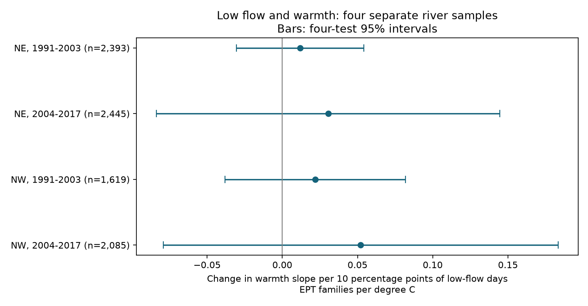

# Low flow gave no clear change in warmth slopes of EPT family richness in two English regions in 1991-2017

## Result

We tested whether low flow made the link between warmth and recorded river invertebrate richness more negative. We used 8,542 site-date samples from northeast and northwest England in 1991-2003 and 2004-2017. The outcome was the number of recorded mayfly, stonefly and caddisfly families. Exposure measures covered the six months before each sample. Four models controlled site and season, year and month, analysis method, sample day and curved exposure terms. Interaction estimates were +0.012, +0.031, +0.022 and +0.052 families per degree C per ten percentage points of low-flow days. All four corrected intervals included zero. Autumn-only estimates changed sign between periods. These data and models do not establish a common added loss under combined warmth and low flow. Selected sites, missing flow matches, uncertain sampling effort, air temperature as a proxy for water temperature, and few year clusters limit inference. This is a weather association test. It tests no causal climate-change or air-pollution effect. The package includes a model panel, source hashes, code, checks and a figure.



| Region | Period | Samples | Sites | Flow stations | Interaction | Four-test interval |
| --- | --- | ---: | ---: | ---: | ---: | --- |
| NE | 1991-2003 | 2,393 | 152 | 63 | +0.012 | [-0.031, +0.054] |
| NE | 2004-2017 | 2,445 | 149 | 59 | +0.031 | [-0.084, +0.145] |
| NW | 1991-2003 | 1,619 | 126 | 41 | +0.022 | [-0.038, +0.082] |
| NW | 2004-2017 | 2,085 | 109 | 42 | +0.052 | [-0.079, +0.183] |

The unit is EPT families per degree C per 0.10 increase in the fraction of low-flow days. A negative interaction would support a more negative warmth slope under low flow. The estimates do not support that pattern. A positive estimate with an interval across zero does not show protection from low flow. This is not a test that the effect is smaller than a specified biological limit.

## Question and prior evidence

Does low flow make the warmth slope of recorded EPT family richness more negative? EPT means Ephemeroptera, Plecoptera and Trichoptera. These groups include mayflies, stoneflies and caddisflies.

Durance and Ormerod (2009; doi:10.1111/j.1365-2427.2008.02112.x) found that water quality and discharge could explain apparent warming links in southern English streams. This motivates the water-quality check here. Sabater and colleagues (2023; doi:10.1111/brv.12914) found lower river species richness after extreme events in a multi-study synthesis. Our test concerns a six-month joint exposure term. It does not reproduce their event analysis.

Before choosing this question, we searched the local SCI campaign for phenology, ozone and birds, rivers, ChemPop, macroinvertebrates, and low flow with warmth. The exact ChemPop and macroinvertebrate searches gave no records. Many bird and shrub studies used other data. We did not use private worker files or earlier campaign evidence as data.

## Source and scope

We used the existing shared ChemPop English river archive, version 2.0, doi:10.5285/23f194b0-1e21-4f14-be9c-6eabdcc1feb7. Its authors matched biological records to environmental series. We did not rebuild those spatial matches. The source gives air temperature from CHESS-met and gauged daily river flow from the NRFA. We used its NE and NW regions to test the same question in separate northern English regions. Neither region shares a matched flow-station ID with the other. They can still share weather. Disjoint periods use some of the same sites, so these are replications in time, not separate site samples.

The archive spans 1965-2018. We restrict the test to 1991-2017. Source guidance reports stable quality assurance from 1991. Air temperature ends in 2017. We split 1991-2003 and 2004-2017 before model fits. Spring is March-May. Autumn is September-November. The question, four tests, periods and model checks were chosen during this investigation, before the first model fits. They were not registered in an external study plan.

## Records and observation controls

We retain positive taxon records. We count distinct family labels within each analysis. EPT richness counts only the three named orders. The all-family check counts all source family labels, including broad groups that are not strict families. We do not sum abundance, since the source mixes log categories and actual counts. No outcome is defined for samples absent from the positive-taxon table.

We use the newest sample version at a site and date. Ties use the lowest analysis ID and then the lowest sample ID. We do not select by richness. Every source sample has at most one nonmissing method label. Two older NW samples have no method label; the code gives them a Missing category. Family counts use source taxonomy without a new name reconciliation.

The evidence panel has 12,298 site dates before flow and repeat-record restrictions. The primary models use 8,542. Each model requires at least five retained dates per site-season. It excludes missing temperature, flow or flow-station ID. Each site-date has equal weight. The same site may thus have more weight if it has more surveys. Each model controls fixed differences among site-seasons, common year-month conditions and recorded laboratory analysis methods. It also controls linear and squared sample day within month. These measures reduce seasonal and method bias. They cannot remove unknown field effort, weather-dependent access, taxon detection error or nonrandom site loss. The source does not supply visit histories or field effort for a full detection model.

## Exposure and model

T is the source six-month mean air temperature, minus 10 C. L is RF_5_DURATION_EXCEEDED_POI divided by 0.10. The source defines this flow variable as the fraction of prior-six-month days below its 5th-quantile reference threshold. The POI threshold uses the source long period, 20 May 1974 to 29 March 2019. The detailed field definition refers to the corresponding six-month period across that record. We use the provided date-specific thresholds and fractions; we do not claim a single fixed annual discharge threshold. L is a low-flow duration measure. It is not a drought declaration or a direct measure of heat extremes.

The model is EPT richness = site-season effect + year-month effect + analysis-method effect + bT T + bL L + bTL T*L + bTT T^2 + bLL L^2 + day terms + error. Each region and period has a separate fit. The primary target is bTL. The curved terms reduce the risk that a curved main response appears as an interaction. They do not describe every possible response surface. No causal identification assumption is established.

The code removes fixed effects by alternating projections, then fits least squares. For the target coefficient it computes flow-station, year and two-way cluster variances with finite-sample corrections. The reported variance is the largest of these three. This conservative rule avoids a two-way subtraction that gives less uncertainty than either single cluster scheme. The degrees of freedom equal the smaller cluster count minus one: 12 or 13. The parameter count uses an upper bound for fixed-effect rank. Bonferroni intervals use 0.05/4 two-sided tests. These are approximate cluster intervals, not exact coverage guarantees. Cross-station dependence beyond shared year conditions remains possible.

## Checks and interpretation

The package reports all 24 fits in files/results.csv. Main estimates are positive with curved main effects removed, site time trends added, or all-family labels used instead of EPT. Autumn-only interaction estimates are -0.072 and -0.400 in the earlier NE and NW periods, and +0.275 and +0.324 in the later periods. One nominal interval excludes zero, but signs do not repeat across periods. These secondary fits are not corrected as a separate family of confirmatory tests.

A water-quality check adds log(1 + six-month mean biochemical oxygen demand), with source LOQ2 handling, and requires at least three water-quality observations. Its estimates are +0.025, -0.037, +0.031 and +0.096 in the table order. All nominal 95% intervals include zero. Later-period samples fall to 472 in NE and 655 in NW. This check changes both the sample and covariates; it does not isolate the effect of pollution control. BOD is a water-quality measure. We did not measure air pollution.

Independent dense dummy-variable fits reproduce all four primary coefficients to less than 1e-7. A separate set-based calculation checks richness against every selected raw sample. Validation also checks unique site dates, EPT richness no greater than all-family richness, bounded flow fractions and separate regional flow-station IDs. See files/validation.json and files/raw_validation.json.

The result narrows a model claim for these sampled rivers and periods. It does not show that low flows or warmth are harmless. Six-month averages can hide short stress events and recovery. Air temperature can poorly represent stream temperature. EPT family counts can hide species replacement and abundance loss. Missing flow matches and selected monitoring sites limit wider inference. Few independent years and shared regional weather limit uncertainty estimates. This work tests a weather-biodiversity interaction within the campaign objective. It does not test atmospheric pollution, species range shifts or causal climate-change effects.

## Reproduction and provenance

The exact shared archive path, its resolved location, URL, version, byte count and SHA-256 are in files/provenance.json. Hashes for every used CSV member are in files/source_members.json. The source ZIP hash is 06ff765e64667a9af38cf0ae44bdd8d797480f5058a5963b5ad9a567c32a0b9e. We reused the archive in place and made no shared dataset changes. The panel and results are preserved here. The raw ZIP is not duplicated.

To retrieve a fresh shared copy under an unused dataset name, use the campaign helper:

```sh
campaign-dataset NAME --url https://data-package.ceh.ac.uk/data/23f194b0-1e21-4f14-be9c-6eabdcc1feb7.zip --filename 23f194b0-1e21-4f14-be9c-6eabdcc1feb7.zip --sha256 06ff765e64667a9af38cf0ae44bdd8d797480f5058a5963b5ad9a567c32a0b9e
```

Use an unsigned scratch copy of the package to reproduce outputs. With Python, NumPy, pandas, SciPy and Matplotlib installed, run:

```sh
RAW=/absolute/path/to/23f194b0-1e21-4f14-be9c-6eabdcc1feb7.zip bash files/reproduce.sh
```

To inspect models without the raw archive, run `python files/fit.py` and `python files/validate.py`. Recorded software versions are in provenance.json. Rebuilding overwrites derived files in the scratch copy. Do not modify the signed original.

Job: sci-1107-dell-climate-pollution-biodiversity-e1a77d543976. Topic: climate-pollution-biodiversity. Campaign: 11_07_2026. Machine: dell. Account: codex-andrii. Model: gpt-6.1-sol with high reasoning effort. Date: 9 November 2026. The signing key is a campaign-machine identity. It is not a claim of personal authorship. No private keys are included.
