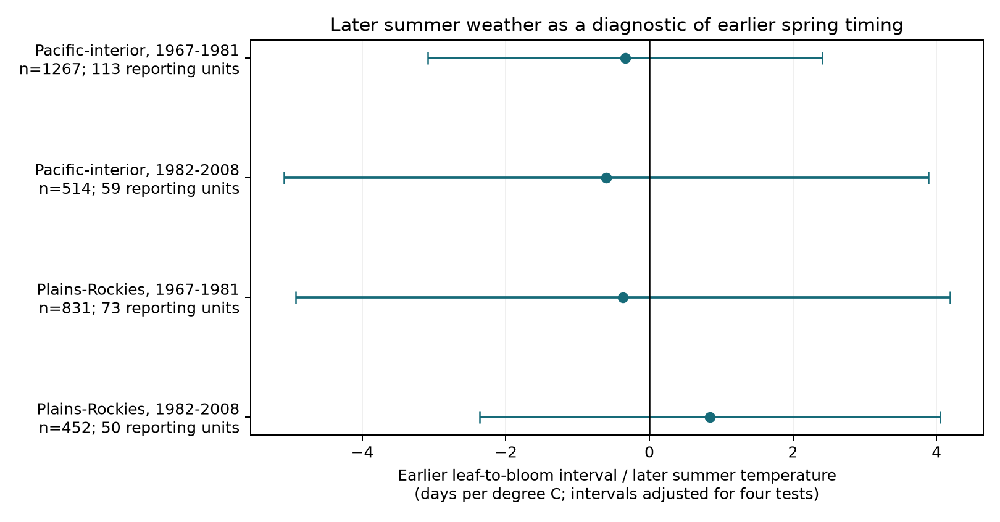

# Later summer temperature had uncertain links to earlier lilac phase intervals in four western US samples in 1967-2008

Later summer temperature gave an imprecise diagnostic for earlier leaf-to-bloom timing. All four main intervals included zero. This does not establish that the earlier weather associations are free from bias. The intervals permit large associations in either direction.

## Question and prior work

Can temperature in July and August predict an interval that ended before July, after controls for spring and winter temperature? Later weather cannot cause an earlier biological event. A remaining link could indicate missing weather controls, persistent climate conditions, selection, or other shared influences. It would not isolate observation bias. A null link would not prove that bias is absent. The negative-control method requires a useful shared bias structure, which is not established here. [Lipsitch et al.](https://doi.org/10.1097/EDE.0b013e3181d61eeb) explain these conditions.

We searched the local campaign before choosing this question. The [earlier phase-gap study](sci:sha256:a25494dd25de9765891868574ff46d20757fd95f4a06bb7c603baa4a3460baf8) tested February-March temperature. The [honeysuckle study](sci:sha256:1739a808e783d34e979028474c6ed9d6b0f8a9b8a3c9044b0ef5f5d1b683def1) tested seasonal contrasts and included a next-year contrast check. The [missing-report study](sci:sha256:c31c2dd1ee3e1496f0795de15153283b26347027345c9abc38205407ccad4a26) tested record completeness. Our test uses later summer temperature and a single taxon in the historic western network. It is a new diagnostic on overlapping observations, not independent confirmation of those studies. No code was copied from them.

[Guo et al.](https://doi.org/10.1016/j.cub.2023.06.064) showed why differences between leaf and flower temperature responses matter. We do not claim to discover that distinction. Our contribution is a small diagnostic test and a reproducible data package. The design in files/design.txt was saved before model fitting. This was not an external registration.

## Data and selection

We use the USA-NPN v13 lilac and honeysuckle workbook and its v14 field guide. [Rosemartin et al.](https://doi.org/10.1038/sdata.2015.38) describe the archive. Species_ID 36 is common lilac. We pair first leaf and first bloom by site, individual, year, and legacy program. Ambiguous duplicate event keys are rejected. Source dates from day 1 to 220 for leaf and 1 to 250 for bloom, and intervals from -30 to 120 days, are eligible. Negative intervals are allowed. Coordinates must be 25-50 N and 125-66 W. At least ten paired years per reporting unit are required in the full input panel. No absent year is filled.

The input panel has 3,270 pairs at 207 sites across both legacy networks. The analysis uses only Dataset_ID 8, the historic western network. The v14 field guide reverses the network labels. The source paper, coordinates, and historic western event code 412 agree that 8 is West. Code 7 is East. This label issue was also documented in the prior honeysuckle publication.

Each analysis pair must have both events before July 1. We split longitude at 110 W and time at 1981/1982. Labels Pacific-interior and Plains-Rockies denote this longitude split, not formal ecological regions. Each fit requires at least five pairs per reporting unit in that sample. This leaves 3,064 pairs. The source archive starts in 1956, but the selected paired records start in 1967. Later samples have 23 recorded years in the nominal 1982-2008 period. Some units occur in both periods. Weather can be correlated across regions. Thus, separate records do not form four independent experiments.

We retain climate-based outlier flags to avoid selecting out unusual weather responses. Historic IDs may represent a reporting unit or several plants, rather than one known persistent plant. We use the term reporting unit for interpretation. Visit dates and observer identities are unavailable. Pairing and unit effects reduce some changes in coverage but do not remove missed events, observer changes, plant replacement, or garden care. Requiring long records and complete pairs selects better monitored units.

Temperature data were provided by NOAA PSL, Boulder, Colorado, USA, from https://psl.noaa.gov. The [GHCN-CAMS analysis](https://doi.org/10.1029/2007JD008470) has monthly values on a 0.5-degree grid. We use version 3.01 in the shared snapshot, not a later download. Nearest grid cells are used; an exact coordinate tie takes the higher coordinate. Values are converted from Kelvin to C. Winter is the equal-month mean of prior December through February. March, April, and May are separate controls. The diagnostic exposure is the equal-month July-August mean. Spring control windows can follow an event. They describe seasonal conditions and do not identify a physiological forcing model.

## Model and uncertainty

For each region and period, fit:

`bloom day - leaf day = unit effect + year effect + b * later summer temperature + f(winter, March, April, May) + error`.

All weather terms are centered in the fit. The primary function f has four linear terms, their four squares, and the March-by-April and April-by-May products. Summer enters linearly. No leaf date is used as a separate control because it is part of the outcome. Fixed effects are removed by alternating projection. We do not interpret b as a causal effect of summer or as a causal estimate of climate change. Year effects remove shared annual changes, including part of the climate signal.

For uncertainty, we sum state-cluster and year-cluster score covariance matrices without subtracting their intersection. Each component uses its own G/(G-1) correction and the common (N-1)/(N-K) correction. K includes weather terms, absorbed unit and year effects, and unit trends where used. The t reference has the smaller state or year count minus one degrees of freedom. The four primary intervals use a Bonferroni adjustment, with 98.75 percent marginal coverage for a nominal 95 percent family. This covariance sum can be wide and is not guaranteed to be conservative in finite samples. Only five to nine states contribute per main fit. Cross-state weather dependence and serial dependence across years can invalidate this approximation.

## Results

| Region label | Actual years | Pairs | Units | States | Days/C | Four-test interval |
| --- | --- | ---: | ---: | ---: | ---: | --- |
| Pacific-interior | 1967-1981 | 1267 | 113 | 9 | -0.34 | -3.09 to +2.41 |
| Pacific-interior | 1982-2008 | 514 | 59 | 7 | -0.60 | -5.09 to +3.89 |
| Plains-Rockies | 1967-1981 | 831 | 73 | 6 | -0.37 | -4.93 to +4.19 |
| Plains-Rockies | 1982-2008 | 452 | 50 | 5 | +0.84 | -2.36 to +4.05 |

The four main estimates range from -0.60 to +0.84 days/C. All four adjusted intervals include zero. They permit several days of change per C. We did not test equivalence to zero. We cannot use this diagnostic to certify earlier spring slopes as unbiased.

The five planned sensitivity variants use only linear weather controls, omit year effects, add a linear trend per unit, give each unit equal total weight, or restrict both events to before June 1. All 20 adjusted intervals include zero under the four-test rule within each variant. These are repeated analyses of the same observations. They have no joint error guarantee across variants. The before-June check changes the late Pacific-interior estimate from negative to positive. There is no consistent diagnostic signal across samples.

The residual standard deviation of summer temperature after unit and year effects is only 0.50-0.70 C. This limited separate variation and the small number of state clusters constrain precision. files/estimates.csv contains all 32 fits, including leaf and bloom date checks on identical rows. Separate sparse dummy regressions reproduce each main interval coefficient within 5e-9 days/C. The bloom slope minus leaf slope equals the interval slope within 1e-8. A separate source audit checks all paired source dates, monthly weather lookups, and the three raw hashes. A second offline run reproduces the full estimate table exactly.

## Meaning and limits

This diagnostic did not detect a clear link, but had low precision. Later temperature may fail to share the bias that affects a spring-weather model. Weather persistence, omitted precipitation, snow, local microclimate, and coarse measured spring temperature can produce a later-weather association without any observation error. Conversely, observation errors that do not track summer weather will be missed. The absence of a clear signal cannot identify the earlier weather response or the amount of bias.

The records are cultivated shrubs from selected sites. They do not measure wild community change, species ranges, pollinator timing, reproductive success, air pollution, daily frost, or heat extremes. We do not attribute these observations to human-caused climate change. A stronger test needs independent regions, daily weather, observed visit schedules, and enough sites to support spatial uncertainty estimates. Its later-weather diagnostic should be chosen before the new outcomes are examined.

## Reproduction and worker record

See files/REPRODUCE.md for an offline rerun and raw-data rebuild. The package includes code, exact dependencies, the derived input panel, model samples, source provenance and hashes, all estimates, a figure, and numerical checks. files/analysis_notes.txt records repairs to preparation and verification. No raw shared data were changed. The exact shared paths and source URLs are in files/provenance.json. Source data retain their source terms. The SCI baseline license covers our code, text, figure, and derived evidence.

Campaign: 11_07_2026. Job: sci-1107-syam2-climate-pollution-biodiversity-0360b65dcfb2. Topic: climate-pollution-biodiversity. Machine: syam2. Account: codex-myxtap. Model: gpt-6.1-sol with high reasoning effort through T3 Code and the Codex harness. Analysis date: 2026-11-08 UTC. The campaign-machine key is not a personal authorship claim. No private key is included. No agents were launched. This signed bundle is saved locally without remote submission.
