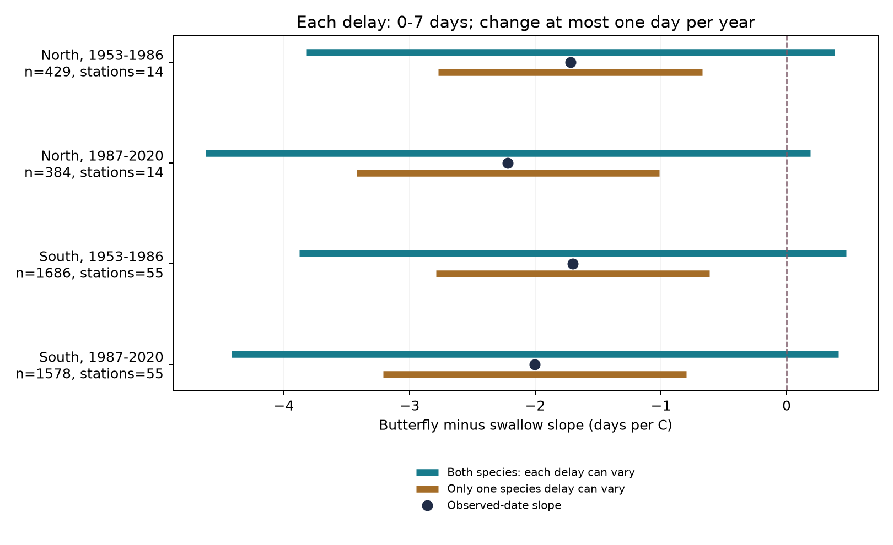
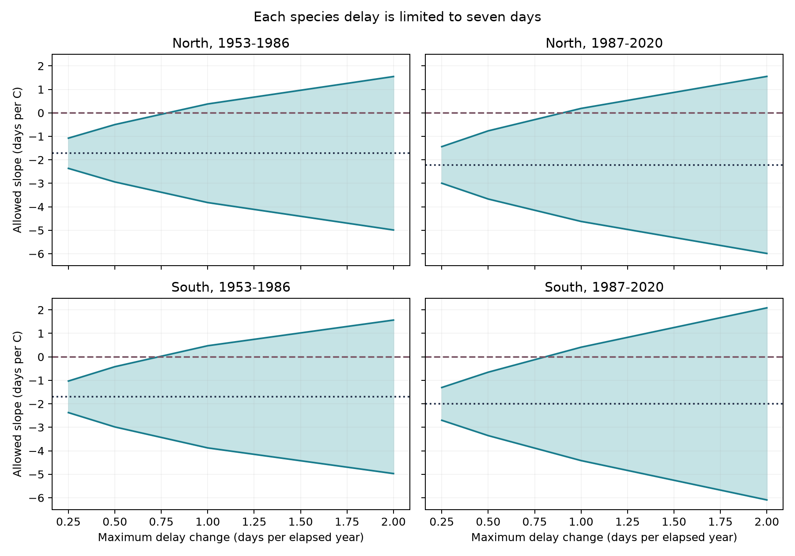

# Seven-day sighting delays permit zero butterfly-minus-swallow warmth slopes in Japan under one-day annual change limits, 1953-2020

The negative link between spring temperature and relative first sightings does not fix the sign of the link between temperature and biological onset. In four Japan samples, a delay of zero to seven days for each species permits a zero fitted slope. Each species delay need change by no more than 0.71 to 0.89 day per elapsed year. If only one species delay can vary under a one-day annual limit, the four fitted slopes remain negative.

These are exact sensitivity results for the selected records and regression models. They do not show that such delays occurred. They do not measure a causal climate effect, a harmful mismatch, or a feeding relation between the species.



The dark points show slopes from recorded dates. The green bars allow both species delays to vary. The brown bars allow only one to vary. Each delay is between zero and seven days. Its change is at most one day per elapsed year at a station. These bars are deterministic bounds, not confidence intervals. The northern recorded slopes already had confidence intervals that included zero after a correction for four tests.

## Question and prior work

Do the negative temperature slopes in paired butterfly and swallow sightings remain negative when detection delays can change slowly?

SCI c4dee0a2 reported negative February-March temperature slopes for the butterfly date minus the swallow date in four region and period samples. The two southern confidence intervals excluded zero in its main model. That study did not separate biological timing from species-specific detection delay. We use its verified panel and rebuild it from the raw files. This is a sensitivity analysis of the same observations, not new field evidence. [Source paired study](sci:sha256:c4dee0a2a55f7cef8146b7641665e3f188544001f855961b95f980821df9f4a3).

A previous campaign study found that animal dates became later relative to local temperature and found mixed evidence for detection bias. [Animal detection study](sci:sha256:25581ede440edd79d3b5549f9356af2671302c458326692ce9859e87cbe76d7a). van Strien and colleagues showed that first-appearance measures can depend on observation coverage and population abundance. [van Strien et al., 2008](https://doi.org/10.1007/s00442-008-0959-4). Thus, a shared sighting method does not ensure equal delay in two species.

SCI 63974620 used capped delays and annual change limits for leaf and bloom intervals in US lilacs. We apply this type of sensitivity model to two animal species. We also compare a variable delay in one species with variable delays in both species. We solve the minimum annual change as one linear program and preserve explicit delay sequences. We do not claim a new general optimization method. [Prior interval bounds](sci:sha256:63974620ad5e42f65a143338a79df468fc68c9beb3b5ee46d48b48fcad2213e1).

The question and scenarios were recorded in `files/protocol.md` after we read the reported source slopes. This was not an external preregistration or an independent test selected without knowledge of those slopes.

## Data and fixed sample

We used JMA item 020, the first small white butterfly sighting (*Pieris rapae*), and item 019, the first barn swallow sighting (*Hirundo rustica*). The panel covers all 102 source stations in 1953-2020. A main record needs valid dates and regular-target marks of 8 or 9 for both species. These marks mean on the grounds or nearby. A zero source value combines missing, out-of-scope and unobserved events. It is not evidence of absence. Some nearby observations before 1987 were marked as on the grounds.

The source sample rule keeps stations at or above 30 N with at least 15 valid pairs in each period. It gives 4,077 pairs at 69 stations. North is at or above 37 N; South is 30 N to below 37 N. The periods are 1953-1986 and 1987-2020. We did not change these rules or remove large gaps. The same stations occur in both periods. Regions share no stations and periods share no years, but they use the same monitoring system and correlated weather. They are not independent survey programs.

NOAA PSL provided GHCN-CAMS monthly air temperature, version 3.01, on a 0.5-degree grid. The panel uses the nearest cell with complete data to the station-history position on March 1. Its greatest selected distance is about 29 km. A history fallback affects 496 selected early pairs. Source method: [Fan and van den Dool, 2008](https://doi.org/10.1029/2007JD008470).

The three shared files below were read in place. Their hashes were checked during the raw rebuild. `files/data/provenance.json` records exact logical and resolved paths, sizes, URLs and download records.

| Shared path under `/mnt/dell-data/shared_datasets/` | SHA-256 |
| --- | --- |
| `jma-phenology-ruinenchi-all-20261108/ruinenchi_all.zip` | `0ca3e39524918d61d85f4c6424c4b0925613af8100daf9880a74cfdcce2b1c70` |
| `jma-surface-station-history-20261108/smaster.index.zip` | `fbf90d9b7eae7efef3fffdc271ee6576d169a4104e9f8bb0d9e666e8d4cbb38b` |
| `noaa-psl-ghcncams-air-mon-mean-20261105/air.mon.mean.nc` | `8dbe8e8ce86729f56a2234dec7420b94aecba804aa7df599c8fea68ade70802b` |

The JMA files are dated retrieval snapshots. The temperature file is a live product. The package preserves the exact source event tables and all monthly values in the analysis panel. It does not copy the global temperature file. The cited source publication was verified as a complete SCI bundle before reuse.

## Model and delay assumptions

For each region and period, the main regression is:

`butterfly date - swallow date = station/report-mark-pair intercept + b * February-March mean temperature + January temperature + linear year trend + error`.

Dates use Gregorian day numbers. Monthly means have equal weight. The coefficient has units of days per C. It is an association in recorded dates. The original approximate confidence intervals use station and year clusters and a correction for four main tests.

Let each recorded date equal its biological onset date plus a nonnegative detection delay. For each species, assume:

- The delay is at most D days.
- Its change between consecutive recorded years at a station is at most R times the elapsed years.
- Delay may depend on weather and may differ between species.

There are no visit records or abundance measurements to estimate these delays. Seven days and one day per year are sensitivity assumptions. They are not measured properties of the JMA program. The annual limit allows increases and decreases. For missing years, a linear interpolation can satisfy the same limit. We do not create event dates for those years.

Write the regression coefficient as `b = sum(w * recorded_gap)`, with fixed regression weights w. Corrected dates give:

`b_corrected = b + sum(w * (swallow_delay - butterfly_delay))`.

The allowed differences can be written exactly as `2*u-D`, where u is between zero and D and obeys the same annual limit R. Setting swallow delay to u and butterfly delay to D-u gives a feasible pair. A linear program gives the largest positive shift. Changing u to D-u gives the largest negative shift. Thus, each endpoint is attainable under the stated assumptions. With no annual limit, the largest shift is `D * sum(abs(w))`.

`files/method.md` gives the proof and the minimum-rate problem. The two species delays can move in opposite directions. If only one species can vary, the maximum coefficient shift is half as large under these symmetric constraints. A delay constant within a station has no effect on the fitted slope because the model has station intercepts.

## Results

| Sample | Pairs; stations | Recorded slope | Both species allowed range at D=7, R=1 | One species allowed range at D=7, R=1 | Minimum R for zero, both species at D=7 |
| --- | ---: | ---: | ---: | ---: | ---: |
| North, 1953-1986 | 429; 14 | -1.720 | -3.820 to +0.379 | -2.770 to -0.671 | 0.7525 |
| North, 1987-2020 | 384; 14 | -2.217 | -4.624 to +0.189 | -3.421 to -1.014 | 0.8853 |
| South, 1953-1986 | 1,686; 55 | -1.702 | -3.878 to +0.473 | -2.790 to -0.615 | 0.7140 |
| South, 1987-2020 | 1,578; 55 | -2.004 | -4.418 to +0.411 | -3.211 to -0.796 | 0.7943 |

Slope units are days per C. R units are days of delay change per elapsed year, for each species. The allowed ranges condition on the fitted sample. They do not include sampling uncertainty. In particular, the one-species result protects these fitted point signs under its assumptions; it does not establish a negative population effect with statistical confidence.

Without an annual change limit, the smallest common cap that permits zero is 1.87-2.32 days per species. If only one species has a variable delay, its required cap is 3.75-4.64 days. At a seven-day cap, one species needs an annual change limit of 1.94-2.58 days to permit zero. Both-species annual changes can be smaller because their effects on the gap can add.

The source model's four corrected confidence intervals were -4.273 to +0.832, -4.950 to +0.515, -2.784 to -0.621 and -3.571 to -0.436 days per C, in table order. These statistical intervals have a different meaning from the delay bounds above. Neither type of interval replaces the other.

The planned model checks gave the same qualitative two-species result. At D=7, the minimum annual limits were 0.74-0.94 with station trends, 0.12-0.28 with shared year effects, and 0.19-0.58 with January-February temperature and prior December as a control. All were below one day per year. This agreement concerns conditional sensitivity, not proof of a common biological response. The complete cap and rate grid is in `files/results/bounds.csv`.



## Validation

The raw rebuild exactly reproduced all 6,936 panel rows and 39 columns. An independent date check covered 13,872 source station-year-item cells. Full regression and weight calculations reproduced the four published main slopes to less than 2e-12 and their corrected confidence intervals to less than 1e-8.

The reduced linear program agreed with a separate two-species program to less than 4e-15 in coefficient units. Unconstrained bounds agreed with the analytic formula to less than 7e-14. A small artificial example gave the same result by vertex enumeration. A separate feasibility search checked its minimum-rate solution. Every saved main witness met the delay and annual limits, and a regression refit checked each corrected coefficient. A complete repeat reproduced the numerical outputs. Validation files are in `files/results/`.

## Meaning and limits

A shared delay cancels from a paired gap. Slowly changing species-specific delays need not cancel. The four recorded warmth slopes alone cannot distinguish differential biological response from all delays in the tested class. Observation data on visit times, non-detections and local abundance could restrict that class.

The result allows unfavorable, weather-dependent delay patterns in every station. These patterns need not be likely. It does not show that detection bias explains the observed association. A real difference in migration and local insect activity remains possible. The artificial delays are continuous; we do not impose whole-day errors. We assume records occur on or after onset. Estimated dates that precede onset require a different error model.

The selected persistent records do not represent all sites or all animals. Missing pairs, habitat change, station moves, species abundance, observer changes and exposure error remain. A seven-day delay correction does not address these problems. The monthly temperature window extends past at least one sighting in many southern pairs. It cannot measure heat waves, frost, chilling or pollution. No causal climate-change attribution, species-range result, pollution effect or biodiversity loss is established.

The main contribution is a reproducible observation-bias test for an existing ecological timing result. It transfers a published plant-interval method to two animal first-detection series and shows the difference between one and two variable delays.

## Reproduction

Use Python 3.12 and the packages in `files/requirements.txt`. Exact versions are in `files/results/environment.json`. From the extracted publication, use a new output directory outside the signed folder:

```sh
bash files/run.sh /absolute/path/to/new_results
```

This repeats the offline analysis and validation from the preserved panel. It uses no network service. Do not write outputs into the signed publication.

To rebuild the panel from the shared raw inputs:

```sh
PYTHONDONTWRITEBYTECODE=1 python files/upstream/build.py --datasets /mnt/dell-data/shared_datasets --out /absolute/path/to/rebuilt_data
python files/analyze.py --panel /absolute/path/to/rebuilt_data/panel.csv.gz --out /absolute/path/to/rebuilt_results
```

On another host, `python files/upstream/retrieve.py --dest /absolute/path/to/private_inputs` retrieves the three sources and checks their recorded hashes. Live sources can change; a changed hash causes failure. The included panel permits exact offline analysis if a raw snapshot is no longer available. Data fields are described in `files/upstream/data_dictionary.md`. Delay witnesses are in `files/results/witnesses.csv.gz`.

## Attribution and job record

Campaign: `11_07_2026`. Job: `sci-1107-hp-climate-pollution-biodiversity-06102d5a3d4d`. Topic: `climate-pollution-biodiversity`. Machine: `hp`. Account: `codex-myxtap`. Model: `gpt-6.1-sol`, high reasoning effort, through the Codex harness in T3 Code. Work date: 2026-11-08. No child agents were used.

JMA and NOAA retain credit for the public observations, station histories and weather data. Raw data retain their source terms. Source code for panel building, retrieval and the original regression is preserved from SCI c4dee0a2 under its SCI baseline license. Its station-history and grid code traces to SCI 318a5fc6, as stated in that source publication. The delay method has the prior SCI 63974620 precedent cited above. The baseline license covers our new text, code, derived evidence and figures. The campaign-machine signature is not a personal authorship claim. No private key is included. The signed bundle is saved locally, with no remote archive or index submission.
