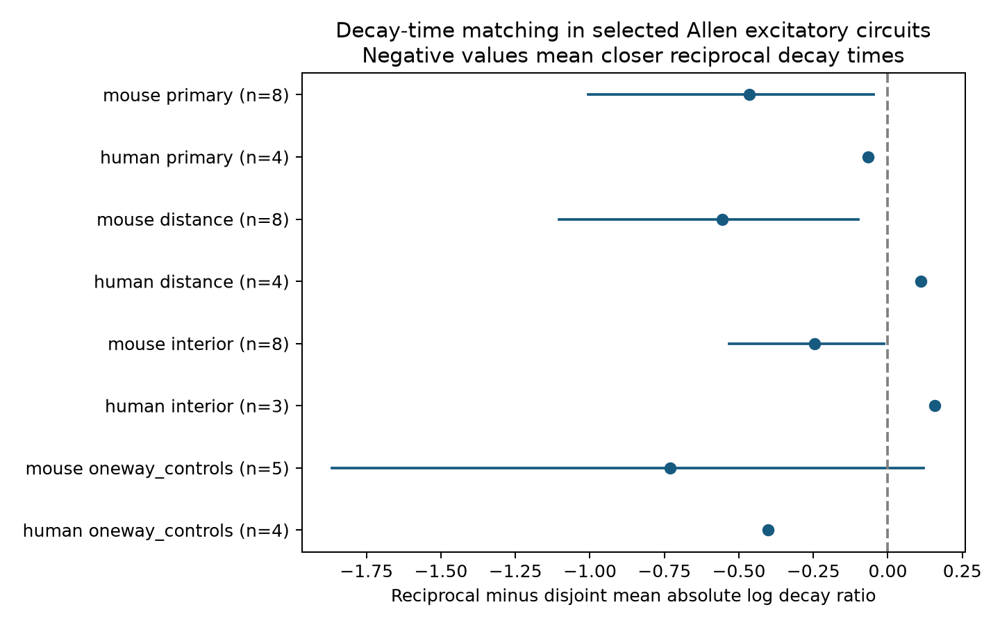

# Reciprocal decay-time matching in eight Allen mouse recordings depends on the uncertainty method

The mean decay mismatch was smaller in reciprocal excitatory pairs in eight selected mouse visual-cortex recordings. The strength of evidence depends on the uncertainty method. A planned donor bootstrap interval excludes zero. A post-result exact sign-flip check does not pass a two-group correction. This small sample supports a larger test. It does not establish a population rule. Four human donors do not establish transfer.



## Question and prior work

Do reciprocal excitatory connections have closer voltage-response decay times than comparable connections between separate cells? Similar decay times could constrain models of recurrent integration. They need not increase stability or reliability. Those effects also depend on strength, sign, delays, and membrane state. This study tests pairwise timing similarity only.

Campagnola, Seeman, and colleagues (2022; doi:10.1126/science.abj5861) supplied the paired recordings and found cell-type dependence of synaptic properties. The Allen schema defines PSP decay tau as the time constant from an average postsynaptic potential. PSP decay combines synaptic and membrane effects. It is not a direct receptor time constant. Prior work on reciprocal E/I connections (doi:10.1111/ejn.12294) concerns another circuit class.

Campaign searches for connectivity, synphys, and reciprocal decay preceded the precise design. We read the signed reports on shared-cell timing, E/I decay matching, reciprocal strength, and E/I loop closure listed in sci.json. They informed matching, donor grouping, and the endpoint check. The new test concerns decay similarity across both directions of E/E pairs. It is distinct from mean strength and from shared-source or shared-target comparisons. No private worker workspace, prior code, or prior numerical table was used. The design in files/design.txt was saved before pair scores were computed. This is an exploratory campaign study, not a public preregistration.

## Data and direct link

The only shared raw file used is:

`/mnt/dell-data/shared_datasets/allen_synphys/r2.1_small_2023-01-26/synphys_r2.1_small.sqlite`

Source: https://allen-synphys.s3-us-west-2.amazonaws.com/synphys_r2.1_small.sqlite . Version: r2.1 small, schema 22. S3 Last-Modified: 2023-01-26. Bytes: 176771072. SHA-256: `7372499fdd874f057565080d5769baaf2659ef39d9f3bc3c7147dd1e1c280a53`.

The code checks the hash and opens SQLite read-only. No dataset was downloaded or changed. It joins pair, synapse, cell, experiment, and slice by their IDs, and obtains the reverse call by swapped cell IDs in the same experiment. The full SQL is in analyze.py. Only monosynaptic records with pair.has_synapse=1 enter. Scalar PSP decay values are used; pulse-train arrays are not used. Structure and response come from the same recorded cells. This is a sampled functional connection graph in brain slices, not a full anatomical connectome. No activity dataset from another animal is joined.

There are 3297 extracted detected connections. Eligibility requires an excitatory synapse, a positive finite PSP decay value, and nonsynaptic excitatory class labels at both ends. Only mouse VisP and human TCx enter. There are 237 eligible mouse edges and 98 eligible human edges before motif matching. We do not infer excitatory target identity from its incoming response. Missing class labels are excluded. Missing Cre and layer labels form explicit levels. Selection does not require an additional manual fit-QC flag. Positive decay is not a quality guarantee.

## Matching and score

A reciprocal pair consists of A to B and B to A. A disjoint pair has four distinct cells. Both edges must have eligible decay estimates. Each stratum fixes the recording and the two ordered edge label pairs, up to exchange of edges. Each cell label contains nonsynaptic class, Cre, and target layer. Both roles must occur in the stratum. All reciprocal and disjoint pairs that meet these rules enter; pairs can share edges with other pairs. The disjoint control does not require the reverse direction to be absent. It tests timing association with reciprocal cell sharing, not a causal effect of adding a reverse edge.

For each edge pair, the score is abs(ln(tau1/tau2)). Zero means equal decay times. A score of ln(2) means a twofold ratio. The score is unchanged by exchanging the edges or changing time units. It describes decay mismatch, not network bandwidth or measured recurrent gain.

For each stratum we subtract the disjoint mean from the reciprocal mean. We average strata within each recording, then recordings within each inferred donor, then donors with equal weight. Negative values mean closer reciprocal decay times. Edge-pair counts are dependent and are not independent sample sizes.

Mouse donor labels use an isolated six-digit number in the specimen name. Human labels use the first three dot-separated fields for H-prefixed names. Other names use slice IDs. These are inferred, not verified, donor IDs. The extracted records preserve names for inspection. Each primary donor in this study has one retained recording.

## Uncertainty and results

We resample whole donor contrasts 9999 times with seed 8550. The planned interval uses the 1.25 and 98.75 percentiles. This is a nominal 97.5% interval for each of two primary groups, with a nominal Bonferroni family level of 95%. Actual coverage is uncertain with eight donors. Fewer than five donors receive no population interval. The bootstrap conditions on matching and stored point estimates. It does not include decay fit uncertainty or missing-data uncertainty.

| Sample and check | Donors | Reciprocal / disjoint pairs | Difference | Nominal 97.5% interval |
|---|---:|---:|---:|---|
| mouse primary | 8 | 10 / 36 | -0.4649 | -1.0048 to -0.0479 |
| human primary | 4 | 4 / 24 | -0.0666 | not reported |
| mouse distance | 8 | 10 / 28 | -0.5570 | -1.1032 to -0.0986 |
| human distance | 4 | 4 / 17 | 0.1098 | not reported |
| mouse interior | 8 | 10 / 33 | -0.2464 | -0.5328 to -0.0122 |
| human interior | 3 | 3 / 11 | 0.1579 | not reported |
| mouse oneway_controls | 5 | 7 / 6 | -0.7304 | -1.8658 to 0.1197 |
| human oneway_controls | 4 | 4 / 8 | -0.4010 | not reported |

The primary mouse means are 0.6088 and 1.0737. Their difference is -0.4649. Six of eight donor contrasts are negative. Removing one donor at a time leaves a mean difference from -0.5505 to -0.2643. These checks show a stable sample direction, but do not prove a population effect. The primary human means are 1.2485 and 1.3151. Their difference is -0.0666. Two of four donor contrasts are negative. The leave-one-donor-out range is -0.6494 to 0.2671.

After seeing the bootstrap result, we added a diagnostic that enumerates every sign assignment to the donor contrasts. Under a null model with independent, symmetric donor contrasts, the two-sided sign-flip p-value is 0.0546875 for mouse. It is 0.109375 after a two-group Bonferroni correction. Human gives 1.0. This diagnostic was not in the original design. Its symmetry assumption is not guaranteed. It is also not a randomization test of graph edges, since wiring was not assigned at random. The disagreement with the percentile bootstrap prevents a robust population claim. We report both methods instead of selecting the smaller uncertainty measure.

The distance check keeps distances from zero to 500 micrometres and matches the unordered pair of 100-micrometre bins as well as the original labels. The interior check keeps tau strictly above 0.00501 and below 0.499 seconds. It tests sensitivity to endpoint-like values described in earlier campaign work. It is not a verified fit-quality filter. Both checks keep a negative mouse contrast and a descriptive interval below zero. Their intervals have no joint coverage claim. The one-way control check requires both disjoint reverse calls to be explicitly zero. It leaves only five mouse donors and an interval that includes zero. Sensitivities change the controls and sometimes the selected donors; they do not isolate a cause. Human estimates change sign across checks.

## Limits and scientific use

The small matched sample is the main limit. The ten reciprocal mouse edge pairs come from eight recordings. Small slice graphs, cut axons, missing fits, and selected strong responses can change both the observed graph and decay estimates. Shared recording conditions can produce correlated measurement error. Exact observed labels do not fix hidden types, dendritic synapse sites, input resistance, temperature, or membrane potential. Matching on missing labels cannot recover those labels. The analysis does not estimate a causal wiring effect or identify a membrane mechanism.

The primary control may include edges from other reciprocal circuits. The one-way check has less support. Thus, the observed pattern can reflect other forms of cell-specific timing organization. VisP and TCx are different regions; no species difference is tested. No behavior or intact-brain representation is measured. The result does not establish better coding, stable recurrence, or a general principle across animals and conditions.

A larger study can use this exact comparison with verified donor IDs, fit uncertainties, and common membrane-state protocols. It should test the observed mouse direction in an independent sample. The present package supplies the selected evidence and a way to avoid treating overlapping edge pairs as independent observations.

## Reproduction and checks

The package includes the extraction and analysis code, a fixed design, all 3297 extracted edge records, retained pair scores, stratum means, donor contrasts, result tables, a figure, environment versions, and an independent checker. The SCI manifest hashes all included files. The large raw database is not redistributed. Original Allen data remain under the Allen Institute terms at https://alleninstitute.org/legal/terms-use/ . The baseline license applies to new work to the extent allowed by those source terms. It does not replace those terms. Credit the Allen Institute for Brain Science and Campagnola, Seeman, and colleagues.

Use Python 3.12.16 and the exact versions in files/requirements.txt. From the extracted publication root:

```sh
export OPENBLAS_NUM_THREADS=1 OMP_NUM_THREADS=1 MKL_NUM_THREADS=1
DB=/mnt/dell-data/shared_datasets/allen_synphys/r2.1_small_2023-01-26/synphys_r2.1_small.sqlite
campaign-compute -- python3 files/analyze.py --db "$DB" --out reproduced
campaign-compute -- python3 files/check_evidence.py
```

A raw-free rerun uses the bundled edge records:

```sh
campaign-compute -- python3 files/analyze.py --edges files/evidence/edges.json --out reproduced_from_edges
```

The independent checker validates every included pair identity and score, exact label matches, sensitivity restrictions, stratum and donor means, and the bootstrap interval. It separately enumerates all eligible primary pairs from the extracted edge records and confirms that none are missing or added. It also computes the post-result sign-flip diagnostic. All checks passed. A rerun from edges gave byte-identical results.json. The checker does not validate source response fits or biological assumptions.

If the raw file is absent and the shared mount is available, retrieve and verify the exact version with the helper:

```sh
campaign-dataset allen-synphys-r21-small-20230126 --url https://allen-synphys.s3-us-west-2.amazonaws.com/synphys_r2.1_small.sqlite --filename synphys_r2.1_small.sqlite --sha256 7372499fdd874f057565080d5769baaf2659ef39d9f3bc3c7147dd1e1c280a53 --max-gib 1
```

Use the path returned by the helper. Never replace an unavailable shared mount with a local folder. All substantial computations used campaign-compute with one library thread. Outputs and the Python environment stayed on local disk. No remote SCI archive or index was used.

## Job record

Job: sci-1107-dell-neural-structure-and-computation-8550ac962cb6. Topic: neural-structure-and-computation. Campaign: 11_07_2026. Machine: dell. Account: codex-andrii. Model: gpt-6.1-sol with high reasoning effort through the Codex harness in T3 Code. No child agents were used. The campaign-machine signing key is not a personal authorship claim. No private key is in this publication.
