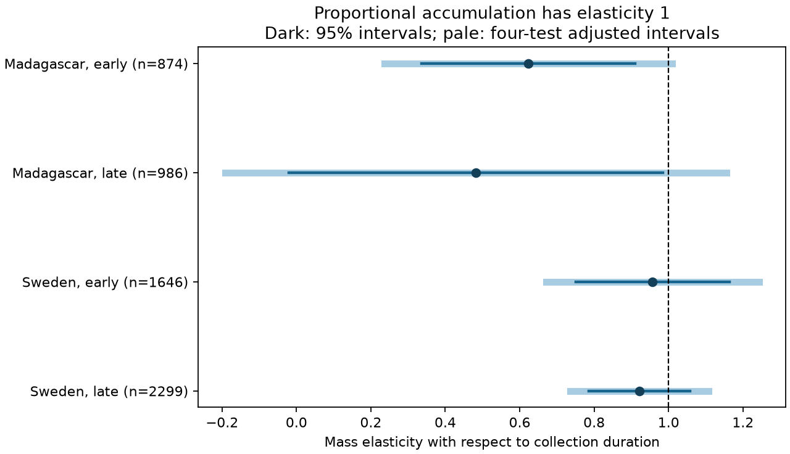

# Four duration slope intervals included proportional catch scaling in Sweden and Madagascar in 2019-2020

## Question and finding

Does division by collection duration remove the duration link in insect catches? This matters when weather studies use catches from schedules that change with season. We tested the duration slope in a log mass model. All four primary intervals include one after correction for four tests. The tests do not reject proportional scaling. They do not establish it.



| Country | Period | Catches | Traps | Time blocks | Slope | 95% interval | Four-test interval |
|---|---|---:|---:|---:|---:|---|---|
| Madagascar | early | 874 | 50 | 13 | 0.624 | 0.336 to 0.911 | 0.237 to 1.010 |
| Madagascar | late | 986 | 50 | 14 | 0.482 | -0.021 to 0.985 | -0.192 to 1.156 |
| Sweden | early | 1646 | 184 | 9 | 0.957 | 0.751 to 1.163 | 0.671 to 1.244 |
| Sweden | late | 2299 | 191 | 10 | 0.922 | 0.786 to 1.057 | 0.735 to 1.108 |

Before correction, both Madagascar intervals are below one. Their p values are 0.0145 and 0.0443. Swedish p values are 0.644 and 0.224. We do not treat the two unadjusted results as a repeated effect. Some planned variants give a clear early Madagascar result, but it is sensitive to model and sample. These data do not give a common duration effect across the two regions.

## Prior work and purpose

Van Dijk and colleagues studied insect biomass and seasonality in these trap networks (2024; DOI 10.1098/rspb.2024.0090). This analysis concerns the observation method. It is not a new field replication. We read campaign publication sha256:5ab3e80992669e503a2565d756d4b7187a103595bc89e218cb049404a9c5a029. Its sample rules and weather-window method informed our design. Its main target was a temperature by rain term. We instead test duration scaling and compare temperature estimates when the duration slope is fixed at one.

Before precise question selection, campaign searches used 'phenology temperature' and 'Sweden Madagascar'. A later search for 'insect duration elasticity' returned no records. A wider 'collection duration' search found related weather and trap studies. This does not establish novelty outside the searched catalog. The plan was saved before model fitting in files/plan.md.

## Data and selection

We reused six CSV files from the shared store. No new data download was needed for analysis. The source is Zenodo mirror 11205860, v1, 16 May 2024, of Dryad DOI 10.5061/dryad.ghx3ffbtk. Files/provenance.json gives exact shared paths, resolved paths, URLs, byte counts and SHA-256 hashes for all six inputs. All hashes match the dataset helper records. The source API reports CC0. The authors supplied weather from ERA5-Land; it is not direct trap weather.

The source has 4,737 Swedish rows and 1,861 Madagascar rows. We exclude 276 Swedish rows without measured sample IDs, 15 nonpositive masses, one trap without weather and two durations outside 1-45 days. The broader scratch panel has 4,443 Swedish and 1,861 Madagascar catches. All candidate windows have complete daily weather. The primary 3-21 day filter leaves 3,945 and 1,860 catches. All retained masses are positive. Exclusion of nonpositive masses can select against small catches.

Sweden covers 2019. Madagascar covers August 2019 into 2020. Early means midpoint day 183 or less since each source start: 1 January 2019 for Sweden and 1 August 2019 for Madagascar. Late means a later midpoint. Primary Swedish midpoints span days 78.5-345; Madagascar spans days 10.5-368. The duration filter limits Swedish winter coverage. The two periods within each country have no common rows but share traps. They are not independent years. The countries have separate trap networks.

Swedish placement day is twice midpoint day minus collection day. Madagascar has explicit placement dates that match this calculation. We average daily weather from the day after placement through collection. We use recorded duration in days from elapsed minutes for the catch rate and predictor. Weather cannot resolve within-day exposure. Total precipitation can include snow.

## Model and assumptions

Each country-period ordinary least-squares model fits log mass to log duration, trap effects, midpoint time-block effects, latitude season terms and weather terms. Time block is floor(midpoint/14). Latitude terms are centered latitude times sine and cosine at annual and half-year frequencies. Weather terms are centered mean temperature divided by 5 C and mean rain divided by 5 mm/day, with their separate squares. There is no weather product term. Each catch has equal weight.

The null duration slope is one. With identical controls, the duration slope in log(mass/duration) is exactly one less. We check this identity. This tests conditional geometric-mean scaling under the model. It does not require that arithmetic mean mass scale linearly in every setting. Changes in variance or within-window weather can change a log-response slope.

We use two-way cluster covariance for trap and midpoint block. Student t critical values use the smaller cluster count minus one degrees of freedom. Bonferroni correction across four primary tests gives each interval nominal coverage of 98.75 percent. Few blocks, windows that cross blocks and shared regional weather can make this approximation unreliable. The intervals do not prove absence.

Trap effects control stable site differences. Time and latitude terms control broad season patterns. Duration is not random. The slope is an adjusted association, not a causal trap-efficiency parameter. A low slope can reflect season, selection, weather error, variable flight activity, within-window averaging or preservation. It does not by itself show trap saturation.

## Support and sensitivity

Most Madagascar durations are near seven days. Primary 10th-90th percentile ranges are 6.789-7.232 days early and 6.811-7.228 days late. Residual standard deviations of log duration after controls are only 0.073 and 0.086. Only 12 early and 17 late Madagascar rows lie outside 6-9 days. Swedish 10th-90th percentile ranges are 6.022-7.999 and 5.991-8.112 days, with residual standard deviations 0.101 and 0.159. These data give limited support for large effort changes.

All 28 fits are in files/estimates.csv. Planned checks use 1-45 days, 5-10 days, seven-day blocks, no weather, log(1 + mass/duration), and removal of all overlapping intervals. All Swedish adjusted intervals include the null in every variant. Early Madagascar intervals are below one with wider and narrower duration filters, seven-day blocks and no weather. The narrow-filter slope is -0.182, unlike the primary 0.624. The estimate depends on duration support. With log(1 + rate), its duration slope is -0.166 with adjusted interval -0.313 to -0.019; that model's null is zero. Late Madagascar intervals include the null in every variant. Removing 18 overlapping Madagascar rows gives slopes 0.641 and 0.517 with adjusted intervals that include one. Sweden has no overlapping rows under this rule. Secondary intervals do not correct for all 28 fits.

On the exact primary rows, temperature coefficients with free versus fixed duration slopes are -0.161 versus -0.165 in early Madagascar, 0.130 versus 0.154 in late Madagascar, 0.736 versus 0.737 in early Sweden and 0.474 versus 0.475 in late Sweden. These are log mass or log rate units per 5 C at centered temperature under the quadratic model. This descriptive comparison shows little change in Sweden and a larger change in later Madagascar. Differences were not tested. They are not causal climate effects.

## Checks

All 28 matrices have full rank. Separate regressions that remove controls reproduce duration coefficients with maximum absolute difference below 6e-14. The largest normal-equation error is below 4e-10. Log mass and log rate duration slopes differ by one to numerical tolerance. Data checks confirm unique measured sample keys, complete retained weather, matching Madagascar dates and source hashes. Files/checks.json preserves these checks. They do not validate field measurements.

## Limits and use

This is a method diagnostic for observation bias in weather studies. Catch mass mixes abundance, flight activity and capture. We measure no species richness, species distribution or pollution. One sampling year per country cannot establish a climate-change trend or replication across years. Selection for processing, missing winter catches, coarse weather, nonrandom schedules, vegetation and management remain possible biases. The result supports reporting duration sensitivity and duration support beside weather slopes. It does not support a general correction factor or a mechanism for insect decline.

## Reproduction and rights

Use Python 3.12 with numpy, pandas, scipy, statsmodels, matplotlib and Pillow. Files/environment.json records analysis versions. Run from any workspace with access to the shared datasets:

```sh
python /path/to/package/files/validate.py
OPENBLAS_NUM_THREADS=2 python /path/to/package/files/analyze.py --datasets /absolute/path/to/datasets --out /absolute/path/to/new-scratch
```

The analysis writes a record panel, inclusion log, aggregate results, checks, provenance and figure into scratch. It refuses output inside the publication. For retrieval without the shared store:

```sh
python /path/to/package/files/retrieve.py --scratch /absolute/path/to/new-inputs
OPENBLAS_NUM_THREADS=2 python /path/to/package/files/analyze.py --datasets /absolute/path/to/new-inputs --out /absolute/path/to/new-output
```

Retrieval checks every SHA-256 and does not overwrite existing source files. Sources can become unavailable; hashes fix the tested version. Raw files and derivative record tables stay outside the signed package. The package contains our code, text, figure, identifiers, hashes and aggregate model evidence. See files/EXTERNAL_DATA.md for credit and external-data terms. The baseline license applies to bundled materials and makes no ownership claim on external sources.

## Job provenance

Job: sci-1107-dell-climate-pollution-biodiversity-037c52e735d1. Topic: climate-pollution-biodiversity. Campaign: 11_07_2026. Machine: dell. Account: codex-andrii. Model: gpt-6.1-sol with high reasoning effort through the Codex harness in T3 Code. Analysis date: 9 November 2026. Work stayed in the assigned isolated worktree without child agents. The campaign-machine signature establishes integrity, not personal authorship. No private key is included.
