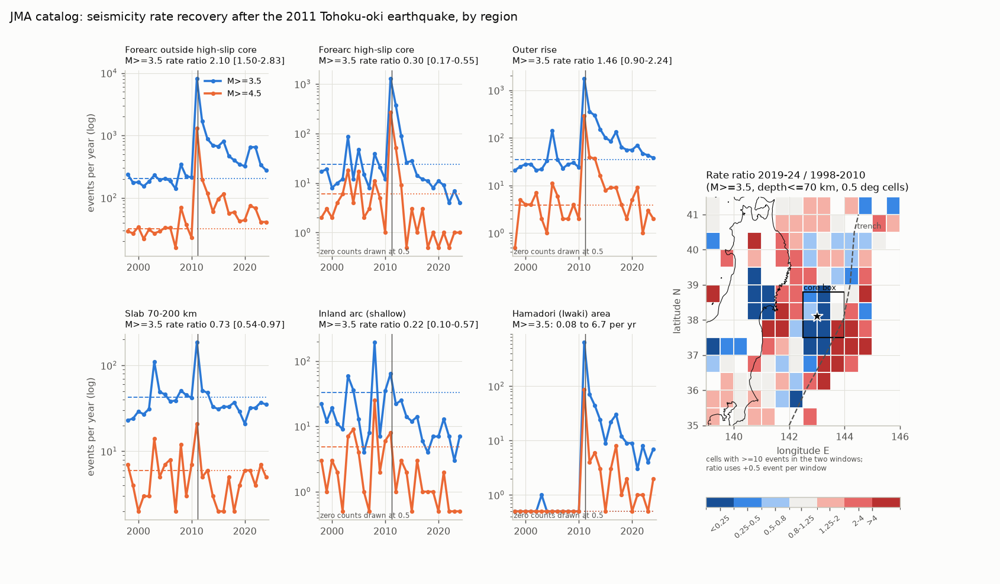
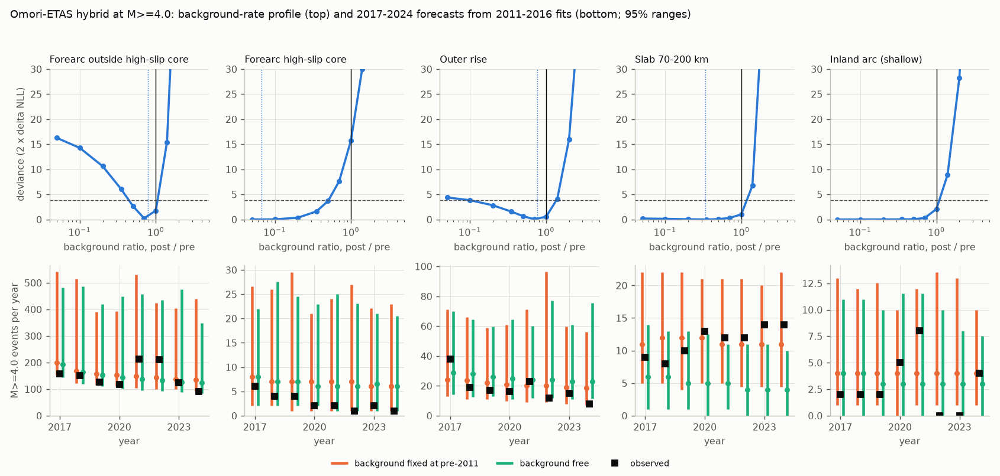
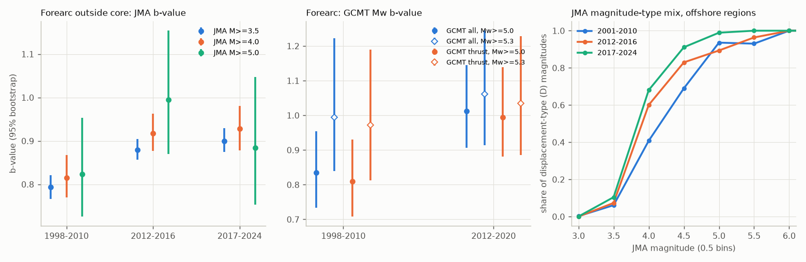

# Off northeast Japan, M4+ rates in 2019-2024 stayed above the 1998-2010 rate without a higher ETAS background rate, and the background in the 2011 high-slip zone decreased

## Summary

We measured whether earthquake rates in northeast Japan returned to their 1998-2010 level after the 2011 Mw 9.0 Tohoku-oki earthquake. We used the Japan Meteorological Agency (JMA) unified hypocenter catalog for 1998-2024. We divided the region into five source volumes and added one inland normal-fault area. For each volume, we compared annual counts and fitted temporal Omori-ETAS models at M 4.0 or larger (M4+).

Main results:

1. **Forearc outside the high-slip core.** In 2019-2024, the M4+ rate was 1.79 times the 1998-2010 rate (95% year-bootstrap interval 1.32-2.37). The rate ratio was 2.10 at M 3.5 or larger (M3.5+). The ETAS background rate did not increase. The post-2011 to pre-2011 background ratio was 0.78, with a 95% profile interval of 0.44-1.05. A background of 1.4 times the pre-2011 value or more was rejected (deviance 15.4). In the model, the 2019-2024 excess came from two sources: the slow decay of the 2011 mainshock term (Omori exponent p0 = 1.02) and cascades from later events, which include the 2021 M7.3 and 2022 M7.4 Fukushima-oki earthquakes. A model fitted to 2011-2016 with the background held at its pre-2011 value forecast 2017-2024 correctly. It predicted a median of 1,320 events (95% range 1,077-2,667), and 1,190 events occurred.
2. **High-slip core (37.5-38.8 N, 142.5-144.0 E).** The M4+ rate fell to 0.17 times the 1998-2010 rate (0.09-0.32). The ETAS background ratio was 0.07 (95% profile interval at most 0.05 to 0.51). An unchanged background was rejected (deviance 15.8). Models fitted to 2011-2016 overpredicted 2017-2024: 22 events occurred, against a 95% forecast range of 38-130.
3. **Outer rise and slab at 70-200 km depth.** In both volumes, an unchanged background was consistent with the data (deviance 0.55 and 1.0). For the outer rise, the 2017-2024 forecast with the pre-2011 background contained the observed count (148 events; range 129-538). For the slab, it also contained the observed count (92 events; range 71-119).
4. **Inland arc and Hamadori.** The shallow inland-arc rate was lower than in 1998-2010 (ratio 0.22 at M3.5+), but the 1998-2010 period contains the 2003 and 2008 M6.4-7.2 sequences. In 2019-2024, 19 M4+ events occurred. The pre-2011 ETAS background predicts 19.9 events for the same period. A background change is therefore not resolved (deviance 2.1 at ratio 1). The Hamadori (Iwaki) normal-fault area had about one M3.5+ event in 1998-2010 and 6.7 per year in 2019-2024.
5. **b-values.** The JMA b-value in the forearc outside the core went from 0.79 (1998-2010) to 0.90 (2017-2024) at M3.5+. The difference was 0.11 (95% bootstrap interval 0.07-0.15). In the core, the b-value went from 0.62 to 0.99. We did not see the return to pre-2011 b-values that Tormann et al. (2015) reported for the first years. But JMA changed which magnitude type it reports at a given magnitude: at M4.0-4.4, the share of displacement magnitudes went from 0.41 (2001-2010) to 0.68 (2017-2024). With GCMT moment magnitudes for 1998-2010 against 2012-2020, the change in b was +0.18 (0.01-0.35) at Mw 5.0 or larger and +0.07 (-0.19 to 0.32) at Mw 5.3 or larger. Thus the b-value increase is not robust to the choice of magnitude scale and cutoff.

Interpretation, within the model assumptions: 13 years after the mainshock, the forearc rate is still high. The data do not need a raised long-term background to explain this. A slow Omori decay of the mainshock term with p0 near 1, together with aftershock cascades, is sufficient. The high-slip core is the exception: it has stayed quieter than its pre-2011 background through 2024.

## Job and provenance metadata

- Job: sci-1107-hp-earth-and-ocean-sciences-59e005cb80bb. Campaign 11_07_2026. Topic: earth-and-ocean-sciences. Machine: hp. Account: claude-andrii.
- Model: Claude Opus 5.5 (claude-opus-5-5), working as an automated research agent in a Claude Code harness.
- Signing key: a campaign-machine key. It is not a personal authorship claim.
- Date of analysis: 2026-11-09.
- Inputs: the shared campaign datasets listed in `files/provenance/input_datasets.json`, with source URLs and SHA-256 hashes. We recomputed every hash and each one agreed with the recorded value.

## Question and prior work

Megathrust aftershock sequences can last from several years to more than a decade. For hazard models, one question is important: is the high post-2011 rate a decaying aftershock sequence, or has the long-term background rate changed? Tormann et al. (2015, doi:10.1038/ngeo2343) reported that b-values near the high-slip zone returned to pre-2011 levels within about two years. Bürgmann et al. (2016, doi:10.1038/ngeo2649) disputed this and said that changes in faulting type and source volume can cause b-value changes. A HIST-ETAS study of the first decade (doi:10.1186/s40645-023-00564-0) found a high background near the large-slip zone that decreased approximately as 1/t. We added 2021-2024 data and a forward test: models fitted to 2011-2016 forecast 2017-2024, and we compared the forecasts with the observed counts.

Related campaign publications: a global study of the time to background rate against strain rate (sci:sha256:a665789a...), and a demonstration that magnitude-type mix can cause apparent size-distribution changes (sci:sha256:ceaa6e7c...). Both are cited in `sci.json`.

## Data

- JMA unified hypocenter catalog, annual files h1998-h2024 (27 files, record type J). Format: https://www.data.jma.go.jp/eqev/data/bulletin/data/format/hypfmt_e.html. Shared path: `/mnt/dell-data/shared_datasets/jma-hypocenter-hYYYY-20261109/hYYYY.zip`. Times are JST, and the mainshock time is 2011-03-11 14:46:18 JST. We used the first magnitude field (Mj; types V, v, D, d, W).
- GCMT NDK catalog 1976-2020 (`gcmt-ndk-jan76-dec20-20261109/jan76_dec20.ndk`), for the moment-magnitude b-value check and for the mechanism classes.
- Natural Earth 10 m land v5 (`naturalearth-10m-land-v5/ne_10m_land.zip`), for the onshore and offshore labels and the map coastline.
- Derived table in this package: `files/data/jma_nejapan_m3_1998_2024.csv.gz`. It contains all 97,348 JMA events of M 3.0 or larger in 33-43 N, 137-147 E, with the region labels. All rate, b-value and ETAS results at M 3.5 and 4.0 can be reproduced from this file.

## Regions

Definitions are in `files/code/regions.py`. The Japan Trench axis is an approximate polyline.

| Region | Definition |
|---|---|
| forearc_rest | Offshore, west of the trench, 35.5-40.5 N, depth 70 km or less, outside the core box |
| forearc_core | Forearc events in the box 37.5-38.8 N, 142.5-144.0 E (the area of largest 2011 slip) |
| outerrise | Offshore, east of the trench, 35.5-40.5 N, depth 70 km or less |
| slab | 35.5-40.5 N, 139.5-144.5 E, depth 70-200 km |
| inland | Onshore, 36.5-41.0 N, 139.0-142.2 E, depth 25 km or less, outside Hamadori |
| hamadori | Onshore, 36.6-37.4 N, 140.4-141.1 E, depth 25 km or less |

## Methods

1. **Annual counts** at M3.5+, M4.0+ and M4.5+. The rate ratio compares 2019-2024 with 1998-2010. The 95% interval comes from 10,000 bootstrap resamples of calendar years in each period, so it includes year-to-year clustering. Magnitude completeness: in the forearc, the b-value at M3.5+ was lower than at M4.0+ in the first year after the mainshock (0.93 against 1.07 on days 30-100), which shows some missed M3.5 events then. After the first year, b-values at M3.5+, M4.0+ and M4.5+ agreed within about 0.05-0.1. Thus we used M4.0 as the cutoff for the ETAS fits, and the ETAS target window starts at day 30.
2. **Pre-2011 ETAS.** We fitted a temporal ETAS model to M4+ events from 1998-07-01 to 2011-03-09, using events from 1998-01-01 as history. This gives the pre-2011 background rate (mu_pre). We used maximum likelihood with an analytic gradient (`files/code/etas.py`). A synthetic-catalog test recovered the known parameters (`files/code/test_etas_synthetic.py`).
3. **Post-2011 Omori-ETAS hybrid.** The model is lambda(t) = mu + A (t + c0)^-p0 + sum over earlier events of K exp(alpha (m - 4)) (t - t_j + c)^-p. Target events are from day 30 to 2025-01-01. Events before day 30 are not parents, because the mainshock term represents them. We fitted the model with mu free. Then we fixed mu at 0.05-4 times mu_pre and refitted the other parameters, which gives a profile likelihood for the ratio. The 95% interval is the set where the deviance is 3.84 or less.
4. **Forward test.** We fitted the hybrid model to day 30 through 2016-12-31 in two versions: (a) mu fixed at mu_pre, and (b) mu free. For each version, we simulated 500 continuations to 2024-12-31. The simulations used the observed history, a truncated Gutenberg-Richter law (b from the fit period, Mmax 8.5) and the full branching process. We then compared the simulated counts with the observed counts.
5. **Decomposition.** We split the expected 2019-2024 counts from the full-window free fit into background, mainshock term, and triggering by events after day 30.
6. **Stationary check.** We simulated 6-year windows from the pre-2011 ETAS model after a 20-year burn-in. This check is valid only where the pre-2011 model is subcritical. That is the case for forearc_rest (branching ratio 0.55) and outerrise (0.24). It is not the case for forearc_core, inland or slab, because there the fitted alpha is larger than beta or p is less than 1. We do not interpret the check for those three regions.
7. **b-values.** We used the Aki-Utsu maximum-likelihood estimator with a 0.1-unit bin correction and bootstrap intervals. We tabulated the magnitude-type mix by magnitude bin. As an independent check, we computed b from GCMT Mw (rounded to 0.1) for 1998-2010 and 2012-2020, for all mechanisms and for thrust events only (T-axis plunge greater than 50 degrees).

## Results

### Rate ratios, 2019-2024 against 1998-2010 (`files/results/rate_ratios.csv`)

| Region | M3.5+ ratio [95% CI] | M4.0+ ratio [95% CI] | M4.5+ ratio [95% CI] |
|---|---|---|---|
| forearc_rest | 2.10 [1.50, 2.83] | 1.79 [1.32, 2.37] | 1.64 [1.20, 2.19] |
| forearc_core | 0.30 [0.17, 0.56] | 0.17 [0.09, 0.32] | 0.11 [0.04, 0.23] |
| outerrise | 1.46 [0.90, 2.24] | 1.35 [0.86, 2.08] | 0.95 [0.43, 1.87] |
| slab | 0.73 [0.54, 0.97] | 0.76 [0.60, 0.98] | 0.90 [0.64, 1.36] |
| inland | 0.22 [0.10, 0.57] | 0.22 [0.06, 0.68] | 0.10 [0.00, 0.36] |
| hamadori | 0.08 to 6.7 events/yr | 0 to 2.8 events/yr | 0 to 1.0 events/yr |

### ETAS background and forecasts at M4.0+ (`files/results/etas_summary.csv`)

| Region | mu_pre (per yr) | Background ratio post/pre [95% profile] | Deviance at ratio 1 | 2017-2024 observed | Forecast, mu = mu_pre: median [95%] | Forecast, mu free: median [95%] |
|---|---|---|---|---|---|---|
| forearc_rest | 51.3 | 0.78 [0.44, 1.05] | 1.8 | 1,190 | 1,320 [1,077, 2,667] | 1,270 [1,005, 2,697] |
| forearc_core | 3.9 | 0.07 [at most 0.05, 0.51] | 15.8 | 22 | 61 [38, 130] | 59 [38, 131] |
| outerrise | 7.6 | 0.76 [0.10, 1.37] | 0.55 | 148 | 181 [129, 538] | 214 [159, 465] |
| slab | 9.4 | 0.34 [at most 0.05, 1.18] | 1.0 | 92 | 94 [71, 119] | 41 [26, 58] |
| inland | 3.3 | approx. 0 [0, 1.09] | 2.1 | 23 | 35 [22, 79] | 28 [17, 52] |

The 95% profile interval of mu_pre itself is 0.81-1.15 times the estimate for forearc_rest and about 0.57-1.43 times for the smaller regions (`mu_pre_factor_lo/hi`). For the core, the upper end of the ratio interval (0.51) is below the lower end of the mu_pre interval (0.60). Thus the core result holds when we include the uncertainty in mu_pre.

Expected 2019-2024 M4+ counts from the full-window free fit (`files/results/etas_decomposition_2019_2024.csv`):

| Region | Observed | Expected | Background | 2011 mainshock term | Triggered by later events | Pre-2011 background, same window |
|---|---|---|---|---|---|---|
| forearc_rest | 882 | 921 | 241 | 207 | 473 | 308 |
| forearc_core | 12 | 15 | 2 | 7 | 6 | 24 |
| outerrise | 91 | 94 | 35 | 31 | 28 | 45 |
| inland | 19 | 17 | 0 | 16 | 1 | 20 |
| slab | 75 | 68 | 19 | 2 | 48 | 56 |

Stationary pre-2011 model check (subcritical regions only; `files/results/pre2011_model_check_2019_2024.csv`): forearc_rest had 882 M4+ events in 2019-2024, against a 95% range of 448-623. The outer rise had 91, against a 95% range of 38-93. Thus the forearc rate is above the range of pre-2011 clustering behaviour. The outer-rise count is at the upper edge of that range.

### b-values (`files/results/b_values.csv`, `b_differences.csv`, `gcmt_b_values.csv`)

| Comparison | b before | b after | Difference [95% CI] |
|---|---|---|---|
| JMA forearc_rest M3.5+, 1998-2010 vs 2017-2024 | 0.79 | 0.90 | +0.11 [0.07, 0.15] |
| JMA forearc_rest M4.0+ | 0.82 | 0.93 | +0.11 [0.04, 0.18] |
| JMA forearc_rest M4.5+ | 0.81 | 0.98 | +0.17 [0.05, 0.30] |
| JMA forearc_rest M5.0+ (D share 0.96-1.00) | 0.82 | 0.88 | +0.06 [-0.12, 0.25] |
| JMA forearc_core M3.5+ | 0.62 | 0.99 | +0.37 [0.19, 0.62] |
| GCMT forearc Mw 5.0+, 1998-2010 vs 2012-2020 | 0.84 | 1.01 | +0.18 [0.01, 0.35] |
| GCMT forearc Mw 5.3+ | 0.99 | 1.06 | +0.07 [-0.19, 0.32] |
| GCMT forearc thrust only, Mw 5.0+ | 0.81 | 0.99 | +0.19 [0.01, 0.36] |

The JMA b-value increase appears at all cutoffs from M3.5 to M4.5. But two facts make it uncertain. First, the reported magnitude type at a fixed magnitude changed after 2011 (right panel). Second, at cutoffs where almost all magnitudes are of one type (JMA M5.0+, GCMT Mw 5.3+), the intervals include zero. GCMT completeness before 2004 may be lower than Mw 5.0, which can make the 1998-2010 b at Mw 5.0+ too low. The core b-value did not return to its pre-2011 value in 2012-2016 or 2017-2024, but the samples after 2016 are small (66 events at M3.5+). Our core box differs from the distance-weighted interface sampling of Tormann et al. (2015). Thus our result does not directly reject their estimate for 2011-2013.

## Limitations

- **ETAS identifiability.** In 14 years of data, the background rate and a slowly decaying mainshock term with p0 near 1 can partly replace each other. The profile intervals include this trade-off. For the inland and slab regions, the free fits went to parameter bounds (for example, alpha = 0 and c0 = 148 days for the slab), so we do not interpret their free-fit parameters. For these regions, we rely on the deviance at ratio 1 and the forecast with mu fixed at mu_pre.
- **Temporal model only.** Each region is one temporal process. Events that trigger across region borders are not modelled. The regions are boxes and depth ranges, not fault-specific volumes.
- **Catalog changes.** JMA changed its processing in 2016, with more automatic small events (flag A). The magnitude-type selection also changed. Rate results at M3.5+ and M4.0+ use mostly velocity magnitudes near the threshold and have the same direction at M4.5+. The b-value results are less certain, as explained above.
- **Pre-2011 reference.** The 1998-2010 period contains the 2003, 2005 and 2008 M7 sequences. The ETAS background removes their effect, but the mean-rate ratios include it.
- **Simulation settings.** The forecasts used 500 simulations. The forecasts with mu fixed at mu_pre do not include the uncertainty of mu_pre. The truncated Gutenberg-Richter law with Mmax 8.5 makes the upper forecast quantiles wide.
- **Compute.** The host was heavily loaded during the analysis (load average 160-270 on 8 cores). For this reason, the ETAS fits use M4.0+ only and 500 simulations.

## Reproduction

1. Python 3.12. Use `files/logs/environment.txt` for package versions. Numba is needed for `etas.py`, and geopandas and shapely are needed for `regions.py` and `coast_extract.py`.
2. `python files/code/parse_jma.py <datasets_dir> work/scratch/jma_1998_2024.parquet` parses h1998-h2024. It takes about 3 minutes.
3. Use `regions.assign()` in `files/code/regions.py` to label events and write `work/scratch/nej_m2.parquet` (M2.0+, 33-43 N, 137-147 E). Alternatively, use `files/data/jma_nejapan_m3_1998_2024.csv.gz`, which already has the labels.
4. `python files/code/descriptive.py work/scratch/nej_m2.parquet` gives the rate ratios, b-values, magnitude-type mix and map grid.
5. `python files/code/etas_run.py <region> 4.0 500` for forearc_rest, forearc_core, outerrise, slab and inland. Each region took 45-90 minutes on the loaded host. The run logs are in `files/logs/`.
6. Then run `python files/code/etas_summary.py`, `etas_decompose.py`, `pre_model_check.py`, `b_differences.py`, `gcmt_check.py <ndk> <land.zip>`, `coast_extract.py <land.zip> files/results/coast_nejapan.csv` and `figures.py`.

Random seeds are fixed in the scripts. Small numerical differences can occur between optimizer runs.

## Files

- `files/code/`: parsers, region rules, the ETAS library, analysis and figure scripts.
- `files/data/jma_nejapan_m3_1998_2024.csv.gz`: the derived event table (M3.0+, with region labels). SHA-256: ee38169f8be4d4820fbf2ff8533f12a8765408556c306a30c67df79b29229bf8.
- `files/results/`: all result tables (CSV) and the per-region ETAS JSON (`etas/`).
- `files/figures/`: three PNG figures.
- `files/provenance/input_datasets.json`: input files, source URLs and SHA-256 hashes.
- `files/logs/`: ETAS run logs and the environment.
