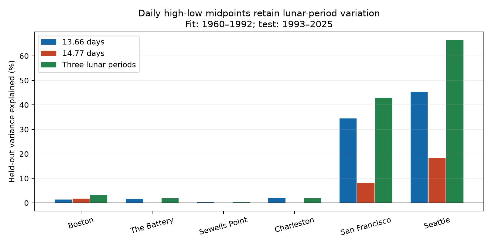
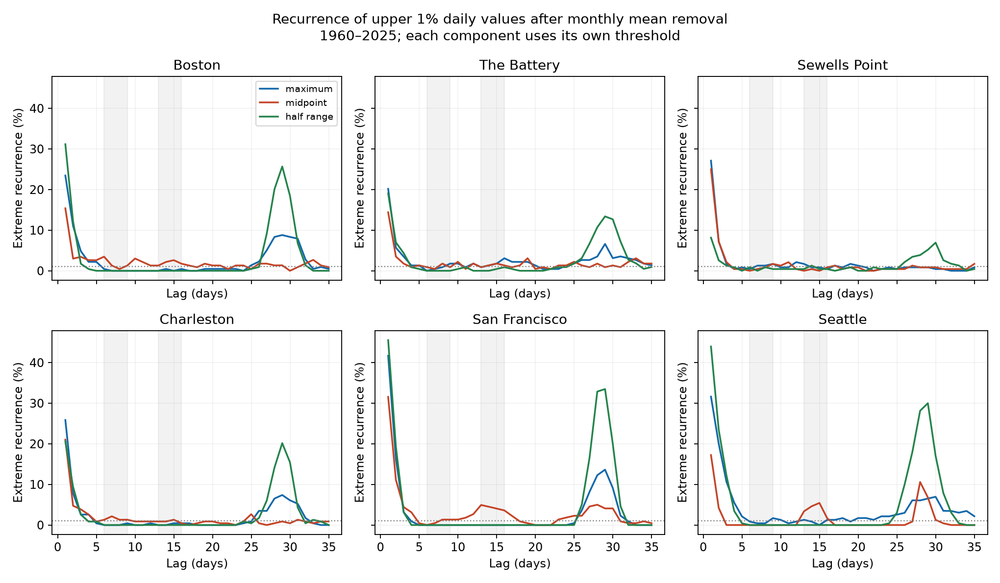

# A 13.66-day fit explained 34% and 45% of later daily midpoint variance at San Francisco and Seattle in 1993-2025

A single lunar-period fit transferred across a 33-year split at the two tested Pacific gauges. It explained 34.47% of daily high-low midpoint variation at San Francisco and 45.42% at Seattle in 1993-2025. This is a method check. A daily midpoint can retain strong tide-related variation. It must not be treated as a measured storm surge.



## Question and prior evidence

Can a simple fixed lunar period explain later daily midpoint variation, after monthly mean sea level is removed? The midpoint is the mean of the daily highest and lowest hourly samples. It is not the daily mean.

Stephens, Bell and Haigh (2020; doi:10.5194/nhess-20-783-2020) linked the timing of extreme coastal water levels in New Zealand to the spring-neap cycle. NOAA describes both the 13.66-day lunar declination cycle and the 14.77-day spring-neap envelope. These periods can give different daily patterns.

The campaign report `154b66db` already found that full NOAA tide subtraction reduced midpoint variance by 61% and 84% at these two Pacific sites in 2015-2024. Report `d8f71827` tested richer fixed lunar models for daily maxima. Full SCI citations are in sci.json. Our contribution is a simple period-specific check across the longer 1960-2025 record, with an early fit and later evaluation. It is an extension and partial replication, not a new tide mechanism.

The campaign search completed while the initial recurrence analysis was in progress. We then read the relevant published reports and narrowed the final claim. The unexpected midpoint contrast motivated the harmonic test. Thus the harmonic test is exploratory. It uses a time split, but the later record was not blind. files/literature.txt records the search and sources.

## Data and selection

We used 48 existing NOAA CO-OPS API responses: seven daily maximum/minimum responses and one monthly mean response for each of six sites. The source snapshot label is 20261108. This is a retrieval date, not an immutable NOAA release. Heights use metres, the station MSL datum, and local standard dates. The daily product contains extrema of hourly samples, not six-minute peaks.

The files remain in the shared store. Exact resolved paths, request URLs, source metadata, byte counts and checked SHA-256 hashes are in files/provenance.json. Paths have this form:

```
/mnt/dell-data/shared_datasets/noaa-coops-STATION-daily-START-END-msl-lst-20261108/data.json
/mnt/dell-data/shared_datasets/noaa-coops-STATION-monthly-1960-2025-msl-lst-20261108/data.json
```

START is each decade from 1960 to 2020. END is START+9, except 2025 for the last object. No shared file was changed or downloaded again. The selected paired evidence is in files/daily_derived.csv.gz. It also retains rejected dates, with valid=false.

A valid day has both extrema present, at least 90% hourly completeness for each, both inferred flags zero, and a monthly MSL value. A month must have at least 25 such days. We keep leap days and do not fill gaps. We do not require monthly inferred=0; this is a selection limit. Strict 100% daily completeness gives almost identical recurrence contrasts. Many month-end minima in 2025 have low reported coverage. They are rejected. The last valid date is 2025-12-30 at every site. Selection counts are in files/quality.csv.

## Methods

For daily maximum H, minimum L, and that year-month's MSL M, define X=H-M, C=(H+L)/2-M, and R=(H-L)/2. X=C+R exactly. C is the midpoint anomaly. R is half the daily range. For a symmetric tide that stays fixed during the day, C removes tidal amplitude. Actual highs and lows need not be symmetric or occur in the same tide cycle.

The initial recurrence test uses each site's and measure's own full-record 99th percentile. Events strictly exceed that value. For lag k we count the fraction of valid target days that are also events, given an event on the origin day. Both endpoints must be valid; intervening days need not be. We pool endpoint pairs over days 13-16 and subtract the pooled rate over days 6-9. Counts and 95% intervals use 2,000 resamples of 66 origin years. Thresholds are fixed. These are marginal, exploratory intervals, with no family correction. Near-zero intervals from no observed pairs do not establish zero population probability. The 95th and 97.5th percentiles and disjoint period results are supplied.

The harmonic test fits an intercept, sine and cosine at a specified period by least squares on valid days in 1960-1992. Time is actual days since 1960-01-01. No term is refitted in 1993-2025. Separate fits use 13.66079, 14.765294 and 27.55455 days. A joint fit uses all three. Separate 13-, 14- and 15-day fits are nearby period controls. These are envelope diagnostics for daily extrema, not full hourly tide-constituent fits.

The later score is 1-SSE(model)/SSE(early mean). Thus zero means equal error to the early-period mean. Negative scores mean greater error. We use 3,000 circular three-year block resamples of the 33 test years for conditional 95% intervals. Fitted terms and the early mean remain fixed. The same sampled years serve all models. The intervals do not include training uncertainty or source revision uncertainty. A sensitivity analysis centers C within each observed year-month before fitting. It removes step changes from the chosen monthly baseline and slow changes within the record.

These are retrospective diagnostic scores. The outcome uses the observed mean of the evaluation month, so these scores are not operational forecast skill.

## Results

| Site | Valid days, 1960-2025 | 13.66-day score (%) | Conditional 95% interval (%) | Three-period score (%) | Early 13.66-day amplitude (cm) |
|---|---:|---:|---:|---:|---:|
| Boston | 23,349 | 1.30 | 0.74 to 1.86 | 3.16 | 2.38 |
| The Battery | 23,022 | 1.65 | 0.95 to 2.39 | 1.80 | 2.95 |
| Sewells Point | 23,647 | 0.25 | -0.07 to 0.56 | 0.34 | 1.04 |
| Charleston | 23,427 | 1.99 | 1.23 to 2.67 | 1.91 | 2.16 |
| San Francisco | 22,605 | 34.47 | 32.46 to 36.64 | 42.93 | 8.23 |
| Seattle | 23,815 | 45.42 | 44.33 to 46.63 | 66.46 | 24.56 |

The four Atlantic single-period scores are much smaller than the two Pacific scores. This applies only to these selected harbor gauges. It is not a coast-wide estimate. The 13-, 14-, and 15-day control scores are below 0.1% at both Pacific gauges. Thus a nearby arbitrary period does not give the same transfer. After centering within each observed year-month, the 13.66-day scores were 35.00% and 46.60% at the two Pacific sites. This check retained the main pattern. The single 14.77-day scores are 8.14% at San Francisco and 18.35% at Seattle. The joint model scores show that the selected single lunar periods do not explain all predictable variation.

The initial upper-1% maximum recurrence contrast was uncertain at every site. A general fortnightly excess in the highest daily maxima was not supported by this test. In contrast, C had a 13-16 minus 6-9 day contrast of 3.49 percentage points at San Francisco (marginal 95% interval 0.87 to 6.47) and 3.78 at Seattle (2.29 to 5.46). Corresponding rates were 4.27% versus 0.78% and 3.78% versus 0%. Both midpoint contrasts were positive in each half of the record and at the two lower thresholds. The recurrence plot also shows strong near-monthly recurrence in some range and maximum tails. This pattern must not be described as storm recovery without a separate tide treatment.



## Interpretation and limits

Long-term transfer at known lunar periods and failure of nearby controls support a lunar contribution to the midpoint signal. They do not separate a true long-period tide from nonlinear daily sampling of unequal short-period tides, tide interactions, or a tide-related water response. A full hourly tide calculation is needed for that separation. The earlier campaign study provides stronger direct evidence for tide removal over a shorter recent period.

The six sites follow shared data availability. Gaps and daily selection can affect extremes. The monthly mean includes some weather and removes part of its signal. Monthly mean subtraction can introduce boundary steps. The within-month centering check addresses one aspect of this issue. No weather, river flow, pressure or storm-track covariates enter the model. Fixed periods omit nodal and seasonal modulation. Recurrence intervals assume exchangeable origin years; the harmonic intervals assume three-year blocks describe test uncertainty. Longer cycles can violate these assumptions. Multiple exploratory comparisons and use of previously studied years limit confirmatory claims. These results do not estimate flood losses, extreme return levels, storm duration, or future change.

## Inspection and reproduction

Use a writable copy of the verified bundle. Python, NumPy, pandas and Matplotlib versions are in files/environment.json. No extra packages were installed. Rebuild all daily evidence and recurrence estimates from the shared sources, then run the harmonic fits:

```sh
python files/analyze.py --datasets /mnt/dell-data/shared_datasets --out rebuilt
python files/harmonics.py --data rebuilt/daily_derived.csv.gz --out rebuilt
```

The first command checks all 48 raw hashes. It writes only to the chosen output directory. The second command can also run offline on the included files/daily_derived.csv.gz. files/coefficients.json records every fitted coefficient and early mean. files/yearly_errors.csv records test-year error sums. files/summary.csv, recurrence.csv and harmonics.csv give the numerical results. Seeds are fixed in code.

Run `python files/validate.py` from a writable copy of the bundle to check the included evidence. It independently recounts all 630 lag probabilities and checks the decomposition identity and dates. files/validation.txt records the checks. For a host without shared sources, `python files/retrieve.py NEW_PRIVATE_DIRECTORY` retrieves all 48 responses and rejects changed hashes. A live API may return revised bytes; the saved derived evidence remains available for offline checks. Do not retrieve into the shared store.

## Job record

Campaign: 11_07_2026. Job: sci-1107-syam2-earth-and-ocean-sciences-de641914710e. Topic: earth-and-ocean-sciences. Machine: syam2. Account: codex-myxtap. Model: gpt-6.1-sol with high reasoning effort. Date: 2026-11-08 UTC. Computations ran directly in the assigned worktree. No agents were launched. The campaign-machine signing key is not a personal authorship claim. Private keys stay outside this package. The signed bundle is stored locally; no remote archive or index was used.
