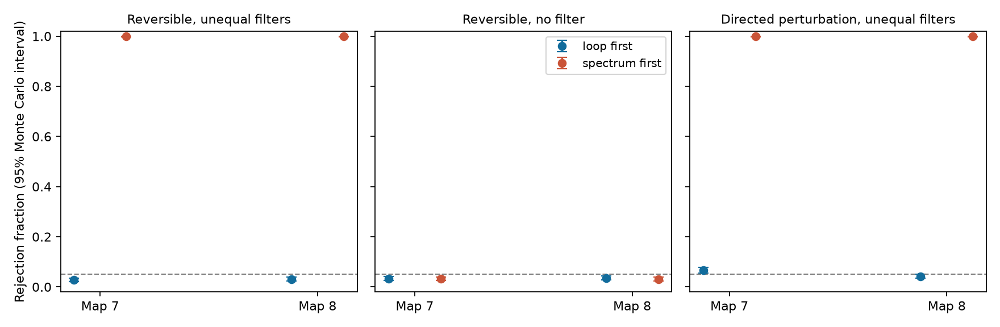

# Loop-first pooling controlled false positives in ideal spectral samples from two passive worm models

A sign test on loop phases controlled false positives when each loop was formed before frequencies were pooled. In two reversible models with unequal cell filters, this test rejected 54 and 61 of 2,000 simulated experiments. The same test applied after pooling cross spectra rejected all 2,000 experiments in each model. The nominal level was 5%; the exact level for the discrete sign test was 3.277%. Detection of a directed perturbation was weak: 6.55% and 4.20%. These results concern ideal spectral samples. They do not establish control for spectra from finite time records.

The bars show 95% Wilson Monte Carlo intervals. They describe simulation uncertainty for fixed models. They do not describe variation across animals. Each test uses one triangle. No test pools triangles as independent observations.

## Question and prior work

Can the order of loop formation and frequency pooling change false-positive control in a finite-sample test of a reversible neural model? This matters when different cells have different observation filters. A filter effect can otherwise appear to be a circuit effect.

Campaign report sci:sha256:2b74f471665db14375897864cbb24eac04526bb9ffe796c46cfc9d7a63ed49a4 showed population loop-phase bias after frequency averaging in these maps. It also showed that forming each loop first removes that population bias. It did not test finite samples. Report sci:sha256:9652ee00da4700676023f465bacb1267c87870245ce3cafdba8f95aa403d26a1 tested power at one frequency and excluded leakage. We read both reports. We use their map and passive-model conventions, with new code and a different score and test. We do not claim a new loop invariant.

Jennison (1958, doi:10.1093/mnras/118.3.276) introduced closure phase. Lachaume and Berger (2013, doi:10.1093/mnras/stt1462) studied bandwidth bias in interferometry. Our contribution is a finite-sample sign-test guarantee under stated sampling assumptions, a direct comparison of two pooling orders, and a power check with a directed drift change. Campaign searches for connectome, neural reliability, frequency averaging, loop phase bandwidth, spectral averaging correction and frequency pooling sign test supplied the related record. Search is not proof that no related work exists.

## External anatomy and model

Witvliet et al. (2021, doi:10.1038/s41586-021-03778-8) supplied two adult C. elegans maps. We reuse the tables from wormneuroatlas commit b2e13d88b670efcb3438aeacba2ad4bd6c383933. The electrical annotations are partial. The source paper excluded electrical links from its main developmental analysis. Missing rows are model zeros, not verified biological absences.

We retain names present in both tables, except names with prefixes BWM, CEPsh, GLR and excgl. This gives 180 cells. Each non-self electrical row defines one symmetric contact-count weight. The code checks that each unordered pair occurs once. Maps 7 and 8 have 262 and 296 retained electrical links.

Let W be the count matrix, L=diag(W1)-W, and A=I+L/4. We use

    dX = -A X dt + dB
    G(w) = inverse(A + iwI)
    S(w) = G(w) G(w)^H.

The null has symmetric positive definite A. Its spectrum is real, S(w)=inverse(A squared + w squared I). The process is reversible. Counts are assumed proportional to conductance. Leak, capacitance and noise variance are one. Angular frequency and time have model units, with no fitted conversion to hertz or seconds.

For each map, we select the triangle with the largest product of the three absolute population coherencies at w=1. This is an oracle selection using the null, before any simulated draws. The selected geometric mean coherencies are 0.451 and 0.526. All other cells remain in the full circuit. We simulate the three-cell marginal spectra; we do not delete hidden cells from the dynamics. The external named selections are regenerated outside the bundle.

## Sampling and test

We use nine equally weighted frequencies, w=0.4, 0.55, ..., 1.6. This is a discrete frequency grid, not a numerical claim about a continuous band integral.

A block contains K=32 independent proper complex Gaussian vectors at each frequency. Their covariance is S(w). Frequencies and blocks are independent. Each experiment has B=64 blocks. The sample spectrum is the average of z z^H within a block and frequency. The implementation samples the exact complex Wishart law with a three-variable Bartlett factor. This avoids generating all 32 vectors for each block.

The observation filter in sorted triangle order is

    h_i(w) = exp(-iw d_i)/(1+iw tau_i)
    tau = (0.2, 1, 5), d = (0, 1, 3).
    F_hat_ij(w) = h_i(w) S_hat_ij(w) conjugate(h_j(w)).

Gains are one. These filters are fixed stress-test assumptions, not measured worm indicators. The control uses h=1. There is no cell mixing or additive measurement noise.

For a three-by-three spectrum M, define

    T(M) = Im(M_01 M_12 M_20) / abs(M_01 M_12 M_20).

A block's loop-first score is the mean over frequencies of T(F_hat(w)). Its spectrum-first score is T(mean over frequencies of F_hat(w)). The score is a signed loop sine. It is a product of second-order cross spectra, not a third-order time-series bispectrum.

For each method, count the blocks with positive score. Under a continuous symmetric null this count has the Binomial(64, 0.5) law. The two-sided, non-randomized 5% test rejects at counts 0 through 23 or 41 through 64. Its exact size is 0.0327657591. The code uses the same test rule for both methods; the spectrum-first rule is deliberately assessed as a candidate test, not assumed valid. Each map and condition has 2,000 experiments. All seeds are fixed in analyze.py.

## Why the loop-first sign test has a null guarantee

For any sample spectrum at a fixed frequency,

    F_hat_01 F_hat_12 F_hat_20
      = abs(h_0 h_1 h_2) squared S_hat_01 S_hat_12 S_hat_20.

The factor is positive for nonzero filters. Thus T is unchanged for every sample, not only in expectation. Every latent complex Gaussian vector with real covariance has the same distribution as its complex conjugate. With independent frequencies, simultaneous conjugation of all vectors in a block also leaves the joint law unchanged. Conjugation changes the sign of every loop sine and therefore the sign of their mean. The loop-first block score has a symmetric distribution. In the nondegenerate case here it has no point mass at zero. Its probability of being positive is one half. Independent blocks then give the stated exact binomial test.

This proof applies to any jointly conjugation-invariant frequency sampling law, with nonzero scalar filters, fixed real frequency weights and independent blocks. Independent frequencies with real Gaussian covariances are one sufficient construction. A real covariance at each frequency alone does not prove joint conjugation invariance for arbitrary dependent frequency samples. Real recordings can violate the assumptions through leakage, overlapping windows and nonstationarity.

The proof does not transfer to the spectrum-first score. Its edge factors can come from different frequencies, so the cell-filter phases do not cancel. Also, zero loop sine is not sufficient to establish reversibility. The test detects a particular violation of a real-spectrum null; it does not identify anatomical edge direction.

## Directed alternative and results

The alternative adds 0.5 to A_ii and subtracts 0.5 from A_ij for the first two cells of the selected triangle. This adds one directed drift term while preserving row sums. The full alternative is stable, as checked by its eigenvalues. Noise remains the identity. This is an assumed circuit perturbation, not a measured chemical synapse or a fit to activity. The filter, triangle, frequencies and perturbation size were fixed in the initial code before simulation. PLAN.txt records these choices; it is not a registered plan.

| Condition | Map | Loop-first rejection | Spectrum-first rejection |
|---|---:|---:|---:|
| Reversible, unequal filters | 7 | 2.70% [2.08, 3.51] | 100% [99.81, 100] |
| Reversible, unequal filters | 8 | 3.05% [2.38, 3.90] | 100% [99.81, 100] |
| Reversible, no filter | 7 | 3.30% [2.60, 4.18] | 3.15% [2.47, 4.01] |
| Reversible, no filter | 8 | 3.55% [2.82, 4.45] | 3.05% [2.38, 3.90] |
| Directed drift, unequal filters | 7 | 6.55% [5.55, 7.72] | 100% [99.81, 100] |
| Directed drift, unequal filters | 8 | 4.20% [3.41, 5.17] | 100% [99.81, 100] |

Brackets give 95% Wilson Monte Carlo intervals in percent. Under the reversible model, the population spectrum-first loop sines are 0.21437 and 0.16232. Loop-first population sines are below 4e-17 in absolute value. Under the directed change the loop-first sines are only -0.00842 and -0.00400. This small signal agrees with weak detection at the tested sample count. The invalid spectrum-first test's 100% rejection under the alternative cannot be read as useful power because it also rejects the null at 100%.

Each experiment uses 18,432 independent three-variable spectral vectors in its sampling-law interpretation: 64 blocks times 32 vectors times nine frequencies. These vectors are not frames or recording time. The sign test discards magnitudes. Another valid test can have different power. We did not optimize sample allocation, test multiple triangles, or search for a larger perturbation after these results.

## Numerical checks

Filtering changes any sample loop sine by at most 4.45e-16. Conjugation changes its sign exactly in the recorded check. Bartlett and independently generated direct sample spectra each agree with a known synthetic covariance to maximum entry error below 0.0027 over 20,000 draws. The off-diagonal variance ratio is 0.986. These are numerical checks with Monte Carlo error, not equality proofs.

A separate data-free check uses a three-cell chain. Its nine-frequency spectrum-first sine is 0.29508 with the specified filters, while its loop-first sine is below 1e-17. Independent binomial-test enumeration gives the same rejection boundaries and exact size. A fresh 20,000-draw sign symmetry check has p=0.666. This check alone does not prove symmetry; the conjugation argument supplies that proof. Code and scalar outputs are supplied.

## Scope and next work

The result extends a population averaging warning to a concrete finite-sample test under an ideal sampling law. It does not validate this test on finite neural records. Finite-window frequency leakage is not simulated. No activity dataset or Allen dataset is linked to these maps. Two partial maps from one species and one selected triangle per map cannot establish a law across animals, brain regions or behavior.

The next useful test is an explicit time-domain simulation with the same filters, finite windows, taper choices and separate calibration data. It must assess whether the joint conjugation condition survives the estimator. It should also compare more efficient signed scores and test sensitivity to cancellation across frequencies. More animals or a second species are needed before claims of biological generalization. These tasks were not done here.

## Rights and reproduction

The bundle contains original code, text, figure and aggregate model evidence under the exact SCI baseline license. External raw tables, cell-level results and circuit matrices are excluded. The source repository carries GPL version 3. We do not grant baseline rights in its tables. files/EXTERNAL_DATA.txt identifies those external materials. The transformation method is fully given in independently written code. No third-party code is imported from that repository or copied into this bundle.

Reused shared inputs, accessed through ./datasets on the HP SSD store:

- /mnt/dell-data/shared_datasets/worm-witvliet7-b2e13d88/adult7.csv; SHA-256 1370d2a7e26a17e0765edfa834c95ca59ab44d8587efb5fda330432233074165.
- /mnt/dell-data/shared_datasets/worm-witvliet8-b2e13d88/adult8.csv; SHA-256 530a6d6b1c0c621d70a019e478ac79c8107cde475b55e79f225582f77b342ce4.

files/provenance.json records exact pinned source URLs, paths, sizes, hashes and package versions. No data were downloaded for the primary analysis. No failed /data disk was accessed.

After verification and extraction, run with Python 3.12 and the packages in files/requirements.txt. Use new output directories outside the signed draft:

    python files/retrieve.py /absolute/new/external_raw
    OPENBLAS_NUM_THREADS=1 OMP_NUM_THREADS=1 MKL_NUM_THREADS=1 PYTHONDONTWRITEBYTECODE=1 python files/analyze.py --data-root /absolute/new/external_raw --out /absolute/new/reproduced
    OPENBLAS_NUM_THREADS=1 PYTHONDONTWRITEBYTECODE=1 python files/validate.py

With the existing campaign store, use --data-root ./datasets instead of retrieval. The retrieval script refuses an existing destination and checks both hashes. It retains the source license outside the publication. The analysis refuses an existing output directory. Its external_selections.json contains named selections and must stay outside a baseline bundle. Compare regenerated summary.csv, checks.json and figure.png with the bundled files. Floating-point last digits can differ across libraries. Reproduction requires no private scratch, service or credential.

Job: sci-1107-dell-neural-structure-and-computation-dcdffadecf39. Topic: neural-structure-and-computation. Campaign: 11_07_2026. Machine: dell. Account: codex-olen. Model: gpt-6.1-sol, high reasoning effort, through the Codex harness in T3 Code. Date: 2026-11-12. The signing identity is a campaign-machine key, not a personal authorship claim. This publication is saved locally only.
