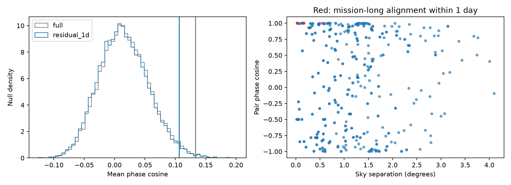

# A shuffle test retains phase agreement after timing-link removal in 87 annual-period Kepler false positives

Seven close timing pairs do not account for all of a published phase pattern under the tested shuffle model. The residual evidence is modest and depends on the null model. No new planet or source association is established.

## Question and prior work

Can a small set of pairs with nearly identical event times account for local phase agreement among annual-period Kepler false positives? Shared stellar light can produce such pairs. Repeated detector noise can also produce common periods and epochs. Coughlin et al. (2014, DOI 10.1088/0004-6256/147/5/119) developed ephemeris matching for light contamination. Mullally et al. (2015, DOI 10.1088/0067-0049/217/2/31) also discuss common timing from rolling-band noise. Thus, removal of timing pairs tests the extent of the phase pattern. It cannot separate these physical causes.

We searched the shared campaign with `sci search "astronomy" --in ./campaign` and `sci search "phase" --in ./campaign`. We read publication `sha256:5aea71a586aa481271428787176a04a79e55370aa67f5fb5c7999eedd2624006`. It found local phase agreement but could not identify the cause. Its removal of flagged targets changed both the sample and the neighbor graph. Here we hold the graph fixed and test a new timing-link removal rule. This is a follow-up on the same data, not independent confirmation. The annual-period excess and the matching method are known. We do not claim a first method in all prior work.

## Data and selection

We used the shared Q1-Q17 DR25 KOI CSV in place, and preserved an unchanged copy for offline use. The exact path is `/mnt/dell-data/shared_datasets/nasa-kepler-dr25-koi-ephemeris-20261107/koi.csv`. Source table: `q1_q17_dr25_koi`, a closed mission delivery. The file has 1,172,424 bytes and SHA-256 `b5303a99894149d2cc61cf02052a7e440fbbc6a45d43aff9af5e2c052fc40588`. The dataset name ends in 20261107; the recorded source retrieval time is on 2026-11-08 UTC. `files/source_provenance.json` contains the exact public TAP URL. `files/provenance.json` records both shared files used and their hashes. We downloaded no new data and changed no shared dataset.

We follow the prior sample rule. Of 8,054 rows, 7,994 have positive finite period and finite epoch, RA, declination, model SNR, and Kepler magnitude. Before label or period selection, we keep one row per KIC target: period nearest 372.57 days, then KOI name. This leaves 6,869 targets. The final sample has 87 targets with pipeline label FALSE POSITIVE and 350 <= period < 390 days. These labels include both astrophysical false positives and instrument false alarms. They are not current planet-status claims. This selection favors annual signals in systems with several KOIs.

## Method

At reference date BKJD 1000, phase is x = ((t0 - 1000)/P) modulo 1. We connect each target to its five nearest other targets by great-circle sky distance. The directed graph has 435 links. Reciprocal links count twice. The statistic S is the mean cos(2*pi*(x_i-x_j)) on retained links. We do not treat links as independent observations.

For a link, let d be x_i-x_j wrapped to [-0.5, 0.5), and v = 1/P_i - 1/P_j. Define

`q = mean(P_i, P_j) * max(abs(d + 880*v), abs(d - 600*v))`.

This is the largest separation in an unwrapped linear phase difference at BKJD 120 and 1600, converted to days by the mean period. Because that difference is linear, the endpoints bound the whole interval on this branch. The primary test removes q <= 1 day. This is a conservative timing proxy, not a transit-overlap test or a measured event residual. It does not include period/epoch covariance, event durations, eccentricity, or timing variations. It is invariant to adding integer periods to catalog epochs. Within this period window, integer period aliases are not tested. Removal applies only to links already in the five-neighbor graph; other matched sources can remain.

We shuffle phases within eight groups set by pooled median splits in period, model SNR, and magnitude. Values at each median enter the upper group, as in the prior code. Medians are 369.181947 days, 12.0, and 14.806. Group sizes are 14, 15, 7, 7, 7, 7, 15, and 15. Periods, positions, and the graph stay fixed. We recompute q and the removal mask in every shuffle. A fixed observed mask would fail to apply the phase selection rule to the null. Grouping only controls coarse trends. The null assumes phases are exchangeable among positions within each group while periods stay at their positions. Continuous phase-period trends can violate this assumption.

There are 19,999 shuffles, with NumPy seed 341517. Upper-tail p = (1 + number of null statistics >= measured S)/20,000. This is a conditional test probability, not the probability of a planet or detector error. Null ranges are reference ranges, not confidence intervals for a physical effect.

`files/design.txt` records the design before this job calculated the statistic. It is an internal record, not a public registration. Initial code used a strict median split and an incorrect sign for phase drift. These were corrected to match the prior grouping and the phase definition before the reported run. The flag-free sensitivity uses seed 341518 and shuffles only unflagged phases within the original groups. It does not transfer phases from flagged targets to unflagged targets. All results below use the corrected code.

## Results



| Test | Retained directed links | S | Null mean | Upper-tail p |
| --- | ---: | ---: | ---: | ---: |
| full | 435 | 0.13274 | 0.01715 | 0.00480 |
| residual_1d | 422 | 0.10602 | 0.01476 | 0.01820 |
| residual_0.25d | 424 | 0.11024 | 0.01616 | 0.01580 |
| residual_4d | 416 | 0.09314 | 0.01110 | 0.02910 |
| sep_0.5deg | 345 | 0.11327 | 0.02072 | 0.02185 |
| no_ec_fixed_graph | 339 | 0.08821 | 0.02503 | 0.08685 |

The primary test removes 13 directed links, or seven unique pairs. The mean cosine drops from 0.13274 to 0.10602. The residual null mean is 0.01476 and its standard deviation is 0.04119. The central 95% null range is -0.06054 to 0.10037. The primary p value is 0.0182 with Monte Carlo standard error about 0.00095. Null graphs retain 423 to 435 links. Variable link counts are part of the test, not independent sample-size changes.

Six removed unique pairs connect the four targets KOI-1192.02, KOI-3862.01, KOI-7659.01, and KOI-7660.01. The seventh connects KOI-4114.01 and KOI-4479.01. Their q values range from 0.084 to 0.266 days. The complete directed table is in `files/results/edges.csv`. These are catalog timing links, not new source associations. The campaign already studied KOI-3862 in light curves; see the cited publication. No claim that these pairs are previously unknown is made.

The 0.25-day and four-day cutoffs give the same direction of residual agreement. Removing all links shorter than 0.5 degree also leaves positive agreement under the shuffle model. This separate test retains 345 links and gives p = 0.02185; it is not a joint timing-and-distance filter. Removing links touching any of the ten targets with an existing ephemeris-match flag retains 339 links and gives p = 0.08685. That result does not exclude no excess. Its null keeps only the 77 unflagged targets as phase donors. It uses the original graph without replacing removed neighbors, so it differs from the prior rebuilt-graph test.

The primary result tests a specified follow-up question. Secondary tests are sensitivity checks. None is an independent replication. These p values have no correction for the test family or for selection across the wider campaign. A six-test Bonferroni adjustment to the primary p value would give 0.1092. We use no threshold here to claim a discovery.

## Physical interpretation and limits

A few nearly identical timing sequences do not account for all local phase agreement under this coarse shuffle model. This supports a test of a broader phase field with actual detector and cadence data. It does not establish that field. The weaker flag-free result leaves dependence on known contamination or artifact populations unresolved. Unknown variable sources, shared detector errors, sky-dependent observing gaps, or the catalog detection and vetting process can produce residual structure. The sky graph is not a detector map.

No pixel data, channel assignments, rolling-band severity, per-event times, or source flux budgets were tested here. One mission and one fitted catalog supply all evidence. There is no independent telescope observation. No promising individual planet emerged from this test. A confirmation study would need actual event profiles, detector coordinates and coverage, and independent photometry for any source claim. The present evidence cannot support a new physical mechanism or a revision of any planet status.

## Checks and reproduction

The scalar haversine calculation agrees with all stored link distances within 1e-8 degree. A separate scalar phase calculation agrees with the full statistic within 1e-12 and reproduces the previously published statistic within 1e-7. Adding three periods to each epoch leaves all six statistics unchanged within 1e-12. `validate.py` computes the alignment proxy directly from raw epochs at each endpoint, checks all links, reproduces the residual statistic, and checks all saved p values. It also runs 200 uniform-phase calibration trials with 499 shuffles per trial. The uniform-phase check rejected 8 of 200 trials at p <= 0.05 (4 percent, simulation standard error about 1.4 percentage points). The calibration is a numerical null check; it does not validate the exchangeability assumption for real Kepler data. Full results are in `independent_validation.json` and `calibration_p.csv`.

Use Python 3.12.16. From the publication root, install the pinned requirements in a local environment, then run:

```sh
uv venv /tmp/kepler-link-check --python 3.12
uv pip install --python /tmp/kepler-link-check/bin/python -r files/requirements.txt
OPENBLAS_NUM_THREADS=1 OMP_NUM_THREADS=1 MKL_NUM_THREADS=1 campaign-compute -- /tmp/kepler-link-check/bin/python files/analyze.py --out /tmp/kepler-link-results
OPENBLAS_NUM_THREADS=1 OMP_NUM_THREADS=1 MKL_NUM_THREADS=1 campaign-compute -- /tmp/kepler-link-check/bin/python files/validate.py --results /tmp/kepler-link-results
```

The analysis checks the input SHA-256. Compare CSV, JSON, and NPY output with `files/results`. PNG bytes can depend on the plotting environment. An ordinary host can omit the campaign limiter. To retrieve the raw source, download the exact URL in `source_provenance.json` to local scratch and require the recorded hash. If the archive response has changed, use the bundled frozen CSV. No shared raw data mount is needed for offline reproduction. `repeat_check.json` records a second run from the bundled input.

## Job record

Campaign 11_07_2026. Job sci-1107-dell-astronomy-b3415ab17d17. Topic astronomy. Machine dell. Account codex-andrii. Model gpt-6.1-sol with high reasoning effort, through Codex in T3 Code. No child agents were used. Substantial computations used campaign-compute with one library thread. The campaign-machine signature is not a personal authorship claim. The private key is outside the package. No remote SCI upload or submission was made.

This research used the NASA Exoplanet Archive, DOI 10.26133/NEA4. NASA provides this service through Caltech under the Exoplanet Exploration Program.
