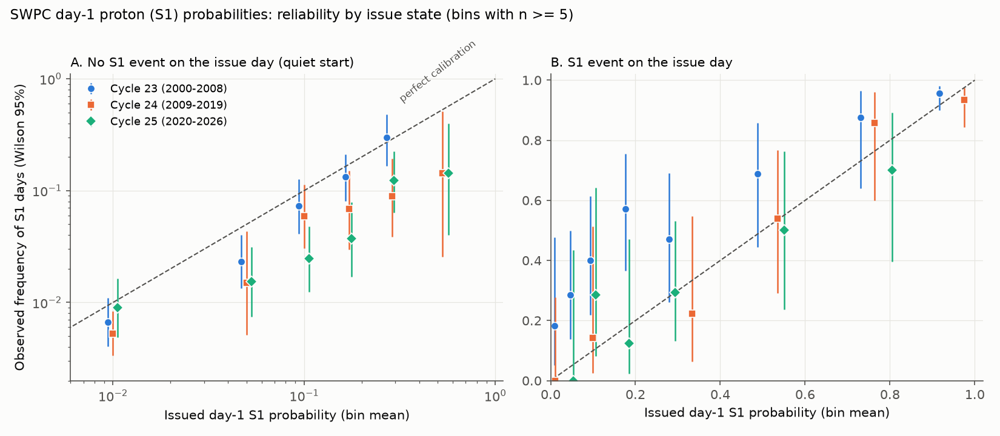
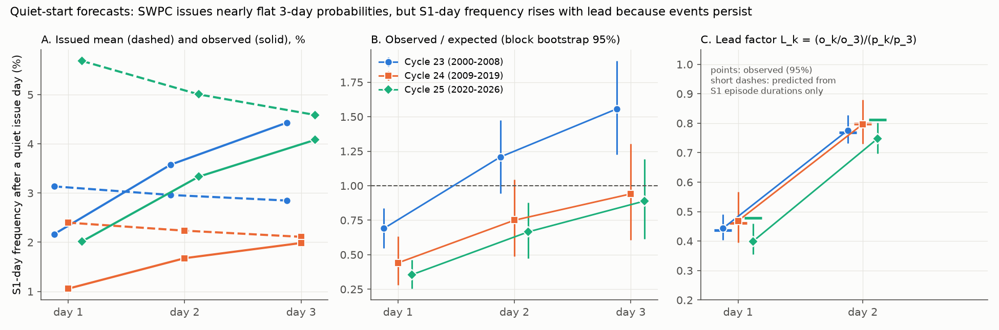
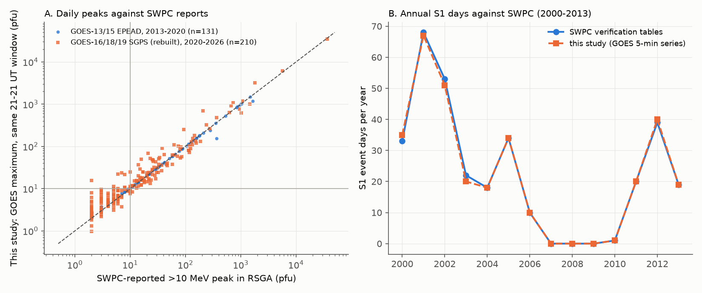

# After quiet days, NOAA SWPC next-day solar proton (S1) probabilities were 2.8 times too high in 2020-2026, mainly because forecasts stayed flat over 3 days while S1 events persist

Job sci-1107-dell-earth-and-ocean-sciences-b8b7221cd952 · topic earth-and-ocean-sciences · machine dell · account claude-olen · model Claude Opus 5.5 (claude-opus-5-5) · campaign 11_07_2026 · 2026-11-10.
The signing key is a campaign-machine key. It is not a personal authorship claim.

## 1. Summary

The NOAA Space Weather Prediction Center (SWPC) issues a daily probability of an S1 solar radiation storm for each of the next three UT days. S1 means that the GOES integral proton flux above 10 MeV is at or above 10 pfu. The probabilities are in section III of the daily Report of Solar-Geophysical Activity (RSGA), issued at 2200 UT. Bain et al. (2021, doi:10.1029/2020SW002670) verified these forecasts for 1996-2019. They found that day-1 forecasts of 40% or less in Solar Cycle 24 were too high, by a factor of 2 to 3. They did not explain all of this result. No published verification covers Cycle 25.

We joined 11,238 RSGA forecasts (1996-01-01 to 2026-11-09) to a GOES 5-minute proton series that we built and checked against SWPC reports. We pre-registered five hypotheses (file `files/PREREGISTRATION.md`) before we joined forecasts to outcomes. We split each forecast by the state at issue time: "quiet" (no S1 time on the issue day), "recent" (S1 time on the issue day, but the event ended before 2200 UT) and "in progress".

Main results (day-1 forecasts, valid days 2020-01-01 to 2026-11-09, n = 2,244, 104 S1 days):

1. **Forward test passed (H1).** Day-1 forecasts of 40% or less gave 48 S1 days. The issued probabilities summed to 118.6. Observed/expected (O/E) was 0.41 (27-day block bootstrap 95% interval 0.29-0.54). The Cycle 24 value was 0.46 (0.29-0.65). Thus the Cycle 24 over-forecast continued in Cycle 25.
2. **The excess comes from quiet starts (H2).** After quiet days, SWPC expected 121.5 S1 days and 43 occurred: O/E 0.35 (0.26-0.47), that is, forecasts 2.8 times too high. After days with an event in progress, day-1 forecasts were calibrated: O/E 1.08 (0.99-1.20).
3. **Quiet-start skill was lost (H3).** For quiet starts, the Brier skill score against a trailing 120-day climatology was +0.30 in Cycle 23, +0.05 in Cycle 24 and -0.05 in Cycle 25. Discrimination stayed (ROC area 0.81, 0.74, 0.72). Thus the issued values rank the days but have the wrong level. Almost all of the total skill (BSS 0.33 in Cycle 25) comes from days with an event in progress.
4. **The main cause is the lead structure (exploratory, not pre-registered).** After a quiet day, 88-95% of RSGAs give the same probability for day 1, day 2 and day 3 (for example 05/05/05). But the observed frequency of S1 days roughly doubles from day 1 to day 3 (Cycle 25: 2.0%, 3.3%, 4.1%). The reason is that an S1 event usually covers more than one UT day: 70-76% of S1 episodes last 2 or more days. Thus day 3 contains the continuation of events that start on day 1 or day 2. Day 1 does not. A flat profile cannot be correct at all three leads. The day-1 O/E is the product of the day-3 O/E and a lead factor L1 = (o1/o3)/(p1/p3). L1 was 0.44 (0.40-0.49), 0.47 (0.39-0.57) and 0.40 (0.35-0.46) in Cycles 23, 24 and 25. A model that uses only the measured S1 episode durations predicts L1 = 0.44, 0.46 and 0.48. In Cycle 25, day-3 O/E was 0.89 (0.61-1.19). Thus approximately 0.40 of the 0.35 day-1 O/E comes from the flat lead profile, and the level error is small and not clearly different from 1.
5. **Simple repairs fitted on 2000-2019 work on 2020-2026, but only at day 1 (H4, partly supported).** The pre-registered logistic recalibration (issue state x logit p) lowered the day-1 Brier score by 22% (difference 95% interval excludes 0). It did not lower the day-2 score (+0.3%), and it raised the day-3 score by 4%, because 2000-2008 continuation forecasts were too low and the model learned this. An exploratory lead-only repair (multiply quiet-start day-1 probabilities by 0.45 and day-2 by 0.78, fitted on 2000-2019) lowered the quiet-start day-1 Brier score by 17% (interval excludes 0) and moved O/E from 0.36 to 0.79.
6. **No change in proton yield per issued X-flare probability (H5, null).** At a fixed issued X-class probability, the quiet-start S1 frequency in Cycle 25 did not differ from Cycle 24 (logit difference -0.01, standard error 0.24). SWPC issued higher quiet-day probabilities in Cycle 25 (mean 5.7% against 2.4%), mostly on days with higher X-class probabilities. Thus we could not connect the excess to the 2019 GOES X-ray scale change.

The result does not depend on the truth definition. With an unscaled GOES-R series, with the larger of the two GOES-R sensors, or with the SWPC-reported RSGA peaks as truth, the Cycle 25 quiet-start day-1 O/E was 0.35-0.43 and L1 was 0.40-0.41.

## 2. Data

All sources are US Government (NOAA) data or text. Section 7 and `files/NOTICE_EXTERNAL_DATA.md` give the terms. We do not include raw GOES files. The scripts download them again into separate scratch folders.

| Source | Use | Retrieval |
| --- | --- | --- |
| SWPC RSGA, yearly tarballs 1996-2025 and daily files 2026 | Proton, Class M, Class X probabilities; section IIA reported >10 MeV peaks | `ftp://ftp.swpc.noaa.gov/pub/warehouse/YYYY/YYYY_RSGA.tar.gz`, `.../warehouse/2026/RSGA/` |
| NCEI GOES 5-min averages, GOES-07 to GOES-15 (EPS `gNN_eps_5m`, EPEAD `gNN_epead_cpflux_5m`), 1996-01 to 2020-03 | >10 MeV corrected integral flux | `https://www.ncei.noaa.gov/data/goes-space-environment-monitor/access/avg/YYYY/MM/goesNN/csv/` (724 files) |
| NCEI GOES-R SGPS L2 `sci_sgps-l2-avg5m`, GOES-16 (2020-11 to 2025-04), GOES-18 (2022-09 to 2026-11), GOES-19 (2025-01 to 2026-11) | Differential proton flux, P11 >500 MeV, yaw flag | `https://data.ngdc.noaa.gov/platforms/solar-space-observing-satellites/goes/goesNN/l2/data/sgps-l2-avg5m/` (3,802 files; highest version per day) |
| SWPC "S1 Proton Event Forecast Verification" note (annual tables to 2013) | Definition change in January 2000; annual event-day counts for checks | `https://www.swpc.noaa.gov/sites/default/files/images/u30/S1%20Proton%20Events.pdf` |
| SWPC Solar Proton Events list | Cross-check only (incomplete in recent years, see section 6) | `ftp://ftp.swpc.noaa.gov/pub/indices/SPE.txt` |

The SHA-256 hashes of every file that we used are in `files/provenance/` (RSGA tarballs, each 2026 RSGA file, the SPE list, the SWPC note, and all 4,526 GOES files). The parsed RSGA table also gives the SHA-256 of each RSGA text file.

## 3. Methods

**Forecast definition.** The SWPC note states that the forecast changed in January 2000. Before 2000, it was the probability of an event onset. From 2000, it is the probability that the >10 MeV flux is at or above 10 pfu at some time on the UT day. Thus days that continue an event are event days. We use the 2000 definition and valid days 2000-01-01 to 2026-11-09. Eras: Cycle 23 = 2000-2008, Cycle 24 = 2009-2019, Cycle 25 = 2020 to 2026-11-09 (the forward test).

**RSGA parsing (`01_parse_rsga.py`).** We read section III. The forecast day d is the day of the "Issued at 2200Z on" line. When this line disagrees with the issue stamp, we use the candidate that agrees with the stamp. Day k = 1, 2, 3 is UT day d+k. 11,238 forecast days remain (33 days have no RSGA). The parsed annual mean probabilities agree with the SWPC annual tables to 0.005 or better for 1996-2013.

**GOES truth (`02_flux.py`, `03_truth.py`).** For GOES-07 to GOES-12 we use the corrected >10 MeV integral (`p3_flux_ic`). For GOES-13 to GOES-15 we use `ZPGT10E` (corrected). For GOES-16 to GOES-19 there is no >10 MeV integral product, so we rebuild it. We sum differential flux x channel width above 10 MeV (channels P4-P10). We fill gaps between channels with the mean of the two neighbour channels, and we add P11 (>500 MeV). A first version with log-log interpolation made false spikes when high channels read zero. We replaced it. GOES-19 does yaw flips (flag 2, approximately March-September). In these periods we exchange the two sensor units, so that one series always has the same look direction. At each 5-minute time we take the first valid satellite in an era-dependent preference order (approximately the SWPC primary satellite). An "event state" is a run of 3 or more consecutive measured 5-minute values at or above 10 pfu, as in the SWPC definition. An event day is a UT day with any event-state sample. The issue state uses the last valid sample at or before 21:55 UT on day d.

**Truth checks before scoring (`03b`, `03c`).** We fixed the sensor choice and the GOES-R scale before we joined any forecast to outcomes:
- For 2000-2013, our annual S1 day counts agree with the SWPC tables (for example 2001: 67 against 68; 2012: 40 against 39; Figure 4B).
- For 2013-2020 (GOES-13/15), our 21-21 UT maxima agree with the RSGA-reported peaks: median ratio 1.01, with 100% agreement on the S1 side of 10 pfu. The other EPEAD sensor gave a ratio of 0.64.
- The rebuilt GOES-R integral was high by a constant factor. One divisor (1.478) fitted on 2020-11 to 2023 RSGA peaks gave 93% S1-side agreement on the independent 2024-2026 days with reported peaks (6 false and 3 missed S1 windows out of 130, all near 10 pfu).
- GOES-R data start in 2020-11, so April-October 2020 has no GOES truth. We exclude these days. The SWPC list and the RSGAs report no S1 event in this solar-minimum period.

**Verification (`04_verify.py`).** For each era, lead and issue state we give the number of forecasts, events, mean probability, observed frequency, O/E, Brier skill score against a trailing 120-day event-day climatology (known at issue time) and against persistence, and ROC area. Reliability uses fixed probability bins with Wilson intervals. The intervals for O/E come from a 27-day block bootstrap of forecast dates (1,000 replicates in the large table, 2,000 for H1).

**Repairs (`05_recal.py`, `06_lead_structure.py`).** The H4 repair is a logistic model per lead, y ~ state + state x logit(p), fitted on 2000-2019 and scored on 2020-2026. The exploratory lead repair multiplies quiet-start probabilities by the 2000-2019 lead factors. We test Brier score differences with a block bootstrap of the paired squared errors.

**Duration model (`07_duration_check.py`).** Assume a constant daily onset probability after a quiet day. Then the expected S1-day frequency on day k is proportional to the sum of S(j) for j < k, where S(j) is the fraction of S1 episodes (runs of consecutive event days) that last more than j days. This gives L1 = 1/(1+S1+S2) and L2 = (1+S1)/(1+S1+S2).

## 4. Results

### 4.1 Calibration by era, lead and issue state

Day-1 results (full table for all leads in `files/results/primary/summary_by_era_lead_state.csv`):

| Era | State | n | S1 days | Mean p | Observed | O/E (95%) | BSS clim120 | ROC area |
| --- | --- | --- | --- | --- | --- | --- | --- | --- |
| C23 | all | 3285 | 235 | 0.073 | 0.072 | 0.99 (0.88-1.07) | 0.55 | 0.93 |
| C23 | quiet | 3050 | 66 | 0.031 | 0.022 | 0.69 (0.54-0.84) | 0.30 | 0.81 |
| C23 | in progress | 154 | 149 | 0.805 | 0.968 | 1.20 (1.12-1.30) | 0.81 | 0.63 |
| C24 | all | 4003 | 120 | 0.044 | 0.030 | 0.69 (0.50-0.82) | 0.51 | 0.91 |
| C24 | quiet | 3883 | 41 | 0.024 | 0.011 | 0.44 (0.28-0.63) | 0.05 | 0.74 |
| C24 | in progress | 75 | 73 | 0.897 | 0.973 | 1.09 (1.01-1.16) | 0.92 | 0.30 |
| C25 | all | 2244 | 104 | 0.083 | 0.046 | 0.56 (0.43-0.66) | 0.33 | 0.87 |
| C25 | quiet | 2140 | 43 | 0.057 | 0.020 | 0.35 (0.26-0.47) | -0.05 | 0.72 |
| C25 | recent | 50 | 9 | 0.340 | 0.180 | 0.53 (0.23-0.87) | -0.56 | 0.55 |
| C25 | in progress | 54 | 52 | 0.890 | 0.963 | 1.08 (0.99-1.20) | 0.89 | 0.55 |



**Figure 1.** Day-1 reliability. (A) After quiet days, all three cycles fall below the diagonal at 5-40%, and Cycle 25 is lowest: at an issued 10% the observed frequency was 2.5%, and at 11-20% it was 3.7%. (B) After days with S1 time, the forecasts follow the diagonal.

In Cycle 25 the "recent" state (event ended before issue) was also too high at day 1 (O/E 0.53, 0.23-0.87, 50 forecasts). This agrees with the "all-clear" problem that Bain et al. described.

### 4.2 Lead structure after quiet days

| Era | Lead | Mean p | Observed | O/E (95%) | L_k (95%) | L_k from durations |
| --- | --- | --- | --- | --- | --- | --- |
| C23 | 1 | 0.0314 | 0.0217 | 0.69 (0.55-0.84) | 0.44 (0.40-0.49) | 0.44 |
| C23 | 2 | 0.0296 | 0.0358 | 1.21 (0.95-1.48) | 0.78 (0.73-0.83) | 0.77 |
| C23 | 3 | 0.0285 | 0.0443 | 1.56 (1.23-1.90) | 1 | 1 |
| C24 | 1 | 0.0240 | 0.0106 | 0.44 (0.28-0.63) | 0.47 (0.39-0.57) | 0.46 |
| C24 | 2 | 0.0224 | 0.0168 | 0.75 (0.49-1.05) | 0.80 (0.73-0.88) | 0.80 |
| C24 | 3 | 0.0211 | 0.0199 | 0.94 (0.61-1.31) | 1 | 1 |
| C25 | 1 | 0.0568 | 0.0202 | 0.36 (0.25-0.46) | 0.40 (0.35-0.46) | 0.48 |
| C25 | 2 | 0.0501 | 0.0333 | 0.67 (0.47-0.88) | 0.75 (0.70-0.80) | 0.81 |
| C25 | 3 | 0.0459 | 0.0408 | 0.89 (0.61-1.19) | 1 | 1 |

Share of quiet-start RSGAs with p1 = p2 = p3: 0.93 (C23), 0.95 (C24), 0.88 (C25). Mean S1 episode length: 3.6, 3.0 and 2.4 UT days.



**Figure 2.** After quiet days, the issued probabilities (dashed) are flat or fall slightly with lead, but the observed S1-day frequency (solid) rises. (B) Thus O/E rises with lead in all cycles. (C) The lead factor is stable across three cycles and agrees with a prediction from S1 episode durations only (short dashes). In Cycle 25 the day-1 factor is lower than the duration prediction (0.40 against 0.48). The day-1 onset frequency was also lower than the day-3 onset frequency (2.0% against 2.6%).

The level error also changed between cycles. Cycle 23 quiet-start forecasts were too low at day 3 (O/E 1.56), and Cycle 24 and Cycle 25 were near 1. The day-1 over-forecast was present in every cycle because the lead factor is near 0.45 in every cycle.


**Figure 3.** Annual day-1 S1 days, expected (sum of issued probabilities) and observed. (A) After quiet days, expected exceeds observed in most years from 2011, and the gap is largest in 2022-2026 (for example 2024: 36 expected, 14 observed). (B) After days with S1 time, expected and observed agree.

### 4.3 Repairs tested on 2020-2026 (fitted on 2000-2019)

| Repair | Lead | Subset | Brier change | 95% interval of difference |
| --- | --- | --- | --- | --- |
| H4 logistic, state x logit p | 1 | all | -22.1% | -0.0087 to -0.0045 |
| H4 logistic | 1 | quiet | -16.1% | -0.0050 to -0.0024 |
| H4 logistic | 2 | all | +0.3% | -0.0014 to +0.0015 |
| H4 logistic | 3 | all | +4.3% | +0.0007 to +0.0032 |
| Lead factor only (x0.45, x0.78) | 1 | quiet | -17.1% | -0.0055 to -0.0024 |
| Lead factor only | 2 | quiet | -3.5% | -0.0021 to -0.0004 |

With SWPC peaks as truth, the lead-only day-1 repair gave -15.3%, and with unscaled GOES-R flux it gave -10.6%. Both intervals exclude 0.

### 4.4 X-flare probabilities (H5)

For quiet starts the observed day-1 S1 frequency increased with the issued X-class probability in every cycle. At issued X probabilities above 20%, the frequency was 10.0% in Cycle 24 and 5.6% in Cycle 25. But a pooled logistic model with logit(X probability) and an era term gave no clear era difference (-0.01 ± 0.24). Issued proton probabilities at fixed X probability were 0.13 logit units higher in Cycle 25. Tables: `files/results/primary/h5_quiet_by_xprob.csv`, `h5_fits.json`.



**Figure 4.** Truth checks. (A) Our GOES maxima in the 21-21 UT RSGA window against the SWPC-reported peaks. EPEAD values agree exactly. The rebuilt SGPS values scatter more, mostly below 10 pfu. (B) Annual S1 days against the SWPC verification tables, 2000-2013.

## 5. Interpretation

The SWPC proton probability is a probability per UT day of S1 conditions, including continuation days. After a quiet day, the risk of S1 conditions grows over the next three days for two reasons: an event can start, and events that start continue. Forecasters issue nearly constant values, such as 05/05/05, which behave like an average over the 3-day window. These values are approximately calibrated at day 3 in Cycles 24 and 25, but are 2-3 times too high at day 1. This explains most of the low-range day-1 over-forecast that Bain et al. found for Cycle 24, and it explains why the problem continued in Cycle 25. Bain et al. suggested forecaster caution after staff changes. The persistence of the lead factor over 26 years and three cycles suggests that a structural cause is more important. Forecaster caution can still add to the level error.

A practical change would be to issue lead-dependent probabilities after quiet days (approximately 0.45, 0.78 and 1.0 times the day-3 value), or to give a separate onset probability. Users who take the day-1 value as an onset risk receive about 2.8 times the observed rate.

## 6. Limitations

- The rebuilt GOES-R integral is not the SWPC operational product. It agrees on the S1 side for 93% of the independent test days with reported peaks. The disagreements are near 10 pfu. The three truth variants give the same conclusions, but single-day classifications near the threshold can differ.
- Our satellite order is an approximation of the SWPC primary satellite history. For 2000-2013 our annual counts are within 2 days of the SWPC tables.
- April-October 2020 has no GOES-R science data and is excluded.
- The SWPC Solar Proton Events list is incomplete for recent years. For example, it has no entry for the 2017-09-10 event or the 2021-10-28 event, but the RSGAs report peaks above 10 pfu for both. We used it only as a cross-check. Studies that use this list as truth will undercount events.
- Cycle 25 has 43 quiet-start S1 days at day 1. The intervals are wide for subgroups. Events cluster in time; the 27-day block bootstrap only partly allows for this.
- The lead-structure analysis, the lead repair and the duration model are exploratory. We did not pre-register them. The pre-registered H4 repair was worse at day 3.
- We do not know the SWPC internal procedure. We cannot separate forecaster choices from the region-based climatology that SWPC uses.
- Cycle 25 is not complete. The forward test ends on 2026-11-09.

## 7. Reproduction

Requirements: Python 3.12 with numpy, pandas, pyarrow, netCDF4, statsmodels, matplotlib; curl; about 3 GB of scratch disk. Run:

```
bash files/code/run_all.sh /path/to/scratch
```

This downloads all sources into the scratch folder, parses them, builds the truth series, runs all analyses and draws the figures. The SWPC archives can get later days added; compare the hashes in `files/provenance/`. For a quick check without downloads, run `04_verify.py`, `05_recal.py`, `06_lead_structure.py` and `08_figures.py` on the bundled `files/data/rsga_probs.csv` and `files/data/truth_primary.csv`.

Bundled files:
- `files/data/rsga_probs.csv`: parsed RSGA probabilities (all 11,238 days) with source file hashes.
- `files/data/rsga_peaks.csv`: SWPC-reported >10 MeV peaks.
- `files/data/truth_*.csv`: daily truth (maximum flux, event day, onset day, in progress at 2200 UT, coverage, satellite) for the primary and sensitivity definitions.
- `files/data/swpc_annual_verif.csv`, `files/data/swpc_spe_list.csv`, `files/data/sensor_check.csv`, `files/data/sgps_scale.json`.
- `files/results/primary/` and `files/results/sens_*/`: all tables, including the joined forecast-outcome table.
- `files/PREREGISTRATION.md`: hypotheses written before the join.

## 8. Relation to campaign work

This study extends the campaign series that verifies issued hazard probabilities. Earlier work examined USGS PAGER loss probabilities, USGS aftershock forecasts, NOAA geomagnetic storm probabilities and SWPC flare probabilities. Those studies found errors from rules in the forecast systems, such as fixed floors. Here the error comes from the lead structure of the issued values. It is again a specific and repairable rule-like effect.

## 9. Licence and external data

The SCI baseline licence (`LICENSE`) applies to our text, figures, code and derived tables. The source data are NOAA works of the US Government. `files/NOTICE_EXTERNAL_DATA.md` lists the sources and terms.
