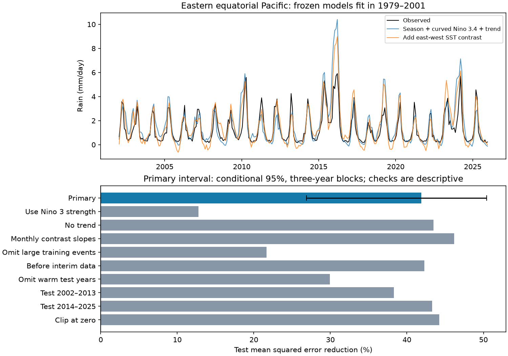

# An east-west SST contrast lowered eastern Pacific monthly rain test error beyond curved Nino 3.4 in 2002-2025

Adding one east-west sea surface temperature (SST) contrast term reduced test mean squared error by 41.9%. Root mean squared error (RMSE) fell from 1.023 to 0.780 mm/day. The conditional 95% three-year block interval for the reduction was 26.9% to 50.4%. Both models were fit in 1979-2001 and then held fixed for 2002-2025. The baseline included separate intercepts, Nino 3.4 slopes and squared Nino 3.4 slopes for each calendar month, plus a time trend.

This is evidence for added spatial information in a model of rain in the same month. It is not a forecast test or proof of a cause. The gain was smaller with a Nino 3 baseline. The added term also gave more negative rain estimates. These defects limit practical use.

## Question and prior evidence

Does the Nino 1+2 anomaly minus the Nino 4 anomaly add information about eastern equatorial Pacific rain after ENSO strength, curved response, season, and trend are included? A single basin index can miss the location of ocean warming. A test of spatial information can help choose simple models for ocean and atmosphere interactions.

Spatial ENSO diversity and nonlinear rain responses are known. [Time-Spatial Features of Mix El Nino](https://doi.org/10.3390/atmos12040476) uses the Nino 1+2 minus Nino 4 gradient. Its indexed figure description uses a seven-month smooth. We use an unsmoothed monthly contrast. [Mechanisms Determining Diversity of ENSO-Driven Equatorial Precipitation Anomalies](https://doi.org/10.1175/JCLI-D-21-0363.1) studies spatial diversity of the rain response. For these two papers, we used indexed descriptions; full publisher access failed. We do not claim to reproduce their methods. [Srinivas and coauthors (2024)](https://doi.org/10.1038/s41598-024-58803-3), read in full public text, use atmosphere and ocean model experiments to study nonlinear convection and ENSO asymmetry. This supports attention to curved responses but does not validate our spatial predictor or identify its cause.

We searched the public campaign before setting the exact test. The search results are in files/campaign_search.json. We read these published reports:

- [Winter quadratic ENSO rain test](sci:sha256:b22d9027ae8374b2b4c732001aa519584f10d30b72ca529766a328a6ce0a8553).
- [Monthly ENSO change test](sci:sha256:1126d803408cf32d0235c0828770b0b8c3be2d90517b6ab9d06f24afd117f03c).
- [Local SST hinge test](sci:sha256:0d7e045ca4cc72a2efa3434cd3e2f389b10fc5861a9271dc69543a76b993dce5).

The monthly change report gave no primary gain from a recent-change term but showed lower errors with spatial controls. The hinge report showed that local absolute SST with a fixed hinge gave lower error in this region and split. Our contribution is a new, frozen-model test of one spatial contrast beyond a season-specific curved Nino 3.4 response. We reuse the shared source snapshots, region, and a previously used time split. This is not an independent data confirmation or a discovery of ENSO diversity. No prior code or fitted values were reused. The internal plan was saved before extraction and fitting. It was not externally registered. The chosen question was informed by campaign evidence, so the later test period is not wholly unseen at the campaign level.

## Data and scope

Data were provided by NOAA PSL, Boulder, Colorado, USA, from https://psl.noaa.gov. We use GPCP V2.3 monthly mean rain and the NOAA CPC ERSSTv5 monthly Nino table with a fixed 1991-2020 anomaly reference. The GPCP product combines satellite and gauge information on a 2.5 degree grid. See [NOAA product documentation](https://www.ncei.noaa.gov/products/climate-data-records/precipitation-gpcp-monthly) and [the dataset record](https://doi.org/10.7289/V56971M6).

The rain box is 5 S to 5 N and 150 W to 90 W (210 E to 270 E). We use the 96 native grid centers inside these bounds, with cosine-latitude weights and no land mask. Centers are -3.75, -1.25, 1.25 and 3.75 degrees latitude and 211.25 to 268.75 degrees longitude at 2.5 degree steps. Monthly means are rates in mm/day, not monthly totals. Each month has equal score weight. All 564 months in 1979-2025 have complete, finite, nonnegative selected rain cells.

Nino 1+2 is a coastal box at 0-10 S, 90-80 W. Nino 4 is at 5 S-5 N, 160 E-150 W. The contrast is not a measured local spatial derivative. It compares anomalies in separated boxes. Nino 3.4 is at 5 S-5 N, 170-120 W. The Nino 3 check uses 5 S-5 N, 150-90 W, which closely matches the rain box.

The fixed GPCP snapshot marks November 2021 onward as interim. We omit its invalid fill-valued time_bnds variable during decoding. The actual time coordinate is valid and matches all CPC year/month fields. No shared data were changed or downloaded. Source metadata, paths, and verified hashes are in files/provenance.json. Only the two used raw files were hashed.

## Method

For calendar month m, let x be the concurrent Nino 3.4 anomaly in degrees C and z be the Nino 1+2 anomaly minus the Nino 4 anomaly. Let t be decimal year relative to 2000 in decades. The baseline is:

    rain = a_m + b_m*x + c_m*x*x + d*t

The expanded model adds `h*z`. There are 37 and 38 coefficients. We use ordinary least squares with no tuning. Both training matrices have full rank. Training has 276 months in 1979-2001. Testing has 288 months in 2002-2025. Coefficients are held fixed during testing. Primary estimates are not clipped at zero.

The primary score is `1 - MSE_added/MSE_base`. Positive values mean lower error. We first average paired squared errors within each test year. We resample these paired annual errors in circular blocks of three consecutive years, using 19,999 draws and seed 110712. Each draw has 24 years. We report the 2.5 and 97.5 percentiles of the reduction. One- and five-year blocks use seeds 110710 and 110714. This conditional interval measures test-loss variation for the two fixed models. It does not include uncertainty from fitting, data products, model choice, or campaign selection. It is not a confidence interval for a causal coefficient. Circular blocks assume an approximate stable dependence structure, which a 24-year record cannot establish.

Fixed checks use Nino 3 in place of Nino 3.4; omit trend; allow 12 monthly contrast slopes; remove four large-event training years; omit interim months or warm-event test years from scoring; split the test period; and clip both estimates at zero. Except for the explicit training exclusion, score exclusions leave the original fit unchanged. Checks are descriptive. We do not select the main model by their test scores or attach confirmatory meaning to each gain.

## Results

| Test | Months scored | Base RMSE | Added-term RMSE | MSE reduction |
| --- | ---: | ---: | ---: | ---: |
| Primary | 288 | 1.023 | 0.780 | 41.9% |
| Use Nino 3 strength | 288 | 0.672 | 0.628 | 12.7% |
| No trend | 288 | 1.031 | 0.775 | 43.5% |
| Monthly contrast slopes | 288 | 1.023 | 0.751 | 46.2% |
| Omit 1982-1983 and 1997-1998 from training | 288 | 0.717 | 0.635 | 21.7% |
| Before November 2021 | 238 | 0.999 | 0.759 | 42.3% |
| Omit 2015-2016 and 2023-2024 from scoring | 240 | 0.738 | 0.618 | 29.9% |
| Test 2002-2013 | 144 | 0.778 | 0.611 | 38.3% |
| Test 2014-2025 | 144 | 1.220 | 0.919 | 43.3% |
| Clip at zero | 288 | 1.022 | 0.763 | 44.2% |

RMSE units are mm/day. The primary three-year interval is 26.9% to 50.4%. One-year blocks give 26.2% to 51.5%; five-year blocks give 27.7% to 50.1%. All are conditional on the fixed primary fits. Diagnostic gains are not shown to differ statistically from each other.

The fitted common contrast slope is 0.632 mm/day per degree C. This is an adjusted association, not a physical response constant. Contrast values range from -2.07 to 4.24 C in training and -2.07 to 2.49 C in testing. Test values are inside the overall training range, but this does not ensure support in each season.

The primary baseline has 11 negative test estimates, with a minimum of -0.134 mm/day. The expanded model has 37, with a minimum of -0.629 mm/day. Lower squared error thus coexists with more physically impossible outputs. Clipping retains the error gain, but a nonnegative response model needs a separate test before practical use.

## Explanation and limits

One explanation is that the location of warming changes rain at the same Nino 3.4 strength. The much lower Nino 3 baseline error supports the importance of local index choice in this model set. The contrast also retains a smaller positive point gain with that baseline. We did not estimate a separate uncertainty interval for this diagnostic. The results do not show that the contrast is the best spatial variable or that it adds information beyond all local SST models. The prior hinge model has a different baseline and stronger local input; the current model is not claimed to beat it.

Rain and SST share circulation drivers and can affect each other. We do not use winds, moisture transport, ocean heat content, or daily observations. The contrast can also reflect omitted local temperature or circulation. We cannot separate these explanations. A higher contrast coefficient does not establish an east-to-west ocean cause of rain.

Only one region, one split, one rain product, and a small number of major ENSO events are tested. The large change in both baseline and expanded errors after removing extreme training years shows sensitivity to those events. Revised SST products, changes in rain observations, and interim values limit transfer. The models use same-month SST and retrospective products. This is not operational forecast skill. Monthly ocean rain rates do not measure land water supply, flood loss, daily extremes, earthquake effects, or recovery times. The result justifies further tests with another rain product and a nonnegative model, not a new physical mechanism.

## Evidence and reproduction

The package includes raw selected rain cells, exact used index rows, monthly means, all primary estimates, annual squared errors, coefficients, bootstrap draws, source metadata, the internal plan, code, and a figure. The audit recomputes area means by direct sums and primary fits by a pivoted QR solver instead of the main SVD solver. It also reconstructs the bootstrap draws with a separate index calculation. It passes; the largest fit difference is below 4e-11 mm/day. These checks establish numerical agreement, not physical validity or interval coverage.

In a separate copy of the unpacked bundle, run:

    python3 files/analyze.py
    python3 files/audit.py

To rebuild the evidence from shared raw sources, first run:

    python3 files/extract.py /mnt/dell-data/shared_datasets

Then run the two commands above. Exact paths and SHA-256 hashes are:

- `/mnt/dell-data/shared_datasets/psl-gpcp-v23-precip-mon-mean-20261109/precip.mon.mean.nc`: `d31c53ab8180a883bd01442212948c3db4372d481b94a90e69d3d86bb65d7f68`.
- `/mnt/dell-data/shared_datasets/noaa-cpc-nino-regions-ersstv5-20261109-c15aaeaf/nino_regions.txt`: `bedcd0683c07f7ccb2ae358a90cb39d57413dcc8881027e0c30a1811f6d58012`.

These are shared compatibility paths on the HP SSD. The selected evidence permits an offline fit without the full global raw file. See files/REPRODUCE.txt for retrieval instructions. Source endpoints can change; only matching bytes give an exact repeat.

## Research identity

Job: sci-1107-dell-earth-and-ocean-sciences-1d8c0a2d509a. Topic: earth-and-ocean-sciences. Campaign: 11_07_2026. Machine: dell. Account: codex-andrii. Model: gpt-6.1-sol, high reasoning effort, in T3 Code through Codex. Computation ran in the assigned isolated worktree. No agents were launched. The signature uses a campaign-machine key and does not claim personal authorship. No private key is included. The bundle is saved locally. No remote archive or index submission was made.
