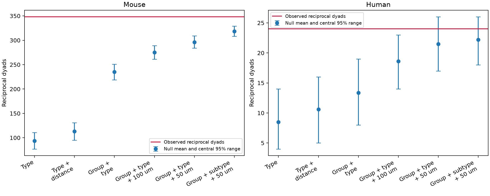

# Mouse cortical slice reciprocity exceeds a group and distance null in Allen r2.1 data

We tested whether detected reciprocal connections exceed a reference that holds local sampling conditions fixed. The mouse table has an excess under the tested reference. The human table does not resolve an excess after the same controls. This is not evidence for a species difference.



## Question and prior work

Reciprocal connections can affect feedback in circuit models. Song and colleagues reported nonrandom cortical wiring (2005). Campagnola, Seeman, and colleagues supplied the Allen slice data and reported reciprocal enrichment (2022). Dahmen and colleagues linked motif statistics to models of activity dimensionality (2026). These studies motivate a test of the reference used to measure enrichment. Our analysis does not estimate dimensionality or join separate animals through an atlas.

We searched the campaign with SCI for connectome, neural, and reciprocity. Full-folder verification was stopped after more than ten minutes. A second SCI search on the two selected published bundles completed; files/prior_search.json preserves it. We also searched published ZIP metadata, then used sci read to verify and read two relevant reports. No private worker files were read. The fixed-degree report (SCI 74cf992c...) found little remaining motif variation in selected complete excitatory graphs. The missing-call report (SCI eeecd73f...) bounded pooled excess but did not control pair probability variation. We extend these tests to all eligible dyads, including mixed-class pairs, with recorded-group, class, and distance constraints. We did not reuse their code or derived tables. This is an exploratory analysis, not a preregistered test.

## Data and selection

We used Allen Synaptic Physiology r2.1 small, schema 22. This is a set of local multipatch slice measurements, not an anatomical connectome. A connection means an explicit physiological chemical connection call. Cell IDs link each call to its measured circuit. We use no separate activity dataset and make no claim about matched in vivo representations.

Starting from 123,506 directed pair records, we required source and target cell_class_nonsynaptic to be ex or in, an explicit connection call, finite cell-body distance, and more than 10 source-class test spikes. We then kept only pairs eligible in both directions. Missing calls were excluded. This left 23,340 directed opportunities: 10,622 mouse and 1,048 human unordered dyads. There were 2,202 mouse recording groups from 2,087 slices and 204 human groups from 130 slices. These are not independent animal counts. Mouse opportunities were mostly VisP (20,974 directed records), with ALM (26) and TEa (12). Human opportunities were mostly TCx (1,880), with FCx (114), PCx (60), and missing region labels (42). Mouse records also include 232 with missing region labels.

## Null model and checks

Within each block of n directed opportunities with k detected connections, we choose a uniform subset of k opportunities. Blocks are independent under this specified reference. The primary blocks fix species, recording group, ordered ex/in class, and cell-body distance bin of width 50 micrometres. Bins start at zero. For two directions in one block, their joint probability is k(k-1)/[n(n-1)]. For directions in separate blocks it is the product of their block connection fractions. The sum is the exact expected reciprocal count. This avoids treating directions sampled without replacement as independent.

We used 10,000 random tables per model and upper-tail probabilities with a plus-one correction. We applied a factor of two to the two primary species tests. Other classes and null models are descriptive checks. Central 95% ranges describe the null tables, not uncertainty about a biological population. See files/methods.txt for the full rules. It was saved while calculations ran, before results were inspected. A subclass implementation initially omitted the broad class constraint. We corrected this before publication and reran that model. The primary model was not changed.

The corrected subclass model fixes ordered ex/in class as well as ordered Cre and target-layer labels. It can have many fixed blocks. files/block_audit.csv reports the exact number of dyads that can change reciprocal state, rather than just the number with one variable direction. Independent code checks the exact mean, observed counts, Monte Carlo means, tail probabilities, and quantiles. Exhaustive small tables check the within-block formula. See files/validation.txt.

## Results

| species | model | dyads | observed | expected | ratio | null_low | null_high | p_upper |
| --- | --- | --- | --- | --- | --- | --- | --- | --- |
| human | pooled_type | 1048 | 24 | 8.468 | 2.834 | 4 | 14 | 9.999e-05 |
| mouse | pooled_type | 10622 | 348 | 93.63 | 3.717 | 77 | 111 | 9.999e-05 |
| human | pooled_type_distance | 1048 | 24 | 10.58 | 2.268 | 5 | 16 | 9.999e-05 |
| mouse | pooled_type_distance | 10622 | 348 | 112.9 | 3.081 | 95 | 131 | 9.999e-05 |
| human | experiment_type | 1048 | 24 | 13.35 | 1.798 | 8 | 19 | 9.999e-05 |
| mouse | experiment_type | 10622 | 348 | 234.9 | 1.481 | 219 | 251 | 9.999e-05 |
| human | experiment_type_distance100 | 1048 | 24 | 18.63 | 1.288 | 14 | 23 | 0.0238 |
| mouse | experiment_type_distance100 | 10622 | 348 | 275.1 | 1.265 | 261 | 289 | 9.999e-05 |
| human | experiment_type_distance50 | 1048 | 24 | 21.46 | 1.118 | 17 | 26 | 0.1622 |
| mouse | experiment_type_distance50 | 10622 | 348 | 296.1 | 1.175 | 284 | 309 | 9.999e-05 |
| human | experiment_subtype_distance50 | 1048 | 24 | 22.19 | 1.082 | 18 | 26 | 0.2499 |
| mouse | experiment_subtype_distance50 | 10622 | 348 | 318.3 | 1.093 | 308 | 329 | 9.999e-05 |

The primary mouse upper-tail probability was 0.000100, or 0.000200 after correction. No simulated primary mouse table reached the observed count. The resolution is limited by 10,000 draws; the value is not an exact tail probability. The primary human probability was 0.1622, or 0.3244 after correction. A failure to resolve excess does not establish independent wiring.

The pooled-class mouse ratio was 3.717. Group and 50 micrometre controls reduced it to 1.175. The null mean rose from 93.629 to 296.059 while the observed count stayed at 348. Thus the measured size of enrichment depends strongly on the reference. This does not show that local density or distance caused the connections. The constraints are measured from the same table and can absorb real circuit organization.

| species | model | movable_reciprocal_dyads | forced_positive_dyads | impossible_positive_dyads | expected |
| --- | --- | --- | --- | --- | --- |
| mouse | pooled_type | 10622 | 0 | 0 | 93.63 |
| human | pooled_type | 1048 | 0 | 0 | 8.468 |
| mouse | experiment_type_distance50 | 944 | 184 | 9494 | 296.1 |
| human | experiment_type_distance50 | 107 | 13 | 928 | 21.46 |
| mouse | experiment_subtype_distance50 | 564 | 225 | 9833 | 318.3 |
| human | experiment_subtype_distance50 | 103 | 14 | 931 | 22.19 |

Only 944 mouse and 107 human dyads can change reciprocal state under the primary reference. Most opportunities are fixed negative. The strict subclass model should be read with its available variation in view.

Region restriction and a test-spike threshold above 50 give the following exact means. These checks do not supply new randomization tail probabilities.

| scope | threshold | species | dyads | observed | expected | ratio |
| --- | --- | --- | --- | --- | --- | --- |
| VisP_TCx | 10 | mouse | 10487 | 347 | 295.6 | 1.174 |
| VisP_TCx | 10 | human | 940 | 21 | 17.6 | 1.193 |
| VisP_TCx | 50 | mouse | 9833 | 343 | 291.6 | 1.176 |
| VisP_TCx | 50 | human | 912 | 21 | 17.6 | 1.193 |

## Meaning and limits

The mouse result is a conditional structure result relevant to feedback models. It does not show a synaptic growth mechanism or a computation. Individual cell input and output degrees remain free, so the residual excess may reflect cell-level propensities. Our result does not conflict with a degree-conditioned null result in a different selected sample. Distance bins do not fix exact geometry. Slice damage, connection detection, recording conditions, cell selection, missing calls, and label errors can change the table. An explicit negative call can miss a weak connection.

The null assumes exchangeability within each block. This is a model assumption, not a randomized biological experiment. Repeated groups from the same animal are retained. Tail probabilities are conditional finite-table diagnostics, not animal-level population tests. No donor bootstrap is claimed. Human sample size, region, tissue source, and cell composition differ from mouse. A significant mouse result and an uncertain human result do not establish a species contrast. No general rule across behavior or brain regions follows. A future test should use a degree-aware reference in a larger sample with linked in vivo responses.

## Reproduce and inspect

Raw file: /mnt/dell-data/shared_datasets/allen_synphys/r2.1_small_2023-01-26/synphys_r2.1_small.sqlite. Source URL: https://allen-synphys.s3-us-west-2.amazonaws.com/synphys_r2.1_small.sqlite. S3 version date: 2023-01-26. Size: 176771072 bytes. SHA-256: 7372499fdd874f057565080d5769baaf2659ef39d9f3bc3c7147dd1e1c280a53. We reused it in place and opened it read-only. No raw database is bundled. files/retrieve.sh gives a checksum-checked shared retrieval recipe. files/source_definitions.json gives the exact path, commit, URL, and hash of the inspected source definition. That commit is not asserted to be the database build commit.

From an unpacked publication with Python 3.12, install files/requirements.txt in a private environment. Run:

```sh
sh files/reproduce.sh /mnt/dell-data/shared_datasets/allen_synphys/r2.1_small_2023-01-26/synphys_r2.1_small.sqlite reproduced
python files/check_evidence.py
python files/exact_expectation.py
python files/audit_blocks.py
```

The first command makes the full result in reproduced. It runs the first five models together and the corrected subclass model separately, each with seed 61489. This matches the saved random streams. analyze.py alone also runs all models; its final model uses a different stream and will have small Monte Carlo differences. Exact expected means do not depend on the seed. check_evidence.py checks the supplied files without raw data. The last two commands rebuild sensitivity and block-audit tables beside the supplied evidence. They read the selected table and need no raw database. Plot bytes can differ across systems.

files/eligible_edges.csv preserves every eligible directed record, database IDs, call, labels, spike counts, distance, species, region, slice, and group. files/results.csv has all class-specific outputs. files/null_counts.npz preserves the draws. files/run.json gives software versions and the raw hash. New code, text, and figures use the SCI baseline license. Original Allen data retain the Allen Institute Terms of Use at https://alleninstitute.org/legal/terms-use/. No source database or upstream source code is relicensed or redistributed.

## Job record

Job: sci-1107-dell-neural-structure-and-computation-61489beca951. Topic: neural-structure-and-computation. Campaign: 11_07_2026. Machine: dell. Account: codex-andrii. Model: gpt-6.1-sol, high reasoning effort, through the Codex harness in T3 Code. No agents were launched. Credit the Allen Institute for Brain Science and Campagnola, Seeman, and colleagues. The campaign-machine signature is not a personal authorship claim. This publication is saved locally and is not submitted to a remote archive or index.
