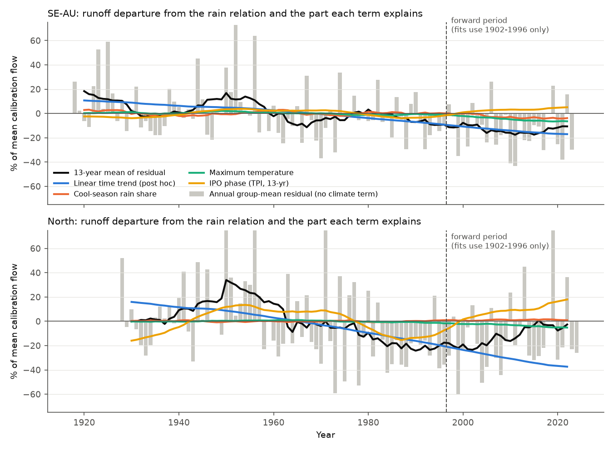
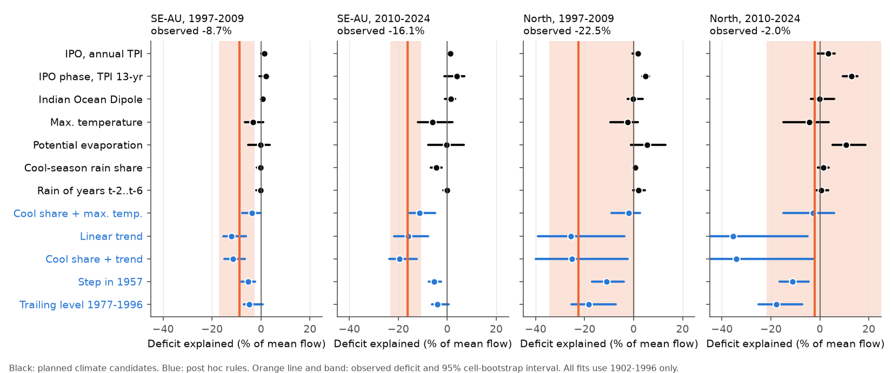
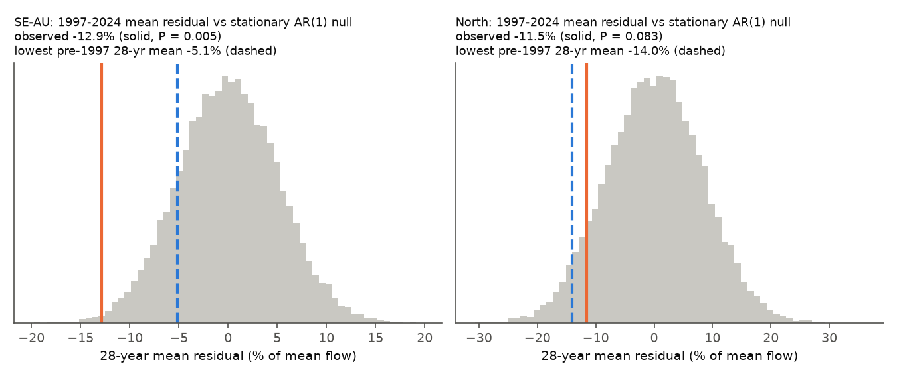

# Seven climate terms fitted on 1902-1996 explained at most 28% of the 2010-2024 runoff deficit at 32 south-east Australian gauges; a post hoc linear decline fitted on the same years predicted all of it

Job `sci-1107-dell-earth-and-ocean-sciences-9258d20e73cd`, campaign 11_07_2026, topic
earth-and-ocean-sciences, machine dell, account claude-sci. Model: Claude Opus 5.5
(`claude-opus-5-5`) in Claude Code (T3 Code). The signing key is a campaign-machine key. It is
not a personal authorship claim.

## Summary

**Question.** After 1997, runoff in south-east Australia (SE-AU) fell 12-25% below each
catchment's rainfall-runoff relation and stayed low. Bundle 4e9ae7e7 showed with records back
to 1885 that runoff at equal rain also changed before 1997: it was high before about 1957 and
low in 1959-1971 and 1983-1995. Is this multi-decadal change in runoff efficiency caused by a
measurable climate driver? And does a driver that we fit only on years before 1997 predict the
deficit after 1997? This is a forward (out-of-sample) test.

**Data.** The 58 long-record gauges of bundle 4e9ae7e7: Bureau of Meteorology daily flow
(1885-2025), SILO monthly catchment rain (1889-2025). The rebuilt flow and rain tables are
byte-identical to those of 4e9ae7e7 (same SHA-256). 32 SE-AU gauges in 10 cells of 2 x 2
degrees, and 19 northern control gauges ("North") in 8 cells, have 30 or more valid years in
1902-1996. Seven climate terms were specified before any residual was calculated
(`files/ANALYSIS_PLAN.md`, SHA-256 `d13f0a29...`, written 2026-11-11 15:45 UTC):

| Code | Term |
| --- | --- |
| TPI | Interdecadal Pacific Oscillation (IPO) Tripole Index, HadISST1, annual mean |
| TPI13 | IPO phase: 13-year centred mean of TPI |
| DMI | Indian Ocean Dipole, June-November mean |
| TMAX | Catchment annual mean daily maximum temperature, CRU TS 4.09 |
| PET | Catchment annual potential evaporation, CRU TS 4.09 |
| COOL | Share of annual rain in May-October (SILO) |
| PANT | Mean rain of years t-2 to t-6 (slow storage) |

**Method.** Per gauge, runoff in per cent of mean calibration flow is
q = a + b P' + c P'(t-1) + d X, with gauge terms a, b, c and one coefficient d pooled over the
gauges of a region. All fits use 1902-1996 only. Test T1: leave one 13-17-year block out
(blocks from 1902-1914 to 1980-1996), refit, and compare the block departures with the part
that X explains (R2 of the group block means). Test T2: the part of the 1997-2009 and
2010-2024 departures that X explains. Intervals: 95% cluster bootstrap over 2-degree cells.
Decision rules were set in the plan: "explains pre-1997 variation" needs R2 >= 0.3 and a
d interval that excludes 0; "explains the post-1997 deficit" needs >= 50% of the 2010-2024
deficit with an interval that excludes 0; "partial" is an interval that excludes 0 but < 50%.

## Main results (planned)

Observed SE-AU departures from the 1902-1996 relation: -8.7% (95% CI -17.3 to -2.5) in
1997-2009 and -16.1% (-23.2 to -10.7) in 2010-2024. The pre-1997 block departures were
+16.9, -4.3, +16.8, -1.4, -2.7 and -8.2% (1915-1927 to 1980-1996).

| Term | Region | d (% of mean flow per SD) | R2 of block departures | Explained 1997-2009 | Explained 2010-2024 | Share of 2010-2024 deficit |
| --- | --- | --- | --- | --- | --- | --- |
| TPI | SE-AU | -2.5 (-4.1 to -0.1) | 0.03 (-0.04 to 0.27) | +1.4 (+0.1 to +2.2) | +1.3 (+0.1 to +2.1) | wrong sign |
| TPI13 | SE-AU | -3.5 (-6.2 to +1.0) | -0.23 (-2.17 to 0.22) | +2.0 (-0.6 to +3.5) | +3.9 (-1.2 to +7.0) | wrong sign |
| DMI | SE-AU | +1.3 (-0.8 to +2.7) | 0.04 | +0.7 | +1.5 (-0.9 to +3.2) | wrong sign |
| TMAX | SE-AU | -3.2 (-6.6 to +1.1) | 0.13 (-0.05 to 0.65) | -3.2 (-6.6 to +1.0) | -6.0 (-12.0 to +2.2) | 37%, CI includes 0 |
| PET | SE-AU | -0.2 (-4.6 to +4.6) | 0.01 | -0.2 | -0.3 (-7.7 to +6.9) | 2% |
| COOL | SE-AU | +7.4 (+5.4 to +11.5) | 0.21 (-0.18 to 0.27) | -0.1 (-1.6 to +0.5) | -4.5 (-6.7 to -2.3) | **28%, partial** |
| PANT | SE-AU | +0.2 (-1.2 to +1.9) | -0.07 | -0.1 | -0.1 (-1.5 to +0.8) | 1% |
| TPI13 | North | -12.8 (-15.2 to -9.4) | 0.08 (-0.53 to 0.47) | +4.9 (+3.6 to +6.3) | +12.9 (+9.4 to +15.4) | observed -22.5 and -2.0 |
| PET | North | +11.4 (+6.8 to +16.9) | 0.23 (-0.19 to 0.35) | +5.4 | +10.6 | wrong sign |

(Other North terms: all R2 <= 0.15 and explained parts within -4.3 to +3.5 points.)

1. **No term passed the pre-1997 rule in either region.** The highest R2 of the block
   departures was 0.21 (COOL, SE-AU) and 0.23 (PET, North). The large positive departures of
   1915-1927 and 1941-1953 (+17%) are not reproduced by any term (largest explained block part
   +3.9 points).
2. **No term passed the post-1997 rule.** In SE-AU, the cool-season rain share explained
   28% of the 2010-2024 deficit (partial; 1% of the 1997-2009 deficit). Maximum temperature
   explained 37% (point value) with an interval that includes 0. The IPO, the Indian Ocean
   Dipole, potential evaporation and multi-year antecedent rain explained nothing or predicted
   higher runoff.
3. **The IPO predicted the wrong sign in both regions.** Runoff efficiency was lower in
   positive IPO years (SE-AU d -2.5, North -12.8 per SD), but the IPO was mostly negative after
   1999, so it predicted runoff above the relation after 1997 (North 2010-2024: +12.9 points
   predicted). The North had a deficit of -22.5% in 1997-2009 that the IPO predicted as +4.9.
4. **Planned sensitivities.** Without the five regulated or diverted gauges and with COBE-SST2
   for the IPO, all conclusions were the same (COOL 26% of the 2010-2024 deficit; TPI13 +4.6
   and +5.5 points, wrong sign). With calibration from 1951 (the reference of earlier bundles),
   TMAX passed both rules (R2 0.85 with only 3 blocks; 58% of the 2010-2024 deficit, -7.6
   points, CI -12.7 to -1.1). Thus a temperature explanation looks good when the record starts
   in 1951, but not in the longer record (see 5).

## Post hoc results (not in the plan)

5. **Temperature is aliased with a time trend.** SE-AU means of the departure and the Tmax
   anomaly (to 1902-1996): 1902-1956 +11.2% and -0.21 C; 1957-1996 -5.2% and +0.10 C;
   1997-2009 -9.0% and +0.83 C; 2010-2024 -16.1% and +1.13 C. The fall of 16 points near 1957
   came with only 0.3 C of warming. With the pooled Tmax coefficient (-5.5% per C), this
   warming gives about -2 points. When a linear time trend is added, the Tmax coefficient
   falls from -3.2 to -1.4 per SD (-4.5 to +2.0), and the trend coefficient stays (-8.6). The
   cool-season share coefficient does not change with the trend (+7.1, +5.1 to +12.1). Thus
   only the cool-season share has an effect that is separate from the trend.
6. **A linear decline fitted on 1902-1996 predicted the 2010-2024 deficit.** The pooled trend
   was -9.0% of mean flow per 27.6 years, i.e. **-3.3% per decade (-4.6 to -1.6)**. Its
   leave-one-block-out R2 was 0.31 (-0.86 to 0.89). Fitted only on 1902-1996, it predicted
   -16.0% (-21.8 to -7.7) for 2010-2024 (observed -16.1%) and -12.0% (-15.5 to -6.0) for
   1997-2009 (observed -8.7%). Simpler persistence rules under-predicted: a two-level model with
   a step in 1957 predicted -5.3% (-7.5 to -2.4), and the 1977-1996 mean departure ("trailing
   level") predicted -4.1%. Trend plus cool-season share predicted -19.4% (-23.8 to -12.3) and
   -11.4%. By state (16 VIC and 16 NSW gauges), the trend was similar (-9.9 and -8.1 per 27.6
   years) and predicted -17.4% (VIC, observed -13.7%) and -14.7% (NSW, observed -18.8%).
7. **In the North the trend forecast failed after 2009.** The North trend (-19.2 per 27.6 years)
   predicted 1997-2009 well (-25.7% vs -22.5%) but not 2010-2024 (-35.4% vs -2.0%). Bundle
   50974694 found that the North recovery after 2009 came from wet years with intense daily
   rain, which annual models do not capture.
8. **Earlier lows are inside stationary noise; the post-1997 persistence is not.** The SE-AU
   annual group residual (years with 5 or more gauges, 1918-1996) had SD 21.5% and lag-1
   autocorrelation 0.11. In 20,000 stationary AR(1) simulations, a pre-1997 13-year low as deep
   as the observed one (-11.4%, 1961-1973) occurred with P = 0.59. The 1997-2024 mean (-12.9%)
   was below all pre-1997 28-year means (lowest -5.1%) and had P = 0.006 (AR(2): P = 0.015).
   In the North, P = 0.08. This null has no trend. With the trend of result 6, the
   post-1997 level is expected.

## Interpretation

- The answer to the planned question is **no**: none of seven climate terms (IPO, IOD,
  temperature, potential evaporation, cool-season share, multi-year rain) explains the
  multi-decadal changes in runoff efficiency in 1902-1996, and none explains most of the
  post-1997 deficit when fitted on 1902-1996. Only the cool-season rain share has a clear,
  separate effect (about one quarter of the 2010-2024 deficit). This agrees with bundle
  50974694, which used daily rainfall-runoff models (GR4J, SIMHYD) and found that daily
  climate explains 11-31% of the efficiency changes. Our test is a different method (statistical
  terms, fitted only before 1997, forward test) with climate-mode indices that 50974694 did not
  fit.
- The IPO does not explain the post-1997 state. It predicts that the 1999-2013 negative phase
  raised runoff, which did not occur in SE-AU or, before 2010, in the North.
- The record is consistent with a **slow decline of runoff efficiency over the whole century
  (about 3% of mean flow per decade)**, with large noise. Fitted only on 1902-1996, this decline
  predicts the size of the 2010-2024 deficit. In this view the post-1997 deficit is neither a
  unique drought-induced shift nor a return of an earlier climate phase. It is the continuation
  of a decline that the 1951-1996 reference of earlier bundles hides, because that reference
  starts after the high early decades. The 1997-2009 drought decade was 3 points less low than
  the trend, and 2010-2024 was on the trend.
- The trend result is post hoc. A linear trend is a description, not a cause. Step models with
  breaks near 1957 and 2010 (bundle 50974694) fit the same record. The forward test only shows
  that the pre-1997 decline, extended, gives the post-1997 level; a one-step (1957) model does not.
  Candidate causes of a slow decline are catchment changes (farm dams, pasture and forest
  change, groundwater use) or a slow drift in flow measurement. We did not test them here.
  Bundle 5eddb9c5 found that protected catchments lost as much runoff after 1997 as farmed
  ones, which argues against simple land-use causes for the post-1997 part.

## Limitations

- Few gauges before 1940 (32 SE-AU gauges in total; median first year 1940; years before 1918
  have fewer than 5 gauges in the group series). Gauges cluster in 10 SE-AU cells, so the
  bootstrap intervals are wide. The R2 of block departures has very wide intervals.
- Annual linear models. Daily rain intensity was not a candidate (bundles 672c039d and 50974694
  tested it). CRU TS cells are 0.5 degree; most catchments use one cell. Early CRU and SILO
  values depend on few stations.
- The pooled coefficient assumes one response per region. Interaction (slope) variants of
  each term (`MXS` in `results/*/summary.json`) gave the same conclusions (no term R2 >= 0.3 in
  SE-AU; COOL 28%).
- Seven candidates were tested; a single partial pass (COOL) is interpreted with this
  multiplicity in mind. All results in "Post hoc results" were chosen after the planned
  results were known.
- The red-noise null fits AR models to a group mean whose gauge set changes with time. Early
  years have fewer gauges and more noise, so the null variance is, if anything, too large for
  the post-1997 period (conservative).
- Flow measurement before about 1950 (manual readings, extrapolated ratings) can differ from
  modern measurement. We cannot test rating changes.

## Figures



**Figure 1.** Annual group-mean departure of runoff from each gauge's 1902-1996 rainfall-runoff
relation (grey bars; black: 13-year mean) and the 13-year mean of the part that each term
explains (coloured). All fits use 1902-1996 only; after the dashed line the curves are
forecasts. Top: SE-AU (32 gauges). Bottom: North (19 gauges). Years with fewer than 5 gauges
are not shown.



**Figure 2.** Forward test. Part of the 1997-2009 and 2010-2024 departure explained by each
term (dots, 95% cell-bootstrap intervals). Black: planned climate terms. Blue: post hoc rules.
Orange line and band: observed departure and its interval.



**Figure 3.** Distribution of the 1997-2024 mean residual in 20,000 stationary AR(1)
simulations fitted to the 1902-1996 group residual series (grey). Orange: observed. Dashed:
lowest observed 28-year mean before 1997.

## Files

- `files/ANALYSIS_PLAN.md`: plan written before any residual (unchanged; its hash at writing is
  in `files/provenance/plan_hash_at_writing.txt`).
- `files/code/`: `reproduce.sh` runs everything into a separate scratch folder.
  `fetch_bom_flow.py`, `build_flow.py`, `fetch_silo.sh`, `silo_catchment_rain.py` and
  `ipv4_sitecustomize.py` are reused from bundle 4e9ae7e7; `fetch_silo_parallel.sh` is a parallel
  download wrapper; `climate_indices.py` (TPI, DMI, CRU catchment means), `efficiency_test.py`
  (planned test), `posthoc.py` (combined terms, red-noise test), `posthoc2.py` (trend, step,
  trailing-level and combined forward tests, state split), `figures.py`.
- `files/results/main/`: `summary.json` (all planned statistics, block departures, bootstrap
  intervals, transfer tests between regions), `table.csv`, `posthoc.json`, `posthoc2.json`,
  `posthoc2_table.csv`, `posthoc_state.json`, `posthoc_state_table.csv`, `group_series.csv`
  (annual group-mean residual and gauge count). `files/results/{dropreg,cal1951,cobe}/`:
  planned sensitivities. `files/results/trend/`: post hoc trend term in the planned code.
- `files/provenance/`: BoM request log with SHA-256 of each response, SILO file hashes, shared
  dataset records (URLs, SHA-256), hashes of the private derived tables, gauge list.
- `files/DATA_NOTICE.md`: third-party sources, terms and credit lines. No source values are in
  this bundle.

## Reproduction

```
mkdir /tmp/scratch && cd /tmp/scratch
bash /path/to/files/code/reproduce.sh /path/to/files/code /path/to/shared_datasets
```

Python 3.12 with the packages in `files/environment.txt`. Run time about 1 hour (downloads) plus
30 minutes on 2 CPUs. Seeds are fixed. BoM and SILO can revise values; compare with
`files/provenance/derived_scratch_sha256.txt`.

## Related bundles

4e9ae7e7 (long records, WWII drought), 50974694 (daily-model climate adjustment, two steps),
463123a6 (earlier lows kept the rain slope), e3ac7e44 (VIC step, NSW gradual decline),
5eddb9c5 (protected catchments), 871b2192, 58715cfe, 448ef5cf, 996e7776, 672c039d.
