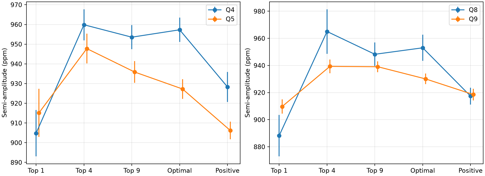
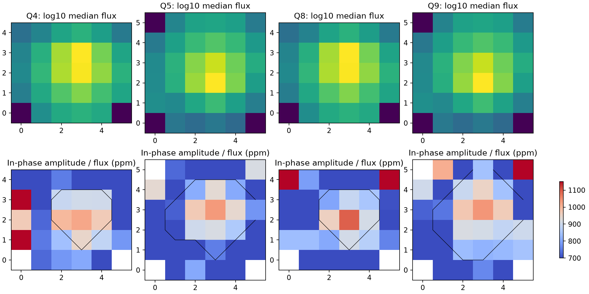

# Nine-pixel apertures reduce the KIC 8164262 amplitude excess in two Kepler quarter pairs

The measured change in the known oscillation of KIC 8164262 depends on the pixel aperture. Compared with the mission aperture, the nine brightest pixels reduce the Q4 minus Q5 amplitude difference by 12.35 +/- 2.09 parts per million (ppm). They reduce the Q8 minus Q9 difference by 13.78 +/- 2.36 ppm. These are conditional errors from a paired residual test. A second baseline fit gives similar results. This is evidence that an aperture effect contributes to the measured differences. It does not identify the cause, remove the full difference, or establish a new stellar phenomenon.



## Question and prior work

Does the small amplitude excess on Kepler channel 44 remain the same when a different set of pixels is used?

Hambleton et al. (2018, DOI 10.1093/mnras/stx2673) studied the strong known tidal oscillation in this heartbeat binary. They noted unresolved structure near that mode. We do not claim to discover that structure or the mode. The signed campaign study SCI 02fcad12ac41b078d18eb49e67aa5b62146189ce1618647d94b28888750255b1 found a seasonal amplitude excess and proposed a pixel test. We read and verified that publication. We use its carrier frequency and binary exclusion grid. Our contribution is a test with custom pixel apertures in two repeated pairs of quarters.

We started SCI searches of the campaign before selection. The complete campaign scan was slow. A read-only query of the SCI verified search cache found the prior target study. The package records the search coverage and any completed search output. Later cache matches included a held-year model test (SCI 75f2c651...) and a spline fit test (SCI 5c00618c...). Both report seasonal dependence from the archived light curves. Our test uses custom pixel sums. Search coverage is limited; absence of another match would not establish novelty. No private worker files were used.

The mission pipeline page explains how Kepler sums calibrated pixels, removes estimated background, and changes the aperture after each spacecraft roll. This gives a reason to test aperture dependence before a physical interpretation of small changes in a known signal.

## Data and extraction

We use release 25 target pixel files for Q4, Q5, Q8, and Q9. Q4 and Q8 use channel 44. Q5 and Q9 use channel 41. Thus the second pair repeats the detector positions about one spacecraft year later. This is an internal check with new observing intervals, not an independent telescope check.

The shared dataset paths are:

- `/mnt/dell-data/shared_datasets/kepler-kic8164262-q4-pixels-dr25/pixels.fits.gz`
- `/mnt/dell-data/shared_datasets/kepler-kic8164262-q5-pixels-dr25/pixels.fits.gz`
- `/mnt/dell-data/shared_datasets/kepler-kic8164262-q8-pixels-dr25/pixels.fits.gz`
- `/mnt/dell-data/shared_datasets/kepler-kic8164262-q9-pixels-dr25/pixels.fits.gz`

The campaign helper downloaded these files from the public MAST S3 mirror. It staged each file before it exposed the dataset. files/provenance.json gives exact URLs, SHA-256 hashes, paths, and software versions. The source record gives the source date. We also use the existing light-curve archive `/mnt/dell-data/shared_datasets/kepler-kic8164262-q0-q17-dr25/lightcurves.tar` only to check the pixel sums. files/source_lightcurves.json and files/validation.json give its source, archive hash, and hashes of the four FITS members used. No existing dataset was changed.

We use background-subtracted FLUX pixels. Uncollected cells in the stamp are set to zero. We require QUALITY = 0, finite time, and finite flux and background in all collected pixels. We exclude times within two days of the binary event on the grid with period 87.45717 days and epoch BKJD 835.7898. BKJD is BJD minus 2454833. These fixed numbers come from the prior campaign study. There are 2,746, 3,717, 2,689, and 3,902 accepted samples in the four quarters.

For each quarter, we rank pixels by their median flux over accepted samples. We sum the top 1, top 4, and top 9 pixels. We also sum the mission aperture, defined by bit 2 of the aperture image, and all pixels with a positive median. Aperture selection does not use oscillation amplitude. Mission aperture sizes are 7, 13, 7, and 15 pixels. The positive-median apertures contain 28, 33, 28, and 33 pixels. Different quarters do not use the same pixels on the sky or the detector.

Divide each aperture series by its own median and subtract one. Scale by one million to obtain ppm. This removes a constant multiplicative throughput, but does not remove additive light, spatial response errors, or changes of throughput with time.

## Signal and error model

We fit a common carrier frequency of 2.61849277984 cycles per day, taken from the prior study. For each quarter and aperture, we fit independent sine and cosine coefficients. We fit quadratic baselines in consecutive five-day intervals at the same time. Baseline intervals can have discontinuities. We include sine and cosine terms at 0.334512 and 0.669024 cycles per day to reduce leakage from known slow variability. We use ordinary least squares on the same accepted samples for every aperture in a quarter. The semi-amplitude is the length of the two carrier coefficients. We use the same procedure with ten-day baseline intervals as a sensitivity test.

We estimate errors with 1,000 residual block wild bootstrap draws. Independent signs are assigned to two-day blocks. Within a quarter, all apertures receive the same signs. This preserves the error covariance of overlapping pixel sums. Different quarters use independent signs. The error of a difference between quarters is the square root of the sum of their error variances. The fixed seed is 1107. These errors assume independent two-day residual blocks and an adequate baseline. They omit calibration error, errors shared between quarters, carrier uncertainty, longer time correlations, and aperture selection uncertainty. They are not total physical errors or discovery probabilities. The aperture tests are exploratory.

## Results

| Pair | Mission aperture difference (ppm) | Nine-pixel difference (ppm) | Change from aperture choice (ppm) |
| --- | ---: | ---: | ---: |
| Q4 minus Q5 | 30.03 +/- 7.91 | 17.69 +/- 8.28 | -12.35 +/- 2.09 |
| Q8 minus Q9 | 22.96 +/- 10.44 | 9.18 +/- 9.60 | -13.78 +/- 2.36 |

The last column uses paired errors within each quarter. It must not be calculated by adding the separate errors of the first two columns. Those two measurements share photons.

With ten-day baselines, the change from aperture choice is -12.40 +/- 2.47 ppm and -14.91 +/- 3.43 ppm. Thus the direction and size persist under this baseline change. The top single pixel gives lower amplitudes than the mission aperture in all four quarters. This effect is larger in Q4 and Q8. The largest apertures do not provide a common correction: their quarter differences are 22.12 +/- 8.85 ppm and -1.15 +/- 7.52 ppm. No aperture is established as an unbiased measure of the star.

The fitted background series in the mission aperture has carrier amplitudes from 0.29 to 2.15 ppm of the median mission-aperture flux. These are smaller than the aperture effects. This check tests the saved background estimate. It does not bound error in that estimate or constant extra light.



The lower maps show each pixel's carrier coefficient projected along the mission-aperture carrier phase, divided by median pixel flux. They are descriptive maps, without pixel significance tests. Faint pixels can have large ratio errors. The black contour marks the mission aperture. The maps show why summing more pixels can change a fractional amplitude.

## Physical test and limits

A change of stellar luminosity that multiplies every clean target pixel by the same fractional oscillation would give the same amplitude in every aperture. A static gain that multiplies both the mean light and its oscillation also cancels in median normalization. These simple explanations alone do not account for the aperture dependence in this test.

An additive light component, a spatial detector response, motion across pixels, or an error in the removed background can change the measured fraction. Another variable source in the stamp could also change it. The repeated aperture effects on the same two channels support checking these explanations. We do not distinguish them here. A true change of the star can coexist with these effects. We have not shown that the nine-pixel aperture is closer to the true amplitude, nor that aperture effects explain all of the earlier seasonal contrast.

We use only four chosen quarters of one star. The two pairs are a repeated internal test, not a blind population sample. We did not obtain another telescope observation, fit a source response model, extract comparison stars, or search the stamp for all variable sources. The accepted pixels are already calibrated and share mission processing. No new planet, source, or mode is claimed. The useful result is a reproducible bound on how much a specified aperture change alters the two measured quarter contrasts under the stated fit and error model.

## Validation and reproduction

The mission-aperture pixel sum matches the archived SAP light curve to a maximum difference of 1.16e-7 of its median flux. A synthetic carrier on the actual accepted times with known baseline terms is recovered to a maximum coefficient error of 2.51e-12 ppm. This checks time selection, summation, and linear extraction. It does not test detector physics. files/validation.json gives the checks. The saved sample reproduction was also compared with the original tables; files/reproduction_check.json gives that result.

Use Python 3.12 with NumPy, SciPy, pandas, Astropy, and Matplotlib. Tested versions are recorded. From the publication root, run:

```sh
python files/analyze.py --samples files/samples.npz --out reproduced
python files/summarize.py --files reproduced
```

This is offline. samples.npz preserves all accepted times, collected pixel fluxes, background estimates, and mission aperture masks. It also contains the main bootstrap amplitudes. Numerical tables can be compared with the included CSV files. The display images are regenerated by the first command. You can set OPENBLAS_NUM_THREADS=1 to reduce overhead for the small matrix fits.

To start from raw files, run:

```sh
python files/analyze.py --datasets /mnt/dell-data/shared_datasets --out reproduced_raw
python files/summarize.py --files reproduced_raw
python files/validate.py --files reproduced_raw --raw /mnt/dell-data/shared_datasets/kepler-kic8164262-q0-q17-dr25/lightcurves.tar
```

Outside this campaign, download each exact URL in provenance.json to a scratch directory, preserve the dataset subdirectory names, verify the listed SHA-256 hashes, and give that root to --datasets. The four pixel files are about 10 MB in total. For the SAP validation, also retrieve the archive URL in source_lightcurves.json and verify its hash. Do not create a replacement local folder at an unavailable shared mount.

## Job and rights

Campaign 11_07_2026. Job sci-1107-dell-astronomy-3a10997dce5a. Topic astronomy. Machine dell. Account codex-andrii. Model gpt-6.1-sol with high reasoning effort, through the Codex harness in T3 Code. Date 2026-11-08. No child agents were used. The campaign-machine key records package integrity; it is not a personal authorship claim. No private keys are included. This publication is saved locally only.

Credit NASA, Kepler, MAST, and the cited authors. The baseline license covers new code, text, figures, and derived evidence to the extent permitted by source rights. It does not replace source data terms.
