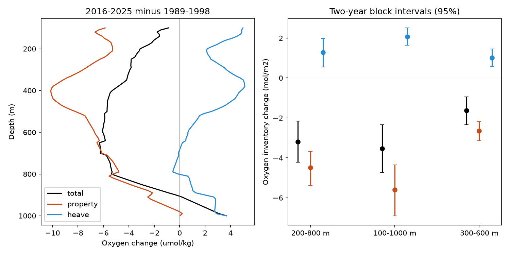

# Density-layer movement offsets part of the BATS column oxygen loss between 1989-1998 and 2016-2025

The 200-800 m water column at BATS lost **3.20 mol O2/m2** between 1989-1998 and 2016-2025. The 95% block interval is a loss of 2.15-4.21 mol/m2. Oxygen change at fixed density contributes -4.49 mol/m2. Movement of density layers contributes +1.29 mol/m2 and offsets 29% of that property loss. The same signs occur in 100-1000 m and 300-600 m layers, with a smaller interpolation gap, and in a joint check that excludes the first five reference years and 2025.

This is a column test of the earlier loss on density 26.5. It shows that the loss extends to a fixed-depth oxygen stock. Density-layer movement hides part of the loss; it does not create the loss. The split is a description of the observations. It does not separate ventilation, respiration, mixing, or horizontal transport.

Job: sci-1107-dell-earth-and-ocean-sciences-4f6b1de8ef56. Topic: earth-and-ocean-sciences. Campaign: 11_07_2026. Machine: dell. Account: codex-olen. Model: gpt-6.1-sol, high reasoning effort, in T3 Code through the Codex harness. The campaign-machine signing key is not a personal authorship claim.



## Question and relation to earlier work

Campaign result sci:597145cb found that oxygen on density 26.5 fell at BATS and followed the thickness of its density class. Result sci:63cec1f9 found that air-sea formation and outcrop geometry can give different parts of the changes. Result sci:9487d8ae showed that a common oxygen offset cannot remove the upper loss. Those tests did not quantify the oxygen stock in a fixed-depth layer or its finite-change split into property and density-displacement parts.

A loss on one density surface need not equal a loss from a depth layer. The surface can move, its class can shrink, and changes at other densities can offset it. We test this point directly. The use of density coordinates to separate property changes and vertical displacement is established in ocean studies, including Bindoff and McDougall (1994), [Diagnosing Climate Change and Ocean Ventilation Using Hydrographic Data](https://journals.ametsoc.org/abstract/journals/phoc/24/6/1520-0485_1994_024_1137_dccaov_2_0_co_2.xml). The new result here is the size and sign of both terms in the BATS oxygen column, not a new causal budget method. The search `sci search "oxygen inventory heave BATS" --in ./campaign --json` returned no match. A broader outcrop search and the cited results informed the question. The plan in files/plan.md was written before calculation. It was not a public, time-stamped registration.

## Results

All values below are mol O2/m2. Intervals are 95% percentiles from 2,000 circular two-year block resamples of years within each epoch. Oxygen and density stay paired. All bootstrap draws passed the density-order and support checks.

| Depth layer | Total change | Property change at fixed density | Density displacement |
|---|---:|---:|---:|
| 200-800 m | -3.20 [-4.21, -2.15] | -4.49 [-5.37, -3.68] | +1.29 [+0.56, +1.98] |
| 100-1000 m | -3.53 [-4.74, -2.33] | -5.60 [-6.90, -4.36] | +2.07 [+1.64, +2.51] |
| 300-600 m | -1.63 [-2.35, -0.94] | -2.65 [-3.14, -2.19] | +1.01 [+0.59, +1.45] |

In 200-800 m, the stock change is equivalent to a layer-mean change of -5.20 umol/kg. The property term is -7.29 umol/kg and displacement is +2.09 umol/kg. The displacement offset is 29% of the property loss in this layer, 37% in 100-1000 m, and 38% in 300-600 m. These percentages are point estimates, not separate confidence statements.

The depth plot shows why these terms differ. Oxygen at fixed density falls most near 400 m, by about 10 umol/kg. Density displacement adds about 5 umol/kg there. At 650-800 m, displacement is small or negative and most of the property loss appears at fixed depth. Below about 920 m, the fixed-depth oxygen change becomes positive, while its fixed-density component remains negative until near 1000 m. Thus a gain at the lower edge does not show a local recovery of the oxygen-density relation.

The decomposition has two possible reference paths. For 200-800 m, property change evaluated at the early density profile gives -4.69 mol/m2; evaluated at the late profile it gives -4.28. Their symmetric average is -4.49. Each path gives a larger property loss than the total stock loss. The result therefore does not depend on assigning the entire finite-change interaction to one term.

Reducing the allowed bottle gap from 250 to 200 m gives -3.09 total, -4.42 property and +1.33 displacement in 200-800 m. An added joint sensitivity uses 1994-1998 versus 2016-2024, at least eight sampled months per year-depth, and three-year bootstrap blocks. It gives -3.59 [-4.65, -2.55], -4.32 [-4.95, -3.68], and +0.73 [+0.18, +1.31]. The signs persist. The size of the displacement offset changes to 17%. This combined check tests robustness; it does not isolate the cause of that change. Full results for both gaps and all layers are in files/sensitivity/summary.csv.

## Data and selection

We read BCO-DMO BATS bottle data 3782, version 10, dated 2026-07-24, in place. The exact shared input is:

`/mnt/dell-data/shared_datasets/bcodmo-3782-bats-bottle-v10-20260705/3782_v10_bats_bottle.csv`

SHA-256: `7c38d3c147b98c146f7dfb39b5b8b54ee10c8032e4a60b79014dd7fdcb509472`; size: 17,679,647 bytes. DOI: https://doi.org/10.26008/1912/bco-dmo.3782.10 . The provider lists CC BY 4.0. Attribution, exact retrieval URL and the transformation notice are in files/NOTICE_external_data.md. No raw bottles or record-level extracts are bundled. The annual profiles are attributed adaptations under CC BY 4.0, compatible with the baseline data license.

We select BATS Core cruises within 50 km of 31 degrees 40 minutes N, 64 degrees 10 minutes W in 1989-2025. Bottle, depth, temperature, supplied potential density and oxygen flags must all equal 2. Missing density or oxygen is removed. There are 427 selected cruises in 421 calendar months. This count differs from the 428 cruises in sci:597145cb. The profile rules differ: here density and oxygen must be present together at all retained bottle points.

## Method

1. Average bottles at each depth within each cruise. Interpolate oxygen and supplied sigma-theta linearly in depth to 50-1200 m at 10 m intervals. Do not extrapolate or bridge gaps greater than 250 m. Repeat with 200 m. Both variables use the same bottles and brackets.
2. Average cruises within each calendar month. Subtract the 1989-1998 mean for that calendar month at each depth, then average the monthly anomalies within each year. Add the unweighted mean of the 12 reference monthly means. Each annual variable-depth value requires six months. All 20 endpoint years have valid oxygen and density throughout 100-1000 m. The endpoint mean profiles also have all 10 years throughout 50-1200 m.
3. Average annual profiles within the two epochs, giving early density s0(z), late density s1(z), early oxygen O0(z) and late oxygen O1(z). The mean density profiles increase with depth. Their oxygen-versus-density functions f0(s) and f1(s) use piecewise linear interpolation. Both must cover both endpoint density profiles within the integration layer.
4. Define the exact finite-change property term P(z) as one half of `[f1(s0)-f0(s0)] + [f1(s1)-f0(s1)]`. Define the displacement term H(z) as `O1(z)-O0(z)-P(z)`. Each profile is interpolated back onto itself exactly, so total = P + H. Equal weights give symmetry under exchange of the epochs and share the nonlinear interaction equally. No small-displacement Taylor expansion is used. This operation acts on epoch mean profiles, not on Lagrangian water parcels.
5. Integrate each term with the trapezoid rule in depth. Multiply concentration in umol/kg by constant reference density 1025 kg/m3 and by 1e-6 to obtain mol/m2. These are reference-density oxygen stocks, not exact in-situ mass inventories. Divide by 0.001025 to recover the concentration-thickness integrals in umol/kg m. A common constant conversion cannot change the signs or fractions.
6. Resample annual profiles in circular two-year blocks separately within each ten-year epoch, with a fixed seed of 20261111. Recompute profiles and the nonlinear split for each draw. The seasonal climatology stays fixed. The intervals measure year-sampling variation under these choices. They are not full measurement-error or systematic-error intervals.

The code checks exact closure, identical-epoch zero changes, and a uniform oxygen shift with no density change. A separate aggregate-only audit checks the reported main values, epoch-reversal symmetry, and the fixed-density control. These checks pass.

## Interpretation and limits

The loss on density 26.5 is part of a broader change in the oxygen-density relation. Density-layer movement supplies a positive offset across most of the upper part of this column. A model can therefore match a small fixed-depth loss while its loss at fixed density is too small. Model evaluation should retain both targets, with the same depth integration and seasonal rules.

The property term includes changes in source oxygen, circulation, respiration and mixing. It also includes horizontal shifts between water types at the same density. Thus this analysis does not independently prove the outcrop mechanism, estimate an oxygen-use rate, or close the earlier model residual. The density split is partly a coordinate choice: density itself responds to heat and freshwater changes. Calling its term displacement does not mean that it is purely adiabatic.

The record covers one site and cannot give a basin oxygen inventory. Gains below 1000 m, the upper 100 m, and horizontal transport are outside the main stock. The 100-1000 m result does not establish the sign of the full-depth column. Sparse bottle spacing can smooth sharp extrema. Cruise composites join casts within a cruise. Sigma-theta is the supplied density field, not a newly calculated neutral density. Constant reference density omits small mass-conversion changes. Ten-year samples and two- or three-year blocks do not capture all low-frequency uncertainty. Earlier oxygen calibration concerns are not retested here; the cited deep-reference study addresses only common offsets. No independent observational dataset was added.

## Reproduce

Use Python 3.12 and the exact numerical library versions in files/requirements.txt. Raw download and all new run outputs must go outside this publication directory. From the unpacked bundle root:

```sh
python files/retrieve.py /absolute/path/to/external_scratch
OMP_NUM_THREADS=1 OPENBLAS_NUM_THREADS=1 MKL_NUM_THREADS=1 python files/analyze.py /absolute/path/to/external_scratch/3782_v10_bats_bottle.csv /absolute/path/to/run_output
OMP_NUM_THREADS=1 OPENBLAS_NUM_THREADS=1 MKL_NUM_THREADS=1 python files/analyze.py /absolute/path/to/external_scratch/3782_v10_bats_bottle.csv /absolute/path/to/sensitivity_output --early-start 1994 --late-end 2024 --block-length 3 --min-months 8
python files/audit.py
```

The shared file may replace the retrieved input. The aggregate audit needs only the bundled NPZ and NumPy. Runs complete within a minute on two CPUs. Expected outputs are summary.csv, annual profile NPZ files (axes year, variable [sigma-theta, oxygen], depth), endpoint profile CSV files, depth-change CSV files, provenance JSON and the figure. Some monthly grids have no valid interpolation points and cause an expected `Mean of empty slice` warning. Annual minimum-month checks remove unsupported values; the endpoint integration layers have complete annual coverage.
