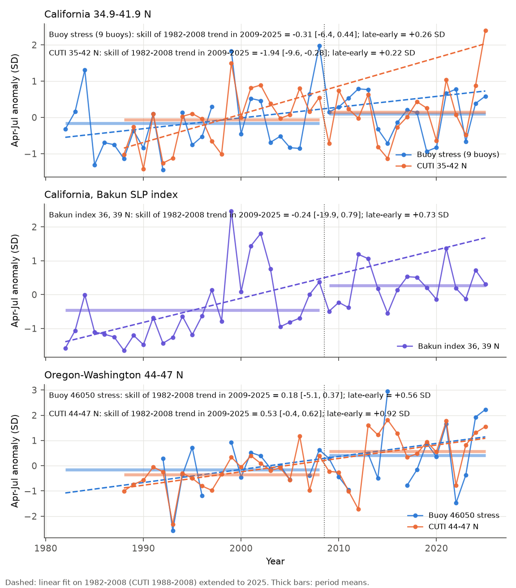
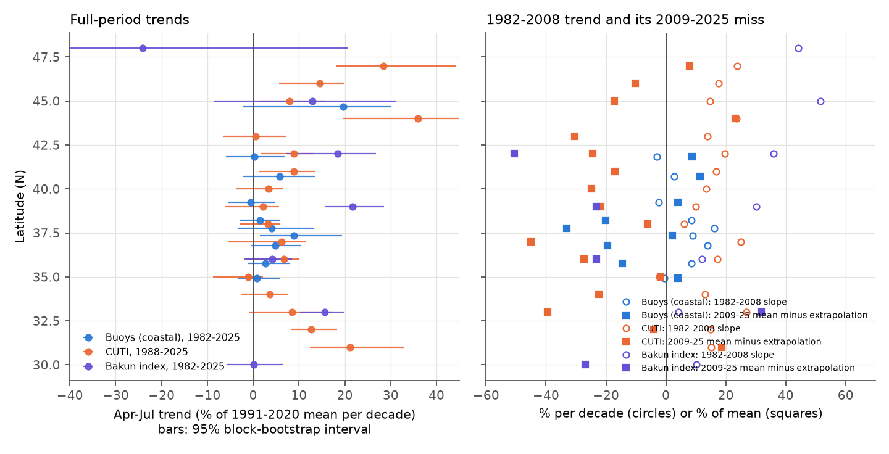
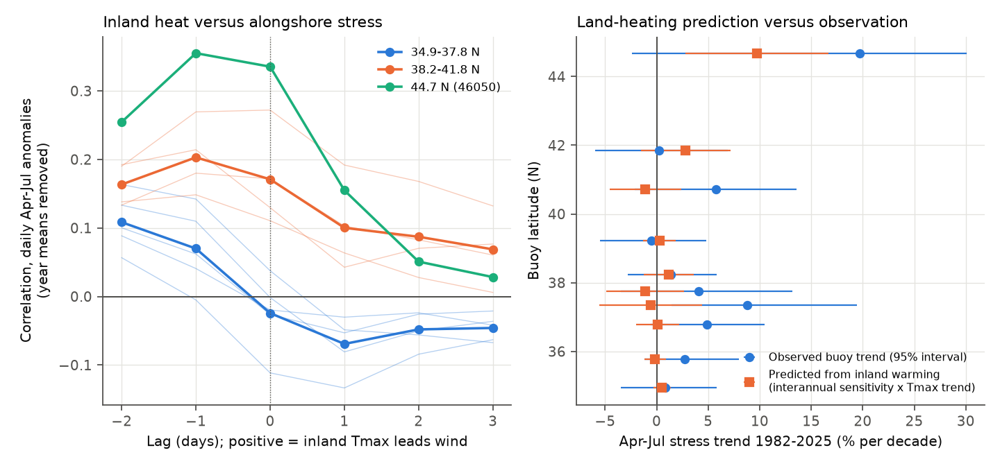

# California upwelling winds did not continue their 1982-2008 rise in 2009-2025; Oregon-Washington upwelling rose; inland heat did not predict the change

Job: sci-1107-dell-earth-and-ocean-sciences-1a947625567a. Topic: earth-and-ocean-sciences. Campaign: 11_07_2026. Machine: dell. Account: claude-andrii. Model: Claude Opus 5.5 (claude-opus-5-5). Analysis date: 2026-11-08. The signing key is a campaign-machine key. It is not a personal authorship claim.

## 1. Question

The Bakun (1990) hypothesis states that greenhouse warming heats the land more than the ocean. A larger land-sea pressure contrast then makes the equatorward alongshore wind stronger, and coastal upwelling increases. Garcia-Reyes and Largier (2010) reported stronger upwelling-favourable winds at central California buoys in 1982-2008. Climate-model studies (Rykaczewski et al. 2015) project more upwelling in the poleward part of the eastern boundary systems and less in the equatorward part.

We asked three questions for the California Current System (31-48 N), April-July (the peak upwelling season):

1. Did the 1982-2008 increase continue in 2009-2025 (an out-of-sample test of the earlier trend)?
2. Do the trends change with latitude, as the projections say?
3. Does inland heating explain the size of the change (the Bakun mechanism)?

We wrote the analysis plan (`files/analysis_plan.md`) before we computed any trend or regression.

## 2. Data

| Source | What | Period | Use |
| --- | --- | --- | --- |
| NDBC stdmet history, 888 station-year files, 23 buoys | hourly / 10-min wind, SST | 1975-2025 | measured alongshore wind stress at 12 coastal buoys 34.9-47.4 N; 4 Southern California Bight buoys; 4 offshore buoys |
| PFEL Bakun upwelling index (ERDDAP erdUI*6hr) | 6-hourly index from FNMOC sea-level pressure, 125 W and coast | 1967-2026 | independent forcing estimate, 30-48 N |
| CUTI and BEUTI daily (Jacox et al. 2018) | ocean-reanalysis transport index (to 2010, near-real-time after) | 1988-2026 | independent forcing estimate, 31-47 N |
| CPC global daily Tmax 0.5 deg | land maximum temperature | 1979-2025 | inland heating, 1-3 deg east of the coast |

Alongshore direction: the principal axis of daily wind at each buoy, positive toward the equator (table `files/data/derived/ndbc_axes.csv`; the axis explains 55-94% of the daily wind variance). Stress: Large and Pond (1981) drag coefficient, air density 1.22 kg m-3, for each record, then the daily mean (a day needs 12 or more records). A season mean needs 70% of its days. A trend needs data in 60% of the years. With this rule, buoys 46041 and 46029 (Washington) and the short-record buoys did not give a 1982-2025 trend.

Shared campaign data: CPC Tmax 1979-2024 came from `datasets/noaa-psl-cpc-global-tmax-daily-YYYY-20261108/tmax.YYYY.nc`. Their source URLs and SHA-256 values are in `files/provenance/cpc_tmax_shared_datasets.csv`. We downloaded all other inputs on 2026-11-08 (`files/code/00_fetch.sh`); their SHA-256 values are in `files/provenance/`.

## 3. Methods

* Trend: OLS slope of the April-July (AMJJ) mean against year, as a percentage of the 1991-2020 AMJJ mean per decade. 95% interval: moving-block bootstrap of years (block 3, 2,000 resamples). Theil-Sen slopes are in `files/results/trends.csv`.
* Continuation test (H2): fit a line on 1982-2008 (CUTI: 1988-2008) and predict 2009-2025. Skill = 1 - MSE(trend extrapolation) / MSE(1982-2008 mean). Negative skill means that the old trend predicts the new years worse than "no change". For regional series we standardised each member (z against 1991-2020), took the mean, and bootstrapped the training years (block 3) to give an interval for skill.
* Latitude pattern (H3): regression of the trend on latitude.
* Mechanism (H4): (a) daily AMJJ anomalies (smoothed day-of-year climate removed, year means removed) of buoy stress against inland Tmax at lags -2 to +3 days, HAC standard errors; (b) interannual regression of detrended AMJJ stress on detrended AMJJ inland Tmax; (c) predicted trend = interannual sensitivity x observed Tmax trend.
* Consistency checks: buoy against CUTI and Bakun index (correlation and drift of the standardised difference); a step test in the CUTI-minus-buoy difference at the 2011 CUTI product change; May-September and annual seasons.

## 4. Results

### 4.1 California 34.9-41.9 N: the 1982-2008 increase did not continue



Regional AMJJ series (z units, `files/results/pooled_h2.csv`):

| Series | 1982-2008 slope (SD/decade) | 2009-2025 slope | 2009-2025 mean minus 1982-2008 mean (SD), p | 2009-2025 mean minus extrapolation (SD) | Skill of extrapolation [95% interval] |
| --- | --- | --- | --- | --- | --- |
| 9 California buoys, stress | +0.30 [-0.26, +0.84] | -0.13 | +0.26, p 0.26 | -0.39 | -0.31 [-6.4, +0.44] |
| 9 California buoys, wind velocity | +0.25 [-0.30, +0.84] | +0.25 | +0.28, p 0.24 | -0.27 | +0.05 [-4.9, +0.46] |
| CUTI 35-42 N (from 1988) | +0.78 [+0.38, +1.47] | +0.68 | +0.22, p 0.41 | -1.26 | -1.94 [-9.6, -0.28] |
| Bakun index 36 and 39 N | +0.71 | +0.29 | +0.73, p 0.005 | -0.84 | -0.24 [-19.9, +0.79] |
| Inland Tmax (CA buoy latitudes) | +0.16 | +0.60 | +0.70, p 0.011 | +0.36 | +0.34 [-2.6, +0.49] |

At the four central California buoys in the Garcia-Reyes and Largier region (46028, 46042, 46026, 46013; 35.8-38.2 N), the 1982-2008 slopes were +8 to +16% per decade. These are similar to the earlier report. But the 2009-2025 slopes were -1 to -14% per decade, the 2009-2025 means were 14-33% below the extrapolated trend, and the extrapolation skill was -1.8 to -7.0. In CUTI 35-42 N, the extrapolation was worse than "no change" with a 95% interval that excludes zero. The 2009-2025 forcing was on average a little higher than in 1982-2008 (+0.22 to +0.28 SD), but this difference is not clear.

Per buoy (AMJJ alongshore stress; trends in % of the 1991-2020 mean per decade):

| Buoy | Name | Lat N | Years | 1991-2020 mean (N m-2) | 1982-2025 trend [95%] | 1982-2008 slope | 2009-2025 slope | Late minus early mean (%) | Late minus extrapolation (%) | Skill | Interannual sensitivity to inland Tmax (% per K) |
| --- | --- | --- | --- | --- | --- | --- | --- | --- | --- | --- | --- |
| 46027 | St Georges CA | 41.8 | 34 | 0.056 | +0.2 [-6.0, +6.9] | -3.1 | +0.5 | +2.5 | +8.7 | -0.21 | +4.4 (p 0.21) |
| 46022 | Eel River CA | 40.7 | 34 | 0.039 | +5.7 [-2.1, +13.6] | +2.8 | -6.5 | +17.6 | +11.3 | +0.22 | -2.5 (p 0.55) |
| 46014 | Point Arena CA | 39.2 | 36 | 0.070 | -0.5 [-5.5, +4.8] | -2.3 | +5.8 | -1.1 | +3.9 | -0.11 | +1.1 (p 0.74) |
| 46013 | Bodega Bay CA | 38.2 | 37 | 0.105 | +1.4 [-2.8, +5.9] | +8.5 | -1.9 | -1.7 | -20.0 | -3.22 | +2.6 (p 0.36) |
| 46026 | San Francisco CA | 37.8 | 37 | 0.057 | +4.1 [-3.4, +13.2] | +16.2 | -13.6 | +1.1 | -33.2 | -7.02 | -2.4 (p 0.56) |
| 46012 | Half Moon Bay CA | 37.4 | 29 | 0.052 | +8.8 [+1.4, +19.4] | +9.0 | -9.8 | +20.7 | +2.2 | +0.57 | -1.2 (p 0.82) |
| 46042 | Monterey CA | 36.8 | 32 | 0.062 | +4.9 [-0.6, +10.5] | +13.8 | -1.3 | +5.2 | -19.5 | -1.82 | +0.3 (p 0.92) |
| 46028 | Cape San Martin CA | 35.8 | 34 | 0.107 | +2.7 [-1.2, +8.0] | +8.5 | -3.9 | +3.7 | -14.5 | -1.76 | -0.7 (p 0.77) |
| 46011 | Santa Maria CA | 34.9 | 35 | 0.066 | +0.8 [-3.5, +5.8] | -0.5 | +1.5 | +2.8 | +3.9 | -0.04 | +2.8 (p 0.24) |
| 46025 | Santa Monica Basin CA | 33.8 | 42 | 0.017 | -3.8 [-8.7, +2.7] | -5.9 | -26.5 | -3.0 | +10.1 | -0.07 | - |

Over the full 1982-2025 period, only 1 of 10 coastal California/Oregon buoys (46012) had a 95% interval above zero.

### 4.2 Oregon-Washington 44-47 N: upwelling increased, and the increase continued

CUTI 44-47 N rose by +0.53 SD per decade in 1988-2025 (p < 0.001). The 2009-2025 mean was +0.92 SD above the 1988-2008 mean (p 0.005), and the 1988-2008 trend predicted 2009-2025 better than the mean (skill +0.53). Single-latitude CUTI trends at 44-47 N were +8 to +36% per decade, all with intervals above zero. Buoy 46050 (44.7 N) agreed in direction (+19.7% per decade, interval -2.4 to +30.1; late minus early +0.56 SD, p 0.19), but its record has gaps. Across latitudes, the trend increased toward the pole, but the latitude slope was not clear (buoys +1.2% per decade per degree, p 0.08; CUTI +0.6, p 0.23). This poleward contrast agrees in sign with the Rykaczewski et al. (2015) projection. CUTI at 31-32 N (Baja California border) also increased (+13 to +21% per decade), which does not agree with the projected decrease at low latitude.



### 4.3 The Bakun sea-level-pressure index drifts relative to buoys

The Bakun index at 39 N rose by +21.6% per decade in 1982-2025 [+15.7, +28.6], and at 42 N by +18.4%. At nearby buoys (46013, 46014, 46026, 46027) the trends were -0.5 to +4.1%. The standardised index-minus-buoy difference increased by 0.36-0.57 SD per decade at 4 of 5 buoys at 37.8-41.8 N (p 0.023 to < 0.001; 46022 +0.20, p 0.16). CUTI-minus-buoy differences had no clear drift at 9 of 10 comparisons (`files/results/cross_source.csv`). The 2011 CUTI product change did not give a clear step (pooled CUTI-minus-buoy step +0.10 SD, p 0.61; one buoy, 46012, showed -1.07 SD, p 0.007). Thus a part of the Bakun-index "intensification" off central California is probably not in the measured wind. The index uses model sea-level pressure at an offshore point (125 W at 36-42 N), so it can also show offshore changes that the coastal buoys do not see.

### 4.4 Inland heating does not explain the change



* Inland AMJJ Tmax at the California buoy latitudes warmed by 0.2-0.6 K per decade (1982-2025), and the 2009-2025 mean was +0.70 SD above 1982-2008 (p 0.011).
* Interannual sensitivity of California buoy stress to inland Tmax was near zero: -2.5 to +4.4% per K, none with p < 0.2 (9 buoys). The predicted trends from inland warming were -1.1 to +2.8% per decade. Only Oregon buoy 46050 had a clear sensitivity (+20.7% per K, r 0.47, p 0.011; predicted +9.7% per decade against an observed +19.7%).
* Daily lags: at 34.9-37.8 N, the correlation was positive when the wind led inland Tmax by 1-2 days (r 0.07-0.11) and negative when Tmax led (r -0.07 at +1 day). Thus inland heat did not precede stronger upwelling winds; a common weather pattern or the wind effect on the coast is a more probable cause of the correlation. At 38-45 N the correlations were positive at lags -1 to +1 days (largest at -1 or 0 days), which also agrees with common synoptic forcing.

### 4.5 Secondary results

* Buoy SST (AMJJ) had no clear trend at most coastal buoys (1982-2025: -0.14 to +0.22 K per decade; one buoy, 46042, above zero). The pooled California buoy SST was +0.19 SD warmer in 2009-2025 (p 0.43) and did not follow the 1982-2008 cooling slope (skill -1.61).
* Spring transition date (minimum of cumulative CUTI): no clear trend at 35-47 N; at 34 N it came later by 11 days per decade (p < 0.01). See `files/results/spring_transition_trends.csv`.
* May-September and annual means gave the same California result: extrapolation skill was negative for buoys (-2.07 and -0.07) and CUTI (-3.58 and -1.57), with no clear mean change. The Oregon CUTI increase was weaker in May-September (+0.59 SD, p 0.053) and absent in annual means.

## 5. Interpretation

Off California, the upwelling-favourable wind increase reported for 1982-2008 was not a steady trend. In the 17 later seasons the forcing returned to near its long-term level, while inland land warming continued. This does not agree with a simple Bakun mechanism in which land warming sets the alongshore wind trend. A plausible explanation is decadal variability of the North Pacific High (for example the 2014-2016 warm anomaly years with weak upwelling), but we did not test this. Off Oregon and Washington, CUTI shows a continued increase that agrees in direction with a poleward shift of upwelling.

## 6. Limitations

* Buoy hulls and anemometer heights changed over time (3-m, 6-m and 10-m hulls, about 3.8-5 m height). We did not correct for this. A height change of 4 to 5 m changes stress by about 5%. The CUTI-minus-buoy drift tests found no large common step, but small steps can remain.
* Buoy gaps: 46041 and 46029 (Washington) did not pass the 60%-of-years rule; 46050 has only 14 training seasons.
* The test period is 17 seasons. The skill intervals for single series and for the buoy pool are wide; only the CUTI 35-42 N interval excludes zero.
* CUTI depends on an ocean reanalysis to 2010 and a near-real-time product after 2010. The Bakun index depends on FNMOC model pressure fields that changed over time.
* The land box (1-3 deg inland) is a simple proxy for the land-sea pressure contrast. We did not use sea-level pressure or ERA5 winds.
* We did not use a climate-mode regression (PDO, NPGO, ENSO); the result can include their effects.
* Multiple series were tested; we report all of them and use the pooled series for the main statements.

## 7. Reproduce

```
# from an empty work directory WORK with ./datasets linked to the campaign shared datasets
sh files/code/00_fetch.sh                     # raw downloads (or use files/data/raw/*)
python -I files/code/01_ndbc_daily.py raw/ndbc derived
python -I files/code/02_cpc_extract.py datasets raw/cpc derived/cpc_tmax_westcoast.nc
mkdir -p scripts && cp files/code/stations.csv scripts/
python -I files/code/03_seasonal.py .         # needs raw/pfel, raw/jacox, derived/*
python -I files/code/04_trends.py .
python -I files/code/05_mechanism.py .
python -I files/code/06_pooled.py .
python -I files/code/07_figures.py .
```

Python 3.12 with numpy, pandas, scipy, statsmodels, xarray, netCDF4, matplotlib. The bundle includes the daily buoy series (`files/data/derived/ndbc_daily.csv.gz`), the inland Tmax series, all seasonal means, and the exact CUTI, BEUTI and Bakun index bytes (`files/data/raw/`), so steps 03-07 can run without new downloads (extract `pfel_bakun_6hr.tar.gz` into `raw/`, gunzip the CUTI/BEUTI files into `raw/jacox/`, gunzip `seasonal_long.csv.gz` into `derived/`). Bootstrap seeds are fixed. Logs of the runs are in `files/results/results_0*.log`.

## 8. Files

* `files/analysis_plan.md`: plan written before the results.
* `files/code/`: all scripts and the buoy table.
* `files/results/`: `trends.csv`, `continuation.csv`, `latitude_fits.csv`, `pooled_h2.csv`, `regional_series.csv`, `mechanism_daily.csv`, `mechanism_interannual.csv`, `cross_source.csv`, `spring_transition*.csv`, `extra_checks.txt`.
* `files/figures/`: three figures.
* `files/provenance/`: SHA-256 of all 888 NDBC files, other raw files, and the shared CPC files.
