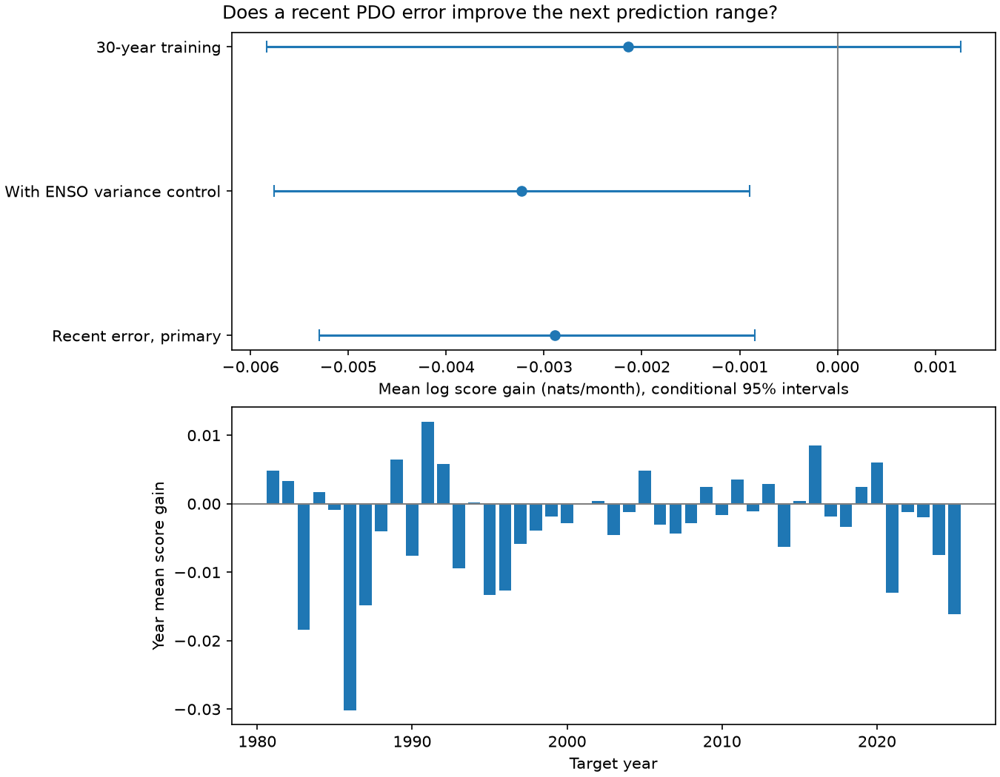

# A recent error term lowered PDO probability forecast scores in a 1981-2025 model test

Adding recent error size to a model of monthly Pacific Decadal Oscillation (PDO) variance made its probability forecasts slightly worse. The mean log score gain was -0.002891 nats per month. Its conditional 95% three-year block interval was -0.005295 to -0.000843. Positive gain means better forecasts. The result applies to one formula and one revised data source. It does not show that all methods based on recent errors fail.



Figure 1. Top: mean log score gains for three planned model cases in 1981-2025. Bars are separate conditional 95% intervals from paired three-year blocks. Bottom: annual mean score gains for the primary case. The reference model allows variance to change with the season. Both models use the same predicted mean.

## Question and prior work

Does a large prediction error in one month provide useful information about the size of the next error? If error size persists, ranges based only on the season can miss periods of high uncertainty. We test whether one measure of recent error improves a proper probability score. This is a test of a useful method, not a test of a physical cause.

[Newman et al. (2016)](https://doi.org/10.1175/JCLI-D-15-0508.1) describe PDO as the result of several processes, including tropical forcing and North Pacific ocean and atmosphere interactions. We used their abstract, which does not establish the specific variance formula tested here. A surface index alone cannot identify these processes.

We searched campaign results for earthquake ocean tide, ENSO drought recovery, warm water volume, PDO, PDO recovery asymmetry and PDO variance. Many tests already used these data. We read the published [ENSO variance test](sci:sha256:5cd067f63f8006231a7cf45bfe05d7d43dfff6d8676144decd60db5fa1ed4098), [seasonal ENSO slope test](sci:sha256:31dfe4e21a09c99614daa4e6ea9e108aa1419bba8709eee1da510e94cf755559), and [PDO sign slope test](sci:sha256:bedc4e04f9b7093ed7ee596c230571ac2922f79ca438971360cd01f9b7446bdc). The ENSO variance test found no clear gain from ENSO strength. It did not include recent error size. We extend its mean model, calendar and scoring method with a new variance predictor. We wrote new code and began training one year later to form valid previous errors. The same source observations are used. This is an incremental test, not independent confirmation or a claim of first use of conditional variance models. The PDO sign test was available in search before the plan; its full text was read after our computations. No private worker workspace was read.

The local plan in files/plan.txt was saved before the new computations. It is not an external registration. Prior campaign results informed the question. All planned checks are reported.

## Data and rights

We reused the two shared NOAA source tables in place. There are 912 complete monthly pairs from January 1950 to December 2025. No missing value is filled. We do not use incomplete 2026 data.

| Source snapshot | Shared relative path | SHA-256 |
| --- | --- | --- |
| NOAA NCEI ERSSTv5 PDO | datasets/ncei-ersstv5-pdo-index-20261108/ersst.v5.pdo.dat | a09ddc3f8b623bc0a262e8ade0c44cb1edf91634877f547c7074c248de620211 |
| NOAA CPC ERSSTv5 Nino 3.4 anomaly | datasets/noaa-cpc-nino-regions-ersstv5-20261109-c15aaeaf/nino_regions.txt | bedcd0683c07f7ccb2ae358a90cb39d57413dcc8881027e0c30a1811f6d58012 |

Nino 3.4 uses the 1991-2020 reference period. PDO is an index, not a temperature. files/provenance.json gives exact absolute shared paths, source URLs, stored download times, versions, byte counts and checked hashes. We did not add or change a shared dataset. Both indices use revised ERSSTv5 observations. Index construction and reference periods can use later information, so this is a retrospective model test, not an operational forecast.

External raw tables and monthly record-level predictions are outside this package. The exact two tables are also preserved in the cited SCI seasonal ENSO slope publication. Its signed ZIP was verified locally. The retrieval script can recover them there when upstream files change. The signed package contains our code, text, figure, fitted coefficients, annual aggregate scores and numerical checks. These original statistical outputs are eligible for the SCI baseline. They do not copy the source database. files/NOTICE.txt retains NOAA attribution and explains external-data status. NOAA [use guidance](https://www.noaa.gov/office-education/outreach-communication/faq) describes its data products as generally public domain, with noted exceptions. We claim no ownership of NOAA material or NOAA endorsement.

## Method

At the start of each target year in 1981-2025, we fit on target months from January 1952 through December of the previous year. The first fit has 348 targets; the last has 876. All 540 test months have two probability forecasts. Coefficients remain fixed within each year. Actual preceding observations become predictors each month. These are one-month forecasts, not twelve-month forecasts made in January.

The common mean is ordinary least squares with 12 calendar-month intercepts, previous-month PDO, previous-month Nino 3.4 and PDO from 12 months before. There is no extra intercept. For each yearly mean fit, compute errors e over the training period and its adjacent months. Let s be mean training e squared. The new predictor for target month t is:

`h[t] = log(1 + e[t-1]^2 / s)`.

The previous error uses the same training-only mean coefficients as the target prediction. At a test month, it uses the observed previous target and its predictors. It does not use the present target. Training errors are fitted errors, not forecasts from earlier fits; this can limit transfer to new months. The log transform reduces the effect of a single large error. No transform or lag was chosen from test scores.

The reference log variance is an intercept plus one annual sine and one annual cosine. The added model has the same terms plus g times h. The coefficient g can have either sign. Thus the method tests information from error size, without imposing that a large error must widen the range. We minimize the Gaussian variance loss on fitted training errors squared, multiplied by n/(n-15). This degrees-of-freedom correction does not remove all leverage or serial-dependence effects. Mean and variance fits are separate. No parameter uncertainty is added to the ranges.

For variance v and predicted mean mu, the negative log score is `0.5 log(2 pi v) + (PDO-mu)^2/(2 v)`. Gain is reference negative log score minus added negative log score, averaged equally over months. It measures the full predicted density and penalizes ranges that are too narrow or too wide. It is in nats per month, not a percentage. We also report central 90% Gaussian coverage, average width and the 90% interval score. Interval score is width plus 20 times the distance outside the interval. Lower interval score is better.

We first average paired monthly score gains within each year. We then sample circular blocks of three years with replacement, truncate to the selected number of years, and calculate 9,999 sample means. Their 2.5 and 97.5 percentiles form the primary interval. Five-year blocks are a check. Seed 110709 is fixed. Intervals condition on fitted forecasts and assume that sampled blocks represent score dependence. They do not include model selection, source revision or training-fit uncertainty, guarantee coverage, or form simultaneous intervals.

Planned checks add squared preceding Nino 3.4 to both log variance models, use only the previous 30 training years, or score 1981-2019 and 2000-2025. Subperiod checks change scoring only. They do not remove those years from training for later targets.

## Results

| Model case | Test years | Log score gain | Conditional 95% three-year block interval |
| --- | --- | ---: | ---: |
| Primary | 1981-2025 | -0.002891 | -0.005295 to -0.000843 |
| Primary | 1981-2019 | -0.002468 | -0.005237 to -0.000146 |
| Primary | 2000-2025 | -0.001590 | -0.003715 to +0.000157 |
| ENSO variance control | 1981-2025 | -0.003227 | -0.005760 to -0.000898 |
| ENSO variance control | 1981-2019 | -0.002843 | -0.005827 to -0.000236 |
| ENSO variance control | 2000-2025 | -0.001654 | -0.004021 to +0.000307 |
| 30-year fits | 1981-2025 | -0.002139 | -0.005837 to +0.001259 |
| 30-year fits | 1981-2019 | -0.003661 | -0.007247 to -0.000818 |
| 30-year fits | 2000-2025 | +0.001075 | -0.001237 to +0.004364 |

The primary five-year block interval was -0.005323 to -0.000610. Both choices place this model's mean score gain below zero. Rolling fits and recent-only scoring give intervals across zero. Thus the evidence against this formula is small and depends on the tested training and scoring scope. It is not evidence that all uncertainty persistence is absent.

The primary reference negative log score was 0.837672. The added score was 0.840563. Coverage was 477/540 (88.33%) for the reference and 476/540 (88.15%) for the added model. Mean width fell from 1.80860 to 1.80567 PDO units. The interval score gain was -0.02045 PDO units. We provide no interval-score significance test. Dependent months prevent a simple binomial interpretation of coverage.

The primary fitted recent-error coefficient was negative in all 45 yearly fits. It ranged from -0.17714 to -0.02414, with median -0.06045. Its 1981 value was -0.14648; its 2025 value was -0.05873. Thus the training fits tended to narrow ranges after a large error. That fitted association did not give useful test skill. This may reflect fit noise, the use of in-sample residuals or omitted mean dynamics. We do not identify the cause or infer physical damping from these coefficients. files/coefficients.csv contains all slopes and training counts; files/annual.csv contains all annual scores. files/summary.json contains all planned score and range summaries, including five-year intervals.

## Limits and use

The contribution is a reproducible benchmark against a specific variance predictor. It helps avoid assuming that a recent large index error must improve prediction ranges. The result does not exclude a better error-history model, a constrained variance model, other lags, non-Gaussian tails or direct wind and subsurface measurements.

There are only 45 test years from one revised SST product. Shared input errors, assumed immediate data availability, fixed index construction, small samples of rare events and repeated campaign use of the same record limit inference. The mean may miss state or seasonal dynamics. A one-lag log variance formula is a narrow test; it is not a full ARCH or GARCH comparison. Conditional score intervals do not prove stationarity. Local marine extremes, ecosystem damage, water availability and recovery cannot be inferred from this basin index. No new climate regime or causal Earth-system link is established.

## Reproduction

Verify and extract the ZIP. From its extracted root, use Python 3.12 with numpy, pandas, scipy and matplotlib. Exact versions are in files/software.json. Run:

```bash
python files/retrieve.py --shared /mnt/dell-data/shared_datasets --out ../repeat_data
python files/analyze.py --data ../repeat_data --out ../repeat_outputs
python files/audit.py --data ../repeat_data --out ../repeat_outputs
```

If the shared store is unavailable, use the archived source publication:

```bash
python files/retrieve.py --bundle /path/to/31dfe4e21a09c99614daa4e6ea9e108aa1419bba8709eee1da510e94cf755559.zip --out ../repeat_data
```

Without either option, retrieve.py requests the recorded NOAA URLs. All modes reject changed hashes. An upstream update therefore requires the exact shared or archived snapshot. Raw inputs and all generated monthly predictions stay in separate local output folders, outside the signed publication. No signing key or network is needed for the shared or archived route. analyze.py rejects output inside the publication.

Compare summary.json, annual.csv and coefficients.csv against files/. The figure can differ in bytes with software. An independent repeat matched these three numeric files and the external predictions.csv byte for byte. files/repeat_check.json records this check. The audit reparses the sources, fits the mean with pivoted QR and fits variance with a separate Newton solver. It checked all 3,240 rows across three cases and both models. Maximum differences were 6.4e-15 in mean, 3.0e-9 in standard deviation and 2.0e-8 in negative log score; all coverage flags matched. files/audit.json records exact differences. The audit checks arithmetic, not physical validity. Block intervals were checked by the deterministic repeat, not an independent bootstrap implementation.

## Campaign record

Campaign 11_07_2026. Job sci-1107-dell-earth-and-ocean-sciences-0b4ccc7bb0cd. Topic earth-and-ocean-sciences. Machine dell. Account codex-myxtap. Model gpt-6.1-sol, high reasoning effort. One finite worker completed this study with no agents. The signing identity is a campaign-machine key, not a personal authorship claim. Private keys remain outside the package. The signed bundle is saved locally. This worker does not upload it or submit it to an index.
