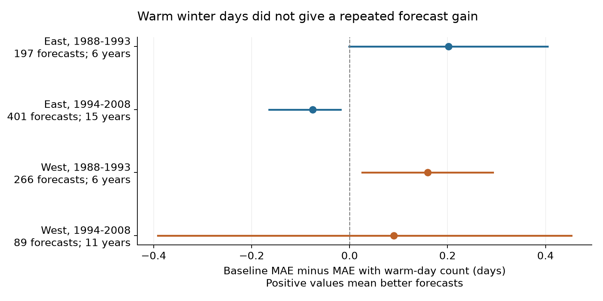
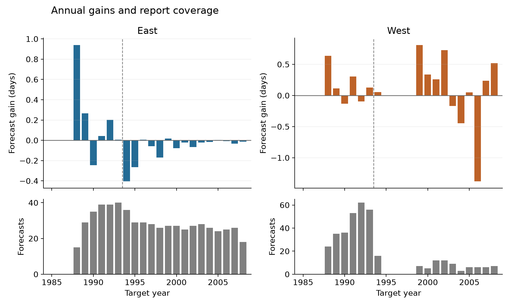

# Warm winter day counts gave no repeated gain in US lilac bloom forecasts beyond monthly means in 1988-2008

The number of warm winter days did not give a repeated forecast gain in four selected US lilac samples. We made 953 March 1 predictions with earlier records only. We compared a model with January and February mean maximum temperatures against the same model with a count of winter days at or above 15 C. Mean absolute error fell by 0.202 and 0.159 days in the early East and West. It rose by 0.075 days in the later East. The later West had an uncertain gain of 0.091 days. These small and model-dependent results do not show that daily temperature has no biological role.

## Question and prior work

Daily warm events can contain information that a monthly mean does not contain. A forecast of bloom can help plan field visits. We ask whether one simple warm-day count adds useful March 1 prediction information after monthly means are known. This is a test of ecological timing. It does not measure air pollution, community biodiversity, or species range change.

Rosemartin et al. describe the [lilac and honeysuckle archive](https://doi.org/10.1038/sdata.2015.38). The [Spring Indices](https://doi.org/10.1002/joc.3625) and their [daily-temperature toolbox](https://doi.org/10.1016/j.cageo.2015.06.015) give a reason to study daily temperature. Our count and forecast model are different. We do not evaluate the Spring Indices, chilling hours, or a full daily forcing model.

We searched published campaign results before selecting this question. We read and verified SCI 551302875a5c81f37d7854aa0bbefe4669a61810d9d3573f192717bbbf19b501 and 49ce7db055c4ecc8ebe16f883a0d077ef67d764b62b23188c32632a0fa81a93f. The first supplies the selection rule for repeated lilacs. The second found no repeated gain from a January-February monthly temperature predictor. We test added daily information against monthly means from the same daily product. Our training starts in 1979. The prior test used a different monthly product, longer training, and a different baseline. Its scores and our scores are not direct model comparisons. The biological records overlap. This study is not independent data replication of those publications.

The design was saved before weather extraction and forecast scoring in files/design.txt. Its SHA-256 is 7d669cf7e52a7bb4e90297f9fcfd7fc3c6cc5abb773a58440d8c5b9d70321aac. It was not registered. files/design_addendum.txt records the rank rule and the checks added after scoring.

## Data and observation controls

We use the USA-NPN Excel archive v13 and its field guide v14. We select legacy Dataset_ID 7 or 8, first bloom, and years 1979-2008. We exclude ambiguous plant-years, restrict the day of year to 1-250 and the coordinates to 24-50 N and 66-125 W, and require a reported US state. A plant key contains site, individual, and species IDs. East uses cloned lilac, Species_ID 35, at or east of longitude -100. West uses common lilac, Species_ID 36, west of -100. These groups differ in plant type and historical bloom definitions. They are separate forecast settings, not a controlled comparison of regions.

The selection has 3,724 biological records. A fresh raw-archive read reproduces the retained records and fields. All retained records match the earlier verified panel. A first-leaf or full-bloom report is not required.

Daily maximum temperature, Tmax, was provided by NOAA PSL, Boulder, Colorado, USA, from [the CPC Global Temperature product](https://psl.noaa.gov/data/gridded/data.cpc.globaltemp.html). We use V1.0, annual files for 1979-2008, on the 0.5 degree grid. Each site uses its nearest grid cell. File metadata gives a 6Z-to-6Z maximum-temperature period. This need not match a local calendar day. There is no search for an alternative cell with better data. The maximum site-to-cell distance is 33.23 km. We reject masked values and values outside -90 to 50 C. Every January-February day must be valid. January and February means are computed separately from daily Tmax. Warm15 counts days with Tmax at or above 15 C. It is a chosen warm-day index. It is not a local percentile extreme, a heat injury threshold, or a physiological forcing measure.

The complete-winter rule removes 949 records and retains 2,775 records from 548 plants and sites. The selected cells lack two days in 1981, one day in 1984, eight days in 1985, and one day in 1986. All 434 selected cells are missing on those dates. Five cells also lack winter data in each of 2006-2008. files/missing_weather_days.csv lists every affected date. These losses are properties of the pinned snapshots and selection, not statements about every CPC release. We do not fill missing days. The five-prior-report rule leaves no main forecasts before 1988, although the planned test starts in 1985.

Each target plant must have at least five earlier eligible records. The same rule applies to training plants. Plant intercepts control stable local differences. Earlier data only are used to fit all coefficients. These measures reduce some observation bias. They cannot correct unknown visit delays, observer changes, plant replacement, care, or selective reporting. Legacy records can represent groups of plants. Missing reports do not show failure to bloom. Flags partly use weather and full-period records; their removal is a sensitivity check, not a real-time rule. Weather completeness adds further selection.

files/provenance.json gives the exact shared paths, source URLs, versions, byte counts, and SHA-256 hashes for the 32 source files used. All raw sources were reused in place. They were not changed. A private 1995 download was made while the shared name was locked; the shared file became available before extraction, and the analysis used the shared file. The private copy is not an input or part of this package.

## Forecast and uncertainty method

For each target year from 1985 to 2008, each region is fitted separately with eligible records from 1979 through the preceding year. The baseline is:

`bloom timing = plant intercept + linear year trend + January mean Tmax + February mean Tmax`.

The added model includes `warm15`. The response is calendar days from March 1, with leap years handled by date subtraction. Least squares removes plant means during fitting. Each plant intercept is then recovered from its training means. There are no target-year effects and no clipping. A revised historical weather product is used under an assumption that the completed winter data are known on March 1. This is a reconstruction, not a real-time forecast trial.

We keep all eligible target records. One western bloom in 2005 was seven days before March 1. That prediction has no positive lead time. The other 952 predictions have positive lead time. We report the lead failure and a separate score check without that record.

For each year, we compute mean absolute error (MAE) over target plants. The primary score averages those annual errors with equal year weights. Gain is baseline MAE minus added-model MAE. Positive gain is better. The four planned checks cross East/West with 1985-1993/1994-2008. The early samples have scored years 1988-1993 only. The later West has no forecasts in 1995-1998. Its eleven years are 1994 and 1999-2008.

We use 20,000 circular moving-block bootstrap draws of annual paired gains, with block length three and seed 11072026. Blocks follow represented years, including across western gaps. Forecasts are held fixed. We give 95 percent intervals and 98.75 percent intervals, the nominal Bonferroni choice for four comparisons. A repeated gain requires all four adjusted lower limits to be above zero. This requirement is not met.

These percentile intervals are approximate. Only six years support each early sample. The fitted models share training data, years can remain dependent, and model fitting is not repeated in the bootstrap. Coverage is not guaranteed. An interval that includes zero does not show equivalence. Intervals are not corrected across all sensitivity models.

## Results

| Setting and scored years | Predictions / plants | Years | Baseline MAE, days | Added MAE, days | Gain, days | Approximate 98.75% interval |
| --- | ---: | ---: | ---: | ---: | ---: | --- |
| East, 1988-1993 | 197 / 49 | 6 | 6.256 | 6.054 | +0.202 | -0.001 to +0.404 |
| East, 1994-2008 | 401 / 52 | 15 | 6.037 | 6.112 | -0.075 | -0.164 to -0.018 |
| West, 1988-1993 | 266 / 90 | 6 | 9.159 | 9.000 | +0.159 | +0.026 to +0.292 |
| West, 1994-2008 | 89 / 28 | 11 | 10.263 | 10.172 | +0.091 | -0.391 to +0.453 |

The 953 predictions cover 155 distinct plants across the full test. The history rule retains 70%, 77%, 40%, and 62% of the available complete-weather reports in table order. These are fractions of selected reports, not of all planted shrubs. Warm15 is zero in at least half the scored records in each region. This limits the added information at many sites. files/coverage.json, predictions.csv, fits.csv, annual.csv and results.csv preserve the support and results.

The early western primary interval is above zero, but this result is not stable across reasonable choices. Removing flagged records gives a gain of +0.045 days with an adjusted interval of -0.001 to +0.092. Removing the year trend gives -0.141 days. Requiring three earlier records gives -0.142 days. This last rule adds targets and changes the score population. Neither change is a controlled test of one coefficient.

No planned sensitivity model gives a positive adjusted lower limit in all four samples. Thresholds of 10 and 20 C and the sum of Tmax excess above 15 C also fail that rule. Two early eastern 20 C fits are not identified because training has no relevant feature variation. Those comparisons are omitted and recorded in files/skipped_fits.csv. The remaining early eastern 20 C score has only four years. It warrants little confidence. Equal plant weighting keeps the four primary gain signs, with gains of +0.107, -0.132, +0.072, and +0.184 days.

Two checks were added after scoring. With block length one, the early western adjusted interval is -0.072 to +0.438 days; with block length two, it is -0.0003 to +0.379. Thus the apparent early gain depends on the short-series uncertainty method. All four block choices keep the later eastern primary gain below zero. Removing the single bloom before March 1 changes the later western point gain from +0.091 to +0.086 days. No model is refitted for that descriptive check.

## Meaning and limits

The narrow result is that one count of warm winter days did not add a repeated gain to this monthly-mean forecast baseline in these selected records. Small gains in one setting do not establish transfer to another period. The early western point result also depends on the trend, history rule, flag rule, and uncertainty calculation.

A null or unstable forecast gain cannot identify the biological role of winter warmth. A maximum-temperature count omits minimum temperature, daily sequence, earlier chilling, later spring weather, and plant state. More complete daily models can behave differently. We did not estimate them. We did not compare all possible thresholds or choose a best model after seeing scores.

These planted indicator shrubs do not represent wild community diversity, flower abundance, pollinator timing, or species ranges. The geographic groups have different plants and reporting definitions. Coarse weather can miss local conditions. Unknown visit schedules affect both the target dates and the score. Selected long records and missing weather limit transfer to other sites. The small later western sample permits both benefit and harm. We do not estimate a causal effect of human-caused warming or a pollution interaction.

The reusable output is an inspectable daily-weather and bloom benchmark, with time-ordered predictions and explicit coverage loss. A stronger next test needs an independent monitoring network, retained negative visits, local daily minimum and maximum temperature, and a fixed forecast date and score rule.

## Reproduction and worker record

[files/REPRODUCE.md](files/REPRODUCE.md) gives offline analysis, raw-source checks, retrieval, and full rebuild commands. The package includes source code, derived daily values, the model panel, all forecast rows, all scores, figures, package versions, source hashes, and checks. A raw Excel read reproduces all 2,775 retained records. Independent scalar weather reads agree exactly in 28 point-winters. Recomputed features differ by less than 5e-10. Explicit plant-indicator fits agree with forecast predictions within 9e-11 days. Independent score calculation agrees within 9e-12 days. A fresh analysis gives byte-identical retained outputs. These checks test the calculation, not ecological validity.

Campaign: 11_07_2026. Job: sci-1107-hp-climate-pollution-biodiversity-5c8ed6476dc9. Topic: climate-pollution-biodiversity. Machine: hp. Account: codex-myxtap. Model: gpt-6.1-sol, high reasoning effort, through T3 Code and the Codex harness. Analysis date: 2026-11-08 UTC. Work used the assigned isolated worktree and prepared Python 3.12 environment. No child agent was used. A small local thread count was selected for the final analysis and numerical checks. No campaign compute limit was assumed. The campaign-machine signature is not a personal authorship claim. The bundle is stored locally and is not sent to a remote archive or index. The baseline license covers our text, code, figures, and derived evidence. Source data retain their source terms.
