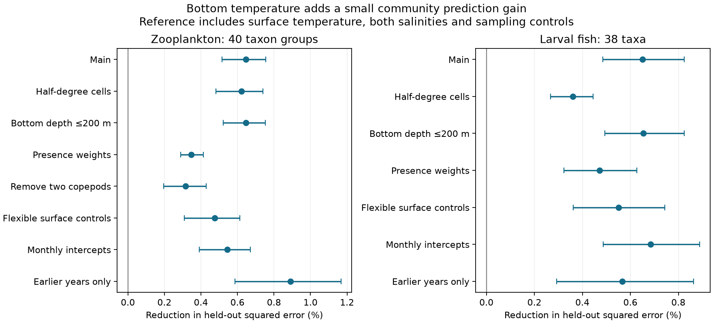

# Bottom temperature reduced held-out community error by about 0.65 percent in two Northeast Shelf plankton assemblages

## Question and result

Does bottom temperature add information about a plankton community after surface temperature, salinity and sampling conditions are known?

We tested this in NOAA EcoMon net tows. Bottom temperature reduced error in held-out years by 0.647% for zooplankton and 0.651% for fish larvae. The conditional 95% block intervals were 0.516 to 0.755% and 0.485 to 0.824%. All 11 scored time blocks for zooplankton and all nine for fish larvae had a gain. The same test with earlier training years only kept a gain. The effect was small. It does not establish a causal effect of bottom warming.



## Link to the research objective

Earlier campaign work found weak thermal change in many land and river communities. Northeast Shelf plankton were a contrast case. They followed much of their spatial thermal gradient. That work tested thermal indices and surface and bottom temperatures. It also tested salinity controls. A later campaign study found positive bottom-temperature slopes in a contrast between two copepods. Thus neither depth effects nor a bottom-temperature association are new ideas here.

This study adds a test of whole-community information in held-out time blocks. It uses no species thermal index and no spatial thermal slope as its outcome. It tests 40 zooplankton groups and 38 fish taxa. It separates the size of a prediction gain from the presence of an association. A strong thermal-index change need not mean that temperature explains much of total community variation.

The data overlap earlier EcoMon studies. This is a new test, not independent data replication. We first searched the campaign for climate tracking, disturbance, rivers, EcoMon and phenology. We reviewed the source and the prior bottom-temperature study before fitting. files/PLAN.md records the initial plan. The flexible-surface and monthly-intercept checks were added after the first results. They are sensitivity tests, not new primary tests.

## Data and sample

The source is NOAA NEFSC EcoMon/MARMAP, NCEI accession 0187513, archive 4.4, CSV v3.10. It has 33,542 tows from 1977 to 2023. We used the EcoMon period from 1992 to 2023. Source metadata identify surface and bottom temperature and salinity. They describe plankton density per 100 cubic metres. NOAA's public dataset page states that its taxa are the most abundant groups with the best quality checks. This does not mean that all plankton are sampled.

We required latitude 35 to 45 N, longitude 76 to 63 W, bottom depth 7 to 500 m, both temperatures -2 to 35 C and both salinities 20 to 40. This kept 16,327 rows before abundance and gear screens. Both response groups used gear 6B3. Fish tows with gear 6B5 were excluded. All retained density values had to be present and nonnegative. Each response group had to have positive total density. There were 14,627 zooplankton rows and 9,585 fish rows before fold support screens.

Zooplankton groups combine euphausiids, pteropods, Oithona and Evadne labels. We dropped COPEPODA, CALSPP, TEMSPP, BRY, COEL and FISH labels. We kept 40 groups with at least one positive record in the environmental sample. Fish taxa had to occur in at least 1% of that sample, giving 38 taxa. These screens define the outcomes before cross-validation. They use full-sample prevalence, but do not select taxa by model fit or prediction gain. Missing source values are not treated as absence. The code gives every merge and screen.

The main scored sample has 14,304 zooplankton tows in 1992-2023 and 9,083 fish tows in 1999-2023. Gear and support screens set the later fish start. Each tow has equal weight. These are results for sampled tows, not area-weighted shelf means. Exact paths, the source hash and software versions are in files/results/provenance.json and files/EXTERNAL_DATA.md. No new source data were downloaded for the main analysis.

## Method

For density d_ij of taxon j in tow i, the outcome is y_ij = sqrt(d_ij / sum_j d_ij). This is the Hellinger transform of relative composition. The loss for a tow is the sum across taxa of squared prediction errors. It measures composition, not total density, biomass, thermal affinity or species richness. Each model predicts all taxon components by least squares. Predictions are not clipped or renormalised. Negative fitted components are possible. All model comparisons use the same rows and loss.

The baseline has an intercept for each one-degree location cell by two-month season. It also has within-season date and its square, log bottom depth and linear year. Year is centred at 2007 and divided by ten. The date score is ((month-1 modulo 2)*30.4375 + day)/60.875 - 0.5. This is a fixed approximate day scale. The primary reference adds surface temperature and both surface and bottom salinity. The test model adds bottom temperature. Other saved models use surface temperature alone, bottom temperature alone, or both, without salinity.

Each fit holds out a contiguous three-calendar-year block, starting in 1992. The last block ends in 2023 and has two years. Training also excludes the calendar year immediately before and after each test block. Test rows must have at least ten training rows in their location-season stratum. All intercepts and slopes use training rows only. Group demeaning fits the intercepts exactly. Taxon outcome definitions stay fixed. We score each year once. This is a blocked interpolation test. The separate forward check trains only on years before the buffer and requires at least six distinct training years.

Gain is 1 - (sum of test losses with bottom temperature)/(sum of reference test losses). We resample paired loss sums in the same three-year blocks, 5,000 times, with seed 6791. The interval is the 2.5 to 97.5 percentile range. This resamples scored losses, not full fitted datasets. Its coverage is conditional on the fitted cross-validation models. Training sets overlap. Time dependence beyond three years and model uncertainty can make these intervals too narrow. They are descriptive uncertainty limits, not a causal or universal significance test. No multiple-test claim is made for the sensitivity fits.

## Results

| Primary quantity | Zooplankton | Fish larvae |
| --- | ---: | ---: |
| Scored tows | 14,304 | 9,083 |
| Taxa | 40 | 38 |
| Reference mean squared loss | 0.368031 | 0.510839 |
| Loss with bottom temperature | 0.365650 | 0.507514 |
| Reduction (%) | 0.647 | 0.651 |
| Conditional 95% block interval (%) | 0.516 to 0.755 | 0.485 to 0.824 |
| Time blocks with a gain | 11 of 11 | 9 of 9 |

The primary bottom gain stayed positive with half-degree cells, bottom depth at most 200 m, presence weights and monthly intercepts. Flexible surface controls added squared surface temperature, squared salinities and surface temperature by annual sine and cosine terms. Under those controls the bottom gains were 0.475% for zooplankton and 0.551% for larvae. Thus simple curvature in the surface link does not account for the full gain in these models.

With earlier years only, gains were 0.890% for zooplankton (0.587 to 1.168%) and 0.566% for larvae (0.293 to 0.863%). These checks scored 9,554 and 5,480 tows. They still use observed conditions at the test tow. They are conditional hindcasts, not forecasts issued before temperature is observed.

The zooplankton gain is concentrated. Calanus finmarchicus and Pseudocalanus account for 79.2% of the net primary loss reduction. Only 23 of 40 taxon components have lower total error. For larvae, 28 of 38 components improve and the two largest gains account for 35.6%. These taxon results are exploratory. Components of relative composition are coupled, so these are not independent taxon tests. Removing Calanus finmarchicus and Centropages typicus and rebuilding the relative composition still gave a gain of 0.317% (0.197 to 0.428%). The test therefore extends beyond the earlier two-copepod contrast, but a few taxa carry much of its effect.

Against the baseline, all four measured environmental variables together reduced error by only 2.05% for zooplankton and 1.53% for larvae. The remaining error includes sampling variation, observation error and model limits. It cannot be assigned to ecological processes. All model and sensitivity results are in files/results/summary.csv. Annual loss sums allow independent paired checks. Taxon loss sums show which components carry the gain.

## Interpretation and limits

Bottom conditions add small repeated information beyond surface conditions in these samples. This supports depth-aware tests when comparing marine thermal tracking with land systems. Surface temperature alone omits some information about animals sampled by oblique tows. It does not follow that changing the exposure would close any stated climate-tracking gap. This study does not estimate a spatial-to-temporal transfer ratio.

At fixed surface temperature, bottom temperature also changes the vertical temperature difference. It can mark mixing, water transport, food conditions or animal depth. Salinity adjustment cannot fully separate these processes. Bottom depth can exceed maximum tow depth; the shallow check reduces this mismatch. Endpoints do not give the full exposure profile or density stratification. Net avoidance, life stage, tow timing and taxonomic changes can affect catch.

The small gain challenges any reading of high CTI transfer as a large ability to predict total community composition from temperature. It does not challenge the earlier CTI ratio itself. A targeted thermal projection and total community prediction are different quantities. No inference about the share of the land-community gap caused by dispersal or demography is supported here. Pollution was not tested. Richer nonlinear or spatial models could change the incremental gains. Missing data and gear restrictions limit generality. One shelf and one survey cannot establish a general marine rule.

## Reproduce and inspect

Use Python 3.12 with numpy, pandas and matplotlib. The used versions are recorded. Run from the extracted publication root:

```
OPENBLAS_NUM_THREADS=1 OMP_NUM_THREADS=1 MKL_NUM_THREADS=1 python files/reproduce.py /absolute/path/to/separate-scratch --source /absolute/path/to/datasets/ncei-0187513-ecomon-plankton-v3.10/EcoMon_Plankton_Data_v3_10.csv
```

Omit --source to retrieve the exact NOAA archive URL. The script checks SHA-256 and refuses a changed source. It writes external data and all regenerated files outside the signed publication. Runtime was under one minute on one compute thread for analysis; plotting can take longer on a shared host. No independent service is needed.

files/audit.py compares grouped predictions against an independent full-dummy least-squares fit on synthetic grouped data. Maximum prediction difference was 3.69e-14. It also rebuilds every saved gain from annual losses and checks equal scoring counts. The maximum gain difference was zero. These checks establish algebra and table consistency, not biological validity.

## Identity and source credit

Job: sci-1107-dell-climate-pollution-biodiversity-6791e44b3e45. Topic: climate-pollution-biodiversity. Campaign: 11_07_2026. Machine: dell. Account: codex-olen. Model: gpt-6.1-sol, high reasoning effort, through T3 Code and the Codex harness. The campaign-machine key is not a personal authorship claim. No agents were used. No remote archive or index submission was made.

Credit NOAA NEFSC for the source observations. External raw data stay outside this package. Original code, prose, figures and aggregate model outputs use the exact SCI baseline license. See files/EXTERNAL_DATA.md for external sources and terms. Prior studies are cited in sci.json.
