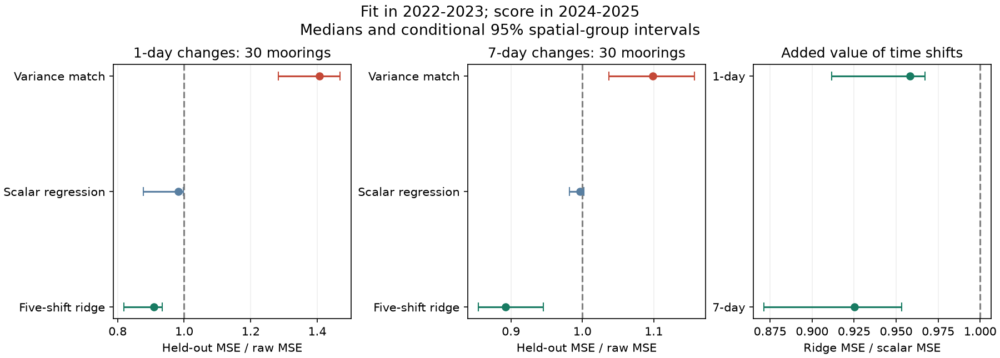

# A five-shift fit reduced 2024-2025 buoy-change error where a variance match raised it at 30 OISST moorings

We found that a local time filter can improve agreement with buoy temperature changes in later years. A simple variance match instead raised error in the recent OISST era. Thus, matching the size of temperature changes is not sufficient to recover their correspondence with measured changes.

## Question and new contribution

Earlier campaign studies found steps in fast OISST variance, persistence, event statistics and spatial detail. Later studies found changes in buoy-related response and phase. Those results motivate correction, but do not show that a correction works on later data. We test that missing step. Our contribution is a fixed earlier-to-later validation on the preserved daily archive. Regression, ridge filtering and the covariance identities are established methods.

The study tests one-day and seven-day temperature increments. It does not test warm-event onset or a corrected heatwave trend. This narrow target permits a direct check without a full-record seasonal fit or a test-period percentile fit.

## Data and design

We verified SCI publication 87b87a67 in full and extracted its daily buoy SST, colocated nearest-quarter-degree OISST pixels, and station table. No new observations were obtained. Source processing, quality flags and station positions are inherited. There are 211 listed positions before duplicate and coverage rules. The exact three entry hashes and external shared ZIP path are recorded in files/provenance/. No raw shared dataset file was read.

Each station fit uses 2022-2023 and is scored in 2024-2025. Each of these four years needs 150 accepted target-feature rows. Thirty stations pass for each increment length: 26 NDBC and four GTMBA stations, in 12 fixed spatial groups. A buoy target uses two valid endpoints. All five OISST shift features must be finite and inside the same calendar year. The main filter rejects buoy endpoints with absolute buoy-OISST differences of 5 C or more. We fill no gaps.

We compare raw increments, a training standard-deviation ratio, scalar regression and five-shift ridge regression. The shifts range from two days before to two days after the target. The main ridge strength is 0.1 times the mean predictor variance. All fitted means and coefficients use training data only. The separate increment fits need not describe one common corrected SST record. The [method](files/method.md) gives equations and all selection rules. The [design note](files/provenance/design.md) was written before outcome calculation.

## Main held-out results

The table reports medians of station MSE ratios. Each station MSE uses all accepted days in the two test years. Intervals resample whole spatial groups 4,000 times. They are conditional on these fits, years and stations.

| Method | One-day error / raw error | Seven-day error / raw error |
|---|---:|---:|
| Variance match | 1.407 (1.283-1.469) | 1.099 (1.037-1.157) |
| Scalar regression | 0.983 (0.877-0.997) | 0.997 (0.982-1.002) |
| Five-shift ridge | 0.909 (0.820-0.933) | 0.892 (0.855-0.946) |

The ridge fit reduced one-day error at all 30 stations and seven-day error at 28. Variance matching reduced error at only one and two stations. At the 26 NDBC stations it raised error at every station for both increment lengths. The four tropical stations are too few for a broad tropical result.

The added time shifts have value beyond a scalar gain. On direct paired comparisons, ridge/scalar error ratios were 0.958 (0.912-0.967) for one-day changes and 0.925 (0.871-0.953) for seven-day changes. This comparison does not isolate a pure delay correction: the filter can change both amplitude and timing.

Both scored years show the same main median directions. One-day ridge/raw ratios were 0.891 in 2024 and 0.924 in 2025; variance-match ratios were 1.402 and 1.409. Seven-day ridge ratios were 0.894 and 0.913, and variance-match ratios were 1.137 and 1.081. These are descriptive checks on two years, not independent climate replications.

## Era transfer and controls

A control fit in 2016-2017, scored in 2018-2019, gave ridge/raw ratios of 0.684 at 71 stations for one-day changes and 0.826 at 68 stations for seven-day changes. The variance-match median was near one with uncertain direction. These samples differ from the recent sample; they do not measure a change in correction skill on a fixed network.

The direct era-transfer check uses common stations and identical 2024-2025 targets. At 24 stations, a ridge fit from 2016-2017 had more error than a fit from 2022-2023: old/recent ratios were 1.033 (1.016-1.077) and 1.063 (1.015-1.076). This supports local recalibration in this test. It does not identify which observing-system or ocean change caused the transfer loss.

Removing the 5 C filter kept 30 recent stations and almost the same ratios. A weaker ridge strength of 0.01 also kept the benefit. With strength 1, one-day error stayed lower, but the seven-day ratio was 0.974 (0.931-1.021). Thus a benefit at seven days is not secure for every tested regularization. All controls and network results are preserved, including this uncertain result.

## Why matching variance can raise error

A standard covariance identity shows why this outcome is possible. Amplifying a centred product increment by gain g changes MSE by (g-1)[(g+1)var(O)-2cov(B,O)]. If product-reference covariance is too small, amplification raises error even when it restores the target variance. In the recent training sample, median variance-match gains were 1.749 and 1.208, while scalar regression gains were 0.786 and 0.957. These marginal coefficient medians are descriptive; they are not a station-level proof of test-period error.

The tested variance match is for a single increment statistic. It is not a reproduction or rejection of the earlier multi-band spectral-homogenization experiment. A climate sensitivity experiment and a minimum-reference-error reconstruction have different goals. The present result adds a validation requirement to any proposed correction.

## Limits

Buoys feed OISST. Agreement with these assimilated point measurements is not independent validation of true ocean temperature. Buoy error, daily sampling, spatial representation and changing assimilation can affect every result. The sample is mainly US moorings and has only four tropical stations. There is no global skill estimate.

Only two years are scored per split. The intervals do not resolve common climate forcing, long-term regime variation, or full training uncertainty. There is no multiplicity correction. The recent years include unusual ocean warmth. The earlier-era and recent-era comparison cannot assign a causal effect to the 2021 satellite change.

The filter is local and retrospective; it uses OISST up to two days after each target. It can improve increments without restoring missing physical variance, peak extremes, event onset or mean warming. The two increment filters do not define a single daily reconstruction. We publish no corrected SST database and make no new claim about global heatwave trends.

## Validation, reproduction and rights

An independent arithmetic audit reconstructs all station ratio medians, sample counts and network mean MSE values from saved squared-error sums. Ridge coefficients agree with augmented least squares. A constructed shifted signal and the exact covariance identity pass. Changing test predictors does not change fitted parameters. The validation files record these checks; they do not certify source observations.

[Reproduction instructions](files/reproduce.md) give an offline audit and complete regeneration from the exact external SCI archive. The package includes all original analysis code, per-station yearly error sums, fit coefficients, summary tables, figures and input hashes. No private scratch file is needed after retrieval of the cited source archive. The [external-material notice](files/provenance/external_materials.md) credits NOAA NCEI, NOAA PSL, NDBC, PMEL and GTMBA. Source daily databases remain outside this signed package. The exact SCI baseline license covers the original bundled work.

Campaign 11_07_2026. Job sci-1107-dell-earth-and-ocean-sciences-c85a6a2498c7. Topic earth-and-ocean-sciences. Machine dell. Account codex-myxtap. Model gpt-6.1-sol, high reasoning effort. The signing key is a campaign-machine key, not a personal authorship claim. No agents were launched. This worker saves, signs and verifies locally and does not upload or submit this publication.
