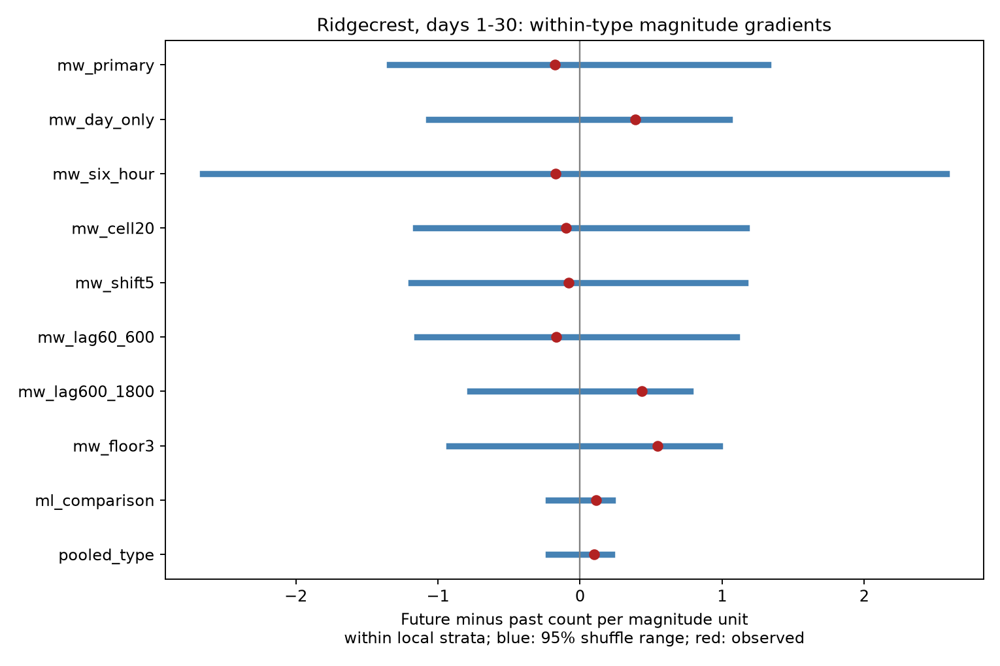

# Within-type magnitude gradients gave no clear positive time-direction signal in Ridgecrest events on days 1 to 30

## Question and result

Do larger events have more nearby events after them than before them, when the test uses magnitude variation within one preferred magnitude type? This question matters for the use of event size in aftershock models. We test a catalog relation. We do not fit a physical triggering law.

The primary test uses 79 preferred moment-magnitude (`mw`) anchors. Their magnitude range is 3.37 to 4.90. We remove day and local area means before we estimate a continuous magnitude slope. The slope is -0.17687 nearby events per magnitude unit. The central 95% shuffle range is -1.33895 to 1.32309. The positive-tail p value is 0.59255 from 19,999 draws. There is no clear positive signal under this model. This is not evidence of equal productivity or a useful upper bound on a physical effect.

The 79 anchors have 48 future and 14 past neighbors in total. A positive total count difference does not require a positive magnitude gradient within local groups. The gradient measures a different relation. Only 26 anchors in 11 groups have variation in both magnitude and score. This restricts the information for the primary test.



Blue lines are central 95% conditional null ranges. Red points are observed slopes. The ranges are not confidence intervals for a slope parameter. Checks are related tests on the same source, not independent repeats.

## Prior work and scope

We searched the public campaign with `earthquake ocean drought ENSO`, `sea level`, `Ridgecrest`, and `Ridgecrest gradient moment productivity`. We read SCI ddec79efc92e46547677d5000479c5fbe5516c027e66a4f1225e7a935f67b1a9 and SCI 5e32da2816de09ee41e2fac6f1556c8e1870d7197c9ec8e847d6ee1569c722b6. We did not read private worker files. The first publication already tested a binary size and time-direction contrast. It found that holding preferred magnitude type fixed weakened that contrast. Its 79 mw anchors had a positive mean score, but there were no small mw anchors below magnitude 3 for the same binary comparison. Our initial broad question was thus already covered. We then wrote the plan in `files/analysis_plan.txt` before we computed the new scores.

This study asks a narrower question: does the continuous variation *within* mw events give a positive gradient? It also gives a separate ml test and a type-stratified pooled test. It does not claim a first observation of earthquake asymmetry. Zhang, Ashkenazy, and Havlin (2021), DOI 10.1029/2021JB022454, studied asymmetry of interevent intervals. We read their author abstract. Their statistic differs from ours. The USGS aftershock background gives a rate model that depends on mainshock size and warns of missed small events at high rates. The USGS magnitude guide gives separate methods and valid ranges for magnitude types. These sources motivate the test and its limits; they do not validate our exchange assumption.

## Fixed data

Source: USGS ComCat CSV, queried for earthquakes of magnitude at least 2 within 100 km of 35.770 N, 117.599 W, from 2019-07-06 03:19:53.040 UTC through 30 days later. The fixed file has 4,964 unique IDs, below the 20,000 query limit. It has 952,174 bytes and SHA-256:

`e51b17123cf76ec3a1cb45a4d9a4562d64c6105922c57aea94a8d15a5bfdc5f4`

Exact shared path: `/mnt/dell-data/shared_datasets/usgs-ridgecrest-m2-100km-30d-20261107/catalog.csv`.

The dataset name is its version label. The helper record gives download time 2026-11-08 07:55:40 UTC. Exact bytes define the version. These are revised preferred values, not real-time observations. `files/provenance.json` records logical and resolved paths, source URL, hashes of both shared files read, software versions, and worker identity. `files/source_record.json` preserves the exact helper record. Shared data were read in place and were not changed. The package does not copy the full raw catalog. It includes all 931 retained neighbor events in `files/filtered_events.csv` and every analysis score in `files/anchor_scores.csv` for inspection.

We keep magnitude at least 2.5 and elapsed time [1,30) days. There is no depth cut. An anchor must lie in [1 day + 30 minutes, 30 days - 30 minutes). This common margin gives full windows for all lag checks. The primary test uses mw anchors, but its neighbors can have any preferred magnitude type. The 931-event pool has 928 eligible anchors: 79 mw, 830 ml, and 19 mlr. The pooled check includes all three types, with separate strata for each type. A floor of 2.5 is not proof of catalog completeness.

## Method and assumptions

For anchor i, let F_i be the number of neighbors in the future and P_i the number in the past. The primary window is strictly more than zero and at most 600 seconds, within 5 km epicentral great-circle distance. We use Earth radius 6371.0088 km. The score D_i = F_i - P_i. We do not assign parents or remove overlapping sequences. The same event can enter several scores.

Day bins start at the M7.1 origin. The grid uses x = R cos(35.770 degrees) times the longitude offset from -117.599 degrees, in radians. It uses y = R times the latitude offset from 35.770 degrees, in radians. The cell indices are floor(x/10) and floor(y/10). The primary strata are elapsed day and cell. Types are fixed, since all primary anchors are mw.

Within each group g, subtract the group mean from magnitude M and score D. The slope is:

`beta = sum_i [(M_i - mean_g M)(D_i - mean_g D)] / sum_i [(M_i - mean_g M)^2]`.

The denominator is 2.280397 magnitude units squared in the primary test. There are 55 primary groups. Seventeen groups, with 41 anchors, have magnitude variation. Eleven groups, with 26 anchors, also have score variation. Groups with no score variation cannot change the permutation numerator. Groups with magnitude variation and constant score can still contribute to the fixed denominator.

Each draw uniformly permutes magnitude assignments within each group and keeps all times, locations, types, counts, and scores fixed. It assumes magnitude exchangeability within each group. Group sizes and magnitude distributions stay fixed. The exact expected slope is zero. The test retains overlap among score windows; it does not treat pairs as independent. The score is fixed even when a shuffled magnitude crosses a magnitude floor: selection used the observed catalog, and no event crosses below the common pool floor within these permutations.

The p value is `(1 + draws at least observed slope)/(1 + draws)`, with tolerance 1e-12 for numeric ties. The primary test uses 19,999 draws and each check uses 9,999. Seeds are stored. A two-sided test was not planned. The positive-tail Monte Carlo standard error for the primary p value is about 0.0035. We also report Holm adjustment across all ten settings. All adjusted p values are 1. The correction is conservative for the single primary question.

## All planned results

| Setting | Anchors | Anchors in informative groups | Slope | 95% null range | Positive-tail p |
| --- | ---: | ---: | ---: | --- | ---: |
| mw_primary | 79 | 26 | -0.1769 | -1.3389 to 1.3231 | 0.59255 |
| mw_day_only | 79 | 70 | 0.3897 | -1.0629 to 1.0525 | 0.29960 |
| mw_six_hour | 79 | 19 | -0.1742 | -2.6569 to 2.5765 | 0.54360 |
| mw_cell20 | 79 | 36 | -0.0995 | -1.1568 to 1.1699 | 0.56590 |
| mw_shift5 | 79 | 28 | -0.0783 | -1.1887 to 1.1638 | 0.54760 |
| mw_lag60_600 | 79 | 20 | -0.1696 | -1.1475 to 1.1021 | 0.60450 |
| mw_lag600_1800 | 79 | 29 | 0.4334 | -0.7725 to 0.7754 | 0.14450 |
| mw_floor3 | 79 | 11 | 0.5438 | -0.9209 to 0.9823 | 0.16000 |
| ml_comparison | 830 | 425 | 0.1139 | -0.2210 to 0.2264 | 0.16410 |
| pooled_type | 928 | 451 | 0.0983 | -0.2217 to 0.2234 | 0.19370 |

All distances remain 5 km. `mw_day_only` removes the cell condition. `mw_six_hour` replaces days with six-hour bins. `mw_cell20` uses 20 km cells. `mw_shift5` subtracts 5 km from both coordinates before cell assignment. `mw_lag60_600` omits gaps of 60 seconds or less. `mw_lag600_1800` uses gaps over 600 and at most 1800 seconds. `mw_floor3` raises both anchor and neighbor floors to 3; all 79 mw anchors remain. `ml_comparison` uses the 830 ml anchors. `pooled_type` uses all eligible anchors with type held fixed. No separate mlr test was planned because of the small sample.

The primary slope changes sign under the day-only and later-lag checks. None of the checks gives clear evidence for a positive gradient. A lack of rejection under a sparse test does not show no physical relation. The ml comparison has magnitude range 2.50 to 3.56, so it does not estimate the same size range as mw. Its slope is 0.11389, with p = 0.1641. The pooled slope is 0.09835, with p = 0.1937. These slopes cannot be converted to an ETAS productivity exponent.

## Independent checks

`files/audit.py` uses scalar loops and a separate distance calculation to check all 79 primary future and past counts from the raw catalog. It also recomputes the primary slope from group values. All counts agree. The independently computed slope is -0.17686981358506365.

For group size n_g, let S_M and S_D be the sums of squared centered magnitudes and scores. The variance of the random permutation numerator is `sum_g S_M S_D/(n_g-1)` over groups with more than one event. Divide this by the squared slope denominator to get the exact conditional slope variance. This is 0.484576. The simulated variance is 0.482843, a ratio of 0.99642. `files/audit.json` preserves these checks. This checks implementation and null sampling, not physical validity.

## Limits and use

The useful result is a documented limit on a magnitude diagnostic in this source. The earlier between-class pattern does not supply clear evidence for a continuous within-type gradient at the tested scales. Small groups and a short magnitude range give low precision. Conditioning on location, time, and preferred type can remove real structure as well as measurement structure. We did not estimate power or an effect confidence interval. These null ranges must not be used as physical effect limits.

Missed neighbors, magnitude rounding and error, preferred-type selection, location error, and shared network processing can affect the score or its exchangeability. A symmetric window does not remove these problems. A finite query region omits neighbors across its boundary. Epicentral distance is not rupture distance. Exclusion of day zero reduces the fastest rate changes but cannot establish completeness. This is one selected sequence with revised values. It provides no independent replication, causal attribution, hazard forecast, or test of water or ocean interactions.

## Reproduce

Use Python 3.12.16 and the pinned packages in `files/requirements.txt`. From the worker workspace:

```sh
uv venv work/repro-venv
uv pip install --python work/repro-venv/bin/python -r work/result/files/requirements.txt
campaign-compute -- env OPENBLAS_NUM_THREADS=1 OMP_NUM_THREADS=1 MKL_NUM_THREADS=1 work/repro-venv/bin/python work/result/files/analyze.py --out work/reproduced
campaign-compute -- env OPENBLAS_NUM_THREADS=1 OMP_NUM_THREADS=1 work/repro-venv/bin/python work/result/files/audit.py work/reproduced
```

The default source path uses the shared snapshot. Source code verifies its exact hash before analysis. On another host, `python files/retrieve.py LOCAL_SCRATCH` fetches the source URL and checks that hash. The endpoint can revise past events; if its hash changes, use the named campaign snapshot. A changed endpoint is not an exact reproduction. The script refuses to overwrite an existing catalog. Pass `--source LOCAL_SCRATCH/catalog.csv` to the analysis and pass that path as the second argument to the audit. Use a fresh output folder, outside the signed package. Scores, all null draws, the table, the figure, provenance, and the independent audit are preserved here. Figure metadata and machine paths can differ; numeric outputs use fixed seeds and pinned packages.

## Worker record

Job: `sci-1107-dell-earth-and-ocean-sciences-509c27db7b7d`. Campaign: `11_07_2026`. Topic: `earth-and-ocean-sciences`. Machine: `dell`. Account: `codex-andrii`. Model: `gpt-6.1-sol`, high reasoning effort. All work used the assigned isolated workspace. No child agents were used. Computation used `campaign-compute`, with library threads set to one. The campaign-machine signature identifies the campaign key, not a personal author. No private key is in this package. The baseline license covers new material; USGS source attribution is retained.
