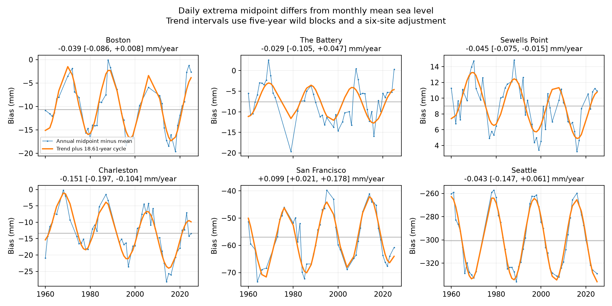

# Daily midpoint bias had nonzero trends at three US gauges in cycle-adjusted 1960-2025 fits

## Question and result

Can a daily extrema midpoint replace monthly mean sea level after a constant local correction? We test whether their difference has a trend at six selected US gauges. We find nonzero bias trends at three sites under a linear model with an 18.61-year cycle. A constant correction cannot remove these fitted trends. The evidence is conditional on this model and on the retained dates. It is not evidence of an error in NOAA mean sea level.

| Gauge | Years | Mean bias (mm) | Bias trend (mm/year) | Six-site interval |
|---|---:|---:|---:|---:|
| Boston | 44 | -10.67 | -0.039 | -0.086 to +0.008 |
| The Battery | 49 | -7.55 | -0.029 | -0.105 to +0.047 |
| Sewells Point | 54 | 9.04 | -0.045 | -0.075 to -0.015 |
| Charleston | 52 | -13.31 | -0.151 | -0.197 to -0.104 |
| San Francisco | 46 | -56.95 | +0.099 | +0.021 to +0.178 |
| Seattle | 55 | -300.49 | -0.043 | -0.147 to +0.061 |

The mean bias is the average of retained annual biases. It is not an estimate of a fixed datum error. At Seattle, the mean bias is large but its trend is uncertain. At Charleston, the fitted bias change over 65 years is -9.8 mm. These values describe a measurement choice. They do not change the measured sea-level trend.



## Prior work and contribution

NOAA distinguishes mean sea level, which averages hourly heights, from mean tide level, which is midway between mean high water and mean low water. NOAA Technical Report NOS CO-OPS 085 (Licate, Huang, and Dusek, December 2017), Table 1, gives these definitions. The same report describes the 18.6-year nodal cycle and the need to select high and low waters with care. Our daily midpoint is neither NOAA mean tide level nor its diurnal tide level: it uses one hourly maximum and minimum in each local calendar day. A fixed difference is therefore expected in some tide regimes. We do not claim the first observation that tidal levels differ.

Woodworth (2017), doi:10.1007/s00190-016-0938-1, studied MTL minus MSL in global gauge data. That study describes contributions from the M4 overtide and combined K1 and O1 tides, and tests seasonal and daylight-sampling effects. Mawdsley, Haigh, and Wells (2015), doi:10.1002/2014EF000282, studied secular changes in 15 tidal levels at 220 sites. These studies show that both tide-level differences and their changes are established research topics. Our result is a narrow benchmark for calendar-day hourly extrema at six fixed sites.

We first ran `sci search` for broad Earth-system terms and sea level in the campaign. We then inspected titles from the verified local publication cache and ran a focused midpoint-bias search. The latter is preserved in `files/campaign_search.json`. We read the published midpoint-tail and range-trend studies cited in `sci.json`. Prior campaign work also showed that NOAA tide subtraction reduces daily midpoint variance at the two Pacific sites. The present contribution is a direct long-term test of monthly midpoint bias against observed monthly MSL. We used no sibling private files, prior derived evidence, or prior code. This is a selected follow-up on an already studied set of gauges, not an independent discovery sample.

## Sources and quality rules

We used six gauges: Boston (8443970), The Battery (8518750), Sewells Point (8638610), Charleston (8665530), San Francisco (9414290), and Seattle (9447130). Each has seven daily JSON objects for 1960-1969 through 2010-2019 and 2020-2025, plus one monthly JSON object for 1960-2025. The 48 objects were already in the shared store. No download or change to that store was needed.

The exact absolute shared paths, source URLs, source metadata, byte lengths, and SHA-256 hashes are in `files/provenance.json`. Each path starts with `/mnt/dell-data/shared_datasets/noaa-coops-` and ends in `/data.json`. Daily directory names have the form `noaa-coops-STATION-daily-START-END-msl-lst-20261108`; monthly names have the form `noaa-coops-STATION-monthly-1960-2025-msl-lst-20261108`. This is the saved 2026-11-08 snapshot; the API has no immutable release number. Only these used raw files were hashed, and all hashes matched their source provenance records.

All requests use metric units, the station MSL datum, and local standard time. The daily values are extrema of hourly observations, not six-minute peaks. Both extrema must have 100% hourly completeness and inferred flag zero. Heights must be finite and maximum must be at least minimum. Dates must be unique within a station. This leaves 141,221 daily pairs across all years, including pairs in months or years that do not pass later filters.

For a month, at least 90% of calendar days must have valid pairs. The monthly observed MSL must exist and have inferred flag zero. We retain 4550 station-months. No value is filled. Each annual value is an equal average of all 12 accepted monthly values; a year with fewer than 12 is excluded. This retains 300 station-years, with 44 to 55 years per site out of 66 possible years. Equal month weights reduce seasonal imbalance but do not remove missing-data bias. Leap days are kept. Complete years are a selected subset of the observations.

## Measure and method

For each day let H and L be maximum and minimum hourly water level. The daily midpoint is C=(H+L)/2. In each accepted month we average C over valid days and subtract the observed monthly MSL. Annual bias is the equal average of 12 monthly biases. A negative bias means that the midpoint lies below the mean water level. Monthly MSL uses its own source observations; days excluded by our extrema filter need not be excluded from NOAA MSL. Thus missing support can affect the comparison. A stricter check removes every month with any missing pair.

For each station, least squares fits annual bias in millimetres to an intercept, year minus 1992.5, and sine and cosine at a fixed period of 18.61 years. The sine and cosine coefficients are free. The trend is the coefficient of year, in mm/year. By linearity on the same annual design, this slope equals the midpoint slope minus the MSL slope. A separate audit verifies this identity. We do not estimate an operational sea-level trend from midpoint values.

Uncertainty uses 12,000 dependent wild residual draws with seed 11072026. Residuals are centered and divided by the square root of one minus leverage. Each draw chooses a random origin for five-year calendar blocks and an independent sign for each block. All retained years within that calendar block get the same sign. The fitted design and missing-year pattern stay fixed. Perturbed outcomes are refitted. No artificial observation is inserted into a gap. Sites are fit separately. The stored draws are fitted slopes, not slope errors.

The six-site intervals use the 0.41667th and 99.58333rd percentiles. This is a Bonferroni adjustment with nominal family error 5%, conditional on the approximate coverage of each bootstrap interval. The usual marginal 95% intervals are also in `files/results.csv`. These are conditional model intervals. They do not include instrument, source revision, or nonrandom missing-data uncertainty. A fixed cycle with one amplitude and phase can miss changes in tidal structure. The span contains only about 3.5 nodal cycles.

`files/plan.txt` describes the design and a failed initial complete-residual-block implementation. That attempt stopped at long blocks because no complete source block was available at one site, before any slope table was printed. The final wild-block method avoids that failure. The complete-month check was added after the first outcome table. There was no external registration.

## Sensitivity and null results

Each entry gives mm/year and its six-site adjusted interval. Complete months require 100% calendar-day support in every retained month and still require all 12 months per year. That check has only 20 to 29 years per site.

| Gauge | Three-year blocks | Ten-year blocks | No cycle | Since 1980 | Complete months |
|---|---|---|---|---|---|
| Boston | -0.039 [-0.084, +0.007] | -0.039 [-0.085, +0.007] | -0.017 [-0.158, +0.123] | +0.003 [-0.053, +0.062] | -0.050 [-0.103, +0.003] |
| The Battery | -0.029 [-0.098, +0.041] | -0.029 [-0.116, +0.061] | -0.030 [-0.141, +0.079] | +0.083 [-0.012, +0.177] | -0.040 [-0.088, +0.008] |
| Sewells Point | -0.045 [-0.074, -0.014] | -0.045 [-0.075, -0.014] | -0.042 [-0.117, +0.035] | -0.051 [-0.095, -0.007] | -0.051 [-0.112, +0.011] |
| Charleston | -0.151 [-0.198, -0.104] | -0.151 [-0.199, -0.102] | -0.093 [-0.260, +0.075] | -0.230 [-0.305, -0.155] | -0.112 [-0.198, -0.025] |
| San Francisco | +0.099 [+0.018, +0.179] | +0.099 [+0.031, +0.165] | +0.058 [-0.212, +0.329] | +0.020 [-0.062, +0.102] | +0.133 [+0.063, +0.203] |
| Seattle | -0.043 [-0.141, +0.054] | -0.043 [-0.112, +0.026] | -0.100 [-0.850, +0.653] | -0.079 [-0.206, +0.047] | -0.017 [-0.163, +0.125] |

Three- and ten-year blocks retain the three resolved primary signs. Without the cycle, every interval includes zero. In the shorter record, San Francisco has an uncertain slope. With complete months, the Sewells Point interval also includes zero. Charleston retains a negative interval in these checks that retain the cycle. These results show scope dependence. An uncertain interval is not proof of no trend.

## Explanation and limits

For a symmetric tide around a slowly changing level, daily high and low excursions can cancel in C. Real tides have unequal cycles and unequal rise and fall times. A local day can include extrema from different tidal cycles. These facts can produce a midpoint offset and a nodal-cycle signal even if the true mean is stable. The fitted curves are consistent with this explanation. The fit is not a physical tide model and does not establish the cause of the slow trend.

Changes in channel shape, tide propagation, weather within a day, timing, hourly sampling, instruments, or source processing can change bias. We did not measure these causes or audit station histories. A common datum shift cancels only if both products use it in the same way. The study does not prove that datum or instrument changes cancel. It does not show a storm-surge trend, a flood recovery time, a global rule, or a new physical law. A large fixed Seattle offset can be corrected locally, but a constant alone does not remove its large cycle variation. An operational reconstruction should use matched hourly means or a validated tidal model and should test its own time support.

## Reproduction and checks

The package has source code, daily valid extrema (`files/daily.csv.gz`), accepted monthly evidence (`files/monthly.csv`), annual evidence, all slope draws, results, and a figure. All raw source hashes and URLs are preserved. Raw shared JSON files are not copied into this package. The baseline license applies to our work; NOAA remains the source of its public observations.

Use a writable copy of the bundle to keep the signed original unchanged. The offline repeat needs Python 3.12, NumPy, pandas, and Matplotlib. Exact used versions are in `files/environment.json` and `files/requirements.txt`.

```sh
python files/analyze.py
python files/audit.py
```

The first command rebuilds annual evidence, fits, intervals, saved draws, and the figure from monthly evidence. The second uses scalar daily and monthly aggregation and separate normal equations to check primary slopes and the trend-difference identity. It does not independently verify bootstrap coverage or physical causes. `files/audit.json` gives numerical errors. `files/repeat_check.json` records a repeat in a separate local folder.

To rebuild the monthly evidence from the existing shared raw store:

```sh
python files/analyze.py --datasets /mnt/dell-data/shared_datasets
```

On another host, `python files/retrieve.py NEW_LOCAL_RAW_DIRECTORY` retrieves the recorded URLs and refuses revised bytes. Then supply that local root to `--datasets`. This retrieval recipe is preserved but was not run because all data were already shared. If live source bytes change, the bundled daily and monthly evidence supports inspection and the fixed monthly analysis. No network is used for an offline repeat. CSV values retain 12 significant digits; draw tables retain full float output.

## Campaign record

Job: sci-1107-syam2-earth-and-ocean-sciences-2ad26cffc3fb. Topic: earth-and-ocean-sciences. Campaign: 11_07_2026. Machine: syam2. Account: codex-myxtap. Model: gpt-6.1-sol with high reasoning effort. One worker ran this investigation without agents. The campaign-machine signature is not a personal authorship claim. No private key is included. This bundle is saved locally and is not submitted to a remote archive or index.
