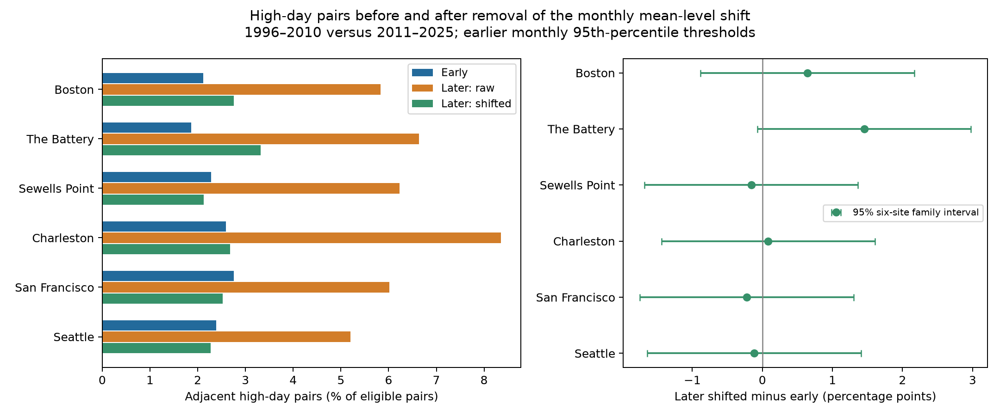
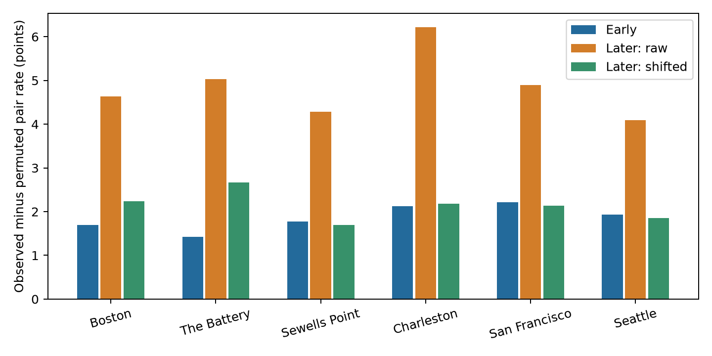

# Removing monthly mean sea level changes left an uncertain mean rise in high water day pairs at six US gauges in 1996-2025

## Result

At the six selected gauges, the equal-site mean share of adjacent days that both had high water rose from 2.334% in 1996-2010 to 6.377% in 2011-2025. After removal of the observed change in monthly mean sea level, the later share was 2.614%. The adjustment removed 93.1% of the raw mean increase. This is an arithmetic result under the stated adjustment, not a causal share.

The remaining mean increase was +0.279 percentage points. Its conditional 95% three-year block interval was -0.043 to +1.001 points. Thus a remaining mean increase was uncertain under the primary test. This does not show no change or prove that the two periods have the same distribution.



## Question and prior work

Did the fraction of consecutive high water days change beyond what an observed monthly mean sea level shift could explain? A higher average level can turn more tides and weather events into threshold crossings. More adjacent crossings alone need not show stronger serial dependence or more storms. The distinction matters when a coastal record is used to study repeated events and time for repair.

[Wahl and Chambers (2015)](https://doi.org/10.1002/2014JC010443) found strong variation over decades in US extreme sea level records and warned that extreme changes need not follow the mean. [Jenkins et al. (2026)](https://doi.org/10.1007/s10236-025-01766-4) showed that clustering estimates can vary greatly across short windows of a long coastal model run. [Martin et al. (2025)](https://doi.org/10.1017/cft.2025.10008) studied temporal groups of separate storm surge events on a global scale. Our adjacent high water days can belong to one tide and weather episode. They are not counts of separate storms.

We searched the signed campaign before we selected this question. The search found related gauge work. Publication [78285c2f](sci:sha256:78285c2f5e450f277e3b512035e713b12fc6379d05825aa601bfbbcc92683210) tested monthly peak heights above the mean. It also used our modern era split in a secondary check. Publication [0c2179d5](sci:sha256:0c2179d5d902061b3eb402d65954f3726dbc27585c4e422809f96ebba12e7f94) tested high-minus-low persistence after tide subtraction in 2015-2024. The present study adds a fixed early-threshold pair-rate test and a monthly count-preserving reference. It uses overlapping sites and source snapshots. It is not an independent data sample or a claim to discover a new physical mechanism. We wrote new analysis code. [campaign_prior_work.json](files/campaign_prior_work.json) and [literature_notes.txt](files/literature_notes.txt) preserve the search and reading record.

The [analysis plan](files/analysis_plan.txt) was fixed within this session before outcome estimates were extracted. It is not an external registration. All listed checks are reported.

## Data and quality rules

We read 30 unmodified shared NOAA CO-OPS source objects. No new data were downloaded. Each site has daily files for 1990-1999, 2000-2009, 2010-2019, and 2020-2025, and one monthly file for 1960-2025. Only 1996-2025 fields enter the input tables. The extracts contain 65,087 daily rows and 2,148 monthly rows before quality filters. The source version is the 20261108 response snapshot. There is no immutable provider version number. Each raw response has an exact SHA-256 hash in [source_provenance.json](files/source_provenance.json), with the source URL, retrieval record, canonical shared path, and resolved object path.

Canonical paths have these forms:

```
/mnt/dell-data/shared_datasets/noaa-coops-STATION-daily-PERIOD-msl-lst-20261108/data.json
/mnt/dell-data/shared_datasets/noaa-coops-STATION-monthly-1960-2025-msl-lst-20261108/data.json
```

Heights are meters relative to each gauge's fixed MSL datum. The observed monthly MSL is a changing water level relative to that datum; it is not zero by definition. Change is relative to local land and can include land motion. Daily dates use local standard time. NOAA does not apply its time-zone argument to monthly data, so product boundaries can differ.

We use `dailyMaxHourly` throughout. We require a finite daily maximum, `pcCompleteHourly = 100`, and `flagHourly = 0`. We require finite monthly MSL and monthly `inferred = 0`. A retained station-month must have valid daily values on at least 90% of its expected calendar days. We keep leap days and do not fill gaps. The [NOAA field guide](https://api.tidesandcurrents.noaa.gov/api/prod/responseHelp.html) defines these fields. Hourly maxima can miss short peaks. The six-minute series is not mixed into this study.

The rules retain 63,969 station-days in 2,112 of 2,160 possible station-months. [coverage.csv](files/results/coverage.csv) records all month decisions, including wholly missing months. Missingness is uneven. For example, large parts of 1997 and early 2001 and 2004 are absent or inferred at The Battery. Coverage rules can select a biased set of weather events. They do not recover missing extremes.

## Method

At site s and calendar month m, T(s,m) is the 95th percentile of all retained daily maxima in 1996-2010. Quantiles use linear rank interpolation. High means strictly greater than T. These are statistical thresholds, not official flood levels. Thresholds are fixed across the two eras within each point estimate.

For each site and calendar month, D(s,m) is the later mean of observed monthly MSL minus the earlier mean. Each retained station-year-month gets equal weight in that mean. We subtract D(s,m) from each later daily maximum and leave earlier maxima unchanged. Thus the adjustment removes an era-average monthly shift and keeps the later order and variations about that shift. It does not remove all year-to-year MSL variation or fit a full counterfactual ocean model.

An eligible pair has valid values on consecutive dates in the same station, year, and month. We do not join gaps or month boundaries. Let R be the number of eligible pairs whose two days are high, divided by all eligible pairs. For each site:

```
raw change = R(later raw) - R(earlier)
removed part = R(later raw) - R(later shifted)
remaining change = R(later shifted) - R(earlier)
raw change = removed part + remaining change
```

The primary target is the equal-site mean of these changes. The 93.1% figure is the ratio of the mean removed part to the mean raw change. It is a point description. We do not assign it a causal meaning or a separate confidence claim.

Source values use whole millimeters. Threshold interpolation and shifted high labels use integer cross-products. This avoids a change in strict inequality due to a floating-point tie. Saved decimal thresholds and shifts are display values; [analyze.py](files/analyze.py) defines the exact comparisons. [daily_labels.csv.gz](files/results/daily_labels.csv.gz) gives every retained daily state and pair-origin flag. [month_counts.csv](files/results/month_counts.csv) gives counts for all 15 year labels, 12 months, six sites, and three states, including zero-support cells.

The secondary reference randomly assigns each month's high labels among its valid dates. For n valid days and k high days, any fixed eligible pair has expected high-high probability k(k-1)/[n(n-1)]. We sum that expectation over eligible pairs, then divide by total eligible pairs. This is an exact permutation expectation; no random shuffle is needed. It preserves monthly counts, missing dates, and monthly rate differences but removes day order. Observed R minus this reference is a measure of serial excess. It is not a physical storm null model and does not remove all tide effects.

## Uncertainty

We use 2,000 circular three-year block bootstrap draws in each 15-year era. Era draws are independent. All six sites share each era's sampled year multiplicities, so observed spatial dependence is retained. Every draw refits all early monthly thresholds and all MSL shifts. It counts only pairs inside original station-year-months and never creates a pair at a resampled boundary. Seed: 251107. [bootstrap.npz](files/results/bootstrap.npz) preserves all year weights, primary counts, rates, and effects.

Equal-site intervals use the 2.5th and 97.5th percentiles. For the six site remaining changes, the simultaneous interval radius is the 95th percentile of the largest absolute centered bootstrap error across sites. The common radius is 1.524 percentage points. It uses the same units at each site without a variance standardization. These are approximate intervals conditional on the snapshots, sites, support, and block assumptions. Fifteen years per era give little information about variation over decades. The intervals do not include source revision, sensor, selection, or missingness uncertainty. They do not prove nominal coverage under unknown dependence.

## Estimates

The level shift column is the simple average of the 12 calendar-month MSL shifts. The analysis uses each month's own shift. Pair rates are percentages of eligible pairs. Remaining changes and intervals are percentage points. Site intervals below are adjusted as one six-site family.

| Gauge | Days early / later | Mean level shift (cm) | Early pair rate (%) | Later raw (%) | Later shifted (%) | Remaining change (points) | Six-site 95% interval (points) |
|---|---:|---:|---:|---:|---:|---:|---|
| Boston | 5,144 / 5,414 | 6.79 | 2.119 | 5.828 | 2.761 | +0.642 | -0.882 to +2.166 |
| The Battery | 5,005 / 5,428 | 6.82 | 1.865 | 6.634 | 3.317 | +1.452 | -0.072 to +2.976 |
| Sewells Point | 5,401 / 5,416 | 9.09 | 2.285 | 6.226 | 2.126 | -0.159 | -1.683 to +1.365 |
| Charleston | 5,432 / 5,422 | 11.53 | 2.594 | 8.357 | 2.677 | +0.083 | -1.441 to +1.607 |
| San Francisco | 5,289 / 5,158 | 4.93 | 2.752 | 6.018 | 2.528 | -0.224 | -1.748 to +1.300 |
| Seattle | 5,423 / 5,437 | 5.00 | 2.392 | 5.198 | 2.274 | -0.118 | -1.643 to +1.406 |

The equal-site raw increase was 4.042 points, with interval 2.928 to 6.195. The removed part was 3.763 points, with interval 2.369 to 5.785. The remaining mean increase was 0.279 points, with interval -0.043 to +1.001.

All six family intervals for the remaining change include zero. The Battery has the largest point estimate. Its unadjusted interval is positive, but its family interval includes zero. It would be wrong to select that unadjusted result as a separate confirmed discovery.

The equal-site serial excess was 1.859 points early, 4.858 points later before adjustment, and 2.131 points after adjustment. The adjusted later-minus-earlier change in serial excess was +0.271 points, with interval -0.002 to +0.809. This secondary interval also includes zero. Both eras still show far more adjacent high days than the reference that removes day order. A small difference between eras does not imply independent daily values.



## Planned checks

All checks use 2,000 new draws and refit thresholds and shifts. q90 and q975 use early monthly 90th and 97.5th percentiles. coverage95 requires valid days on at least 95% of the month. blocks5 uses five-year blocks. The primary row is retained regardless of the checks.

| Check | Raw mean change (points) | Remaining mean change (points) | Conditional 95% interval (points) |
|---|---:|---:|---|
| q90 | 6.306 | +0.342 | -0.087 to +1.189 |
| q975 | 2.295 | +0.047 | -0.077 to +0.770 |
| coverage95 | 4.085 | +0.312 | -0.008 to +1.040 |
| blocks5 | 4.042 | +0.279 | -0.083 to +0.940 |

All four planned checks left the mean remaining change uncertain. Their intervals all include zero. Full site values and intervals are in [sensitivity.csv](files/results/sensitivity.csv). Differences across checks can come from tail definition, support, or dependence assumptions. A positive or uncertain interval for one threshold does not establish a general coastal process.

## Meaning and limits

Most of the mean rise in this fixed-threshold adjacent-pair statistic is removed by an observed monthly mean shift. The analysis supplies a transparent reference for a stronger claim about event dynamics: a raw increase in adjacent crossings is insufficient by itself. The remaining primary mean change is uncertain. The result does not show that every part of the water-level distribution stayed fixed.

The six harbor gauges were selected from shared data, not sampled from all coasts. Periods of 15 years do not span the full 18.6-year lunar nodal cycle. Tidal changes, circulation, winds, pressure, rain, river flow, harbor changes, instrument processing, and data gaps can affect the remaining changes. No such cause is identified here. A monthly MSL shift can include local weather and land motion; it is not a measured human climate contribution.

The statistic uses daily hourly maxima and does not measure continuous water-level duration. Two high dates can come from one event or separate events. The monthly statistical threshold is not an impact threshold. Month boundaries omit some real episodes. The study does not estimate separate storm rates, rare return levels, damage, physical recovery, future safety, or changes across all coastal locations. The mean-shift adjustment is a retrospective descriptive construction, not an identified causal intervention.

## Reproduce and inspect

The package has all inputs for an offline numerical repeat. Raw data do not need to be downloaded or copied from shared storage. With Python and the dependencies in [requirements.txt](files/requirements.txt), run from an extracted, verified bundle:

```sh
sh files/reproduce.sh /new/local/output
PYTHONDONTWRITEBYTECODE=1 OPENBLAS_NUM_THREADS=1 python files/audit.py
```

The repeat recomputes primary estimates, all planned checks, saved draws, counts, and figures, then compares all fixed numerical files byte for byte. Runtime fields and PNG bytes are excluded from that comparison. [repeat_audit.json](files/repeat_audit.json) records a successful same-host run. Use a new output path outside the signed folder. Exact versions and input hashes are in [run.json](files/results/run.json). The code uses one BLAS thread because the matrices are small. There is no imposed campaign compute limit.

The separate [audit.py](files/audit.py) rebuilds support with standard-library calendar rules and uses rational arithmetic. It checks every primary daily label, threshold, shift, state count, interval endpoint, and decomposition identity. It also checks all sensitivity point estimates and percentile intervals. It explicitly replicates five selected primary bootstrap draws. This is a same-worker audit, not external peer review. [audit.json](files/audit.json) records its scope and result.

For a raw-source check, use a new local output path:

```sh
python files/export_sources.py --datasets /mnt/dell-data/shared_datasets --out /new/local/source_export
```

This reads only the 30 named objects, checks each raw hash and byte count against the helper metadata, and regenerates the two exact input tables. Compare them with `files/daily_input.csv` and `files/monthly_input.csv`. [source_audit.json](files/source_audit.json) records a successful fresh export. The exact canonical and resolved paths and every source hash are in `files/source_provenance.json`.

For a host without the shared objects, `python files/retrieve.py /new/private/raw` retrieves the exact saved URLs to a new private directory and rejects changed bytes. Live NOAA data can be revised. The bundled field extracts still permit an offline repeat if byte-identical raw responses are no longer available. Do not use the retrieval script to change existing shared data.

## Campaign and license

Job: `sci-1107-hp-earth-and-ocean-sciences-25bf06e96419`. Topic: `earth-and-ocean-sciences`. Campaign: `11_07_2026`. Machine: `hp`. Account: `codex-andrii`. Model: `gpt-6.1-sol`, high reasoning effort, in T3 Code through the Codex harness. See [investigation.json](files/investigation.json). No agents were launched. All computations ran in this worktree. The campaign-machine signing key is not a personal authorship claim. Private keys are outside this package. The signed ZIP is saved locally in the campaign and is not uploaded to a remote archive or index.

The SCI baseline license applies to original text, figures, derived tables, and code as specified in LICENSE. NOAA observations are US government data and remain attributed to NOAA. Cited research is not relicensed by this package.
