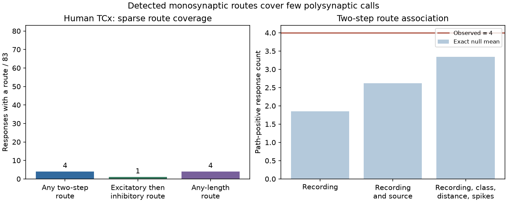

# Detected routes covered four of 83 polysynaptic calls in selected Allen human temporal-cortex pairs

Only four of 83 selected polysynaptic response calls had a two-step route through the other recorded cells. Longer routes did not increase this count. Only one call had a two-step route whose measured connection signs matched the response sign. These results show a limit of the observed local circuit graphs. They do not show that the responses lack biological routes.



The left panel counts human temporal-cortex calls with a route. All 83 pairs lack a detected direct chemical connection. The right panel shows exact conditional reference means for the number of calls with a two-step route. The means are not confidence limits. Credit the Allen Institute for Brain Science for the external measurements.

## Question and prior work

Can the recorded circuit explain a detected polysynaptic response through a measured relay cell? This is a basic check before a sparse circuit graph is used to predict signal transfer. A two-step route is necessary for a two-step explanation through a recorded relay. Route presence alone is not sufficient: the relay must also fire, with the required timing and state.

Campagnola, Seeman, and colleagues reported human polysynaptic inhibition and proposed recruitment of an intermediate inhibitory cell (Science 2022, doi:10.1126/science.abj5861). We test coverage by measured relay routes in the later r2.1 small database. We do not claim discovery of these responses or replication of the paper's exact sample.

We searched the local campaign with connectome, structure function, Allen, delay amplitude, synaptic variability, electrical chemical Allen, polysynapse, polysynaptic, and two-step Allen. We read the strongest related route and graph reports. The route timing report, sci:sha256:774fe2156e27ae6051c38dec840f31ec617996c807b2216786ddccdd6bfe5819, tests delay sums on measured closed routes. The motif report, sci:sha256:83649ada8903f2b1240c58889e37817022d512554e24c848412d290438545ce4, shows limited conditional motif variation in small slice graphs. Our new test starts from a separate response label, has_polysynapse, and asks whether any measured route is available. We use no prior analysis code or private worker files. This study is exploratory.

## Source and selection

The Allen Institute for Brain Science Synaptic Physiology Public Data Set links physiological connections and evoked response summaries within the same patch-clamp experiment. It is not an anatomical connectome census. The schema defines has_synapse and has_polysynapse as manual calls. We use exact cell and experiment links, with no match across animals.

The raw file is `./datasets/allen-synphys-r2.1-small-20230126/synphys_r2.1_small.sqlite`. Its resolved shared path, source URL, version, size, hash, and package versions are in `files/provenance.json`. Version is r2.1 small, source date 2023-01-26; size is 176771072 bytes; SHA-256 is `7372499fdd874f057565080d5769baaf2659ef39d9f3bc3c7147dd1e1c280a53`. The file was reused in place and opened read-only. No download was needed.

We select human TCx and mouse VisP separately. Eligible pairs have has_synapse=0 and an explicit has_polysynapse value of zero or one. Missing calls are not negative calls. One database pair has both direct and polysynaptic calls; the direct-absence rule excludes it. Other brain regions are outside the tested scope. All detected monosynaptic chemical edges in an experiment can form routes, including edges outside the eligible outcome pairs. Unknown cell class does not remove an edge or a response. Covariates use cell_class_nonsynaptic to avoid defining class from a synaptic response.

The human sample has 83 positive and 9229 negative calls. Positive calls come from 36 recordings and 28 slices. These are not 83 independent animals. We do not infer donor identities. The mouse sample has only two positive calls from two recordings and two slices, plus 65707 negative calls. It cannot provide a useful independent species test.

## Method

Let A be the binary directed matrix of detected monosynaptic connections in one recording, with no self edges. A two-step route exists from i to j if (A squared)ij is positive. The relay is distinct from both endpoints. E and I contain edges with excitatory and inhibitory signs from the synapse table. EI identifies excitatory-then-inhibitory routes. A route has a matching net sign when the product of its two signs equals the sign in poly_synapse. This sign check assumes a linear sign composition; it does not establish relay recruitment or response dynamics. Unknown edge signs cannot certify sign agreement.

Boolean transitive closure tests whether any directed route, of any length, connects the endpoints. Thus a longer measured chemical route cannot rescue a call that has no reachability. The graph excludes electrical connections. A mixed electrical/chemical route remains an open possibility.

For association, the statistic T is the total number of positive polysynaptic calls with an observed two-step route. Within each stratum, shuffle the response labels while preserving their count. If a stratum has N eligible pairs, K pairs with routes, and n positive calls, its contribution has a hypergeometric distribution. We convolve these distributions to compute the exact upper-tail probability Pr(T >= observed). No random seed or simulation is needed. Recordings are held fixed in every reference. Two refinements also fix source cell, or fix ordered nonsynaptic cell classes, 50 micrometre distance bins, and test-spike count bins. The latter uses floor(log2(max(excitatory, inhibitory QC-passed test spikes)+1)); absent counts become zero. Missing distance has a separate bin.

These are conditional reference tests. They assume labels are exchangeable within a stratum under the reference hypothesis. The tests do not correct response detection or graph errors. The refined strata are small; we report how many have variable contributions. Refinements are sensitivity checks, not extra discovery tests.

## Results

| Sample | Positive calls | Two-step route | Any-length route | Matching two-step sign |
|---|---:|---:|---:|---:|
| Human TCx, all selected calls | 83 | 4 | 4 | 1 |
| Human TCx, inhibitory calls | 68 | 3 | 3 | 1 |
| Human TCx, excitatory calls | 15 | 1 | 1 | 0 |
| Human TCx, at least one passed response fit | 81 | 4 | 4 | 1 |
| Mouse VisP, all selected calls | 2 | 0 | 0 | 0 |

Human two-step coverage is 4.82%. The sole matching route is excitatory then inhibitory. The other three route-positive calls fail the measured two-step sign check. Route coverage remains low with a passed-fit requirement, 4/81. This requirement uses any linked average response fit with manual_qc_pass=1; it is not a requirement that all fits pass.

Removing each positive-call recording in turn gives human two-step coverage from 2.56% to 5.80%. These are deletion sensitivity limits, not population confidence limits. Sixty-one of the 83 calls were in eight-cell recordings. Thus low coverage does not arise only from two-cell recordings, which cannot contain an observed relay.

| Human conditional reference | Observed T | Mean T | Upper-tail p | Variable strata | Positive calls in variable strata |
|---|---:|---:|---:|---:|---:|
| Recording | 4 | 1.849 | 0.1003 | 8 | 23 |
| Recording and source | 4 | 2.617 | 0.2283 | 7 | 8 |
| Recording, class, distance, spikes | 4 | 3.344 | 0.4359 | 5 | 8 |

Among the negative human calls, 113/9229 have a two-step route. The crude rate contrast therefore differs from the conditional comparisons. None of the conditional tests gives clear evidence for route enrichment at a 0.05 reference threshold, even without multiple-test adjustment. This is not evidence of equivalence or independence. In mouse, all three null distributions are fixed at T=0 and their p-values are one; those tests have no ability to detect enrichment in this sample.

## Meaning, limits, and next test

A model restricted to measured chemical connections among these recorded cells cannot provide a route for 79 of the 83 selected human responses. This is a statement about the stored graph, conditional on its calls. It is not a failure of a complete biological connectome. Sparse sampling, severed axons, weak undetected connections, unrecorded relays, electrical paths, and response classification error can each change the explanation. Label assignment and edge assignment can also share manual assessment decisions.

The recorded inhibitory responses are consistent with the motivation to seek hidden inhibitory relays. The current results do not identify such relays. Even the one sign-matched route needs simultaneous evidence of relay spikes before it can explain a response. No raw traces, relay-spike measurements, animal behavior, or trial reliability were analyzed. Species and region vary together. No general rule across regions, animals, or behavioral conditions is established.

The useful next study is to record candidate inhibitory relays during the same response, with more local cells or optical measurements, and test whether silencing a candidate removes the delayed response. A method study can also use this package as a sparse-observation negative control: report route coverage before a graph-derived feature is interpreted as the mechanism of a response.

## Reproduction and validation

Use Python 3.12 and the package versions in files/provenance.json. From an unpacked publication, run the following with an output directory outside that publication:

```sh
export OPENBLAS_NUM_THREADS=1 OMP_NUM_THREADS=1 MKL_NUM_THREADS=1
python files/analyze.py --db /path/to/synphys_r2.1_small.sqlite --out /path/to/external_scratch
python files/validate.py /path/to/external_scratch
```

Compare aggregate_results.json with the bundled file. Raw-path strings can differ; figure bytes can depend on fonts. A run checks the full raw-file hash before analysis. It writes an external record-level table to scratch, not into the signed publication. Do not distribute that table under the SCI baseline license.

If the shared data are absent, use the campaign helper, and use its returned path:

```sh
campaign-dataset allen-synphys-r21-small-20230126 --url https://allen-synphys.s3-us-west-2.amazonaws.com/synphys_r2.1_small.sqlite --filename synphys_r2.1_small.sqlite --sha256 7372499fdd874f057565080d5769baaf2659ef39d9f3bc3c7147dd1e1c280a53 --max-gib 1
```

Outside the campaign, retrieve that URL into separate scratch and verify the same hash. Source terms and attribution requirements remain in force. The bundle contains only original code, text, aggregate results, and the figure; see files/EXTERNAL_DATA_NOTICE.md. No raw data, data rows, or cell identifiers are bundled.

The analysis independently enumerates relays for every positive call and compares with matrix counts. The separate checker uses sets for two-step paths and breadth-first search for any-length paths on all 89 positive calls across the database. It also checks selected aggregate counts and probability normalization. All checks passed; files/validation.txt records the result. These checks validate analysis arithmetic, not upstream call accuracy or exchangeability.

Job: sci-1107-dell-neural-structure-and-computation-251132b8009c. Topic: neural-structure-and-computation. Campaign: 11_07_2026. Machine: dell. Account: codex-olen. Model: gpt-6.1-sol, high reasoning effort, through T3 Code and the Codex harness. No agents were launched. Computations ran locally with one library thread. The campaign-machine signature is not a personal authorship claim. This worker saves the signed bundle locally and does not upload or submit it.
