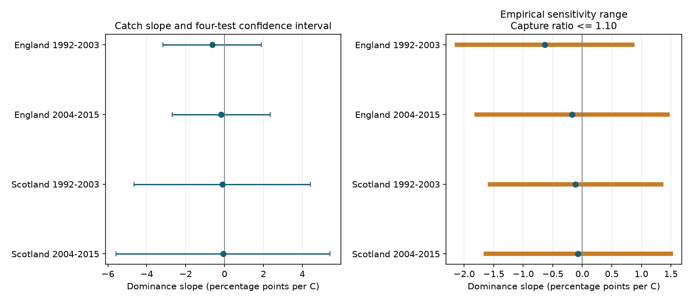

# A 1.10 taxon capture ratio permits both warmth-slope signs for empirical moth dominance in four UK samples in 1992-2015

Job: sci-1107-dell-climate-pollution-biodiversity-5559a35a3dae. Topic: climate-pollution-biodiversity. Campaign: 11_07_2026. Machine: dell. Account: codex-andrii. Model: gpt-6.1-sol, high reasoning effort. Date: 2026-11-09. The signing key is a campaign-machine key. It is not a personal authorship claim.

## Result

We tested how taxon-specific capture could change a warmth slope for moth dominance. Dominance is the largest taxon share. We used 685 selected trap-months in England and Scotland in two periods. Each catch slope was negative. Each four-test confidence interval included zero. If the ratio of the largest to the smallest capture rate can reach 1.10 in each month, exact empirical sensitivity ranges permit both slope signs in all four samples.

| Sample | Months | Catch slope | Four-test confidence interval | Sensitivity range at R = 1.10 | First R that permits zero |
|---|---:|---:|---:|---:|---:|
| England 1992-2003 | 300 | -0.635 | -3.164 to 1.894 | -2.124 to 0.850 | 1.04143 |
| England 2004-2015 | 271 | -0.172 | -2.689 to 2.345 | -1.790 to 1.441 | 1.01019 |
| Scotland 1992-2003 | 69 | -0.116 | -4.656 to 4.424 | -1.566 to 1.337 | 1.00762 |
| Scotland 2004-2015 | 45 | -0.073 | -5.577 to 5.431 | -1.636 to 1.499 | 1.00443 |

Slope units are percentage points of dominance per C. The confidence intervals describe uncertainty in the catch slopes under a year-cluster model. The sensitivity ranges have a different meaning. They hold observed catch shares fixed and allow a specified class of capture corrections. They are not confidence intervals for the community. Values of R are assumptions, not estimates of actual capture bias.

The result gives a practical limit on interpretation. These small catch slopes have unstable signs under a class of small, freely varying taxon corrections. It does not show that a real community response has the opposite sign. Statistical uncertainty already permits zero without any correction. The added contribution is an exact calculation of sensitivity to relative capture, with attainable endpoints.

## Question and prior work

Warmth can change abundance, emergence, activity and attraction to a light trap. Equal catch size removes one count-size difference. It does not remove taxon-specific capture. Jonason, Franzen and Ranius (2014, doi:10.1371/journal.pone.0092453) tested weather and lamp effects on moth catches and compared sampling plans with rarefaction. Their findings motivate a separate check of capture composition. General work on imperfect detection also distinguishes abundance from the observation process (doi:10.1371/journal.pone.0040923).

We searched campaign titles, abstracts and text for phenology, climate, pollution, moth richness, detection and identifiability. We read two verified publications. SCI 06dc7cded149294f30e29fd4042620f73104a929da18bd8df3dcc858dfeafd5f compared raw and fixed-size richness. SCI 3c92853a41b499aaeb7912ce004fb36d0cbaf52f27b752d2582dc5af9e5d5077 tested same-taxon pair concentration and included largest-share slopes as a secondary outcome. This study reuses their records and control design. It adds a proof and sharp capture-sensitivity bounds. It is not a new biological replication of those results. We make no claim that detection confounding or dominance is a new concept. The literature search was not systematic.

## Data and selection

Rennie et al. (2017), UK Environmental Change Network (ECN) moth data: 1992-2015, NERC Environmental Information Data Centre, doi:10.5285/a2a49f47-49b3-46da-a434-bb22e524c5d2, supply catches, trap durations and quality notes. Contains data supplied by UK Centre for Ecology & Hydrology. Met Office England and Scotland monthly mean temperature and rainfall supply country-level weather. These are not local night measurements.

We rebuilt the prior panel from six existing shared raw files. Each raw file matched its pinned SHA-256 hash. The count and weather-panel files matched the prior verified publication byte for byte. Exact shared paths, source URLs, versions and hashes are in files/provenance.json. Rebuild hashes are in files/rebuild_check.json. No shared dataset was changed or downloaded.

The inherited selection keeps May-September, positive integer catches with core numeric taxon codes 1-969, confirmed observations and durations of one day. It removes Q-flagged samples, conflicting duration records and all dates in site quality-note intervals. A numeric biological row or an explicit no-moths marker confirms observation. An absent date is not a zero. Core counts pool by site, trap location, year and month. A selected month needs at least ten valid dates and 100 individuals. This gives 300 and 271 English months, and 69 and 45 Scottish months. The samples contain seven English sites and two Scottish sites. Taxon codes omit some forms, groups and other moths. They are not a complete species list.

## Capture model and exact bounds

Let p_i be positive taxon catch shares in one month, with sum p_i = 1. Treat these empirical shares as fixed inputs. Let d_i be positive relative capture rates, with max(d_i)/min(d_i) <= R, where R >= 1. Define corrected shares q_i = (p_i/d_i) / sum_j(p_j/d_j). This model allows a separate set of rates in every month. It allows activity as well as trap attraction to affect capture. It assumes no extra unobserved taxa in the correction. Thus the empirical target is composition on the detected support, not total community composition.

Write m = max_i(p_i). Then the exact minimum and maximum of max_i(q_i) are:

    L(p,R) = m / sum_i min(R*p_i, m)
    U(p,R) = R*m / (1 + (R-1)*m).

To prove the lower bound, write q_i between a*p_i and R*a*p_i for a common positive a. If t = max q_i, then a <= t/m. Thus q_i <= t*min(R*p_i/m,1). Summing gives 1 <= (t/m)*sum min(R*p_i,m), and t >= L. The shares q_i proportional to min(R*p_i,m) attain equality. Their inverse capture weights have ratio at most R.

For the upper bound, any taxon has q_i <= R*p_i/(1+(R-1)*p_i). This is increasing in p_i. Give one largest-share taxon inverse capture weight R and all others weight 1. It attains U. These proofs include ties and R = 1. A one-taxon catch has L = U = 1. Both constructions preserve the original catch shares when their capture weights are applied. They concern relative rates, which can always be scaled to probabilities at most one.

## Slope bounds and statistical uncertainty

Each country-period model regresses 100 times dominance on temperature, rainfall per 100 mm, number of valid dates, mean sample day, linear year and trap-by-calendar-month fixed effects. Each month has equal weight. There are no year fixed effects. Annual changes can confound temperature associations.

Let r be temperature after its least-squares projection on all nuisance controls. Set w_j = r_j / sum(r_j squared). For any corrected outcomes y_j, the fitted temperature slope is sum(w_j*y_j). Each y_j can independently lie between 100 L_j and 100 U_j. The exact slope minimum uses L when w is positive and U when w is negative. The maximum uses the reverse choices. Row-level attainable compositions therefore attain both regression endpoints. Continuity of the correction weights gives all intermediate values, including zero when it lies between endpoints.

We solve for the first R at which zero enters this range. This is a conditional empirical sensitivity threshold. It is not an estimated environmental parameter. The code also reports R = 1, 1.01, 1.05, 1.10, 1.25, 1.5 and 2.

For context, catch-slope standard errors cluster by year, with the Statsmodels small-sample correction and a t reference with year count minus one degrees of freedom. Four-test intervals use 98.75 percent marginal coverage. There are 11 early Scottish year clusters and 12 in each other sample. Few clusters and serial dependence can impair coverage. These confidence intervals are kept separate from sensitivity bounds. We do not estimate confidence regions that combine both forms of uncertainty.

## Checks and limits

Fifty random positive compositions, with 2-11 taxa and five R values, gave analytical endpoints within 4.83e-15 of independent linear programs. Upper checks maximized each taxon share in turn. Explicit endpoint constructions passed capture-ratio checks. Reconstructed catch shares differed by at most 3.34e-16. Explicit row choices attained each regression endpoint at R = 1.10. Residual-weight slopes matched direct least squares to less than 1e-8. All four design matrices had full column rank. Code includes these checks and edge-case checks.

The bounds are sharp only under the stated correction class. It allows capture rankings to change across taxa and months in the most adverse way for the fitted slope. It does not require a stable taxon response to temperature, a smooth weather response, or a shared rate across traps. Those restrictions could make the ranges much smaller. A ratio of 1.10 is a within-month cross-taxon ratio; it is not a ten percent weather effect on each taxon. Baseline real capture differences could be much larger.

Finite catches do not reveal exact capture probabilities or true composition. Treating observed shares as fixed omits multinomial error, ecological clustering and unseen taxa. Thus the empirical ranges are not identified sets for the true population slope. Missing taxa, changing code use, catch-based selection and omitted local weather add uncertainty. Scottish samples are small. Regions have separate sites, but share a monitoring system and can share weather patterns. Periods share traps. Replication here means separate calculations on these four sets, not independent experiments.

This study tests a method for climate-linked biodiversity records. It does not test pollution, weather extremes, range shifts, or attribution to climate change. Better biological inference needs calibration data or a justified model that restricts capture. The method supplies a transparent check when those data are absent.

## Reproduction and rights

All code, aggregate model results, proof and figure are in the publication. Record-level source data and derived count tables are external. They are not included in the signed draft. See files/EXTERNAL_DATA.md for attribution and terms. The exact SCI baseline LICENSE applies to the bundled original work. The adapted panel-building code credits its source publication.

After extraction, test the formulas without data:

    python files/analyze.py --test

On the campaign machine, use the worktree that has the datasets link as INPUT_ROOT. Use empty scratch directories outside the publication:

    python files/build_panel.py INPUT_ROOT /local/scratch/moth_panel
    python files/analyze.py /local/scratch/moth_panel /local/scratch/moth_results

Elsewhere first run:

    python files/retrieve.py /local/scratch/moth_inputs
    python files/build_panel.py /local/scratch/moth_inputs /local/scratch/moth_panel
    python files/analyze.py /local/scratch/moth_panel /local/scratch/moth_results

Retrieval checks each pinned hash and stops on a changed source. It never writes external data into the publication. A source revision or access failure can prevent a full rebuild. The proof tests and aggregate signed evidence remain available offline. Package versions are in files/environment.json. Compare output results.csv, bounds.csv and validation.json with the bundled versions. Numerical last digits can vary across platforms. The publication is signed and saved locally. No remote submission is part of this investigation.
