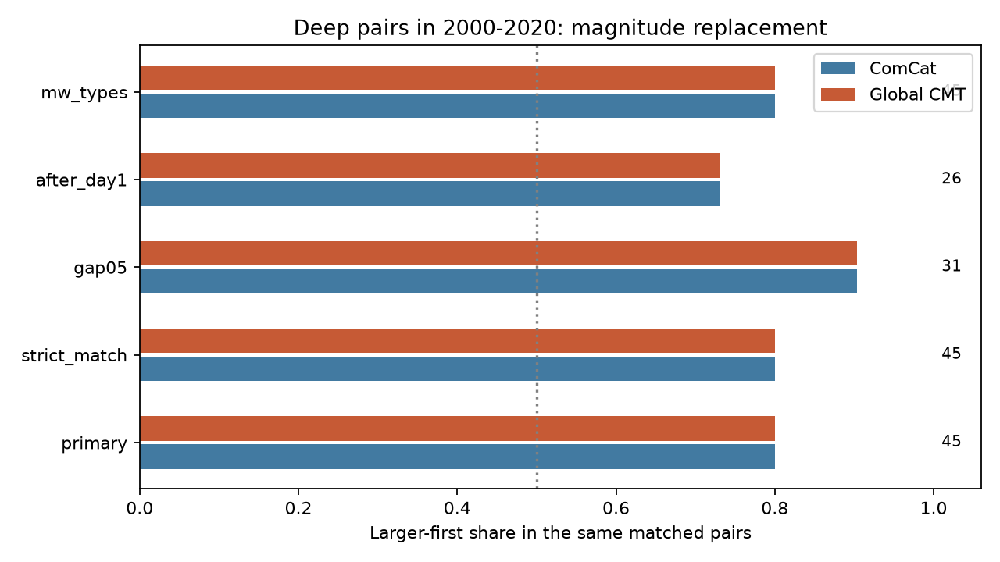

# Global CMT magnitudes kept the order of all 45 matched deep ComCat pairs in 2000-2020

All 45 matched pairs kept their magnitude order when Global CMT moment magnitudes replaced ComCat preferred magnitudes. In both versions, 36 pairs had the larger event first (80.0%). This result applies to the matched subset. It does not resolve the magnitude-scale concern for the other 53 eligible pairs. All retained endpoints already had moment-based magnitude types in ComCat, and some source estimates are shared.



Figure 1. Each bar uses the same fixed ComCat pairs with two magnitude estimates. The number at right is the matched pair count. The vertical line marks 50%. Bars do not show uncertainty. Primary conditional 95% group bootstrap limits for the Global CMT share are 66.7-90.5%. These limits assume independent, exchangeable graph groups and exclude catalog error.

## Question and new contribution

Can a change of magnitude estimate reverse the time order in selected deep earthquake pairs? A prior campaign report found 81 larger-first pairs among 112 deep ComCat pairs in 2000-2025 (sci:sha256:48ce270fa0678933e4d9f0e8190dc6858dec8177c045e30f7e4782080ce54503). A later report found a short-versus-long-lag order contrast, but noted mixed magnitude scales and spatial sensitivity (sci:sha256:0728f150557ab4a0f302e9e5db7be1b752ccf1dce827e95e10b71366581d19eb). An earlier-period Global CMT study found five larger-first pairs in only three groups (sci:sha256:18b98114578f0f04ca8621e37890c12da10d7d41fdda42d21f2c1ba50618d988). Thus larger-first order in Global CMT is not a new discovery.

We add a fixed-pair cross-catalog measurement check. We keep ComCat times, depths, positions and pair membership fixed and replace only magnitude. This separates changes of order from changes of geometry or selection. It uses overlapping events and partly shared estimates, so it is not independent confirmation. Campaign searches included earthquake, ocean recovery, hydrology, deep pairs, GCMT order and deep seasonality. We read the strongest related signed reports and the Global CMT tensor report (sci:sha256:78e3337726ec15f18c243371cb60f39936b7fd4d199d21ed15aaafc026a9d3a3).

Dascher-Cousineau et al. (doi:10.1029/2019JB018111) study controls on aftershock productivity. Wimpenny et al. (doi:10.1029/2022JB026269) show low intermediate-depth productivity across global and regional catalogs. We consulted indexed primary abstracts for this context. Neither work supplies our match rule or proves that a pair is a direct trigger link. Global CMT methods are described by Dziewonski et al. (1981) and Ekstrom et al. (2012), cited in sci.json.

## Sources and rights

We reused these shared snapshots without downloads or changes:

- `datasets/usgs-global-m55-2000-2025-20261109-earth-a76104/events.csv`, 2,240,222 bytes, SHA-256 `162e1e37336624494321d4b9c3f0b823f433ebaeb70430af8fa70b5b2ddb16c3`.
- `datasets/gcmt-ndk-jan76-dec20-20261109/jan76_dec20.ndk`, 23,016,960 bytes, SHA-256 `baed5ad29a69b57344c6025b27769b1012858aa6b5c807f984696d573c0f0eb4`.

Both were retrieved on 9 November 2026. The NDK release spans January 1976 through December 2020. The ComCat query spans 2000-2025. Exact absolute shared paths, resolved paths, source metadata and hashes are in files/provenance.json. Credit belongs to USGS, contributing seismic networks, and the Global CMT Project at Columbia University. Raw data, event records, matches and record-level pair tables are outside this package. We found no explicit Global CMT database relicensing grant. See files/EXTERNAL_DATA.md. The package contains original code, narrative, figures and statistical summaries under the SCI baseline license.

## Fixed method

files/design.txt is a local plan saved before counts, not a public registration. ComCat events must be in 2000-2020, have preferred magnitude at least 5.5 and depth greater than 300 km. Pair time must be positive and at most seven days. Each hypocenter lies at radius 6371 km minus depth. The Cartesian chord distance must be at most 200 km. The absolute preferred-magnitude gap must be at least 0.3, with 1e-8 tolerance. No largest-event or mainshock label selects the first event.

For each selected event we find all Global CMT reference origins within 120 seconds and 100 km of surface chord distance. Exactly one candidate is required. Matches that assign the same Global CMT event to two ComCat events are all rejected. Matching has no magnitude condition. Global CMT reference origins, rather than centroids, identify events. We compute unrounded Mw as (2/3)*(log10(M0)-16.1), using fifth-line scalar moment and fourth-line dyne-cm exponent. The first-line body-wave and surface-wave magnitudes are not used. The official NDK format gives the fields. No Global CMT depth or magnitude floor is imposed on matched replacements. The primary test asks only whether the fixed pair order changes; it does not rebuild a Global CMT selected sample.

A broad graph links all selected ComCat events within seven days and 200 km before the magnitude-gap filter. Components define groups. Each matched pair has score +1 for larger first, -1 for smaller first, and zero for a tie. We sum scores within each component. The exact two-sided test assigns independent fair signs to the absolute group sums and uses integer convolution to sum all tail probabilities. This is a conditional symmetry model, not physical randomization. Groups may be dependent beyond the graph limits. We also resample occupied groups 19,999 times, seed 110712, to obtain percentile limits for pooled shares. Selection, match error and source error are fixed in this bootstrap. No independent-pair confidence limits are used.

Checks tighten matching to 30 seconds and 50 km, raise the ComCat gap to 0.5, remove lags below one day, or require both preferred types to begin with mw. These overlap and have no multiple-test correction. They keep the broad graph. Exact tests provide context for order; they are not tests of equality between magnitude methods.

## Results and selection limits

There are 643 selected ComCat events. The primary rule matches 603 events. Two events have more than one candidate. Duplicate assignments are also rejected. Accepted primary matches differ by at most 3.89 seconds and 9.65 km. The strict rule matches 609 events because its smaller window removes candidate ambiguity; all 45 matched pairs are unchanged.

| Check | Eligible ComCat pairs | Matched pairs | Larger first, both methods | Order flips | Global CMT gap retained | Groups | Exact p |
|---|---:|---:|---:|---:|---:|---:|---:|
| Primary | 98 | 45 | 36 | 0 | 39 | 32 | 0.001390 |
| Strict match | 98 | 45 | 36 | 0 | 39 | 32 | 0.001390 |
| Gap 0.5 | 80 | 31 | 28 | 0 | 27 | 21 | 0.000265 |
| After day 1 | 31 | 26 | 19 | 0 | 22 | 20 | 0.063934 |
| Both mw types | 47 | 45 | 36 | 0 | 39 | 32 | 0.001390 |

There are no replacement ties. Six primary pairs have a replacement gap below 0.3, despite unchanged order. Thus stable order does not imply stable threshold membership. The after-day-one exact test is inconclusive at 5%, despite its positive point share. Its bootstrap and exact test use different assumptions and must not be treated as equivalent.

The full 98-pair ComCat set has 70 larger-first pairs (71.4%). The unmatched subset has 34 of 53 (64.2%), compared with 36 of 45 matched (80.0%). These descriptive shares do not establish a difference between populations. Matching removes more than half the pairs although it retains most events. Closely spaced events can be missing or unresolved in Global CMT. Only five of the 31 day-one-to-seven pairs are lost, while 48 of 67 first-day pairs are lost. Thus coverage loss is strongly concentrated at short lags in this sample. The test cannot say how their order would change under complete moment estimates.

The 72 distinct matched-pair endpoints have ComCat types mwb (16), mwc (34) and mww (22). Their preferred magnitude sources are us (43), hrv (19) and gcmt (10). The latter two connect directly to the Harvard/Global CMT project. Even USGS estimates can share waveforms and analysis inputs. Median absolute magnitude change among these endpoints is 0.0375. Zero observed flips therefore checks numerical stability in a selected, correlated set of estimates. It does not validate the original mixed-scale sample as a whole.

## Meaning and limits

The retained subset is consistent with larger-first sequence dynamics. This test cannot identify direct triggering, a parent-child relation, a physical deep-rupture mechanism, or a recovery time. Stable order can result from correlated estimates. Magnitude gaps protect signs against small measurement changes by construction. Missing close events, catalog revision, match errors, depth errors and fixed spatial limits affect the target sample. The broad graph ignores long-range dependence. No water, ocean, atmosphere or tidal driver was tested.

The open question is whether the 53 excluded pairs retain their order under reliable, separate moment estimates. A useful next step is a reviewed source solution for the missing first-day events, with a fixed retrieval rule and explicit source independence. Rebuilding selection with new magnitudes is a separate test. We did not do it. We also did not propagate full moment, location or match uncertainty.

## Reproduction and checks

Verify and extract the signed ZIP. Use Python with numpy, pandas, scipy and matplotlib; versions are in files/environment.json. Source bytes must match files/provenance.json. Use the shared snapshots in place. If they are not available, run `python files/retrieve.py --scratch /absolute/new-external`. This writes outside the publication and checks hashes. Live ComCat bytes can change; a mismatch requires the preserved shared snapshot for exact reproduction.

Run from the extracted root, with new output paths outside it:

```sh
python files/analyze.py --comcat /external/events.csv --gcmt /external/jan76_dec20.ndk --out /scratch/new-results
python files/audit.py /external/events.csv /external/jan76_dec20.ndk /scratch/new-results/summary.json /scratch/new-audit.json
```

Set OMP_NUM_THREADS, OPENBLAS_NUM_THREADS and MKL_NUM_THREADS to 1. No shared file is written. summary.json and component CSV files contain the aggregate evidence; the code regenerates all results. The independent audit uses a regex parser, Python datetime, scalar spherical cosine distances, graph traversal and array convolution. It reproduces 643 selected events, 603 matches, 45 pairs, 36 larger-first signs, zero flips, 32 groups and the exact p value. It does not import main analysis functions. It validates arithmetic, not the physical null or every sensitivity result. During development, a pandas timestamp-unit error produced failed output; it was corrected before these results and excluded from this package. The scalar datetime audit checks that correction.

## Campaign record

Job sci-1107-dell-earth-and-ocean-sciences-1bb1b32c01dd. Topic earth-and-ocean-sciences. Campaign 11_07_2026. Machine dell. Account codex-olen. Model gpt-6.1-sol, high reasoning effort, through T3 Code and the Codex harness. Date 12 November 2026. No agents were launched. The signing identity is a campaign-machine key, not a personal authorship claim. No private key is included. No remote upload or submission was made.
