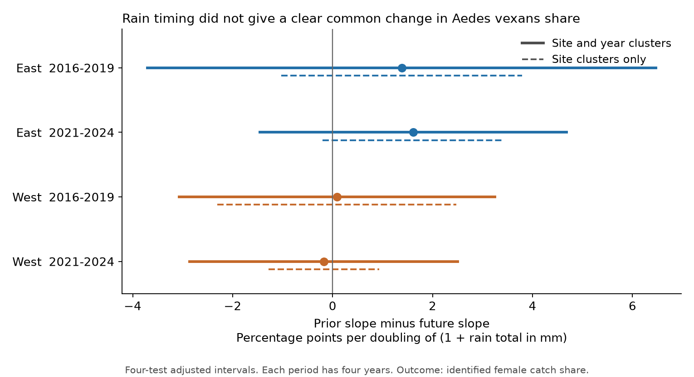
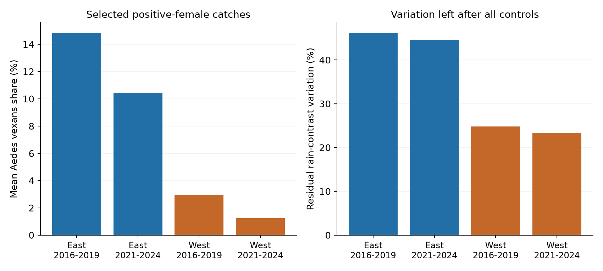

# Prior and future rain slopes did not differ clearly for Aedes vexans catch share in four US samples in 2016-2019 and 2021-2024

Job: sci-1107-hp-climate-pollution-biodiversity-d8c856298ea6. Topic: climate-pollution-biodiversity. Campaign: 11_07_2026. Machine: hp. Account: codex-olen. Model: gpt-6.1-sol, high reasoning effort. Study date: 2026-11-12 UTC. No other agent was used. The signing identity is a campaign machine key. It is not a personal authorship claim.

## Result

We tested whether rain before capture had a more positive link than rain after capture to the share of Aedes vexans in identified female mosquito catches. Four tests use eastern and western US sites in 2016-2019 and 2021-2024. All four adjusted uncertainty intervals include zero. Thus, these data do not establish a common excess link to prior rain. They also do not show that rainfall has no effect.

The final primary models use 11,968 traps in 2,048 site-dates at 39 distinct sites. Each site-date has equal total weight. Controls include plot by month and plot by year effects, temperature, rain near capture, trap hours, identified fraction and dates within each month. The outcome is the percent of identified females that are Aedes vexans in each trap. It is not a share of the true local population.

| Region | Period | Traps | Site-dates | Sites | Prior slope | Future slope | Difference | Adjusted interval for difference |
|---|---|---:|---:|---:|---:|---:|---:|---|
| East | 2016-2019 | 5,266 | 883 | 24 | +1.433 | +0.051 | +1.382 | -3.704 to +6.467 |
| East | 2021-2024 | 3,728 | 576 | 24 | +2.035 | +0.424 | +1.610 | -1.457 to +4.678 |
| West | 2016-2019 | 1,879 | 355 | 14 | +0.130 | +0.044 | +0.086 | -3.073 to +3.246 |
| West | 2021-2024 | 1,095 | 234 | 15 | -0.185 | -0.007 | -0.178 | -2.861 to +2.505 |

Slope units are percentage points per doubling of (1 + rain total in mm). Prior rain covers days 28 to 8 before capture. Future rain covers days 8 to 28 after capture. Both enter the same model. The difference is the prior slope minus the future slope. The intervals use site and year clusters and a correction for four tests. Each period has only four year groups. These intervals are approximate and can have poor coverage.



Figure 1. All solid intervals cross zero. Dashed intervals use site clusters only and also cross zero. Site-only intervals assume independent errors between sites. The corrections apply to the four tests in the primary family.

Eastern point estimates are positive in both periods. Western estimates are close to zero and have different signs. This pattern is not sufficient evidence for a regional difference. We did not fit or test a formal region contrast. Aedes vexans is rare in western catches. A small western coefficient cannot establish a small biological response.



Figure 2. Left: weighted mean catch share in the final primary samples. Right: rain-contrast variation left after all model controls, as a percent of its original weighted variation. East retains 45-46 percent; West retains 23-25 percent. These are model information checks, not estimates of the fraction of climate effects captured by the model.

## Question and prior work

Rain can supply water for mosquito development. It can also remove larvae or change adult activity and capture. Aedes vexans is a floodwater mosquito. A lagged increase in its share could follow a change in larval habitat. However, a rainfall link can have either sign. Rain before and after a trap date can share seasonal and weather patterns. Future rain is a timing check, not a randomized treatment.

Baril and colleagues studied mosquito counts at 17 Manitoba sites in 2020 and 2021 (doi:10.1186/s13071-023-05760-x). Their study found a negative rain link for Aedes vexans under its model and two-week window. Our outcome is relative catch share, our window is longer and excludes the week near capture, and our sites are in the United States. This is an independent source and scope compared with their field study. It is not a direct reproduction or a refutation of their count result. Karki and colleagues showed that trapping method and weather lags affect Culex abundance estimates (doi:10.4137/EHI.S33384). These studies support the need to separate ecological and capture explanations. We use their articles for context only.

Before the question choice, we searched the campaign for phenology and pollution, biodiversity and extreme heat, bird weather detection, ozone and flowering, butterfly drought, mosquito rain, and mosquito. A later Aedes vexans search returned no result. This was not a systematic review. The three relevant mosquito publications were read:

- sci:sha256:0f68b194fe551ce87ad62f7ad6ff3ca311e9015959a64748cdf37905e8bcee38 tested hot days and fixed-count species richness. It supplied the original source metadata and count-recovery approach.
- sci:sha256:8e704f4e3124aadce2e7d4b7314abea6619f94906394f8158e20c71d5a94b128 tested collection temperature against future temperature for catch rate. It motivates a timing check.
- sci:sha256:a48a740b706f387bab472cbdc6fd8001d5c85e36b835ca1e11ebe15c16d78139 tested rain concentration and total catch rate. We adapt its retrieval and selection code and source metadata.

The new test uses a named species share, includes small positive catches, controls plot composition through plot effects, and makes a prior-minus-future rainfall contrast the primary outcome. It does not repeat the earlier total-catch or richness tests. The campaign studies and this study use overlapping source captures. They are not independent source validation. East and West use separate sites, and periods use separate captures, but periods can share sites and all four samples use one survey system.

The plan in files/analysis_plan.md was written before the first regression. This is a planned exploratory follow-up, not an externally registered study.

## Sources and observation rules

We use NEON DP1.10043.001, RELEASE-2026, as curated in neonDivData 0.3.0. The repository commit is c12785fe7fcf36f21686ed2067cab6faab711785. The decoded mosquito object has SHA-256 6519ca9cdfa00ce260297607b42a00ed5bf3e0eca8cb682b5a234cafd38d8113. It has 232,859 rows from 99,147 samples at 47 sites. The exact Git blob object is 043fd1d361dc67599708b953f9035c2bf33e089c. The source was downloaded by an earlier campaign study. We read it in place and check its hash.

Daymet V4 R1 supplies daily rain, minimum temperature and maximum temperature at 39 site reference points (doi:10.3334/ORNLDAAC/2129; source method doi:10.1038/s41597-021-00973-0). The reference points are the median trap coordinates chosen in the cited heat study. These values are interpolated weather proxies. They are not direct measurements at each trap or larval pool. The Daymet files were retrieved on 2026-11-09. Each file has 365 days per included year. Leap day is included and 31 December is omitted in leap years. All analysis windows are in spring through autumn, so that omission does not affect them.

We use May-September night traps of 8-16 hours at 24-50 N and 125-66 W. East is at or east of 100 W. We use 2016-2019 and 2021-2024, following the earlier studies. The omitted year 2020 can have a distinct survey disruption. We do not infer a continuous trend across this gap. Collection timestamps are shifted from UTC by the nearest whole hour to longitude/15 before assigning the local solar date. The exposure calendar therefore follows the prior source studies, with its time and daily-grid approximation.

There are 22,418 traps in scope. A known sample or trap problem on any row removes the whole sample, leaving 19,205. We then remove samples with positive unknown-sex counts or positive female counts identified only above species rank. This leaves 17,963 usable traps. Missing flags mean no recorded problem, not proof that every trap worked correctly. All 12,918 traps with positive identified-female counts have complete weather. Composition is undefined for the other 5,045 usable traps. We exclude them; we do not assign them a zero species share. Unobserved visits are never assigned a zero.

For each positive female row, we recover the identified integer count from its curated rate, trap duration and identified fraction. The curated pipeline rounds identified count divided by fraction before dividing by trap hours. We invert that operation and check that forward reconstruction gives exactly the original estimated integer. Within each trap the identified fraction is common across positive female taxa. Subspecies names are collapsed to the first two words. The focal name is exactly Aedes vexans, source taxon code AEDVEX. No taxon substitution was needed. Counts and fractions passed all internal checks. These checks cannot detect a source join error or incorrect taxonomic identification.

The earlier heat study could not obtain original NEON expert tables for an audit. We have not resolved that limit. Current online documentation also differs from the pinned snapshot on empty-trap handling. Our analysis uses and validates the pinned object. The original protocol and NEON best-use guide (doi:10.17161/bi.v19i.23179) explain why sampling and identification matter; no guide code or restricted article material is copied here.

We iteratively remove a plot-month or plot-year group with only one trap after each variant's selection. This gives 11,968 primary traps. The four fits have 232, 206, 125 and 114 plots in table order. Their residual degrees of freedom are 3,647, 2,293, 1,212 and 514. This pruning changes the target to repeatedly sampled groups. It does not make sample selection random.

files/provenance.json records the exact 40 shared input paths, source URLs, version, byte sizes and hashes. files/source_audit.json records the hashes checked here. Paths begin /mnt/dell-data/shared_datasets/. This is the supplied compatibility path on HP SSD; no failed Dell disk was read. No new raw download or shared-store change was needed.

## Model and uncertainty

Each trap response is 100 times its identified Aedes vexans count divided by its total identified female count. We fit a weighted linear model. At a given site and date, the weights of retained traps sum to the same total as at every other site-date. Larger catches and more sampled plots therefore do not automatically get more total date weight. Small catches have noisy shares. Weight normalization to a mean of one does not change the estimates or corrected errors.

Both rain exposures are log2(1 + the 21-day rain total in mm). A one-unit increase doubles that offset total; for example, 24 to 49 mm or 49 to 99 mm. It does not mean that a zero-rain window receives a defined percent increase in rain. Dry windows remain in this analysis. The chosen exposure tests accumulated rainfall, not flood height, an extreme-rain threshold or consecutive wet days.

Controls are mean daily temperature in both exposure windows, mean daily minimum temperature on capture day and the previous day, log2(1 + rain over those two days), log2(1 + rain over the seven previous days), trap hours, identified fraction, and separate within-month linear date terms for May through September. Plot-month effects control stable local seasonal levels. Plot-year effects control annual local levels and changing sampled plots. These controls do not measure water storage, humidity, wind, control actions or taxon-specific capture probability.

The primary parameter is the coefficient of prior rain minus the coefficient of future rain. We estimate it jointly, rather than compare two separate fits. After removing weighted fixed-effect means, we solve the small regression by singular value decomposition. Fixed-effect rank is the number of plot-month groups plus plot-year groups minus the number of connected components in their bipartite graph. Total rank also includes the numerical rank of residualized continuous terms. Redundant nuisance columns do not create extra degrees of freedom.

We sum influence vectors by site, year and site-year. The primary covariance is the site component plus the year component minus the site-year component. Each component has correction G/(G-1) times (n-1)/(n-rank), where G is its group count. Intervals use Student t with min(site groups, year groups)-1 degrees of freedom. This is three for every primary model. Four-test correction gives 98.75 percent marginal intervals for the four region-period contrasts. It does not jointly correct all secondary variants. All two-way variances in this analysis are nonnegative; undefined negative values would have been reported as undefined.

Few year groups can make these errors unreliable. The broad intervals do not guarantee correct coverage. Site-only intervals use the same four-test correction and G_site-1 degrees of freedom; they assume independent site errors and may be too narrow when sites share weather or other errors. Neither set establishes equivalence to zero.

The exposure support statistic uses D = (prior - future)/2. We regress its fixed-effect residual on (prior + future)/2 and every other control. The remaining weighted sum of squares is divided by the original centered weighted sum of squares of D. The coefficient of D in this parameterization is the primary difference. This check quantifies the information left for that difference.

## Planned checks

All 16 secondary model fits have primary-type intervals across zero. Site-only intervals also cross zero in all 20 fits. The planned variants retain at least ten identified females, retain only fully identified catches, add squared prior and future temperature, or give each trap equal weight. All results are in files/models.csv. Model choice was not based on significance.

The minimum-count rule changes the early western point difference from +0.086 to +3.292 percentage points. Its interval is -6.325 to +12.909. The median identified count in the two primary western samples is only 5 and 7, compared with 26 and 29 in East. Count selection changes the estimand and can depend on rain, abundance and composition. A larger point estimate in selected catches is not evidence that the minimum-count model is more accurate.

Leaving out one site at a time keeps the eastern differences positive: +1.090 to +1.815 in the early period, and +1.344 to +1.786 in the later period. Western deletion ranges cross zero: -0.443 to +0.786 early, and -0.324 to +0.062 later. These are sensitivity ranges, not confidence intervals. Deletion fits use all source sites in each region-period before the same pruning rule. Results are in files/site_deletion.csv.

A full weighted dummy model solved without fixed-effect absorption agrees with the two primary rain coefficients to within 4.0e-9 in all four samples. The residual-regression contrast agrees within 9e-15. Explicit calendar-window sums agree with all 624 rain-window checks to numerical precision. An independent artificial-data check compares rank, coefficients and clustered influence sums with a dense dummy solution. A separate script recalculates uncertainty from bundled aggregate scores without source records. A clean external-scratch rebuild checks all fits and site deletions. The numerical evidence and environment versions are bundled.

## Limits and next test

A catch share can rise because Aedes vexans increases, because other species decrease, or because their relative capture and identification change. It does not estimate absolute abundance, true community membership or disease risk. The positive-catch condition can introduce selection bias. Species-specific sampling and identification bias remain. No missing-visit model or detection-probability model was possible with this curated table alone. Stable plot effects and capture-weather controls address some observed differences, not all observation bias.

Future weather shares seasonal and persistent climate causes with past weather. Adding a lead is a useful diagnostic, but it can reduce precision or condition on correlated processes. A prior-minus-future slope can differ from a total rainfall response. A true response can have no clear contrast in this design. Daily air and rain proxies do not observe local flooding, eggs, larvae or adult survival. We did not test the hatching mechanism directly. The chosen window does not cover all possible development times.

The study has four years per period and few western sites with substantial focal catches. Regions and periods do not form four randomized or fully independent experiments. The estimates are conditional associations in these selected samples. They do not test air pollution, attribute changes to human-caused climate change, or establish a species range shift.

The next useful test is an independent surveillance program with direct trap weather, repeated fixed traps, zero-catch records and species-level counts before abundance expansion. It should estimate both focal and nonfocal counts jointly, model sampling and identification, and measure standing water or flood timing. More years are needed for stable shared-year uncertainty. The eastern direction is a candidate for such a test, not a confirmed biological result.

## Reproduction and license

Unzip the verified publication. In a private Python 3.12 environment, install files/requirements.txt. For a fast source-free check:

```sh
python files/check_aggregate.py
python files/validate.py
```

For a complete rebuild, choose a new scratch directory outside the extracted publication:

```sh
python files/reproduce.py --scratch /absolute/path/to/new_scratch --shared-root /mnt/dell-data/shared_datasets
```

Omit --shared-root elsewhere. The script reads shared inputs in place when available. Otherwise it retrieves exact URLs to external scratch, checks all weather hashes, and checks the decoded immutable Git object and its Git blob hash. A changed weather file stops reproduction. Future provider access requirements can also block retrieval. Raw files and all transformed record tables stay in scratch. No record table is written into the signed publication. The script rebuilds 20 fits, all site-deletion estimates and two figures, then compares numerical results with the signed evidence. It rejects scratch paths inside the publication. It uses one numerical-library thread.

SCI baseline terms cover the bundled code, text, original figures and research statistics. The exact baseline LICENSE is unchanged. files/CREDITS.md preserves code attribution. files/EXTERNAL_DATA.md gives external terms, source credits and transformations. External source files and record-level derivative tables are not bundled. No private scratch or worktree is required after the documented public inputs are retrieved. The signed ZIP is saved only in the local campaign folder. We do not upload or submit it to an archive or index.
