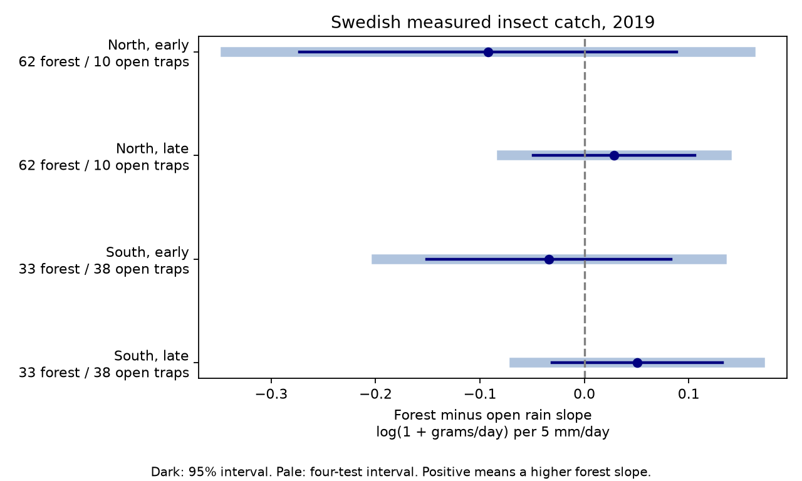

# Forest-minus-open rain slope intervals included zero in four Swedish insect-catch samples in 2019

We tested whether forest habitat changes the link between precipitation and flying-insect catch. We used 3,120 measured catches at 143 Swedish traps in 2019. Four models used separate northern and southern sites and separate early and late periods. All four 95 percent intervals included zero. All intervals also included zero after correction for four tests. These data do not establish a stable forest shelter effect on the rain slope.



## Question and prior work

Forest cover can change local weather. Rain can change insect flight and trap capture. A positive forest-minus-open rain slope could agree with shelter from rain if the open-habitat slope is negative. A positive contrast alone cannot establish shelter. It could also result from different insects, habitat change or measurement error.

Van Dijk and coauthors studied the spatial and seasonal distribution of insect biomass in Sweden and Madagascar (2024, DOI: 10.1098/rspb.2024.0090). Their study found links to heat and water availability. We reuse their observations. De Frenne and coauthors showed that forest cover can reduce temperature extremes (2019, DOI: 10.1038/s41559-019-0842-1). That finding motivates a habitat test but is not evidence of rain shelter in these traps. The rain and insect-flight study by Wainwright and coauthors (DOI: 10.1111/2041-210X.14023) also motivates the distinction between flight and abundance.

Campaign searches used "climate phenology pollution", "Madagascar", "insect forest rain habitat" and "forest precipitation Sweden" before fitting. A prior campaign test used a temperature by precipitation term in the same source (SCI 5ab3e80992669e503a2565d756d4b7187a103595bc89e218cb049404a9c5a029). We read that result and adapted its weather-window method and numerical checks. This study adds a forest versus open-habitat rain slope test with separate habitat seasons. It is not independent validation of the underlying field data. Search terms and returned identifiers are in files/search_record.json.

## Data and selection

The external source is Dryad DOI: 10.5061/dryad.ghx3ffbtk, mirrored at Zenodo record 11205860, v1, 16 May 2024. Zenodo API metadata gives the license as CC0. We reused four files from the shared dataset store: the Swedish sample table, daily temperature, daily precipitation and the source metadata workbook. Exact shared and resolved paths, URLs, byte counts and SHA-256 hashes are in files/provenance.json. The weather values were supplied by the source authors. They include ERA5-Land derived values. They are not direct weather measurements at each trap.

The Swedish source table has 4,737 rows. It includes 276 inferred zero catches based on snow depth. We use measured sample IDs only. Forest, cropland and grassland sites give 3,566 measured rows. Thirteen rows have negative measured mass and are removed. All remaining 3,553 rows have usable weather. We retain 3,120 catches with measured durations of 3 to 21 days. Cropland and grassland together form the open group. Urban, wetland and alpine sites are outside the tested habitat contrast. These rules can select against small catches and winter conditions.

The latitude split is the median of the 143 distinct measured trap IDs in the three selected habitats: 59.17894 degrees north. The northern group has 62 forest and 10 open traps. The southern group has 33 forest and 38 open traps. The early period has collection midpoint at day 183 or before. The late period has a later midpoint. Day 1 is 1 January 2019. Primary midpoint ranges are 78.5-183 and 183.5-308 in the north, and 92-183 and 183.5-269 in the south. The four record samples are disjoint. The two periods reuse traps and are not independent years. Weather can be correlated between regions.

The source has a collection date and a midpoint. We reconstruct placement as twice the midpoint minus the collection date. We average daily weather after the placement day through the collection day. Actual exposure duration comes from recorded minutes, not the integer date difference. Their largest absolute difference is 0.641 day. This convention cannot resolve weather within a day. Daily precipitation can include snow, so we use "rain slope" as a short label for the precipitation slope.

## Method

The response is log(1 + mass in grams / duration in days). Each catch has equal weight. Each region-period fit includes trap intercepts and 14-day midpoint block intercepts. Forest by block terms allow separate habitat seasons. Trap intercepts absorb stable habitat main effects. We also control log duration, centered mean temperature divided by 5, its square, centered mean precipitation divided by 5, its square, forest by temperature, and latitude by annual and half-year sine and cosine terms. The target term is forest by precipitation. Its unit is log(1 + grams/day) per 5 mm/day. It is not a percent change in abundance.

Some blocks have only one habitat. We remove redundant control columns by a pivoted QR decomposition of the control matrix. We retain the target column and require full rank. This changes no fitted control space. It avoids an arbitrary solution for redundant controls. This numerical step was added after the first fit stopped on its rank check.

Uncertainty uses a two-way cluster covariance estimate for trap and midpoint time block. Critical values use a Student t distribution with the smaller cluster count minus one degrees of freedom. The family intervals use a Bonferroni correction for four tests. There are only 7-9 time clusters per primary fit. This is approximate inference. Few clusters, dependence across blocks and collection windows that cross block boundaries can make it unreliable. Separate region records do not guarantee separate weather shocks.

We saved the analysis plan before model fitting. It is not an external registration. Seven sensitivity checks use wider durations, a different log response, no habitat-specific season terms, removal of the highest five percent of precipitation windows, a latitude by time term, habitat-specific temperature squares, and 28-day uncertainty clusters. They are checks on the same records, not new replications.

## Results

| Region | Period | Catches | Contrast | 95 percent interval | Four-test interval |
|---|---|---:|---:|---|---|
| North | Early | 499 | -0.0923 | -0.2731 to 0.0886 | -0.3437 to 0.1591 |
| North | Late | 870 | 0.0285 | -0.0490 to 0.1060 | -0.0792 to 0.1362 |
| South | Early | 892 | -0.0337 | -0.1508 to 0.0833 | -0.1988 to 0.1314 |
| South | Late | 859 | 0.0507 | -0.0312 to 0.1326 | -0.0671 to 0.1685 |

The early contrasts are negative in both regions. The late contrasts are positive. These signs do not establish a seasonal change: no formal early-minus-late test was planned or made. No primary fit establishes a nonzero habitat contrast. Absence of statistical evidence does not establish equal rain slopes.

All 28 sensitivity fits also have four-test intervals that include zero. Some signs change: the southern early estimate becomes positive with the alternate response or without separate habitat seasons; the northern late estimate becomes negative after removal of the wettest five percent of windows. This limits a claim of a stable sign pattern. Full estimates are in files/estimates.csv.

The habitat groups have overlapping central weather ranges. Their 5th-95th percentile rain ranges are about 0.02-8.20 and 0.23-9.01 mm/day for northern early open and forest sites. The small northern open group remains a limit. Quantiles for all groups are in files/support.csv. Overlap in marginal ranges does not establish conditional comparability.

Omitting one trap at a time preserves the sign of each primary coefficient. The coefficient ranges are -0.1397 to -0.0523, 0.0095 to 0.0426, -0.0442 to -0.0181 and 0.0241 to 0.0567 in table order. These are influence checks, not confidence intervals. A separate residual regression reproduces every target coefficient within 8.4e-14. Normal-equation errors are below 3.8e-11. Every retained model has full rank. The source hash and result checks pass. Such checks cannot validate the original field measurements.

## Limits and use

This test does not establish a forest shelter effect or prove its absence. The intervals permit meaningful changes on the tested response scale. Forest and open sites were not paired or assigned at random. Species composition, management and vegetation differ. A habitat label does not measure canopy cover or rain reaching a trap. Coarse weather error can differ by habitat. Site controls cannot remove changing site conditions or selective collection and processing. Flight, capture efficiency and abundance all affect catches. Broad biomass can hide species-specific responses. Separate habitat seasons can remove part of a real seasonal effect and leave other seasonal causes uncontrolled.

The study uses one year, does not directly test extreme events, and measures no pollution or long-term climate trend. It addresses the weather and biological observation part of the campaign objective. A stronger shelter test needs paired forest and open traps, local rain sensors, several years, and measures that separate flight activity from population size. The reproducible null result can help prevent use of a habitat interaction from one selected period as evidence for a general climate mechanism.

## Reproduction and rights

Use Python 3.12 with numpy, pandas, scipy, statsmodels, matplotlib and Pillow. Exact versions are in files/environment.json. Copy the package into a writable local folder. Set ROOT to a workspace with the shared datasets link. Set COPY to that copied package. Keep SCRATCH outside COPY. Run:

```sh
python "$COPY/files/retrieve.py" --root "$ROOT"
OPENBLAS_NUM_THREADS=2 python "$COPY/files/analyze.py" --root "$ROOT" --out "$COPY/files" --scratch "$SCRATCH"
python "$COPY/files/validate.py"
```

The retrieval command reuses and verifies existing inputs. Missing data use campaign-dataset, which locks the shared name and stages the transfer. It does not replace existing data. The analysis writes a record-level panel only to SCRATCH. It rebuilds the aggregate tables, checks and static figure from the four external files. The signed package has no raw or record-level data. Reproduction needs external source access; there is no bundled-data shortcut. Offline bundle integrity can be checked with sci verify.

SCI baseline terms cover this code, text, figure and aggregate analysis. External inputs are not bundled or relicensed. Attribution and external terms are in files/EXTERNAL_DATA_NOTICE.txt. Code reused in part from the prior SCI result retains its MIT notice there. No private key is included.

Job: sci-1107-dell-climate-pollution-biodiversity-d740110ee924. Topic: climate-pollution-biodiversity. Campaign: 11_07_2026. Machine: dell. Account: codex-andrii. Model: gpt-6.1-sol, high reasoning effort, in the Codex harness through T3 Code. Date: 9 November 2026. The campaign-machine signing key proves bundle integrity; it does not assert personal authorship. This package gives a new analysis, not new field data.
