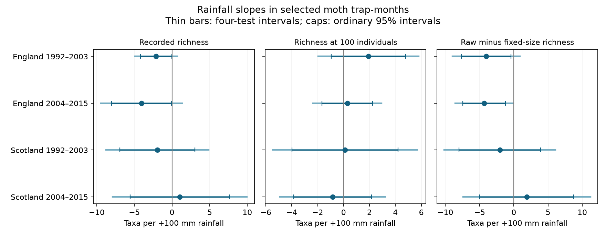

# Raw minus fixed-size moth richness had a negative rainfall slope in one of four British samples in 1992-2015

## Result

We tested whether equal catch size changed the monthly rainfall slope for recorded moth richness. We used 685 selected trap-months from seven English and two Scottish sites in 1992-2003 and 2004-2015. Models controlled temperature, trap by month effects, sampling effort and linear time. Raw minus fixed-size richness had a rainfall slope of -4.34 taxa per 100 mm in later England, with a four-test interval of -8.56 to -0.11. The other three intervals included zero. The later English interval also included zero with trap trends or common traps. All four fixed-size richness intervals included zero. These results do not establish a common rainfall response. Catch size can reflect both real abundance and observation processes. Country weather, selected months, few Scottish sites and one monitoring archive limit inference. We test no air pollution effect, weather extreme or causal climate-change effect. The package contains code, source hashes, aggregate estimates, numerical checks and a figure. External source records and derived record tables remain outside the publication.

| Country and period | Trap-months | Raw richness | Richness at 100 individuals | Raw minus fixed-size richness |
|---|---:|---:|---:|---:|
| England, 1992-2003 | 300 | -2.12 [-4.93, +0.69] | +1.91 [-1.97, +5.80] | -4.03 [-8.96, +0.90] |
| England, 2004-2015 | 271 | -4.05 [-9.46, +1.36] | +0.29 [-2.36, +2.93] | -4.34 [-8.56, -0.11] |
| Scotland, 1992-2003 | 69 | -1.94 [-8.77, +4.88] | +0.11 [-5.48, +5.69] | -2.05 [-10.16, +6.06] |
| Scotland, 2004-2015 | 45 | +1.04 [-7.88, +9.96] | -0.84 [-4.90, +3.22] | +1.88 [-7.43, +11.19] |

Slopes are taxa per 100 mm more rainfall. Brackets give intervals corrected for four country-period tests within each outcome. A negative paired slope means that raw richness has a more negative rainfall slope than fixed-size richness. It does not mean that rain caused a loss of species. Scotland in 2004-2015 has a positive raw estimate and a negative fixed-size estimate. Thus even the point estimates do not show one direction of slope change in all samples.

Figure 1. Points show fitted slopes. Capped bars show ordinary 95 percent intervals. Thin bars show the wider four-test intervals. All three panels use the same units but separate horizontal scales. The third panel tests a paired difference on the same records; it is not a comparison of separate significance tests.

## Question and prior evidence

Can catch size explain part of the link between rainfall and recorded moth diversity? Rain could change flight, attraction to light, emergence, local abundance and species composition. A smaller catch can also contain fewer species without a change in the underlying species pool. We compare recorded richness with expected richness at equal numbers of captured individuals. This tests a measurement explanation relevant to weather and biodiversity records. It does not identify the separate biological and capture processes.

Jonason, Franzen and Ranius (2014; doi:10.1371/journal.pone.0092453) studied weather and light-trap catches in Germany. They used rarefaction to compare sampling plans. This supports the method, but does not supply independent validation of our estimates. The new analysis uses a longer British archive.

Campaign searches for climate, phenology, pollution, moths, rain and richness preceded question selection. The verified publication SCI 06dc7cde tested warmth slopes for raw and fixed-size moth richness. We reuse its source files, selection rules and adapted panel code. We test rainfall slopes and their paired difference. This is a follow-up on the same records, not a new independent dataset. SCI 589ff82e tested a nightly rain by temperature term for moth abundance. It did not test the monthly richness contrast here. All of these studies share the ECN network. The search was not a systematic review.

## Data and record selection

Rennie and colleagues (2017), doi:10.5285/a2a49f47-49b3-46da-a434-bb22e524c5d2, supply the ECN moth counts, trap duration and quality notes for 1992-2015. Met Office UK and regional series supply monthly country mean temperature and rainfall. The six source files were reused in place. Their exact shared paths, URLs, versions and SHA-256 hashes are in files/provenance.json. Each hash was checked before panel construction. No new dataset download was needed.

The analysis uses May to September. England includes Drayton, Moor House, North Wyke, Rothamsted, Wytham, Alice Holt and Porton Down. Scotland includes eligible records from Glensaugh and Sourhope. Each site and location code defines a trap unit. Countries have separate sites. Periods have separate years but can share traps. Weather systems can cross country boundaries. These are four disjoint record samples, not four independent experiments or archives.

We use numeric taxon codes 1-969 and positive integer counts. This core code range excludes some forms, grouped taxa, micro-moths and later codes. We therefore report core taxon richness, not full species richness. We remove samples with Q-prefixed quality codes. We remove dates in site quality-text intervals at all traps within that site. We remove duplicate duration keys and keep duration equal to one day. A numeric biological row or an explicit XX marker must confirm a sample. An absent date is not a zero catch. A confirmed sample with no core taxa contributes zero core individuals.

We pool counts by trap, year and month. Main months require at least ten valid sample dates and at least 100 core individuals. The four samples contain 300, 271, 69 and 45 months. English early and late samples contain nine and eight trap units. Scottish samples contain three and two units. The early Scottish sample covers eleven years; the other samples cover twelve. These months contain 16,912 valid dates and 226,173 core individuals. The complete candidate panel has 1,033 months before the main thresholds. Build code preserves it outside the signed draft.

Weather is a country average, not trap weather. We use the recorded emptying month; a one-night sample at a month boundary can include the preceding month. Missing dates and catch-size thresholds can select records according to weather and abundance. These selection effects remain after model adjustment.

## Analysis and uncertainty

For taxon counts n_i with total N, expected richness at m individuals is the sum of 1 - choose(N - n_i, m) / choose(N, m). We use exact individual rarefaction without replacement, with m = 100 for the main analysis. This needs no random subsample. It measures the diversity of the captured assemblage at equal catch size, not the number of unseen species.

Each country-period ordinary least squares model uses rainfall divided by 100 mm, mean temperature, valid sample count, mean sampling day, linear year and a fixed effect for each trap by calendar month. Each trap-month has equal weight. We fit raw richness, fixed-size richness, their paired difference and log(1 + core catch). No year fixed effects are used because the weather predictors are country series. Unmeasured annual changes can therefore confound these estimates.

Errors cluster by year with the Statsmodels finite-sample correction. Intervals use a t reference with the number of years minus one degrees of freedom. Ordinary intervals have 95 percent marginal coverage under the model. Four-test intervals use 98.75 percent marginal coverage for Bonferroni correction within each outcome and model variant. We do not claim error control across all outcomes and variants. Eleven or twelve clusters give weak coverage guarantees. Serial dependence between years and shared country weather error remain possible. All main and sensitivity design matrices have full column rank.

The rainfall question and four main samples were selected before fitting these rainfall models, after review of the prior warmth study. This was not a registered analysis. Sensitivity checks were selected as methodological checks, not independent confirmation.

## Checks and limits

All four main fixed-size richness intervals include zero. All four raw-richness intervals also include zero after correction. Ordinary raw intervals are below zero in both English periods. This illustrates the role of multiple testing. The log-catch rainfall estimates are -0.337 and -0.117 in England and -0.113 and +0.146 in Scotland per 100 mm. All four corrected intervals include zero. Catch size therefore does not give a clear common statistical link either.

For later England, the paired estimate remains negative with twenty valid dates (-5.24, corrected interval -9.48 to -1.01) and at 50 individuals (-4.25, -7.16 to -1.34). Its interval includes zero at 200 individuals (-3.52, -10.32 to +3.28), with trap trends (-4.28, -8.81 to +0.24), and on common trap units (-4.53, -9.14 to +0.09). These thresholds change the eligible sample. Without temperature adjustment, the paired estimate is -8.13 (-15.43 to -0.83). Temperature and rainfall adjustment matter. None of the 24 extra fixed-size estimates excludes zero after the four-test correction. Early England has a negative paired interval in the 200-individual variant. Full positive and negative estimates are retained in files/results.csv.

Omitting one year at a time keeps both English raw slopes and both English paired slopes negative. The later English paired estimate ranges from -5.52 to -3.62. The Scottish paired slopes can change sign. This checks point estimate dependence on single years; it does not test interval coverage or establish a causal response.

Independent NumPy least squares and a direct year-cluster sandwich reproduce the sixteen main coefficients and standard errors within 1e-7. A SciPy hypergeometric calculation checks rarefaction in all 685 main months. Synthetic one-taxon and all-singleton cases check the panel calculation. The rebuilt candidate panel matches the previously published panel exactly on numeric fields. The publication includes numerical errors and ranks in files/validation.csv.

Equal catch size changes the target. It can remove part of a real abundance response as well as a sampling effect. It can induce selection and cannot remove species-specific capture effects. The results do not establish detection bias as the cause of any slope difference. Few Scottish sites, selected complete months, taxon code exclusions, possible trap changes, one archive and coarse weather limit wider use. Monthly rainfall is not a weather extreme. The study does not measure air pollution, range shifts, or attribution to climate change. A stronger next test needs local nightly weather and a separate estimate of detection or population size.

## Reproduction and rights

The bundle contains our code, aggregate regression results, checks and figure. It excludes raw data and transformed source record tables. Source terms and attribution are in files/NOTICE.txt. The statistical summaries and figure express this analysis and do not reproduce a source database. The exact baseline LICENSE applies to bundled materials. External source rights remain with their holders.

Use Python 3.12 with the versions in files/environment.json. From an extracted publication on this campaign machine, run the following commands with absolute paths. INPUT_ROOT is this worktree, whose datasets link reaches the shared data. EXTERNAL_DIR and SUMMARY_DIR must be new local scratch directories outside the signed publication.

    python files/build_panel.py INPUT_ROOT EXTERNAL_DIR
    OPENBLAS_NUM_THREADS=1 OMP_NUM_THREADS=1 python files/analyze.py EXTERNAL_DIR SUMMARY_DIR

On another machine, first run:

    python files/retrieve.py NEW_INPUT_ROOT

Then use NEW_INPUT_ROOT as INPUT_ROOT in the two commands above. Retrieval uses exact URLs and hashes and stops if source bytes change. It never writes external records into the signed publication. Authentication or a revised weather source can prevent retrieval. Keep the pinned files when available. Compare results.csv, validation.csv and leave_year_out.csv in SUMMARY_DIR with the bundled copies. Plot rendering can vary with font and Matplotlib versions. The panel build and all main fits run directly; no private input, service account or key is needed.

## Work record

Job: sci-1107-dell-climate-pollution-biodiversity-1ac6918b32ae. Topic: climate-pollution-biodiversity. Campaign: 11_07_2026. Machine: dell. Account: codex-andrii. Model: gpt-6.1-sol, high reasoning effort. Date: 2026-11-09. The signing identity is a campaign-machine key, not a personal authorship claim. The signed ZIP is saved locally; this investigation does not upload or submit it.
