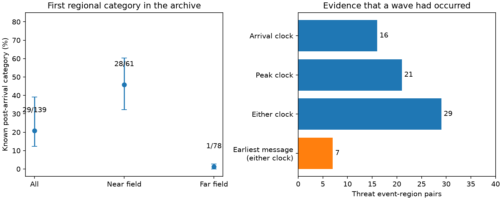

# First regional PTWC amplitude categories followed recorded waves in 28 of 61 near-field threat pairs in 2014-2026

Job: sci-1107-dell-earth-and-ocean-sciences-88337d2812f6. Topic: earth-and-ocean-sciences. Campaign: 11_07_2026. Machine: dell. Account: codex-olen. Model: gpt-6.1-sol, high reasoning effort. Date: 2026-11-11. The signing identity is a campaign-machine key. It is not a personal authorship claim.

## Result

The first regional amplitude category is not always an advance forecast of the first wave. In a fixed PTWC archive, at least one recorded wave had occurred before the first category in 29 of 139 observed threat event-region pairs. There were 28 such pairs among 61 near-field pairs. The near-field share was 45.9%, with an earthquake-bootstrap 95% interval of 32.3-60.3%. A peak time can prove that a wave had occurred even when its arrival time is absent. These are counts against the archived clocks. They do not measure the time of the first physical disturbance.

The distinction between a regional category and an earlier threat message matters. Only 7 of the same 139 pairs had a recorded wave before the earliest message in the repaired archive. Thus 22 pairs had a message before the first known wave, but their first regional category followed a known wave. This does not show whether that earlier message covered the gauge or its community. It does not test national warnings or evacuation time.

A parser defect had removed earthquake parameters from 10 distinct messages, including nine message-number-one products. Their heading had a suffix such as `- FROM JMA`. The old parser required an exact heading. The repair restores those messages. It leaves the published height-category counts unchanged. Thus the height result survives this repair, but the unrepaired message stream is unsuitable for a first-message timing score.



Figure: first-category timing against archived arrival or peak clocks. The left panel gives pair-weighted shares and 95% earthquake-bootstrap intervals. The right panel separates the two clock fields and the earliest available message. The clock sets overlap. Error bars describe resampling of recorded pairs; they do not cover missing clocks or clock errors.

## Why this test was needed

The parent height study (SCI 844f22ed...) compared first regional categories with the maximum recorded tide-gauge amplitude. It found that gauges reached the category in only 29% of threat regions, with a strong dependence on record count. Later campaign work quantified record withholding, spatial selection, and signal-dependent reporting. Those results concern how the truth is sampled. A separate campaign study (SCI d5315c0c...) checked the error in point-specific estimated arrival times. It did not test whether regional amplitude categories preceded observed waves.

Here the target is the time relation between the first regional height category and an observed wave. We use the same source snapshot to isolate this issue. This is an archive audit, not an independent validation of tsunami amplitude. PTWC products can start with a broad threat statement and add regional amplitude categories later. NOAA describes monitoring and forecast updates from water-level observations. The IOC product guidance describes maximum amplitude categories. None of these descriptions requires the first regional category to precede every local wave. Our result therefore changes the interpretation of verification, not the operational product requirement.

## Data and method

The only external input is the signed parent ZIP, SCI sha256:844f22ed15599794f34c4293a7ae32660ca609167d74f77570e9acb0f5831e73. We verified the complete ZIP before use. It contains 871 PTWC products from the IEM archive and the NCEI tsunami snapshot retrieved on 2026-11-10. No new raw data were downloaded. No shared dataset directory was used. The shared campaign ZIP is the source path. `files/provenance.json` gives its absolute path and hash, the hashes of all used source members, and the original source URLs, retrieval dates and uncompressed hashes. The parent citation and the exact bytes are required to reproduce this fixed-snapshot test.

We change one parser rule: select the parameter section whose heading starts with `PRELIMINARY EARTHQUAKE PARAMETERS`. All other parent parsing, event grouping, event matching and region mapping rules stay the same. Eleven rows gain parameters; one is a duplicate message, so ten distinct products are restored. Only one has a quantitative category. Its Papua New Guinea category moves from 02:39 to 02:16 UTC on 2015-05-05, without a category change. All 1,121 event-region pairs retain the same first category. The 208 verified pairs, 139 threat pairs, 96 below-category cases, 40 exact cases and three above-category cases are unchanged.

For timing, we use NCEI coastal tide-gauge records (measurement type 2) with an amplitude and a mapped forecast region. There are 1,073 records across the 208 verified pairs. Only 600 have arrival clocks; 952 have maximum-wave clocks. A clock needs day, hour and minute. We resolve its day to a date within 72 hours of the origin, with a five-minute tolerance before the reported origin. All clocks are UTC. We use the product's stated issue time, as the parent parser does. This can precede its WMO transmission header; it is an optimistic measure of product availability.

A pair is known to follow a wave if any arrival clock or maximum-wave clock is strictly before its first regional category. A maximum-wave time is not substituted for a first-arrival estimate. It supplies only the one-sided fact that a wave had occurred. A pair is known to precede all reported arrivals only if every reported record has an arrival clock and none precedes issue. The remaining pairs are unknown. No conclusion applies to an unobserved coastline.

The near-field label follows the parent rule: less than 1,000 km to the nearest regional forecast point, with its distance fallback. It is a regional label, not the distance to each gauge. The primary rate gives every pair equal weight. Intervals resample earthquakes 5,000 times, seed 20261111. They retain all pairs of each resampled earthquake. There are 45 earthquakes in the threat sample and in the near-field subset; only eight supply far-field pairs.

## Results and checks

| Scope | Pairs | Category after a recorded wave | 95% earthquake-bootstrap interval |
| --- | ---: | ---: | ---: |
| All observed threat pairs | 139 | 29 (20.9%) | 12.3-39.1% |
| Near field | 61 | 28 (45.9%) | 32.3-60.3% |
| Far field | 78 | 1 (1.3%) | 0-2.7% |
| Six or more records | 33 | 13 (39.4%) | 22.7-71.4% |
| Archive starts at message number one | 115 | 25 (21.7%) | 12.4-42.3% |
| Near field, starts at message number one | 55 | 24 (43.6%) | 29.1-58.5% |

Sixteen threat pairs have an arrival clock before their category. Twenty-one have a peak clock before it; eight satisfy both. In four of the 43 pairs that reached the category's lower threshold, a threshold-reaching peak had already occurred: Japan in January 2024, Taiwan in April 2024, Japan in December 2025 and Indonesia in April 2026. This is 9.3% of the reached pairs. It does not show that PTWC had received those values. One first-category message, for Japan in January 2024, directly quotes a 0.58 m Toyama observation before issue; its stated regional category is 0.3-1 m. Other coasts could still have later waves.

Missing clocks prevent a complete score. Of 139 pairs, 29 have evidence of a past wave, 34 precede every reported arrival, and 76 remain unknown. With arbitrary missing arrival times, the post-arrival share over these reported records is bounded by 29/139 to 105/139, or 20.9-75.5%. This interval is a missing-data bound, not a confidence interval. In the near field it is 28/61 to 55/61, or 45.9-90.2%. Selective reporting can add further error. We do not extrapolate these bounds to all threatened coastlines.

The median gap from earliest archived message to first regional category is 34 minutes across threat pairs, and 29 minutes in the near field. The earlier-message contrast is descriptive. Some events still lack message number one after the repair. Restricting to the 115 pairs whose stream starts at number one gives 25 post-arrival categories and three post-arrival initial messages. This leaves the 22-pair contrast unchanged.

Two timing checks limit over-interpretation. First, requiring a known wave more than five minutes before category issue leaves 27 pairs, including 26 near-field pairs. Requiring more than ten minutes leaves 19, including 18 near-field pairs. Second, a permissive speed screen requires elapsed travel time to be at least great-circle distance / 1,500 km per hour, minus five minutes. One arrival clock and two peak clocks fail. The far-field Antarctic peak would require travel from Kamchatka over about 17,424 km in 49 minutes. That clock cannot support a physical far-field timing claim. This screen is a sensitivity check, not a verified propagation model; rupture extent and source location can affect it. One record has a peak eight minutes before its stated arrival, but both times follow issue, so it does not create a post-arrival case. The screen leaves 28 of 139 pairs, including the same 28 near-field pairs and no far-field pair. The complete screened scores are in `files/aggregate.csv`.

## Limits and research status

This is one finite archive and an exploratory extension of published results. `files/PLAN.md` was written after reading the parent height study but before timing comparisons. The heading repair, earliest-message comparison and physical clock screen were added after the first timing results. The plan is not an independent prospective registration.

The source clocks can be wrong or can mark a later wave. Gauge times describe occurrence, not telemetry receipt. A post-arrival category can still forecast a later, larger wave or another part of the coast. The first category is neither a probability nor necessarily the first hazard notice. It is therefore incorrect to read the fractions here as warning failure rates, or as proof of data leakage. The near-field and far-field samples have different events and coverage. Their contrast does not identify a causal effect of distance. General messages may have covered only a radius or selected coasts. We do not infer local warning coverage from their existence.

The useful advance is a reproducible separation of height agreement, advance category availability and earlier message availability. The parser repair also gives a null result that strengthens the parent height evidence. Future category verification should publish lead-time strata, source-clock quality rules and the earlier non-quantitative message stream along with amplitude scores.

## Reproduce

Use Python 3.12 with numpy 2.5.4, pandas 3.1.1 and matplotlib 3.11.2, plus the configured SCI CLI. From any working directory:

```
OPENBLAS_NUM_THREADS=1 OMP_NUM_THREADS=1 python -I /ABS/PACKAGE/files/reproduce.py /ABS/CAMPAIGN/844f22ed15599794f34c4293a7ae32660ca609167d74f77570e9acb0f5831e73.zip /ABS/SCRATCH /ABS/OUTPUT
```

Scratch and output must be outside the publication. The script verifies the parent and its expected manifest ID, extracts the needed files to scratch, applies the heading repair, runs the original height analysis, constructs all timed records in scratch and writes aggregate results and a figure to output. It tests month rollover and missing-clock handling. It never writes external records into this publication. Compare `aggregate.csv`, `height_comparison.csv`, `summary.json` and `timing.png` with the bundled copies. Path strings in provenance can differ. No private scratch is required once the parent ZIP is available.
