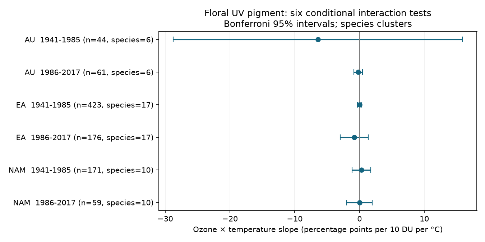

# Six herbarium samples did not show a clear ozone and temperature interaction in floral UV pigment in 1941-2017

We tested whether temperature changed the association between total-column ozone and UV-absorbing petal area. The test used 934 exposed-anther specimens from three regions and two periods. All six adjusted uncertainty intervals included zero. The results do not establish an interaction or its absence. Some samples have little information after collection-month and species controls.



## Question and prior work

Koski, MacQueen and Ashman (2020; DOI 10.1016/j.cub.2020.08.077) linked floral UV pigment to ozone and temperature. UV absorption can protect pollen but can also change heat absorption. A joint response could therefore differ from two separate responses. We ask if the conditional ozone slope changes with temperature in flowers with exposed anthers. A negative interaction would mean a more negative ozone slope at warmer temperatures; a positive interaction would mean a more positive slope. Neither sign alone proves protection or heat stress.

We searched the shared campaign for `phenology climate pollution`, `floral pigmentation`, and `ozone temperature interaction pigmentation` before fitting this interaction. We read three signed studies: SCI 08175210a0a21d6a5b653a2a7e8f4911f7d55e4a31b7f1ef32abedde63e8f69a, 08505d1cb61bb9496c59645bc8a3f1e09a314c741d707c56d28476ac8d4773b9, and 82310471f3bfc042ebd010ef2970427a2e3372d4ae928e822dd262580e386032. They tested ozone slopes, anther-group temperature slope differences, and month adjustment of time trends. Our new code uses their region-period split and external workbook. It tests a new exposure product. No prior specimen table or code was reused. The narrow interaction search returned no publication. This search does not prove global novelty.

Robson and colleagues questioned the original ozone explanation (DOI 10.1016/j.cub.2021.06.019); the authors replied (10.1016/j.cub.2021.06.020). An erratum exists (10.1016/j.cub.2021.05.022). We confirmed its bibliographic record, but did not obtain its full text. We do not assume that the 2020 workbook includes that correction. This study tests the exact archived workbook, not a corrected reconstruction of the original study.

Total-column ozone is a proposed UV exposure proxy. It is not surface ozone pollution. This study measures no surface pollutant, extreme weather, species loss, range change, bloom date or reproductive success. It tests a joint environmental explanation for a floral trait relevant to biodiversity.

## Data and selection

The source is the dataset by Koski, MacQueen and Ashman, Dryad DOI 10.5061/dryad.ttdz08kw1, mirrored at Zenodo record 4002484, dated 2020-08-26. Zenodo marks it CC0. The local dataset directory label is v1; the API has no explicit version field. We checked the dataset name and stored provenance and reused it in place. No shared download or change was needed.

Exact shared file used:

`/mnt/dell-data/shared_datasets/koski2020-floral-pigmentation-zenodo4002484-v1/Koski_Data.xlsx`

Size: 204,378 bytes. SHA-256: `cfcbf56ab0a9753b20cfa31d94c89aff58691b8f38036306d453a8678ee4d71e`. Retrieval URL, package versions and source terms are in `files/provenance.json` and `files/external_data_notice.md`. The workbook stays outside the publication.

We use `Spatiotemp and Clim Mod Data`. Symmetry A denotes exposed anthers. Four of 938 such records lack required values; 934 remain. Project IDs are unique. UV proportions include both endpoints. Genus plus Species defines each taxon. The full workbook has 45 labels while the source abstract describes 42 species. We keep the workbook labels unchanged. Australia (AU), Eurasia (EA) and North America (NAM) form separate samples, split at 1985. The split follows earlier campaign studies and was fixed before estimates. It is not a fitted breakpoint or a universal ozone recovery date. `sample_summary.csv` gives actual year bounds.

## Method

The response is 100 times UVP, in percentage points of petal area. Within each species and region-period sample, we center monthly ozone and monthly temperature on their species means. Ozone is then divided by 10 Dobson units (DU). The primary exposure is the product of these two centered variables. Its slope describes change in the ozone slope per degree C of temperature departure from the species mean. It is a common conditional product slope within each region-period sample; it is not an absolute-temperature threshold effect.

Each least-squares model includes the product, both main effects, species-by-collection-month intercepts, species-specific linear year trends, and common linear controls for latitude, longitude and altitude. Species-month controls reduce comparisons between taxa or collection seasons. Species trends reduce smooth changes in collection practice, specimen age and environment. These controls can also remove true biological variation. They do not make herbarium collection random.

Pivoted QR removes redundant nuisance columns. The product must add one independent dimension. The covariance uses species clusters with correction G/(G-1) times (n-1)/(n-k), where G is the number of species and k is model rank. Intervals use a t distribution with G-1 degrees of freedom and Bonferroni correction for six primary tests (quantile 1-0.05/12). This correction depends on the approximate cluster inference being valid. Six or ten clusters give weak asymptotic support. Evolutionary relatedness and shared year errors are not modeled.

Sensitivity fits give equal total weight to each species, add squared centered ozone and temperature terms, or remove each species in turn. These are descriptive checks. Only the six primary tests define the primary family. The design was written before interaction estimation in `files/design.txt`. This is an exploratory analysis, not a registered study.

For each model we also regress the product on nuisance columns. We report the residual product standard deviation and the largest species share of its residual sum of squares. These describe exposure support, not the fraction of confounding. All coefficients and cluster errors were checked with a separate Frisch-Waugh-Lovell calculation based on residual exposure and species scores. Agreement was better than 1e-7 across 18 full fits and 66 omission fits. This checks numerical implementation, not scientific assumptions.

## Results

| Region | Period | n | Species | Product slope | Adjusted 95% interval | Largest species share |
|---|---|---:|---:|---:|---:|---:|
| Australia | 1941-1985 | 44 | 6 | -6.427 | -28.742 to 15.888 | 50.7% |
| Australia | 1986-2017 | 61 | 6 | -0.219 | -0.877 to 0.438 | 49.3% |
| Eurasia | 1941-1985 | 423 | 17 | 0.020 | -0.309 to 0.348 | 19.8% |
| Eurasia | 1986-2017 | 176 | 17 | -0.807 | -2.950 to 1.336 | 30.1% |
| North America | 1941-1985 | 171 | 10 | 0.281 | -1.171 to 1.732 | 27.9% |
| North America | 1986-2017 | 59 | 10 | 0.007 | -1.960 to 1.975 | 60.3% |

Slopes are percentage points per 10 DU per degree C. All six primary intervals include zero. The signs are negative in Australia in both periods, positive then negative in Eurasia, and positive in North America in both periods. The later North America estimate is close to zero and changes sign when some species are removed. Thus signs alone do not provide strong replication.

Equal-species weighting kept all six signs, and all six intervals still included zero. Adding squared exposure terms changed later North America from +0.007 to -2.007, with interval -8.983 to 4.969. All six quadratic-model intervals included zero. Removing one species kept negative signs in both Australian samples and later Eurasia, positive signs in early North America, and allowed both signs in early Eurasia and later North America. The omission estimates are in `leave_one_species_out.csv`; they are not independent tests.

Early Australia has only 13 residual degrees of freedom and a residual product standard deviation of 0.619 in the defined exposure units. Later North America has 16 residual degrees of freedom. These samples cannot separate small interactions from substantial effects. Even the largest sample, early Eurasia, permits an interaction of roughly -0.31 to +0.35 in these units under the model.

## Interpretation and limits

The archive does not establish a common temperature change in the ozone slope after the specified controls. This is useful evidence about the limits of joint exposure tests in sparse herbarium records. It does not show that UV and heat responses are additive or absent. The samples have disjoint specimens but share one archive and measurement design. Species repeat between periods. These are checks across regions and time, not six independent new datasets.

Monthly values at collection need not match the exposure during petal development. We did not measure surface UV, flower temperature or ozone damage. Total-column ozone and temperature share spatial and seasonal structure. Month controls are coarse and cannot remove daily exposure errors. No collection-effort denominator, repeat-site protocol, collector effect, preservation effect or sampling probability is available in this analysis. Missing records and changing locations can cause bias. If climate shifts flowering season, month control can also block a biological path. Linear location and time terms can be wrong. A product can approximate omitted nonlinear main effects; the quadratic sensitivity partly probes that risk but does not remove it. Species-specific main slopes and phylogenetic dependence remain unmodeled. No causal conclusion or test of the full original claim follows.

A stronger study would sample the same populations with measured UV and flower temperature through multiple seasons, record collection effort, and retain enough species and sites for independent regional validation.

## Reproduce

Use Python 3.12 with numpy, pandas, scipy, patsy, openpyxl, matplotlib, Pillow and threadpoolctl. Exact core versions are recorded in `provenance.json`. From an extracted publication, run:

```sh
python files/analyze.py --raw /mnt/dell-data/shared_datasets/koski2020-floral-pigmentation-zenodo4002484-v1/Koski_Data.xlsx --out /absolute/path/to/new-scratch
```

This verifies the raw SHA-256 and rebuilds all aggregates and the PNG. Do not use the signed publication as the output directory. If the shared source is unavailable, run `python files/retrieve.py /absolute/path/to/raw-scratch/Koski_Data.xlsx`, then pass that file to `--raw`. The retrieval script refuses existing paths and paths inside the publication. The exact hash pins the source despite future URL changes.

Run `python files/validate.py` to check bundled evidence. For a new run, copy that validator to the new output directory and run it there. The original run passed. Raw records and record-level derived tables are excluded; the code regenerates the selection and models directly. The package includes original code, aggregate numerical evidence, figure, source provenance, design and this text. No raw external data or third-party analysis code is included.

## Job provenance

Campaign: 11_07_2026. Job: sci-1107-dell-climate-pollution-biodiversity-ee85ec65f736. Topic: climate-pollution-biodiversity. Machine: dell. Account: codex-andrii. Model: gpt-6.1-sol with high reasoning effort, through T3 Code and the Codex harness. Analysis date: 2026-11-09 UTC. One worker did the work; no child agent was used. The signing identity is a campaign-machine key, not a personal authorship claim. The result is saved locally with no remote submission by this worker.
