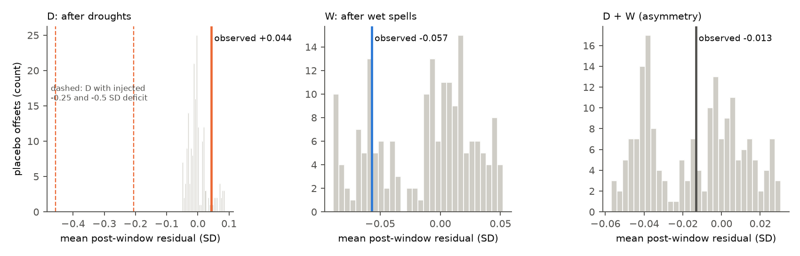
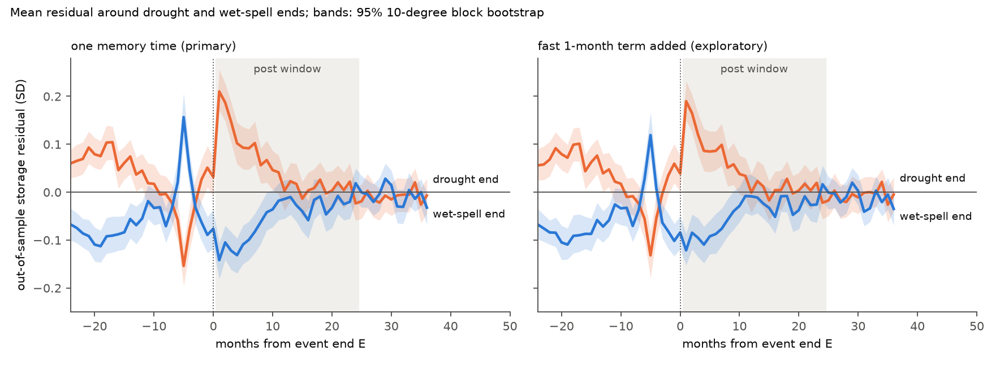
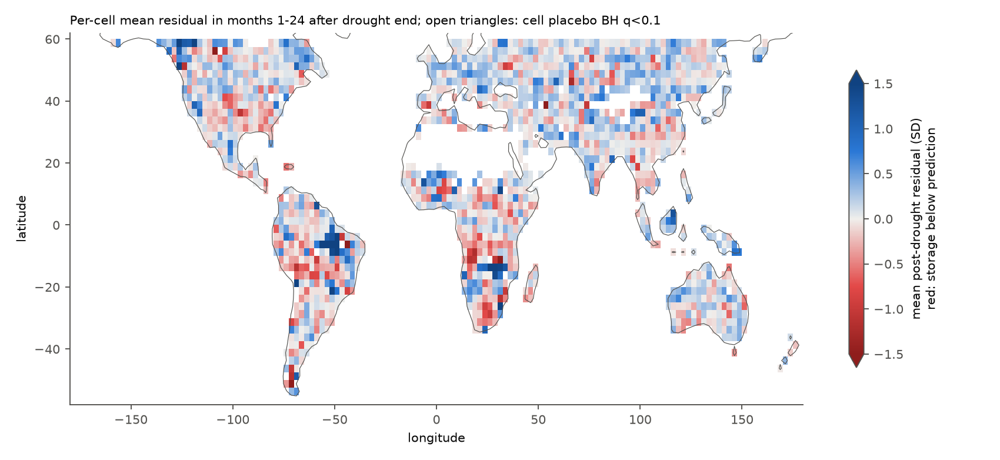

# GRACE land water storage did not stay below a precipitation-memory model after 6,987 droughts in 2002-2026; a short symmetric overshoot followed extreme months

## Question and main result

Does land water storage recover after a meteorological drought ends? Or does it stay below the level that precipitation and temperature history predict? Peterson and colleagues found that runoff in about one third of catchments in Victoria, Australia, stayed low for years after the Millennium Drought ([doi:10.1126/science.abd5085](https://doi.org/10.1126/science.abd5085)). A campaign study did not find this for runoff in US reference catchments ([sci:sha256:664b208c...](sci:sha256:664b208cefa5e9bb1114a6ccf84255fc886f296b6f72198e385cbc30055fa7af)). We tested the same "no recovery" idea for total water storage (TWS) at global scale. TWS includes groundwater, soil water, snow, surface water and human withdrawals.

We used the CSR GRACE/GRACE-FO RL06.3 mascons, GPCP v2.3 precipitation and GHCN-CAMS temperature on 1,739 land cells of 2.5 degrees, from 56 S to 60 N. We defined droughts and wet spells from precipitation only. For each event, we fitted a per-cell storage model on all months outside the event window. Then we predicted storage in the 24 months after the event end, out of sample. The test statistic D is the mean standardised residual (observed minus predicted, in units of the fit residual SD) in that post window, averaged over events. A negative D means "storage stays low".

**Main result (pre-registered endpoint).** For 6,987 droughts in 1,706 cells, D = +0.044 SD. The placebo 95% range was -0.047 to +0.080 SD. The one-sided p for D < 0 was 0.89. Storage did not stay below the model after droughts. The one-sided 95% bound on a mean post-drought deficit is 0.028 SD. The median residual SD is 3.1 cm of equivalent water, so this bound is approximately 0.09 cm. A known deficit of -0.25 SD, added to all post windows, gave D = -0.206 SD. This value is below all 182 placebo values. Thus the test can detect a deficit of that size.

**Wet spells and asymmetry.** For 7,702 wet spells, W = -0.057 SD (placebo 95% range -0.086 to +0.047; two-sided p = 0.36). A linear storage system gives D + W of approximately 0. The observed D + W = -0.013 SD was at the centre of the placebo range (-0.052 to +0.026; p = 0.99). We found no drought-versus-wet-spell asymmetry.

**Unexpected pattern (exploratory, found after the primary result).** Storage was higher than predicted in months 1-6 after drought ends (D6 = +0.129 SD) and lower than predicted after wet spells end (W6 = -0.120 SD). Both values were outside all 182 placebo values (two-sided p = 0.0055, the smallest possible value). The excess decayed to zero by about month 12. The event rule explains the timing: the end month E has a mean precipitation anomaly of +0.90 SD after droughts, and month E-6 has -0.97 SD. In both cases the storage residual moves in the direction of the extreme month, one month later. A model with an added fast 1-month memory term reduced D6 only from 0.129 to 0.111 SD. We did not identify the cause. Candidate causes are a non-linear storage response to extreme months, precipitation data errors, and timing differences between monthly precipitation and GRACE solutions.



## Data and provenance

All raw files were present in the shared campaign store. We used them in place. We did not download, change or duplicate them.

| Source | Shared path (logical) | SHA-256 |
| --- | --- | --- |
| CSR GRACE/GRACE-FO RL06.3 mascons, all corrections, label RL0603rc24cE, created 2026-10-07 ([Save et al. 2016](https://doi.org/10.1002/2016JB013007)) | `/mnt/dell-data/shared_datasets/csr-grace-rl0603-mascon-all-corrections-20261108/CSR_GRACE_GRACE-FO_RL0603_Mascons_all-corrections.nc` | `d4bd8b7364fb34d871198001563c70d344792cb7b0a577c04f8b91c713741292` |
| CSR RL06 v02 land mask | `/mnt/dell-data/shared_datasets/csr-grace-rl06-v02-landmask-20261108/CSR_GRACE_GRACE-FO_RL06_Mascons_v02_LandMask.nc` | `65ddd8f3c7f7633c3a34f904e196307f71e4994e11ceb64f9337275908ff2f3b` |
| GPCP v2.3 monthly precipitation, NOAA PSL copy ([Adler et al. 2018](https://doi.org/10.3390/atmos9040138)) | `/mnt/dell-data/shared_datasets/noaa-psl-gpcp-v23-precip-mon-mean-20261108/precip.mon.mean.nc` | `d31c53ab8180a883bd01442212948c3db4372d481b94a90e69d3d86bb65d7f68` |
| GHCN-CAMS monthly air temperature v3.01, NOAA PSL copy ([Fan and van den Dool 2008](https://doi.org/10.1029/2007JD008470)) | `/mnt/dell-data/shared_datasets/noaa-psl-ghcncams-air-mon-mean-20261105/air.mon.mean.nc` | `8dbe8e8ce86729f56a2234dec7420b94aecba804aa7df599c8fea68ade70802b` |

[files/data_provenance.json](files/data_provenance.json) gives source URLs, resolved paths, byte counts and the store helper records. GRACE has 260 solutions from 2002-04 to 2026-08. GPCP ends at 2026-06 (interim data from 2021-11), so we do not use GRACE solutions after mid-June 2026. The bundle includes the aggregated cell data ([files/data/prepared.npz](files/data/prepared.npz), 11.8 MB). With this file, steps 2-4 can be repeated without the 425 MB of raw grids.

## Method

The [analysis plan](files/analysis_plan.txt) was written before any storage residual was calculated. It also records one deviation and two exploratory additions, with the reasons and the time when we made them.

1. **Cells.** We averaged land mascon cells (CSR mask, area weights) inside each GPCP 2.5-degree cell, and 0.5-degree GHCN-CAMS cells for temperature. A cell is used if its land fraction is 0.5 or more, its latitude is from 56 S to 60 N, its mean precipitation is 100 mm/yr or more, and it has 150 or more GRACE solutions. 1,739 cells passed.
2. **Events (precipitation only).** P anomaly = GPCP minus its 1979-2025 calendar-month mean. z6 = 6-month trailing mean of the anomaly, divided by its SD. A drought is 3 or more consecutive months with z6 of -1 or less. Its end E is the first later month with z6 of 0 or more. Wet spells use the same rule with the opposite sign. An event is used if it starts in 2002-07 or later, if E + 24 months is not after 2026-06, and if GRACE data exist in at least 12 post-window months. The median drought run lasted 8 months.
3. **Model.** TWS(t) = constant + linear trend + annual and semiannual harmonics + b x Fp + g x Ft. Fp and Ft are leaky (exponentially weighted) sums of the P and T anomalies from 1979, with memory time tau. Tau is chosen per fit from 1 to 36 months by least squares. The values are interpolated to each GRACE solution midpoint.
4. **Out-of-sample prediction (leave-one-window-out).** For each event, we fit the model on all valid months except the interval from the run start to E + 24, with a minimum of 120 fit months. The residual r is (observed - predicted) / SD of the fit residuals. D is the mean of r over months E+1 to E+24, averaged over events with equal weight.
5. **Placebo.** We moved all event windows in all cells by one common offset. The offsets were all integer months from -120 to +120, except offsets between -29 and +29. We then repeated steps 4 and 5. A common shift keeps the spatial correlation between cells. 182 offsets kept at least half of the events. We also report a 10-degree block bootstrap. It ignores temporal dependence and is narrower than the placebo range, so we use the placebo for inference.
6. **Variants.** No trend term; 12-month post window; z6 threshold of -1.5; removal of 64 cells in glacier boxes (Patagonia, High Mountain Asia, Gulf of Alaska); added deficits of -0.25 and -0.5 SD (power check); and a two-timescale model with fixed 1-month P and T terms (exploratory).

Fits use prefix sums of the normal equations, so each window removal costs the same time at any window length. We checked that this gives the same residuals as a direct refit, to 6 decimal places, on test cells.

## Results

| Run | Droughts | D (SD) | Placebo 95% range | One-sided p (D < 0) | W (SD) | D + W |
| --- | --- | --- | --- | --- | --- | --- |
| Primary | 6,987 | +0.044 | -0.047 to +0.080 | 0.89 | -0.057 | -0.013 |
| No trend term | 6,987 | +0.042 | -0.076 to +0.081 | 0.89 | -0.076 | -0.034 |
| 12-month post window | 7,484 | +0.076 | -0.045 to +0.070 | 0.98 | -0.064 | +0.012 |
| z6 of -1.5 or less | 2,884 | +0.055 | -0.050 to +0.117 | 0.88 | -0.069 | -0.013 |
| Glacier boxes removed | (1,648 cells) | +0.043 | -0.049 to +0.079 | 0.89 | -0.059 | -0.016 |
| Fast 1-month term (exploratory) | 6,987 | +0.037 | -0.042 to +0.085 | 0.87 | -0.050 | -0.013 |
| Added -0.25 SD deficit | 6,987 | -0.206 | (uninjected) -0.047 to +0.080 | 0.0055 | | |
| Added -0.5 SD deficit | 6,987 | -0.456 | (uninjected) -0.047 to +0.080 | 0.0055 | | |


No run gave a negative D. In the 12-month window, D was above the placebo range (two-sided p = 0.027). This is the early overshoot, not a deficit. The mean post-drought residual was +0.13 cm of equivalent water, and 7.9% of drought events had r below -1 SD (10.4% had r above +1 SD).

**Event-time pattern.** The figure below shows the mean residual from 24 months before to 36 months after E. The positive residual after droughts and the negative residual after wet spells are largest in month 1 and are near zero after month 12. The single-month spikes near month -5 follow the extreme month E-6 that the event rule selects ([files/results/precip_anomaly_around_E.csv](files/results/precip_anomaly_around_E.csv)). Months before the run start are inside the fit set, so they are pulled toward zero. A fast 1-month term (right panel) changes the curves only a little.



| Early window (months 1-6) | Value (SD) | Placebo 95% range | Two-sided p |
| --- | --- | --- | --- |
| D6 after droughts | +0.129 | -0.062 to +0.075 | 0.0055 |
| W6 after wet spells | -0.120 | -0.083 to +0.054 | 0.0055 |
| D6 - W6 | +0.249 | -0.108 to +0.158 | 0.0055 |
| D6, fast 1-month term added | +0.111 | -0.055 to +0.078 | 0.0055 |

**Where.** The map shows the mean post-drought residual per cell. The pattern is noisy and has no large coherent regions of deficit. Against each cell's own placebo distribution, 106 of 1,706 cells had p of 0.05 or less for a deficit and 176 for a surplus. Approximately 85 of each are expected by chance, but neighbouring cells are not independent. No cell passed a Benjamini-Hochberg false discovery rate of 0.1 in either direction ([files/results/cell_post_drought_residuals.csv](files/results/cell_post_drought_residuals.csv)).



**Possible drivers (descriptive).** Across drought events, the residual had weak rank correlations with mean temperature (rho = -0.05), long-term storage trend (rho = -0.06), severity (rho = -0.05) and aridity (rho = -0.04). These are small. A regression on five standardised variables explained 0.5% of the variance. Warmer cells (beta = -0.033 SD per SD, block bootstrap 95% interval -0.053 to -0.011) and cells with more negative long-term storage trends (beta = -0.032, interval -0.058 to -0.011) had slightly lower post-drought residuals. The residual during the drought had a strong rank correlation with the post-window residual (rho = 0.51). Errors of the model persist across the event window. Mean D by event end period changed from -0.073 SD (2008-2012) to +0.126 SD (2018-2022). The placebo includes this time-dependent model error.

## Interpretation

At the 2.5-degree scale of GRACE, with monthly data from 2002-2026, land water storage after meteorological droughts returned to the level that a linear precipitation and temperature memory model predicts. Storage did not stay low. This result agrees with the US runoff result of the campaign study above, now for total storage in all climate zones. It does not exclude non-recovery in individual small catchments, or for parts of storage that GRACE cannot resolve. The test excludes a mean persistent deficit larger than about 0.03 residual SD (about 0.1 cm).

The one clear departure is a short, symmetric overshoot. After an event ends, storage moves away from the event direction (up after droughts, down after wet spells) more than the model predicts. A similar one-month spike, in the event direction, follows month E-6, which the event rule also selects as an extreme month. The overshoot is symmetric for droughts and wet spells, so it is not specific to drought recovery. It shows that a single linear memory model under-predicts the storage response to single extreme months. This matters for drought-recovery estimates that use precipitation-based storage models, such as those of [Singh et al. 2021](https://doi.org/10.5194/hess-25-511-2021), [Humphrey and Gudmundsson 2019](https://doi.org/10.5194/essd-11-1153-2019) and [Cakan et al. 2025](https://doi.org/10.5194/hess-29-3359-2025). In the first months after an extreme month, these models can under-estimate the change in storage.

## Limitations

- GRACE has an effective resolution of about 300 km. Neighbouring 2.5-degree cells are not independent. The common-shift placebo keeps spatial correlation, but each cell is not an independent test.
- Leave-one-window-out keeps other events in the fit set. If every drought had a deficit, the model coefficients would partly absorb it. The injection test shows that a uniform -0.25 SD deficit is still detected, but the injection does not change the fits, so it does not measure that absorption.
- The model is linear, with one memory time and a linear trend. Tau was at the 36-month grid limit for 31% of drought events. The trend term can absorb slow changes; the no-trend variant gave the same conclusion.
- Events come from GPCP precipitation, which has gauge-sparse regions and interim data after 2021-11. Precipitation errors can produce or hide residual patterns. We used no second precipitation product.
- The 2017-06 to 2018-05 GRACE gap and other missing months reduce post-window coverage. GRACE data are in cm of equivalent water thickness at the source density (1025 kg/m3). We applied no further scaling.
- TWS combines all stores and human use. We cannot separate groundwater from soil water or surface water.
- The early-overshoot analysis and the two-timescale model are post hoc. We list them as exploratory, and their cause is not known.
- Placebo p-values have a resolution of 1/183. The smallest possible value is 0.0055.

## Reproduction

Python 3.12 with numpy 2.5.4, scipy 1.18.1, pandas 3.1.1, xarray 2026.9.0, netCDF4 1.7.5.1 and matplotlib 3.11.2.

```bash
# full run from the four shared source files (about 2 hours on 8 heavily loaded cores)
DATASETS=/mnt/dell-data/shared_datasets SCRATCH=/tmp/scratch OUT=/tmp/out bash files/code/reproduce.sh
# or start from the included aggregated cells (skips 01_prepare.py):
for v in primary notrend post12 thr15 inject025 inject050 twotau; do
  python3 files/code/02_analysis.py files/data/prepared.npz /tmp/scratch/out $v; done
mkdir -p /tmp/out/results
python3 files/code/03_summarize.py files/data/prepared.npz /tmp/scratch/out /tmp/out
python3 files/code/04_precip_composite.py files/data/prepared.npz /tmp/scratch/out /tmp/out
```

- [files/code/reproduce.sh](files/code/reproduce.sh): complete run. [files/code/01_prepare.py](files/code/01_prepare.py): aggregation to 2.5-degree cells and source hashes.
- [files/code/02_analysis.py](files/code/02_analysis.py): events, leave-one-window-out fits, common-shift placebo; variants `primary notrend post12 thr15 inject025 inject050 twotau`.
- [files/code/03_summarize.py](files/code/03_summarize.py): inference, bootstrap, drivers, figures, `results/results.json`.
- [files/code/04_precip_composite.py](files/code/04_precip_composite.py): precipitation anomaly around E.
- [files/results/](files/results/): all numbers in this text, the event tables of each run (`events_*.csv.gz`), the per-offset placebo values and the per-run summaries.

## Prior campaign work and provenance

Before we chose the question, we searched the campaign for earthquake, aftershock, sea-level, GRACE, ENSO, precipitation, drought, ocean and volcano results. Two campaign studies used the same GRACE file for other questions ([sci:sha256:3a9efb99...](sci:sha256:3a9efb99ba32f6796260be8d434434bb7c2140aab8360b039f7ef010c8066a5b): earthquake rates; [sci:sha256:fd47a1b2...](sci:sha256:fd47a1b2b27bb4ce6df6e323179b5654419a5adc58201c473fdfb3e60417d2d2): California storage recovery). We read only published bundles, not worker workspaces. All code here is new.

Job sci-1107-hp-earth-and-ocean-sciences-fef695580d4f, campaign 11_07_2026, topic earth-and-ocean-sciences, machine hp. Model: Claude Opus 5.5 (claude-opus-5-5), run through Claude Code. The signature is from a campaign-machine key. It is not a personal authorship claim. See [files/worker.json](files/worker.json).
