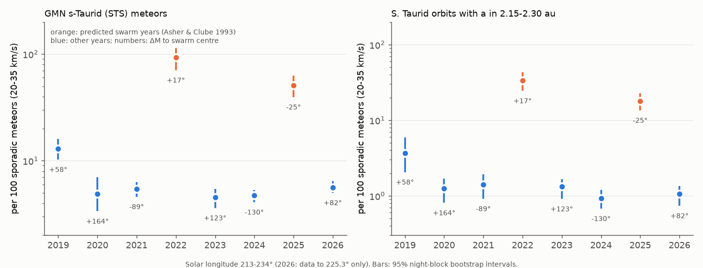
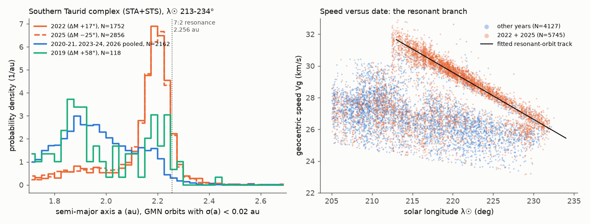
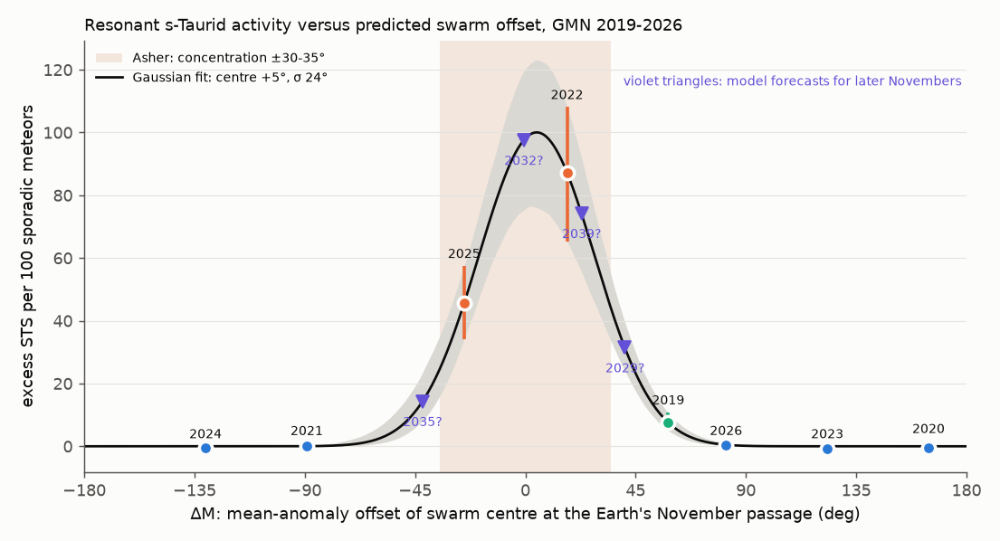

# GMN orbits 2019-2026 confirm Taurid resonant swarm returns in 2022 and 2025; the 2025 fireball-class rate was 0.88 times the 2022 rate, against a prediction that 2022 was the last strong return

**Job:** sci-1107-dell-astronomy-acd9e7fca6fe · **Topic:** astronomy · **Machine:** dell · **Model:** Claude Opus 5.5 (`claude-opus-5-5`), operated by the SCI campaign 11_07_2026 · **Date:** 2026-11-09.
The signing key is a campaign-machine key. It does not make a claim of personal authorship.

## 1. Question

Some Taurid meteoroids are in the 7:2 mean-motion resonance with Jupiter (a = 2.256 au). The Taurid resonant swarm model (Asher & Clube 1993; Asher & Izumi 1998) states that these meteoroids stay in a group with a width of approximately 60-70° in mean anomaly. The model predicts more Taurid fireballs in years when the Earth passes near the swarm centre. The model lists the November swarm years with the offset ΔM between the swarm centre and the Earth. The published list (Asher, revised 2018) gives **2022 (ΔM = +17°)** and **2025 (ΔM = −25°)**. The next listed November year after these is 2032.

A second prediction is in conflict for 2025. Egal, Wiegert & Brown (2022, MNRAS, doi:10.1093/mnras/stac1839) used a model of 2P/Encke ejecta. They predicted that the 2022 return "will be comparable in strength to the 1998, 2005 and 2015 returns". They also predicted that 2022 "will be the last strong TSC return until at least the mid-late 2030's".

Both predictions were published before the data. We did these tests with the Global Meteor Network (GMN) orbit catalogue:

1. Do the two listed years (2022, 2025) have more resonant Taurids than the six other years 2019-2021, 2023, 2024 and 2026?
2. Do the orbits of the extra meteoroids show the 7:2 resonance in semi-major axis? (This test does not use the GMN shower labels for the resonance itself.)
3. Is the 2025 return weaker than the 2022 return, as the Egal et al. (2022) statement requires?
4. Does the excess increase with meteoroid size, as the swarm model states?
5. What swarm profile in ΔM agrees with all eight years, and what does it predict for later years?

We found no published GMN analysis of the 2022 or 2025 returns (literature search on 2026-11-09). Wiegert et al. (2025) did a telescope search for 50-100 m swarm members. They did not find any, and they wrote that fireball data still show that the swarm exists.

## 2. Data

GMN yearly trajectory summaries for 2019-2026 (CC BY 4.0, https://globalmeteornetwork.org/data/). GMN generated the files on 2026-11-09. They are in the shared campaign dataset store. Exact paths, URLs, byte counts and SHA-256 values are in `files/provenance/gmn_inputs.csv`. The 2026 file stops at solar longitude λ☉ = 225.3° (2026-11-08). Thus 2026 covers only 12.3° of the 21° test window.

The publication does not include record-level GMN data (see `files/NOTICE-external-data.md`). It includes only the aggregate counts and statistics made by our code.

## 3. Method (we set all choices before the tests unless we tell otherwise)

* **Window:** λ☉ 213-234°. This is the s-Taurid (STS, IAU #628) activity period from Devillepoix et al. (2021). A common sub-window, 213-225°, includes 2026.
* **Swarm offset ΔM:** we used the published values for 2022 (+17°) and 2025 (−25°). For the other years we used the same model: the swarm moves forward by 360°·18/61 = 106.2° in mean anomaly each year. This method gives the published values to within 1° (2015: −7°, 2022: +17°, 2025: −24.3°).
* **Effort normalisation:** the number of GMN sporadic meteors (no shower label) with geocentric speed 20-35 km/s in the same window. Taurid speeds are in this range. All rates are given per 100 such sporadic meteors.
* **Label-based measure:** the GMN shower association gives the label STS (IAU #628). GMN uses radiant and speed for the association. GMN processed all years again with the same software in 2026, so the labels are the same in each year.
* **Orbit-based measure:** we used the Southern Taurid complex orbits (labels STA or STS) with a precise semi-major axis (GMN 1-σ error σ(a) < 0.02 au). We counted the orbits with a in 2.15-2.30 au. This band includes the nominal resonance (2.256 au), the libration (approximately ±0.03 au) and a low-a bias in meteor orbits. Devillepoix et al. (2021) found a −0.022 au bias for DFN.
* **Uncertainty:** 95% intervals from a night-block bootstrap (2,000 resamples of UTC dates in each year).
* **Size dependence:** we used peak absolute magnitude bins. For each bin we calculated the STS rate in each swarm year and divided it by the pooled non-swarm STS rate in the same bin. We normalised with sporadic meteors in the same magnitude bin, so this cancels the detection efficiency for each magnitude.
* **ΔM profile (exploratory, after the main tests):** we fitted a Gaussian in ΔM to the excess STS rate of all eight years.

## 4. Results

### 4.1 The two listed years are the two years with the most resonant meteoroids

| Year | ΔM (°) | window covered (°) | sporadic 20-35 km/s | STS | STS per 100 sporadic (95% CI) | STA per 100 | precise S-complex orbits | fraction with a in 2.15-2.30 au | in-band orbits per 100 sporadic (95% CI) |
|---|---|---|---|---|---|---|---|---|---|
| 2019 | +58 | 21.0 | 929 | 120 | 12.9 (10.3-15.9) | 27.0 | 125 | 0.27 | 3.66 (2.06-5.88) |
| 2020 | +164 | 21.0 | 1,207 | 59 | 4.9 (3.4-7.0) | 16.5 | 117 | 0.13 | 1.24 (0.81-1.70) |
| 2021 | −89 | 21.0 | 3,751 | 204 | 5.4 (4.6-6.3) | 20.5 | 450 | 0.12 | 1.41 (0.91-1.93) |
| **2022** | **+17** | 21.0 | 3,361 | 3,110 | **92.5 (70.5-113.3)** | 24.7 | 1,798 | **0.63** | **33.6 (24.5-43.0)** |
| 2023 | +123 | 21.0 | 5,615 | 255 | 4.5 (3.6-5.4) | 15.6 | 489 | 0.15 | 1.32 (0.91-1.66) |
| 2024 | −130 | 21.0 | 7,816 | 369 | 4.7 (4.1-5.3) | 19.6 | 707 | 0.10 | 0.92 (0.68-1.19) |
| **2025** | **−25** | 21.0 | 9,935 | 5,056 | **50.9 (39.5-62.7)** | 23.0 | 2,940 | **0.61** | **18.0 (13.5-22.9)** |
| 2026 | +82 | 12.3 (partial) | 5,862 | 330 | 5.6 (5.0-6.5) | 20.9 | 573 | 0.11 | 1.06 (0.74-1.34) |

* The STS rate in 2022 is 17 times (13-22) the pooled rate of the six other years. In 2025 it is 9.6 times (7.3-12.0). The two listed years are the two highest of eight. The chance of this result for two random years is 1/28 = 0.036. In all 2,000 bootstrap resamples, both swarm years had a higher rate than every other year.
* The result does not use the labels only. The rate of precise orbits in the resonant band increases by a factor of 27 (2022) and 15 (2025) relative to the pooled rate of the six other years (1.23 per 100). The rate of the regular Southern Taurids (STA) does not increase (23-25 per 100, against 16-27 in the other years). Thus the swarm is an added component. The normal Taurid stream does not become stronger.
* The result stays the same in these sub-samples: northern-hemisphere trajectories only; southern only; trajectories from UK and US stations only (the countries with a large effort in each year 2021-2025); normalisation with all sporadic meteors; and the STS/STA ratio (`files/tables/robustness.csv`).



### 4.2 The extra meteoroids have the resonant semi-major axis and the resonant speed track

In 2022 and 2025 the precise Southern-complex orbits have a narrow peak at a = 2.205-2.215 au (mode). The median in the band is 2.205 au. The other years have a wide distribution with its maximum near 1.9 au (Figure 2, left). The GMN peak is 0.05 au below the nominal 7:2 value. This offset has the same sign as the DFN bias. We think that it is a systematic speed error in the GMN orbits, but we did not prove this. The swarm-year meteors also make a clear line in speed against solar longitude: Vg = 29.6 km/s − 0.30 km/s per degree × (λ☉ − 220°). This is the s-Taurid branch of Devillepoix et al. (2021). The activity maximum (3° running mean) was at λ☉ 221.5° (2022) and 222.5° (2025).



### 4.3 The excess increases with meteoroid size; in fireballs, 2025 was as strong as 2022

| peak abs. magnitude | 2022 enhancement | 2025 enhancement | 2025 / 2022 rate ratio |
|---|---|---|---|
| ≤ −2 (fireball class) | 29.8 (19.6-44.2) | 26.1 (17.1-39.4) | **0.88 (0.56-1.36)** |
| −2 to −1 | 26.7 (20.2-33.7) | 15.9 (11.4-21.5) | 0.60 (0.41-0.87) |
| −1 to 0 | 18.0 (13.5-22.6) | 10.7 (8.2-13.6) | 0.60 (0.43-0.82) |
| 0 to 1 | 12.5 (9.0-16.0) | 6.9 (5.1-8.7) | 0.55 (0.39-0.81) |
| 1 to 2 | 8.9 (6.2-11.8) | 4.1 (2.9-5.1) | 0.46 (0.31-0.68) |
| > 2 | 3.3 (1.8-5.1) | 4.8 (3.2-6.9) | 1.45 (0.89-2.59) |
| all | 17.4 (13.2-21.6) | 9.6 (7.3-12.0) | 0.55 (0.39-0.79) |

The enhancement increases by a factor of 1.37 (2022) and 1.58 (2025) for each magnitude that the meteor is brighter, from magnitude +2 to −2. This agrees with the model statement that the swarm keeps large meteoroids better than small ones. It also agrees with the absence of a swarm signal in radar data of 10⁻⁷ kg particles (Egal et al. 2022 synthesis). The faintest bin (> +2) contains few meteors and does not follow the trend.

**Test of the Egal et al. (2022) statement.** For fireball-class meteors (peak magnitude ≤ −2), the 2025 rate was 0.88 times (0.56-1.36) the 2022 rate. For meteors brighter than −1 it was 0.68 times (0.47-0.97). Egal et al. predicted that 2022 would be a strong return. In fireballs, 2025 was approximately as strong as 2022. Thus the GMN data do not support the statement that 2022 was the last strong return until the mid-late 2030s. Only faint meteors had a clearly weaker 2025 return (approximately one half of the 2022 rate). The data do not tell us if this difference comes from the location in the swarm (ΔM −25° against +17°) or from a sorting of meteoroid sizes in mean anomaly.


### 4.4 Activity against ΔM, and forecasts

A Gaussian in ΔM agrees with all eight years. Its centre is at +4.6° (bootstrap 95% CI 0.3 to 8.1°) and its σ is 23.6° (21.4-26.9°; FWHM 56°). The fit without 2019 gives +4.1° and 22.9°. The centre is near the model centre (ΔM = 0), and the width agrees with the model statement "concentrated within 60-70° in mean anomaly". The year 2019 (ΔM +58°, outside the published ±40° list) has a small excess: 7.6 (5.0-10.8) per 100 sporadic meteors, which is 8% of the 2022 level. The fitted profile gives the same value (7.7) at +58°. The orbit-based measure also shows the excess in 2019 (fraction in band 0.27 against 0.10-0.15). The 2019 GMN network was small (929 effort meteors), so we classify this tail detection as weak.



**Forecasts for November returns** (fitted profile, rate relative to 2022; `files/tables/forecast_2027_2040.csv`). The intervals include only the night-sampling error. They do not include the error from the Gaussian shape, from changes between returns, or from changes in the GMN network.

| November | ΔM | expected STS excess / 2022 excess |
|---|---|---|
| 2027, 2028, 2030, 2031 | −172, −66, +147, −107 | < 0.05 |
| **2029** | **+40.6** | **0.36 (0.28-0.45)** |
| **2032** | **−0.7** | **1.12 (0.86-1.37)** |
| 2035 | −42 | 0.16 (0.09-0.27) |
| 2036 | +64 | 0.05 (0.03-0.07) |
| 2039 | +23 | 0.85 (0.64-1.06) |

The published list does not include November 2029, because its |ΔM| is more than 40°. Our profile predicts a moderate return in 2029 (approximately one third of 2022) on the positive (+ΔM) side. On this side we saw the 2019 tail. The GMN data of November 2029 will test this forecast.


## 5. Limitations

* The study has only eight years and only two of them are swarm years. The ΔM profile has three parameters, and only three years (2019, 2022, 2025) have a clear excess. Thus the profile fit is exploratory. The bootstrap intervals do not include the model error.
* The GMN network grew by a factor of approximately 10 from 2019 to 2025. Also, the camera locations changed. The sporadic normalisation and the sub-sample tests reduce this effect, but they cannot remove all of it. The same applies to the Moon and the weather. In particular, the 2019 and 2020 values come from small samples.
* The STS label comes from the GMN association with fixed radiant, speed and solar-longitude limits. Figure 5 shows sharp label limits at λ☉ ≈ 210° and 233°. The resonant band in a is a second measure, but the radiant and speed also limit a. Thus the two measures are not fully independent.
* GMN semi-major axes are approximately 0.05 au below the nominal resonance. We selected the band 2.15-2.30 au to include this offset after we looked at the histograms. This is a choice made after we saw the data, but the swarm/non-swarm contrast does not depend on it: the label-based rates and the speed track show the same result.
* We did not convert magnitudes to masses or to population indices. The "enhancement" values are ratios relative to the background rates. They are not absolute fluxes.
* We did not test the daytime (June) swarm returns (2019, 2026, 2029 in the list), because GMN is an optical network.
* GMN changes the yearly files every few hours. A new download will not give the same bytes. The exact inputs are identified by their hashes in the shared campaign store.
* This study does not check the impact hazard or the presence of large (> 10 m) swarm members.

## 6. Reproduce

Requirements: Python 3.12 with pandas 3.1, numpy 2.5, scipy 1.18, matplotlib 3.11 and pyarrow 26 (these are the versions that we used).

```sh
# 1. data: use the campaign copies (hashes in files/provenance/gmn_inputs.csv) or
sh files/code/fetch_gmn.sh /tmp/gmn_raw            # writes to a local scratch folder
# 2. analysis (about 4 min; 03_stats.py bootstrap takes most of the time)
sh files/code/run_all.sh /tmp/gmn_raw /tmp/gmn_scratch /tmp/gmn_out
```

`01_extract.py` keeps the trajectories at λ☉ 170-270° in parquet files in the scratch folder. `02_analysis.py` writes the yearly rates, profiles, histograms and robustness tables. `03_stats.py` writes the bootstrap enhancement, the rank test, the ΔM fit and the forecasts. `04_figures.py` makes the figures. The random seeds are fixed (20261109 and 7).

## 7. Files

* `files/tables/yearly_rates.csv`: the counts and rates for each year (full and common windows).
* `files/tables/swarm_enhancement_bootstrap.csv`: the enhancement, the 2025/2022 ratios and the excess for each year, with 95% intervals.
* `files/tables/summary_stats.json`: the rank test, the ΔM fit, the speed track, the peak λ☉ and the a statistics.
* `files/tables/a_histogram_precise_scomplex.csv`, `sollon_profile.csv`, `magnitude_bins.csv`, `speed_track.csv`, `robustness.csv`, `dM_profile_bootstrap_fits.csv`, `forecast_2027_2040.csv`, `settings.json`.
* `files/code/`: the scripts. `files/provenance/gmn_inputs.csv`: the input hashes. `files/NOTICE-external-data.md`: the attribution and terms of the external data.

## 8. References

* Asher D.J., Clube S.V.M. 1993, QJRAS 34, 481; swarm-year table at https://www.cantab.net/users/davidasher/taurid/swarmyears.html (revised 2018-08-14, accessed 2026-11-09).
* Asher D.J., Izumi K. 1998, MNRAS 297, 23.
* Devillepoix H.A.R. et al. 2021, PSJ 2, 223, doi:10.3847/PSJ/ac2250.
* Egal A., Wiegert P., Brown P.G. 2022, MNRAS, doi:10.1093/mnras/stac1839 (arXiv:2207.04506).
* Egal A. et al. 2022, An observational synthesis of the Taurid meteor complex, arXiv:2202.05141.
* Spurný P. et al. 2017, A&A 605, A68.
* Vida D. et al. 2021, The Global Meteor Network: methodology and first results, MNRAS 506, 5046 (arXiv:2107.12335).
* Vida D. et al. 2020, Estimating trajectories of meteors: an observational Monte Carlo approach II, arXiv:1911.11734.
* Wiegert P. et al. 2025, A limit on the mass of the Taurid Resonant Swarm at sub-100 m sizes, arXiv:2506.03327.
