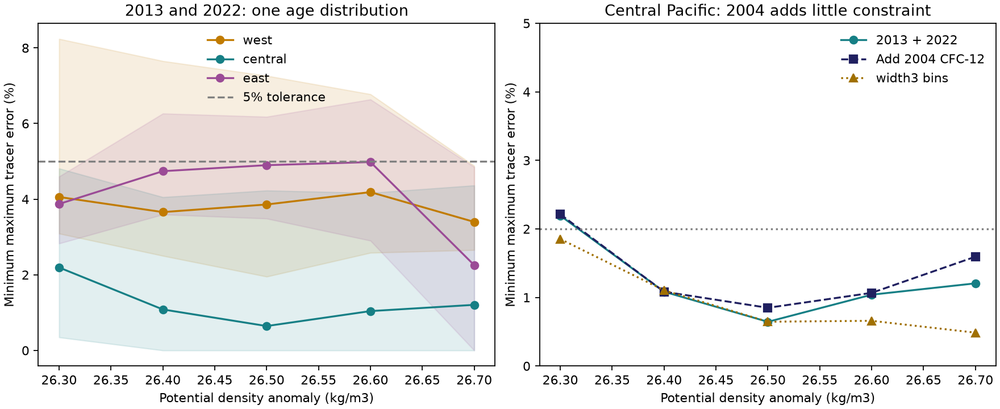

# P02 dual tracers admit unchanged transit-age distributions at 5 percent tolerance in 2013 and 2022

Job sci-1107-dell-earth-and-ocean-sciences-e99819f0ec92. Topic earth-and-ocean-sciences. Campaign 11_07_2026. Machine dell. Account codex-olen. Model gpt-6.1-sol, high reasoning effort, T3 Code through the Codex harness. Date 11 November 2026. The campaign-machine signature is not a personal authorship claim.

## Question and result

Does the North Pacific oxygen loss require a change in the transit-age distribution measured by transient tracers? We test a narrower question: can one nonnegative age distribution fit repeated CFC-12 and SF6 means without a change in time? We do not impose an inverse-Gaussian shape, a mean age, or an upper limit on the tracer-free tail.

**All 15 main regional density means admit an unchanged distribution within 5% relative error per tracer observation for 2013 and 2022.** In the central Pacific, the smallest error is only 0.64-2.19%. Adding the 2004 CFC-12 observation gives 0.85-2.21%. Thus these regional tracer means do not require a change in age distribution at that tolerance, even where prior work found oxygen loss and phosphate gain. This is a constructive compatibility result under stated source assumptions. It is not evidence that the circulation stayed fixed.

Left: main two-occupation fits at 100% saturation. Shading is a conditional 95% spatial block interval from 199 draws. It does not include calibration or source errors. Right: central fits with and without 2004 CFC-12, and with three-degree bins. Strict interpolation gives too few central bins and is absent from the plot. Each density and region has its own distribution and spatial support.

## Why this test adds information

The outcrop studies in the supplied campaign identify a plausible oxygen-supply mechanism. The perfect-model study sci:978770d0 shows that CFC-based age changes can have large errors. The direct P02 nutrient study sci:3ba2f3ce finds continued central oxygen loss to 2022 and a phosphate balance consistent with accumulated respiration. It also shows that freshening makes local within-type regression an extrapolation. These observations leave the change of ventilation rate unresolved.

We use the same four P02 source files as that direct study. This is a new test on overlapping cruises, not an independent field replication. Earlier shape-free work at A20 (sci:b0b64638) allowed separate spectra in each occupation while testing an unchanged oxygen-use law. Here we instead require **one spectrum across occupations** and test the tracers alone. The result separates a shape assumption from the observational constraint. A fitted single age is not needed.

This test is related to established use of repeated CFC and SF6 to test steady ventilation (Sonnerup et al., 2015, doi:10.1002/2015JC010781), and to tests of tracer-based ventilation estimates in models (doi:10.1002/2016JC011900). Its contribution is an exact convex feasibility test for all nonnegative spectra under a piecewise-linear atmospheric boundary history, with explicit P02 witnesses and lower bounds.

## Data and selection

We read CCHDO P02 bottle files for 2004, 2013, and the west and east legs of 2022. We use northern-hemisphere CFC-12 and SF6 atmospheric histories from Bullister and Warner, NCEI 0164584, version 2.2, revised 2023. No new download was needed. `files/provenance.json` gives the exact shared paths, URLs, source-store metadata, hashes, sizes and software versions. `files/NOTICE_external_data.md` gives source terms and attribution.

We select 28-32 N and 160 E-120 W. CTD salinity and CFC-12 must have good flag 2; SF6 must also have flag 2 in 2013 and 2022. We compute TEOS-10 sigma0 and potential temperature. For each cast, we interpolate normalized tracer values to 26.3, 26.4, 26.5, 26.6 and 26.7 kg/m3. The nodes must be in increasing density order. No density extrapolation is allowed. Maximum node gaps are 0.30 kg/m3 and 250 dbar. We average casts in two-degree longitude bins, then weight the common bins equally across occupations at each density.

The nominal regions are west (160-180 E), central (180-160 W), and east (145-120 W). Actual retained coverage is incomplete and differs with density. Main counts are 5-6, 8-9 and 5-12 bins, respectively. The three-occupation support is used for both the pair and three-occupation tests, so the comparison does not gain bins when 2004 is removed. SF6 is not used in 2004. Tracer effective partial pressure is concentration divided by the gas solubility at the sample potential temperature and salinity (Warner and Weiss, 1985; Bullister et al., 2002). This conventional normalization is an approximation, not a conservative mixing coordinate when source solubilities differ.

## Test and continuous-age proof

For observation i, let y_i be the regional effective partial pressure, t_i its mean sampling date, and H_i the northern atmospheric history of its tracer. The predicted value is

`prediction_i = integral H_i(t_i - a) dG(a)`.

G is a nonnegative distribution with total mass one. It is shared by all observations in the tested region and density. The objective is the smallest epsilon such that

`abs(prediction_i / y_i - 1) <= epsilon` for every observation.

Each pair fit has four constraints: CFC-12 and SF6 in 2013 and 2022. Each three-occupation fit adds 2004 CFC-12. Separate-spectrum fits allow a distinct G in each occupation. All separate fits have zero error, so the mismatch in the main fits comes from stationarity, rather than a failure of an individual tracer pair to fit any spectrum.

The atmospheric histories use linear interpolation between annual values. As a function of age, the vector of all tracer predictions is piecewise linear. Its only breakpoints are zero and the nonnegative differences between each sampling date and each atmospheric-history date. Any age between adjacent breakpoints is an exact convex combination of those endpoints for every observation at once. Thus the convex hull of breakpoint vectors is the full continuous-age feasible set. We use all breakpoints up to age 300 years. Before that oldest date the histories of both tracers are zero. All older ages are represented exactly by the zero-tracer atom at 300. There is no physical upper-age assumption for the stationary test, but the data cannot constrain the mean age of that atom.

This reduces the test to a linear program. We also permit one common saturation factor from 0.8 to 1.2 by allowing total mass in that range. The normalized age distribution is then the weight vector divided by its mass. This factor is common to both gases and all occupations. It is not a test of independently varying gas saturation. It changes central errors by less than the printed precision and lowers some eastern pair errors by about 0.1 percentage point.

## Results

Minimum relative error, percent, at fixed 100% saturation:

| Density | West, 2013-2022 | Central, 2013-2022 | East, 2013-2022 | Central, all three years |
|---|---:|---:|---:|---:|
| 26.3 | 4.058 | 2.194 | 3.874 | 2.213 |
| 26.4 | 3.658 | 1.084 | 4.741 | 1.084 |
| 26.5 | 3.860 | 0.645 | 4.899 | 0.849 |
| 26.6 | 4.187 | 1.041 | 4.982 | 1.067 |
| 26.7 | 3.399 | 1.206 | 2.255 | 1.595 |

For central 26.5, the conditional spatial interval for the pair error is 0-4.23%. The main minimum error is not a p value, a measurement uncertainty estimate or a posterior probability. The 2%, 5% and 10% thresholds are sensitivity tolerances. At 2%, four of five central density means still admit stationarity, while the west and east means do not. At 5%, all main pair means admit it. Some western and eastern spatial draws exceed 5%. At fixed 5% or 10% tracer tolerance, the minimum total variation between separate 2013 and 2022 spectra is zero for all main means. The data therefore give no positive lower bound on the amount of changed age-spectrum weight at these tolerances. The 2% bounds in `results.csv` are conditional on this tighter box.

Adding 2004 does constrain the eastern region more: the three-occupation error reaches 6.30% at 26.7. This is not a universal stationary fit across every decade and region. At central 26.5, the source files also give an ancillary oxygen difference of -7.52 umol/kg on this tracer-selected support. Oxygen is not used to fit G. This oxygen number has its own missing-data support and is not a new trend estimate; the prior joint oxygen-nutrient study supplies the stronger oxygen-loss evidence.

Three-degree bins retain the small central errors (0.49-1.85%). Eastern 26.5 becomes 5.014%, so the all-region 5% classification is sensitive near the threshold. The stricter interpolation rule (0.20 kg/m3 and 150 dbar) leaves fewer than four common bins at every central and western density and does not support those regional tests. In its four eastern tests errors are 1.55-7.03%. These failures of coverage and threshold stability are reported, not discarded.

## Numerical checks

`witness.csv` contains positive age-weight mixtures for all 30 main fixed-saturation fits. They reconstruct the stated optimum. `audit.py` independently reads the aggregate observations and raw atmospheric history, evaluates each witness, and solves a dual lower-bound problem. If A contains the normalized breakpoint columns, its dual bound is `z - sum(q)` with `z <= q dot A_column` and `sum(abs(q)) <= 1`. The witness error and dual bound agree within 1e-7 for all 30 fits. `audit.json` records the coefficients, observation order, mass errors and gaps. A known stationary two-atom synthetic case also fits exactly. This checks computation, not the ocean-model assumptions.

## Interpretation and limitations

These two tracers can fit a fixed distribution while oxygen decreases. Therefore they cannot, at a 5% box tolerance on these regional means, rule out unchanged transport with a changed oxygen-use law or source oxygen. Conversely, they do not rule out slower ventilation. The result leaves the outcrop mechanism plausible and limits what the transient tracers can establish independently. It does not estimate the share of oxygen loss due to outcrop change, respiration or source changes.

The common spectrum can have multiple narrow peaks and an old component. We impose no flow evolution, source-region geometry, or link across density classes. Such mathematical spectra need not be realized by a physical circulation. A regional average can hide changes of opposite sign at individual locations. These fits do not establish stationarity at each station. Mean sampling dates approximate the date distribution; the occupations have different seasons. Changes of source T-S, air-sea tracer saturation, tracer calibration, and bottle interpolation can affect the normalized observations. The spatial bootstrap is conditional on three cruises and is not an estimate of temporal variability. Strict interpolation removes central support. The tolerance boxes do not include a measured error covariance. Oxygen is not a constraint in the optimization. A steady age distribution with fixed oxygen-use and preformed oxygen would not explain a changing oxygen mean; at least one of those assumptions or the sampling representation would need to change.

## Reproduction

Use Python 3.12 and `files/requirements.txt` in a private environment. Run `bash files/run_all.sh /path/to/datasets /separate/local/scratch/output`. This runs the main test, both sensitivity tests, audit and figure generation on one CPU per process. All raw and per-bin derived files stay in separate scratch; the script refuses its own code directory as output. To retrieve the exact external versions, first run `python files/retrieve.py /separate/local/scratch/external-data` and use that root instead. Retrieval checks every recorded hash and fails if a source version changes. For new additions to the campaign shared store, use the campaign dataset helper, not this scratch retrieval script.

The package contains our code, aggregate observations, numerical witnesses, aggregate sensitivity results, provenance, a figure and this report. It excludes third-party raw tables and per-cast or per-bin databases. No private workspace or earlier bundle is required for reproduction.
