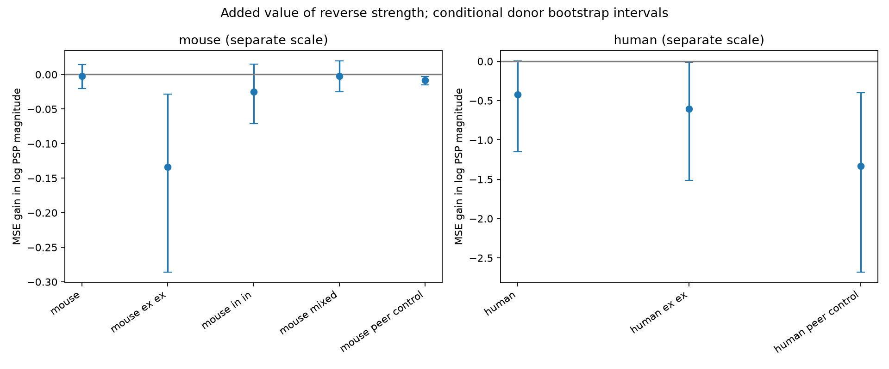
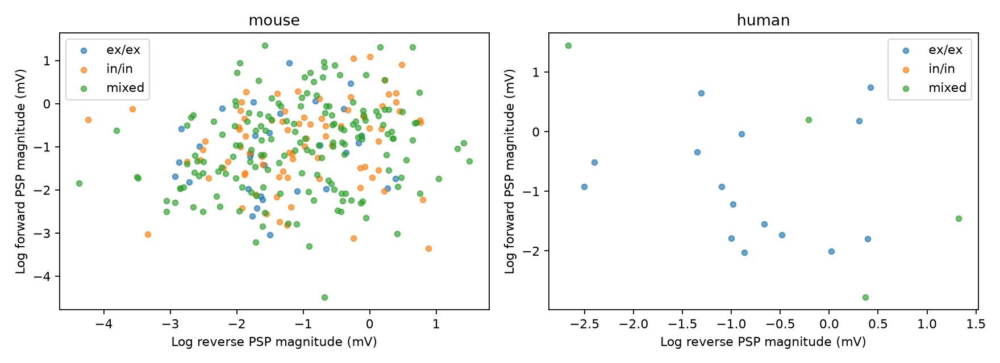

# Reverse synaptic strength gives no clear prediction gain across mouse donors in Allen reciprocal-pair data

## Result

We tested whether the strength of one direction of a reciprocal connection predicts the other direction in new animals or donors. We used resting-state postsynaptic potential amplitudes in the Allen Synaptic Physiology r2.1 small database. The reference model used cell labels, layer, connection types, and cell-body distance. Validation kept all records from each inferred donor together. In 283 mouse reciprocal pairs from 211 inferred animals, reverse strength did not lower prediction error. Three near-zero fitted amplitudes caused large log errors. A check with both amplitudes at least 10 microvolts kept 277 pairs from 208 animals. Log-amplitude RMSE was 1.0111 for the reference model and 1.0121 with reverse strength. The mean squared error gain was -0.0021, with a conditional donor bootstrap interval of -0.0202 to 0.0144. A simpler reference model gave a small gain with an interval that included zero. Type-specific slopes did not improve the pooled result. Only 19 human reciprocal pairs met the main filters. These tests do not show that reciprocal strengths are independent. They show that a reverse-strength predictor gave no clear added value across donors under the tested selection and models.

This is an exploratory reanalysis of public recordings. It is not a preregistered test. The useful result is a benchmark and a limit on one simple rule for circuit models: knowing the reverse connection strength did not give a clear gain beyond the tested cell labels and distance. The test concerns connection weights within known reciprocal pairs. It does not test whether reciprocal pairs are stronger than single-direction pairs.

## Question, data link, and prior work

A reciprocal circuit can support feedback. A model of such a circuit needs both connection weights. Can the measured weight in one direction help predict the other in a new animal?

Song and colleagues (2005, doi:10.1371/journal.pbio.0030068) studied nonrandom connectivity and strength in rat visual cortex. That work motivates a prediction test; we do not claim the first test of correlated reciprocal strengths. Campagnola, Seeman, and colleagues (2022, doi:10.1126/science.abj5861) supplied the Allen paired recordings. Their study describes cell-class differences and large strength variation. The Allen schema defines PSP amplitude as the resting-state postsynaptic potential in volts.

Connectivity and response measurements share the same cell and pair IDs. No link between separate animals or atlases is assumed. These data contain small tested graphs in brain slices. They are not an electron microscopy connectome or a recording of behavior.

Before the question was fixed, campaign searches for connectivity, reciprocal, and synaptic results found the prior latency study cited in sci.json. We read that signed publication. It tests distance and latency, not reverse strength. We used its source and donor-name notes. Web searches covered Allen synaptic physiology, reciprocal strength, and local circuit motifs. No private worker workspace was read.

## Selection and analysis

The SQL in files/selection.sql joins pair, synapse, cell, experiment, and slice records. Both directions must have a chemical synapse call and at least one current-clamp average fit with manual quality control passed. Each direction must have a finite nonzero PSP amplitude with the expected polarity. We keep mouse VisP and human TCx, with cell-body distance above zero and at most 500 micrometres. This local range was fixed before fitting. These filters select a subset of detected connections; they do not correct detection bias.

We use both directions as prediction targets, so each reciprocal pair has two rows. Both rows and all other records from the same inferred donor stay in one fold. The target is the natural logarithm of absolute PSP amplitude in millivolts. The reverse predictor uses the same measure in the other direction. Both measurements are available at test time. This is a conditional prediction task for a new reciprocal pair, not a prediction from wiring alone.

Mouse donor groups use the six-digit animal number after a hyphen in the specimen name. Human groups use the first three dot-separated fields, such as H17.03.005. The code checks each name. These are inferred groups, not registered donor identities. One mouse name has a hyphen after the animal number, which the parser accepts.

The reference model has an intercept, indicators for forward/reverse synapse type, separate pre/post nonsynaptic cell class, Cre label and target layer, and joint pre/post indicators for class, Cre label and layer. Missing labels have their own level. It also has log cell-body distance. Nonsynaptic class avoids defining cell class from the target amplitude, although connection-type calls still use physiology. The added model includes log reverse strength. Each numeric column is centered and scaled using the training fold. Categories use training levels only. Ridge penalty is 1 for all coefficients except the intercept. The penalty is fixed; we did not tune it to test errors.

Each analysis has five folds and ten splits, with seeds 110700 through 110709. A random permutation assigns whole donors to folds in turn. All models in a comparison use the same folds. We report the square root of pooled mean test squared error over directions and splits. MSE gain is reference MSE minus added-model MSE. Positive gain is better. We first average errors over splits for each direction. Then we resample whole donor groups 4,000 times with seed 90711. The table gives percentile intervals.

These intervals condition on fitted validation models. They do not include refit uncertainty. Training sets overlap. Intervals are approximate and exploratory, with no correction for several comparisons. Neither the number of directions nor the ten repeats is the number of independent animals.

## Initial result and amplitude check

| Test | Directions | Pairs | Donors | Reference RMSE | With reverse RMSE | MSE gain [95% interval] |
|---|---:|---:|---:|---:|---:|---|
| mouse | 566 | 283 | 211 | 1.9689 | 1.9695 | -0.0023 [-0.0108, 0.0046] |
| mouse peer control | 358 | 179 | 124 | 2.4556 | 2.4569 | -0.0063 [-0.0181, 0.0040] |
| human | 38 | 19 | 15 | 1.0076 | 1.1992 | -0.4227 [-1.1500, 0.0041] |

The SQL query returns 742 directed rows before the region, value, distance and polarity filters. The final initial sample has 604 directed rows. The initial sample contains 283 mouse pairs from 211 inferred animals and 19 human pairs from 15 donors. Three mouse forward amplitudes are about 1.30e-14, 3.76e-14 and 1.12e-11 volts. They are positive fitted values, not zeros. Their logarithms cause large errors. Pair IDs 29158, 108672 and 113919 identify them. We did not change these source values.

After this check, we added an amplitude floor of 0.01 mV in both directions. This floor is an exploratory sensitivity choice, not an established detection threshold. It removes six mouse pairs, including those three values. It changes the population being tested and can itself cause selection bias.

## Results with the amplitude floor

Errors are in natural-log amplitude units. MSE gains are in squared log units. The peer-control row compares the peer model with the peer-plus-reverse model.

| Test | Directions | Pairs | Donors | Reference RMSE | With reverse RMSE | MSE gain [95% interval] |
|---|---:|---:|---:|---:|---:|---|
| mouse | 554 | 277 | 208 | 1.0111 | 1.0121 | -0.0021 [-0.0202, 0.0144] |
| mouse ex ex | 62 | 31 | 25 | 1.0206 | 1.0842 | -0.1338 [-0.2857, -0.0282] |
| mouse in in | 164 | 82 | 68 | 1.0473 | 1.0594 | -0.0254 [-0.0710, 0.0147] |
| mouse mixed | 328 | 164 | 124 | 1.0340 | 1.0352 | -0.0026 [-0.0247, 0.0195] |
| mouse peer control | 350 | 175 | 123 | 1.0340 | 1.0381 | -0.0086 [-0.0151, -0.0031] |
| human | 38 | 19 | 15 | 1.0076 | 1.1992 | -0.4227 [-1.1500, 0.0041] |
| human ex ex | 30 | 15 | 11 | 1.1494 | 1.3870 | -0.6028 [-1.5150, -0.0132] |
| human peer control | 24 | 12 | 11 | 1.2106 | 1.6727 | -1.3322 [-2.6783, -0.3993] |





The mouse reference error of 1.011 log units is large. It is about a factor of exp(1.011), or 2.75, on an amplitude scale, but this factor is not a calibrated prediction interval. Reverse strength leaves this error almost unchanged.

The peer check uses the mean log PSP magnitude of other connected directions in the same recording, excluding both directions of the target pair. It includes other pairs that can share one endpoint. Only finite nonzero peer amplitudes with a passed current-clamp fit are used; peer values do not use the 10 microvolt floor or polarity filter. This check is limited to recordings with another measured connection. Its sample differs from the main sample. In the richer model, reverse strength still did not improve error after this recording-level measure was supplied. This does not isolate all shared recording effects.

## Model sensitivity

The simple model removes Cre labels and all joint class and layer indicators. It keeps direction types, separate nonsynaptic classes and layers, and log distance. It uses the same 10 microvolt selection.

| Test | Directions | Pairs | Donors | Reference RMSE | With reverse RMSE | MSE gain [95% interval] |
|---|---:|---:|---:|---:|---:|---|
| mouse | 554 | 277 | 208 | 1.0550 | 1.0434 | 0.0243 [-0.0220, 0.0690] |
| mouse peer control | 350 | 175 | 123 | 1.0355 | 1.0301 | 0.0112 [-0.0226, 0.0425] |
| human | 38 | 19 | 15 | 1.0345 | 1.2182 | -0.4140 [-1.1155, 0.0030] |

The richer reference model can already use class information that a reverse strength might carry. The simpler model gives a small positive mouse gain, but its interval includes zero. Thus the data do not establish that the added value is zero, and the sign of the small pooled gain depends on the reference model.

A separate sensitivity model gives each forward/reverse type its own reverse-strength slope. It uses the richer reference model and the same amplitude floor.

| Test | Directions | Pairs | Donors | Reference RMSE | With reverse RMSE | MSE gain [95% interval] |
|---|---:|---:|---:|---:|---:|---|
| mouse | 554 | 277 | 208 | 1.0111 | 1.0216 | -0.0214 [-0.0457, -0.0003] |
| mouse peer control | 350 | 175 | 123 | 1.0340 | 1.0634 | -0.0616 [-0.1099, -0.0256] |
| human | 38 | 19 | 15 | 1.0076 | 1.1914 | -0.4042 [-1.0496, -0.0204] |

Separate slopes did not rescue the pooled prediction. This is one model family. A different penalty, nonlinear model, or larger matched sample could give a different result.

## Meaning and limits

A correlated weight rule can be useful in circuit simulations, but an in-sample association need not improve prediction for a new donor. Here, a reverse-strength term gave no clear added value across mouse donors after the tested labels and distance were included. This is a result for these models and selected recordings. It is not proof that the weights are independent or that reciprocal wiring has no computational role. We did not measure feedback stability, reliable coding, or behavior.

The human sample is small: 15 donors and 19 pairs. Region and species differ together. The tests cannot establish a common rule across species or a species difference. Excitatory-only mouse pairs also have only 25 inferred animals. Null results are not equivalence tests.

Resting PSP amplitude is affected by membrane resistance, holding potential, synaptic location and recording conditions. It is not a synapse count or a direct conductance estimate. Requiring a detected connection, two usable amplitudes and passed fits can bias the sample. An arbitrary amplitude floor can remove weak connections. Some current-clamp fits can pass while a stored resting amplitude remains near zero. We did not inspect the raw response waveforms or estimate measurement error. Cell labels are incomplete. The donor parser can be wrong. Multiple measured pairs can share cells; donor grouping keeps them together. We did not link these slice data to intact-brain activity.

## Reproduction

The only shared raw file used for computation is:

- Path: /mnt/dell-data/shared_datasets/allen_synphys/r2.1_small_2023-01-26/synphys_r2.1_small.sqlite
- Version: r2.1 small, schema 22; S3 Last-Modified 2023-01-26.
- Bytes: 176771072.
- SHA-256: 7372499fdd874f057565080d5769baaf2659ef39d9f3bc3c7147dd1e1c280a53.
- Source: https://allen-synphys.s3-us-west-2.amazonaws.com/synphys_r2.1_small.sqlite.

Each run checks that hash before analysis. No raw database is redistributed. If no shared copy is present, use the campaign helper, which stages and locks the download:

```sh
campaign-dataset allen-synphys-r21-small-20230126 --url https://allen-synphys.s3-us-west-2.amazonaws.com/synphys_r2.1_small.sqlite --filename synphys_r2.1_small.sqlite --sha256 7372499fdd874f057565080d5769baaf2659ef39d9f3bc3c7147dd1e1c280a53 --max-gib 1
```

From an unpacked publication, use Python 3.12.16, NumPy 2.5.4 and Matplotlib 3.11.2. Set DB to that SQLite file. Keep library threads at one. On this host run:

```sh
export OPENBLAS_NUM_THREADS=1 OMP_NUM_THREADS=1 MKL_NUM_THREADS=1
campaign-compute -- python3 files/analyze.py --db "$DB" --out reproduced
campaign-compute -- python3 files/analyze.py --db "$DB" --out reproduced_floor10 --min-amp-mv .01
campaign-compute -- python3 files/analyze.py --db "$DB" --out reproduced_simple10 --min-amp-mv .01 --simple
campaign-compute -- python3 files/analyze.py --db "$DB" --out reproduced_types10 --min-amp-mv .01 --type-slopes
python3 files/check_evidence.py
```

Outside this campaign, the analysis can run directly in the same single-thread environment. Each output has exact SQL, selected pair IDs and covariates, all held-out predictions and fold labels, results, source hash and software versions, and two PNG figures. The original run is in files/. Sensitivity runs are in floor10/, simple10/ and types10/. The checker verifies reciprocal rows, target transforms, donor fold grouping, prediction counts, RMSE and MSE gain. Its successful output is in files/validation.txt. It checks the stored bundle evidence without the database. No pulse-train arrays are used.

## Attribution and job record

Job: sci-1107-dell-neural-structure-and-computation-4bde2d5a2f2b. Topic: neural-structure-and-computation. Campaign: 11_07_2026. Machine: dell. Account: codex-andrii. Model: gpt-6.1-sol, high reasoning effort, through the Codex harness in T3 Code. No child agents were used.

Credit: Allen Institute for Brain Science and Campagnola, Seeman, and colleagues. The source data remain under the Allen Institute Terms of Use at https://alleninstitute.org/legal/terms-use/. The baseline license covers this new report, code, figures, and derived evidence to the extent allowed by source terms. It does not replace upstream terms. The campaign-machine signature is not a personal authorship claim. This bundle is stored locally only.
