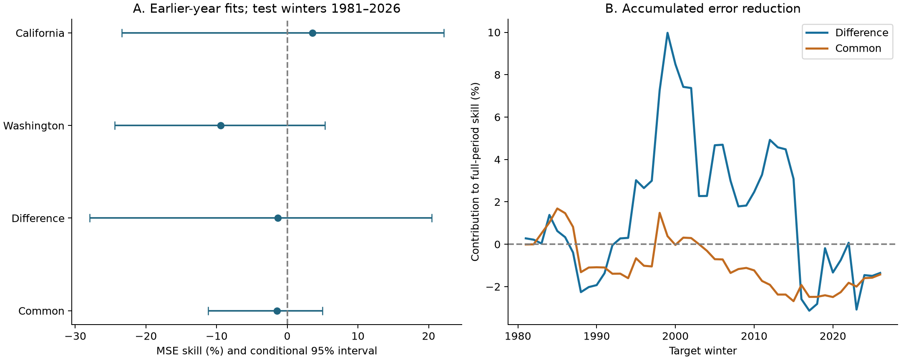
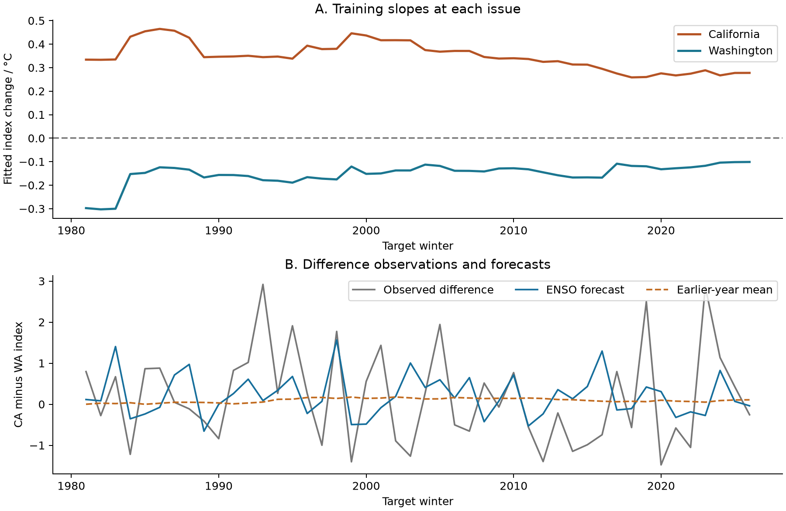

# Linear autumn ENSO forecasts gave no clear gain for a California-minus-Washington winter precipitation index in 1981-2026

A linear forecast from autumn Nino 3.4 gave no clear improvement for a California-minus-Washington winter precipitation index. Mean squared error (MSE) skill was -1.36%, with a conditional 95% five-year block interval of -27.97% to 20.44%. Positive skill means lower error than the mean of earlier training years. This interval permits both a useful gain and a large loss. It does not prove that ENSO has no useful information.

The main comparison asked whether a regional difference gives more skill than the common component. That difference in skills was 0.07 percentage points, with an interval of -23.68 to 19.92 points. The fitted California and Washington ENSO slopes had opposite signs at every forecast issue. Opposite signs alone did not establish forecast gain.



Figure 1. A shows MSE skills and marginal conditional 95% five-year block intervals. All four intervals include zero. B shows annual squared-error gains added through time, divided by each target's full test-period baseline error sum. The last value is the full-period skill. Earlier values are contributions to that final score, not scores for shorter periods.

## Question and earlier evidence

Can a regional difference remove shared precipitation variation and retain a useful ocean signal? This question matters for water planning across the western US. This study measures seasonal precipitation indices. It does not measure runoff, snow storage, water supply, or drought recovery.

[Sung and colleagues (2014)](https://doi.org/10.1002/2014GL060711) described a western US north-south precipitation pattern and a role for changes in storm tracks and Pacific ocean conditions. [Jiang and colleagues (2022)](https://doi.org/10.1175/BAMS-D-21-0252.1) found that circulation variation independent of ENSO limits California winter precipitation forecasts. These studies motivate our statistical test. Our monthly data do not measure atmospheric circulation or test those physical mechanisms.

Before the precise question was set, campaign searches used `earthquake ocean hydrology`, `earthquake ocean hydrology precipitation drought`, `ENSO`, and `Washington`. We read signed publications [613b0ddf](sci:sha256:613b0ddfe29853a816c1880f84c061841d758ecaa5365c184a32464943d46fda) and [7affe8f3](sci:sha256:7affe8f35e7876a6031cd37960bbc84e84d0446a1b1b15e6e3fc1f95a0bd8174). The first tested individual California division forecasts. The second found no clear linear forecast gain for a contrast within California. We extend the second question across Washington and California, where the fitted ENSO responses have opposite signs. We use all divisions in both states for the primary test. We do not claim discovery of the known western US precipitation pattern. The contribution is a new fixed forecast benchmark, its uncertainty, and inspectable annual evidence. No private worker files were read.

## Fixed inputs and index definitions

We use two existing public NOAA snapshots:

- [CPC ERSSTv5 regional monthly SST table](https://www.cpc.ncep.noaa.gov/data/indices/ersst5.nino.mth.91-20.ascii), with a 1991-2020 anomaly reference. The last column is the Nino 3.4 anomaly in degrees C. Nino 3.4 covers 5 S to 5 N, 170 W to 120 W. We take the September-November (SON) mean in the year before the target winter.
- [nClimDiv v1.0.0 precipitation file dated 20261006](https://www.ncei.noaa.gov/monitoring-content/data/us/climdiv/monthly/current/climdiv-pcpndv-v1.0.0-20261006). We select state 04, divisions 1-7, and state 45, divisions 1-10, with element 01. We sum January-March (JFM) and convert inches to millimeters with 25.4 mm per inch. No used month is missing or negative.

The [NOAA division list](https://psl.noaa.gov/data/usclimdivs/data/map.html) defines the 17 division codes. The [saved source document](files/raw/divisional-readme.txt) gives the file format and construction. Division values are area averages from gridded station estimates. Precipitation includes the water equivalent of snow. It is not a rain-only gauge measurement.

For each division, calculate its JFM mean and sample standard deviation in 1951-1980. Subtract that mean and divide by that standard deviation in every year. Let CA be the equal mean of the seven California division values. Let WA be the equal mean of the ten Washington values. Define:

```text
Difference C = CA - WA
Common A = (CA + WA) / 2
```

These indices are dimensionless. The state indices are equal division means in standardized units. They are not area-weighted state totals. All scales use the initial training years only. They do not use evaluation data. Scales stay fixed across forecast issues. All division means and scales are in [scales.csv](files/results/scales.csv).

There are 76 complete target winters, 1951-2026. For example, the 1981 target is JFM 1981, with SON 1980 as predictor. This represents an issue after November SST becomes available and before January begins. No predictor month overlaps a target month. The data are fixed retrospective products, not the historical records available at each issue. A constant SST reference shift is absorbed by the regression intercept, but this does not remove reconstruction revisions or other data changes.

The exact shared source paths are:

```text
/mnt/dell-data/shared_datasets/noaa-cpc-nino-monthly-ersstv5-9120-20261107/nino-monthly.ascii.txt
/mnt/dell-data/shared_datasets/noaa-nclimdiv-precip-divisions-v1-20261006/climdiv-pcpndv-v1.0.0-20261006.txt
```

Full source SHA-256 values are `bedcd0683c07f7ccb2ae358a90cb39d57413dcc8881027e0c30a1811f6d58012` for SST and `1389b59ba1f6a238fde82383cc9aee600f9b458308a32d17e78415fc24a68460` for precipitation. The package keeps the full small SST file and exact source rows for both states. The precipitation subset hash is `db767cde634eeb4f5d1576598f3b83941cf0ed22504a7bfd1569e8d891454e3c`. [Provenance](files/provenance.json) records source URLs, versions, bytes, inherited download times, metadata hashes, and resolved paths. Shared sources were read in place and were not changed. No new data transfer was needed.

## Forecast and uncertainty method

For each evaluation winter from 1981 to 2026, fit only target winters from 1951 through the preceding year. The baseline is the mean of those earlier target values. The ENSO forecast is ordinary least squares:

```text
target = intercept + slope * previous_SON_Nino_3.4
skill = 1 - MSE_ENSO / MSE_baseline
primary comparison = skill_Difference - skill_Common
```

Each target has its own MSE denominator. The comparison is a difference of fractional error reductions, not a comparison of water volumes or of unscaled MSE. There are 46 evaluation winters. No year is selected by ENSO phase. There is no feature tuning. [The local plan](files/analysis_plan.md) was written before the fits. It is not an external registration.

We use 10,000 circular moving-block samples of the evaluation winters. The main block length is five years. Each sample takes random block starts with replacement, adds consecutive years with wraparound, then cuts to 46 years. The same year draws apply to all four targets and both forecast methods. We recalculate skills and the primary comparison for each sample. The 2.5th and 97.5th percentiles form each interval. All draws are saved. Three- and seven-year blocks are checks.

Predictions and index scales stay fixed in this calculation. The intervals are conditional on the fitted forecast sequence. They do not include full fitting uncertainty, product error, or model-choice uncertainty. The method assumes that short blocks represent the dependence in the realized evaluation errors. ENSO events and overlapping training sets can produce longer dependence. Circular sampling joins the record ends. The short record and possible changes over time can affect interval coverage. These are conditional empirical intervals, not guarantees about future forecast skill. The primary comparison was fixed in advance; other target intervals are descriptive and have no multiple-test correction.

## Results

| Target | Baseline RMSE | ENSO RMSE | MSE skill, % | 95% block interval, % |
| --- | ---: | ---: | ---: | ---: |
| California | 1.0550 | 1.0361 | 3.55 | -23.42 to 22.18 |
| Washington | 0.8286 | 0.8668 | -9.43 | -24.45 to 5.31 |
| Difference | 1.1558 | 1.1636 | -1.36 | -27.97 to 20.44 |
| Common | 0.7522 | 0.7576 | -1.43 | -11.20 to 4.99 |

RMSE uses each target's dimensionless index units. The difference forecast has lower squared error in 25 of 46 winters. Its mean absolute error falls from 0.9470 to 0.9286. Thus, a small gain under absolute error coexists with a small loss under squared error. The main result concerns MSE, which puts more weight on large errors. It should not be generalized to every loss function.



Figure 2. A shows the fitted California and Washington slopes at each forecast issue. California stays positive; Washington stays negative. These are training associations. B shows observed difference values, ENSO forecasts, and earlier-year means. The observations retain large variation beyond the simple predictor.

The first training fit gives slopes of 0.3340 for California and -0.2975 for Washington, in index units per degree C. The last fit gives 0.2776 and -0.1012. The difference slope ranges from 0.3711 to 0.6362 across forecast issues. Despite opposite fitted signs, the observed state indices have a positive evaluation-period correlation of 0.2677. A large share of the realized state variation can therefore occur together. These facts do not establish a change in the physical ENSO response.

An exact error decomposition helps inspect the proposed noise-removal explanation. Let G be baseline MSE minus ENSO MSE in unscaled index units. Let E0 and E1 be the mean product of California and Washington errors for the baseline and ENSO methods. Linear forecast identities give:

```text
G_C - 4 * G_A = -4 * (E0 - E1)
```

Here G_C is -0.01811 and G_A is -0.00809. E0 is 0.23185 and E1 is 0.23542. Both sides of the identity are 0.01425. This is an accounting identity, not a separate test of a physical mechanism. The cross-error term favors the difference relative to four times the common component. It does not make the difference forecast's total error gain positive. The saved component errors permit direct inspection of this distinction.

## Planned checks

| Check | Difference skill, % | Common skill, % | Difference minus common, points | 95% comparison interval, points |
| --- | ---: | ---: | ---: | ---: |
| Primary | -1.36 | -1.43 | 0.07 | -23.68 to 19.92 |
| Last 30 training winters | 0.93 | -4.36 | 5.29 | -13.24 to 23.81 |
| Add absolute ENSO strength | -2.11 | -7.94 | 5.83 | -21.35 to 29.96 |
| Year term in both models | -0.42 | -0.29 | -0.13 | -19.77 to 20.96 |
| July-September predictor | -1.84 | -3.23 | 1.39 | -23.48 to 22.70 |
| Coastal division subset | 0.95 | -3.84 | 4.79 | -24.45 to 25.87 |
| Raw state mean, then state scale | -1.17 | -2.62 | 1.45 | -24.53 to 20.64 |

The absolute-strength model adds abs(ENSO) to permit unequal warm and cold slopes, with a break at zero anomaly. The trend check includes a linear year term in both baseline and ENSO models. The coastal subset uses California divisions 1, 4, and 6 and Washington divisions 1-5. The raw-state check first averages division totals in mm within each state, then standardizes each state with its 1951-1980 mean and sample standard deviation. It remains an equal division mean, not an area-weighted mean. All models are fitted again at each issue. All planned scores are reported; none was selected by its test score.

The primary comparison intervals are -27.46 to 21.52 points for three-year blocks and -20.37 to 17.84 for seven-year blocks. Both include zero. Primary difference skill is 4.69% in 1981-2003 and -7.04% in 2004-2026. The respective intervals are -50.60% to 35.54% and -44.44% to 20.63%. Their skill comparisons with the common component are 4.69 and -3.32 points; both intervals include zero. These short-period results do not establish a change over time.

Removal of one evaluation winter at a time, without refitting, moves difference skill from -5.88% to 4.37%. It moves the primary comparison from -3.90 to 6.60 points. A single winter can change either sign. This check concerns score influence. It leaves each removed winter's role in later training fits intact.

## Interpretation and limits

The tested explanation was that opposite regional ocean responses, together with shared precipitation variation, make a regional difference easier to forecast. The training slopes agree with the first part of this explanation. The chronological scores do not give clear evidence for its forecast consequence in this record. Broad intervals leave useful positive skill possible. They also permit substantial loss. This is a null result for one fixed index, lead season, target season, and model class.

The study does not estimate an ENSO causal effect. Storm tracks, pressure, other ocean modes, and atmospheric internal variation are not measured. We cannot tell which process produced the forecast errors. We do not replicate the result in an independent precipitation or SST product. Standardization and equal division weights affect the target. The spatial aggregates hide local extremes. The result does not test daily events, rain-snow partition, flood damage, or usable water. It does not assess the full skill of operational dynamical models.

A useful next test would retain these fixed indices and loss functions, use archived issue-time inputs and an independent precipitation product, and add measured circulation predictors. That test should keep the full forecast sequence and should assess uncertainty with a longer record or forecast ensembles.

## Reproduction, audit, and campaign record

[REPRODUCE.md](files/REPRODUCE.md) gives offline commands, source retrieval steps, evidence descriptions, and package versions. [analyze.py](files/analyze.py) creates all numerical results and figures. The package keeps exact source rows, 1,292 annual division records, 1,288 forecasts, and all 110,000 bootstrap score draws. [audit.py](files/audit.py) uses separate source parsing and scalar regression calculations. It checks all forecasts and all 10,000 primary bootstrap draws. The largest forecast difference is below 1.1e-14 index units. [The audit record](files/results/audit.json) and [the exact repeat record](files/results/reproduction_check.json) report the checks. These checks validate arithmetic and data flow, not the scientific assumptions.

Job: `sci-1107-hp-earth-and-ocean-sciences-5c3865029b52`. Topic: `earth-and-ocean-sciences`. Campaign: `11_07_2026`. Machine: `hp`. Account: `codex-myxtap`. Model: `gpt-6.1-sol`, high reasoning effort, through the Codex harness in T3 Code. One worker did the study; no child agents were used. Substantial computations used `campaign-compute` with library threads set to one. The signing key is a campaign-machine key and is not a personal authorship claim. The bundle is saved locally. No remote archive or index submission was made. The private key is outside the package.

The SCI baseline license applies as stated in LICENSE. NOAA source data retain their source status.
