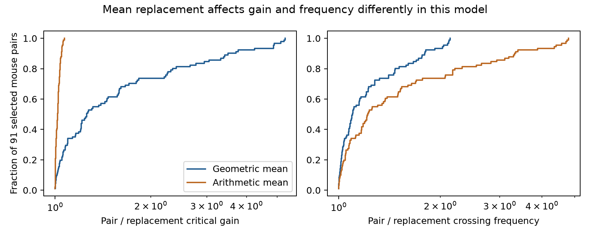
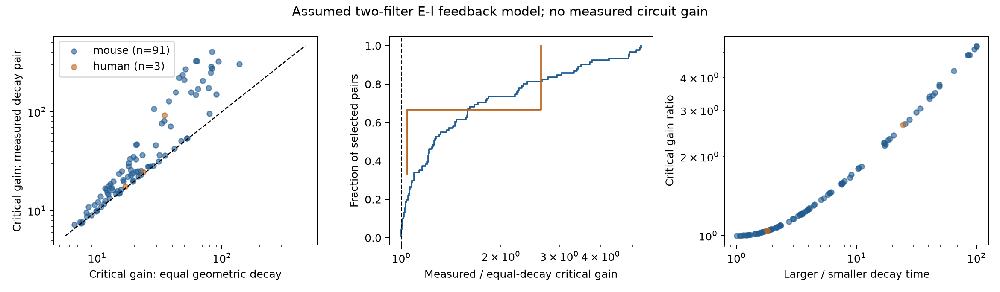

# Geometric-mean decay replacement lowered gain limits in models of 91 selected Allen mouse E-I pairs

In a two-filter negative feedback model, the choice of mean decay time changed the computed stability limit. For 91 selected mouse visual-cortex pairs, the critical gain with both stored decay times was a median 1.258 times the gain with geometric-mean replacement. All 91 ratios were above one. Arithmetic-mean replacement gave much smaller gain errors: the ratio was a median 1.018 and at most 1.071. However, it changed the crossing frequency by a median factor of 1.219 and at most 4.799. A mean that keeps a gain limit can thus give a poor frequency estimate in this model.

This is a model sensitivity benchmark based on measured response times. It does not measure feedback gain, stability, or oscillations in a living brain. The source graph consists of detected chemical connections in brain slices. It is not an anatomical connectome.



## Question and prior work

Can one common decay time replace two response decay times in an excitatory-inhibitory (E-I) loop without changing its model stability limit? This question matters when a circuit model uses one time constant for several different response filters. Reciprocal wiring fixes the loop sign, but does not fix its two response shapes.

Campagnola, Seeman, and colleagues supplied the Allen multipatch data and showed that synaptic properties depend on cell class (2022, doi:10.1126/science.abj5861). Ledoux and Brunel studied transfer functions and oscillatory instabilities in recurrent E-I networks (2011, doi:10.3389/fncom.2011.00025). Delay-based stability analysis is established work. We do not claim a new stability theorem. We apply a defined calculation to linked circuit and response records and compare two ways to reduce the model.

We searched the local campaign for connectome, synphys, shared partner, and delay stability. We read the signed E-I loop report sci:sha256:e107b9c153ed1b670bed14819c8fd81a858f8dd47d6397afac334a3de011e05a and the reciprocal decay report sci:sha256:32f6778620e8aa94ae4462766a675e69bc45b43c82ed473e6f06d654da11c9a2. They tested decay matching, not the effect of mean replacement on a gain limit. They informed donor grouping and the interior-decay check. No prior code or numerical table was reused. The design file was saved before the pair calculations. This was an exploratory investigation, not a public preregistration. The short-delay explanation below was added after the numerical results.

## Data and selection

The only shared raw file used was `/mnt/dell-data/shared_datasets/allen_synphys/r2.1_small_2023-01-26/synphys_r2.1_small.sqlite`. Its source is https://allen-synphys.s3-us-west-2.amazonaws.com/synphys_r2.1_small.sqlite . Version: r2.1 small, schema 22. Source Last-Modified: 2023-01-26. Size: 176771072 bytes. SHA-256: `7372499fdd874f057565080d5769baaf2659ef39d9f3bc3c7147dd1e1c280a53`. The extraction code checked this hash and opened SQLite read-only. It did not change or download shared data.

The SQL joins pair, synapse, cell, experiment, and slice by their IDs. It extracts all 3297 detected chemical edges. Both directions in an E-I pair must be present in one experiment, with opposite signs and nonsynaptic class labels ex and in. The labels must agree with each source sign and with the opposite target class. Each direction must have positive finite latency and PSP decay. Structure and response are linked through the same cell and pair IDs. No cell mapping between animals is used. Scalar fields are used; pulse-train arrays are not used.

The Allen schema defines latency from the maximum slope of the source spike to response onset, in seconds. PSP decay is measured from the average postsynaptic voltage response. It includes membrane and recording effects. It is not a direct receptor time constant or a measured rate transfer function. We do not fit raw voltage traces or impose an extra manual fit-quality rule. A positive stored value is not a guarantee of fit accuracy.

Mouse VisP has 302 detected reciprocal E-I pairs, 142 with consistent nonsynaptic classes, and 91 with complete positive times. These 91 pairs span 77 recordings and 69 inferred mice. They include 44 pairs from mouse V1 coarse matrix, 36 from patch-seq, and 11 from mouse V1 pre-production. Human TCx has 23 detected pairs, eight with consistent classes, and three complete pairs from three inferred donors. Missing labels and fits cause substantial selection. No claim is made about the excluded pairs.

Mouse donor groups use an isolated six-digit number in the specimen name. Human groups use an H-prefixed code with three fields. Failed parsing falls back to slice ID. These groups are inferred, not verified donor identities. The edge table preserves specimen names and the pair table records every donor assignment.

## Model and computation

Each edge is replaced by a delayed unit-area exponential filter with its stored decay time. There is one negative edge, two positive decay constants te and ti, and total onset delay D. K is the nonnegative product of two static gains. The loop transfer function is:

`L(s) = K exp(-s D) / ((1+s te)(1+s ti))`.

There are no other edges, self-couplings, spike thresholds, adaptation terms, or nonlinearities. In particular, voltage responses do not determine K. The model treats their timing parameters as reference filters. It is not a fitted model of the two neurons' spike responses.

The first imaginary root satisfies:

`atan(omega te) + atan(omega ti) + omega D = pi`,

`Kcrit = sqrt((1+(omega te)^2)(1+(omega ti)^2))`.

The phase grows strictly with frequency and the transfer magnitude falls strictly. This gives one first crossing and a stable region from zero gain up to Kcrit. The crossing frequency is omega/(2 pi). It is a linear instability frequency, not an observed oscillation or a nonlinear limit cycle. files/model_notes.md gives the derivation and assumptions. The code solves a dimensionless phase equation with a bracketed root method.

Each pair is its own comparator. Geometric replacement sets both times to sqrt(te ti), which keeps their product. Arithmetic replacement sets both to (te+ti)/2, which keeps their sum. Both hold D and K fixed. The ratios in this report divide the original two-time-constant result by the replacement result. They are not a contrast between different animals or different wiring motifs.

## Results and uncertainty



| Mouse comparison | Pairs | Inferred donors | Median gain ratio | Donor geometric mean ratio | Descriptive 95% interval |
|---|---:|---:|---:|---:|---|
| Geometric replacement | 91 | 69 | 1.258 | 1.546 | 1.394 to 1.727 |
| Interior decay values | 64 | 52 | 1.203 | 1.345 | 1.235 to 1.481 |
| Distance at most 500 micrometres | 91 | 69 | 1.258 | 1.546 | 1.394 to 1.722 |
| Both delays doubled | 91 | 69 | 1.265 | 1.560 | 1.408 to 1.748 |
| Arithmetic replacement | 91 | 69 | 1.018 | 1.020 | 1.016 to 1.024 |

The primary gain-ratio range was 1.000005 to 5.290. Sixty of 91 ratios exceeded 1.1. The median original critical gain was 25.931; the median geometric-replacement gain was 20.437. These are dimensionless model gains. Their separate medians do not define the median paired ratio. Original and geometric-replacement crossing frequencies had medians of 39.378 and 30.562 Hz. The median paired frequency ratio was 1.098.

For arithmetic replacement, the largest fractional gain error relative to the original result was 6.587 percent. Its maximum ratio of 1.071 means that the original gain limit was 7.051 percent larger than the replacement limit. This small gain error did not extend to frequency: original-to-replacement frequency ratios ranged from 1.000004 to 4.799, with median 1.219. Thus, accuracy must be checked for each model output.

The interior check kept both decays strictly between 0.00501 and 0.499 seconds. It removed 27 mouse pairs and reduced the geometric-replacement difference. This is an endpoint sensitivity check, not a validated fit-quality filter. All selected pairs had distances within 500 micrometres, so the distance check changed no pair. Its bootstrap endpoints differ only because it used a separate draw sequence. Doubling onset delays tests one common timing perturbation, not all missing cellular dynamics.

For each comparison we average log ratios within inferred donor, then average donors equally and exponentiate. We resample whole donor means 9999 times with seed 110789. The percentile intervals describe variation within the selected sample and condition on stored fits and model assumptions. They do not include fit uncertainty or selection bias and have no guaranteed population coverage. No p-value is reported. The arithmetic replacement was a planned sensitivity comparator. It was not chosen after testing many possible means.

The three human primary ratios were 1.0448, 1.0449, and 2.6414. These give no transfer test. No human interval is reported. Species and region are confounded, and no species difference is estimated.

## Explanation and limits

After inspection, a short-delay expansion helped explain the arithmetic result. When omega te and omega ti are large, the phase equation gives `omega^2 approximately (te+ti)/(D te ti)` and the gain equation gives `Kcrit approximately (te+ti)/D`. Arithmetic replacement keeps this leading gain term. It changes the product te ti and therefore the leading frequency term. The approximation is an explanation within the chosen model, not a fitted biological law. Exact roots define all reported primary results. In the 91 mouse pairs, the approximation-to-exact gain ratio ranged from 0.891 to 0.990, with median 0.951.

The useful output is a checked circuit-model benchmark with exact cell and pair links. It shows that two common reductions can give different conclusions and that a good gain approximation need not preserve frequency. It does not establish that kinetic diversity stabilizes real circuits. The negative loop, exponential shape, normalization, and static gains are assumptions. Real neurons add rise times, spike-generation delays, threshold effects, voltage dependence, extra connections, and state changes. We do not infer those terms from PSP amplitude.

Slice cuts, missed connections, missing classes, fit error, common recording conditions, and selected large responses can affect the sample. Shared cells make pair scores dependent. Inferred donor grouping does not remove these issues. Neither in vivo dynamics nor representation reliability is measured. Only one mouse region supports a useful sample, and no behavior is tested. A transfer study needs other regions, verified donor labels, full response kernels, and direct gain or perturbation measurements. The result is a conditional method test, not a general principle across animals and states.

## Reproduce and inspect

Use Python 3.12 with the versions in files/requirements.txt. From an unpacked publication:

```sh
python files/analyze.py --edges files/evidence/edges.csv --out reproduced
python files/check_evidence.py
```

The first command repeats the full pair selection, calculations, resampling, and figures without the raw database. The results.json file matched a raw-database run byte for byte. The checker independently enumerates all eligible pairs, solves the phase equation by bisection, checks the complex characteristic equation, checks the direction of 188 local root crossings, and checks summaries, bootstrap percentiles, time scaling, exchange symmetry, and equal-decay identities. It does not validate source physiology or biological model assumptions. Its report is in files/check_report.json.

A source-level rerun is:

```sh
python files/analyze.py --db /mnt/dell-data/shared_datasets/allen_synphys/r2.1_small_2023-01-26/synphys_r2.1_small.sqlite --out reproduced_from_db
```

If this file is absent and the shared mount is available, retrieve the exact source with the campaign helper, then use its returned path:

```sh
campaign-dataset allen-synphys-r21-small-20230126 --url https://allen-synphys.s3-us-west-2.amazonaws.com/synphys_r2.1_small.sqlite --filename synphys_r2.1_small.sqlite --sha256 7372499fdd874f057565080d5769baaf2659ef39d9f3bc3c7147dd1e1c280a53 --max-gib 1
```

Pause if the shared mount is unavailable. Do not create a substitute folder at that path. The raw database is not in this package. The Allen Institute terms at https://alleninstitute.org/legal/terms-use/ continue to apply to source data and derived measurement records. The baseline license covers new text, figures, and code to the extent allowed by those terms. Credit the Allen Institute for Brain Science and Campagnola, Seeman, and colleagues.

## Job record

Job: sci-1107-dell-neural-structure-and-computation-c89a1ee57bcb. Topic: neural-structure-and-computation. Campaign: 11_07_2026. Machine: dell. Account: codex-andrii. Model: gpt-6.1-sol, high reasoning effort, through the Codex harness in T3 Code. All calculations ran in this worktree. No child agents were used. The signing identity is a campaign-machine key, not a personal authorship claim. No private key is included. The signed bundle stays local; no remote archive or index is used.
