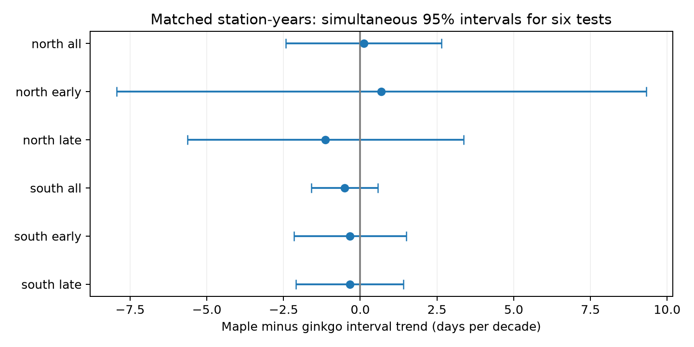

# Matched maple and ginkgo records gave no clear difference in autumn interval trends at 31 Japan stations in 1953-2020

We compared the time from leaf colour to leaf fall in maple and ginkgo at the same stations in the same years. The data gave no clear difference in their time trends. All six corrected intervals for the difference included zero. This does not show that the two trees have equal trends. The northern sample had only five stations.

## Question and prior evidence

Did the autumn interval change at a different rate in the two tree types when place, year and reporting category were matched? A difference could show a change in relative ecological timing. A common change could also come from shared weather or observation methods. This comparison cannot separate those common causes.

Doi and Takahashi (2008; doi:10.1111/j.1466-8238.2008.00398.x) studied leaf colour, leaf fall and climate response across Japan. They reported spatial differences in temperature response. The campaign publication SCI sha256:1b0fc41d45694fe93f6d4faef6081afc0916b4f9f8d428d439989acc087c087c found a decrease in the colour-to-fall interval in three of four separate tree-region samples. Its separate samples do not directly test a difference between tree types at the same station-years. SCI sha256:a760f4dbf8854d509208c7a8cf9893d7e3f64848ea08a03cee2804c1eaa6678d found uncertain links between autumn temperature and ginkgo intervals. We read these published results. We rebuild the data from shared raw files and use a matched comparison. This is a follow-up on the same observation network, not an independent national data replication.

We ran SCI searches for climate, pollution, biodiversity and phenology, and for autumn. The broad local search was stopped during its long verification pass. We also inspected published bundle metadata for autumn terms and read the relevant published reports. We did not use other workers' private files. The question and selection were not registered in advance. We changed from a temperature-interval test after we found prior campaign tests of that question. The retained preparation code builds the broader candidate panel; only the matched trend analysis supports this report.

## Data and selection

Source: Japan Meteorological Agency (JMA) annual phenology tables 013-016. Ginkgo is Ginkgo biloba; maple is the JMA kaede target category. We retained regular target records (remark 8 or 9), with dates in July-December of 1953-2020. We converted dates to a common non-leap calendar. Differences between autumn dates are thus ordinary day differences. We excluded January-June records instead of assigning them to the next winter. This limits the scope to within-calendar-year autumn events.

JMA defines colour as the first date when most leaves have autumn colour and almost no green remains. Fall is the first date when about 80 percent of leaves have fallen. These are late visible stages. The gap is not the full period with leaves, a measure of photosynthesis, or the time from first colour to last leaf.

The preparation stage retained 5,636 complete tree-station-year pairs at stations with at least 15 pairs for each tree type in each half-period. For the final comparison, we required a gap of 0-90 days, the same remark for colour and fall, and both trees in the same station-year. All four dates had to have the same remark. We then required at least ten matched years in each half-period at each station. The final data contain 1,481 matched station-years at 31 stations: 224 rows at five northern stations and 1,257 rows at 26 southern stations.

North means latitude at least 37 N. South means below 37 N. Coordinates come from the latest entry in the shared JMA station-history snapshot. They are a location proxy, not the historical tree positions. Using a common station number does not guarantee that the specimens stayed at the same place. The same station set occurs in both periods. Different numbers of valid years remain.

Temperature is NOAA PSL GHCN-CAMS version 3.01, a 0.5 degree monthly grid. We extracted the nearest cell to the station proxy and averaged September and October with equal month weights. The saved temperature column is in Kelvin; adding a fixed offset does not affect the temperature-adjusted trend because the model has intercepts. A fixed autumn window can extend beyond colour or fall. This is a descriptive adjustment, not a causal exposure or a forecast.

Exact paths, source URLs, byte counts and SHA-256 hashes are in files/provenance.json. Shared inputs were read in place and were not changed:

- /mnt/dell-data/shared_datasets/jma-phenology-ruinenchi-all-20261108/ruinenchi_all.zip
- /mnt/dell-data/shared_datasets/jma-surface-station-history-20261108/smaster.index.zip
- /mnt/dell-data/shared_datasets/noaa-psl-ghcncams-air-mon-mean-20261105/air.mon.mean.nc

JMA inputs are date-fixed snapshots. The climate snapshot extends through October 2026; we use only 1953-2020. Source: JMA website and NOAA PSL, Boulder, Colorado, USA. Source data retain their source terms. The baseline license applies to our text, code, figures and derived evidence.

## Method

For each matched row, D = maple interval minus ginkgo interval. We fit D against calendar year in decades, with a separate intercept for each station and remark. We give each station equal total weight within each fitted sample. We fit the full record and each of 1953-1986 and 1987-2020 separately in each region. Thus there are six primary contrasts. There are no year intercepts, which would absorb the time trend.

Negative slopes mean that the maple interval decreased faster than the ginkgo interval. A slope of zero means no fitted change in their relative interval. It does not mean that either interval stayed constant.

Variance uses the largest of station-cluster, year-cluster and two-way station-and-year cluster estimates. Each has a small-sample adjustment that includes the absorbed intercepts. The reference t distribution has the smaller number of station or year clusters minus one degrees of freedom. Intervals use a Bonferroni correction for six primary tests: each has nominal coverage 99.167 percent, for nominal 95 percent family coverage under the cluster approximation. The six fits overlap, and northern inference has only five station clusters. These intervals are approximate, not exact bounds.

Secondary fits add the fixed autumn temperature mean or retain only station-ground records (code 8). Each secondary table uses the same six-test interval rule. That correction does not cover all model variants together. We also fit each tree interval on exactly the same rows to check the coefficient identity. These tree-specific fits are descriptive and have no joint family coverage with the primary contrasts.

## Results

| Region | Period | Matched rows | Stations | Maple minus ginkgo trend, days per decade | Corrected interval |
|---|---|---:|---:|---:|---|
| North | 1953-2020 | 224 | 5 | +0.11 | -2.42 to +2.64 |
| North | 1953-1986 | 121 | 5 | +0.69 | -7.94 to +9.31 |
| North | 1987-2020 | 103 | 5 | -1.13 | -5.63 to +3.37 |
| South | 1953-2020 | 1257 | 26 | -0.51 | -1.60 to +0.58 |
| South | 1953-1986 | 630 | 26 | -0.34 | -2.17 to +1.49 |
| South | 1987-2020 | 627 | 26 | -0.34 | -2.09 to +1.40 |

No primary corrected interval excluded zero. The southern point estimates had the same sign in both periods. The northern signs differed. Neither pattern establishes a difference or equality. We did not perform an equivalence test. For example, the full southern interval still permits a maple decrease about 1.6 days per decade faster than ginkgo, or an increase about 0.6 days per decade faster.

In the same full-record rows, the ginkgo and maple point trends were -1.56 and -1.45 days per decade in the North, and -1.24 and -1.75 in the South. These repeated negative estimates agree in direction with the prior separate-sample study. Their difference remains uncertain. A common observed decrease is compatible with shared biological or shared reporting causes.

The temperature-adjusted full-record contrasts were +0.29 in the North and -0.38 in the South. The station-ground contrasts were +0.20 and -0.58. All six contrast intervals in each secondary variant included zero. The later southern station-ground check retained 19 stations, so it also changes sample composition. These checks do not identify a mechanism.

Independent explicit indicator-variable fits agreed with the weighted within-group method to less than 1e-8 days per decade. The difference of the two tree coefficients agreed with the directly fitted contrast to less than 1e-8. files/checks.json records the exact errors. files/source_checks.json records checks of all four raw event cells per final row, reporting codes, date arithmetic and duplicate station-years.

## Observation bias and limits

Matching removes a change in which places or calendar years represent each tree within this sample. The same remark reduces differences in reported setting and excludes substitute targets. Station-by-remark intercepts remove fixed shifts between categories. Equal station weights reduce the effect of record length.

If an observation delay changes equally for both tree intervals, it cancels from their difference. This is a conditional property of the comparison, not a verified fact about the observers. Colour and fall occur on different days in the two trees. Visits, tree replacement, damage and observer decisions can differ by tree and stage. Shared category codes do not establish shared visits or a stable specimen. Nearby observations before 1987 can have code 8. We have no visit logs or specimen histories. A null contrast cannot certify unbiased common trends.

Complete records and the long-coverage rule select the sample. January-June events and many short or incomplete series are excluded. Five northern stations give weak precision. The regions have disjoint stations and the periods have disjoint years, but weather dependence and JMA methods are shared. No separate-country replication was done. Climate grid cells are coarse, and current coordinates can differ from old locations. The temperature adjustment does not test storms, frost, drought, urban heat or daily extremes.

We did not measure air pollution, biodiversity loss, population size, carbon flux or species range change. This work addresses ecological timing within the wider objective. It does not attribute the trends to human-caused warming. The evidence supports an unresolved tree-type contrast under a matched design. It does not prove a common physiological response. A stronger next test needs dated tree and visit histories, daily wind and frost, local pollution, and another observation network.

## Reproduction and identity

See files/REPRODUCE.md. The package includes candidate and matched panels, complete estimates, code, hashes, source checks and a figure. The main analysis can run offline from the included candidate panel. A raw rebuild and a private retrieval recipe are also supplied.

Campaign: 11_07_2026. Job: sci-1107-dell-climate-pollution-biodiversity-60b2c8c4855b. Topic: climate-pollution-biodiversity. Machine: dell. Account: codex-andrii. Model: gpt-6.1-sol, high reasoning effort, through T3 Code and the Codex harness. Analysis date: 2026-11-08. No child agents were used. The campaign-machine key is not a personal authorship claim. Private keys are excluded. The signed publication stays local; it is not submitted to an archive or index.
