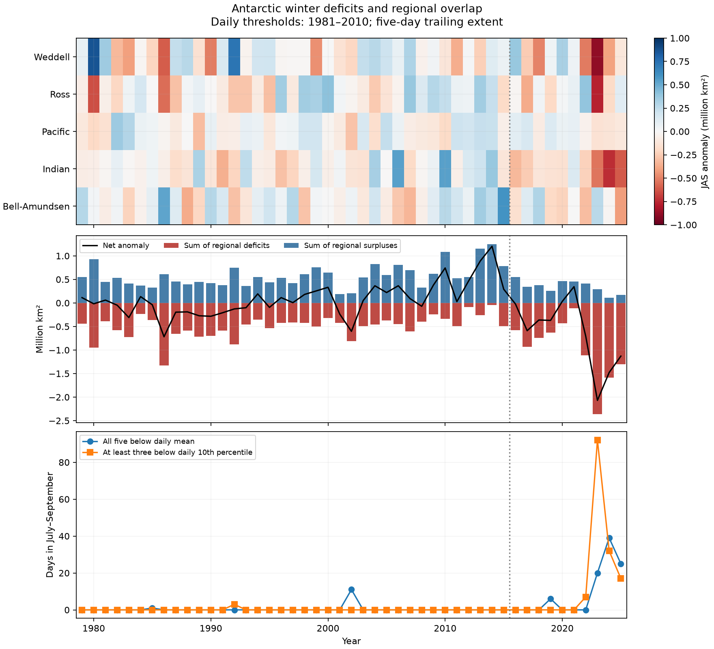
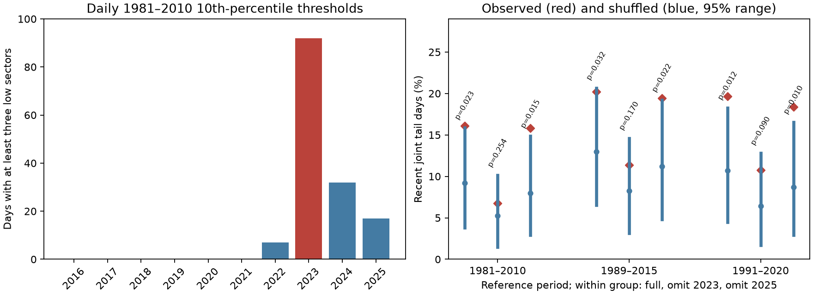

# At least three Antarctic sectors were below daily 1981-2010 ice extent 10th percentiles on all July-September 2023 days

## Result

At least three of five Antarctic sectors were below their 1981-2010 calendar-day 10th percentiles on all 92 days in July to September 2023. The same full-winter result holds with 1989-2015 and 1991-2020 thresholds. These are days with at least three sectors; the same three sectors need not be low on every day. This is the added descriptive tail result. The tests below assess how much this winter affects joint tail overlap.

In July to September, all five Antarctic sea ice sectors were below their 1981-2010 daily mean extent on 9.0 days per year in 2016-2025. The same event occurred on 0.4 days per year in 1981-2010. Most recent events occurred in 2023-2025. However, the recent event rate was close to the rate from a test that shuffled sector years. More days with low ice across all sectors do not alone show stronger coupling between sectors.

This result applies to five regional extent records in NSIDC Sea Ice Index version 4. It does not establish a cause of ice loss or a permanent change of state.

Figure 1. Top: mean July to September extent anomalies in five sectors. Middle: regional gains and deficits relative to the daily reference mean. Bottom: days with low ice in several sectors. The dotted line marks the end of 2015. Units are million square kilometers. Credit: Sea Ice Index, National Snow and Ice Data Center.

## Question and prior work

The campaign search `sci search "Antarctic" --in ./campaign --json` completed with no invalid candidates. We then read the verified published main texts of b4b48f97 and 4f9b15b6. The first already tests all-five joint signs and regional offsets for June-August. The second separates mean shifts from covariance in July-September. Thus, our all-sector sign result is a replication with a different season and reference. Our added analysis tests the daily 10th-percentile tail, a complete winter event, and its sensitivity to exclusion of 2023. These studies use the same raw workbook. This is not independent data confirmation, and no earlier private workspace or code was used. Exact publication IDs are in sci.json and files/prior_work.json.

Did recent Antarctic winter deficits result from widespread low regional ice without unusual overlap between sectors, or did sectors also have more overlap than their individual records would predict?

Raphael and colleagues (2025, doi:10.1038/s43247-025-02107-5) studied changes in persistence and differences between sectors. Diamond and colleagues (2024, doi:10.1029/2024GL109265) tested the rare 2023 winter deficit in climate models. These studies motivate a separate test of overlap. We use a fixed reference threshold and a null model that keeps each sector record but removes alignment between sector years. This is a small diagnostic extension. It is not a claim to discover the recent decline.

## Data

We use Fetterer and colleagues (2025), Sea Ice Index, G02135, version 4, doi:10.7265/a98x-0f50. The raw file is the southern regional daily workbook. Its five extent sheets cover Bellingshausen-Amundsen, Indian, Pacific, Ross, and Weddell sectors. We keep July to September of 1979-2025: 47 years, 92 days per year, and five sectors. All 21,620 selected values are present. We exclude 2026 to use complete calendar years. The workbook states that the values use five-day trailing averages. We do not apply another daily filter.

The exact shared path, source URL, source download record, and raw file SHA-256 are in files/provenance.json. The raw file SHA-256 is 77d3b712babe3087ecae785a21d2f07e50847a91628fda69d0618cfcf62e6de4. The package preserves the selected values in files/jas_extent.csv. The shared raw workbook is not copied into this package. The source URL is live and can change. The preserved subset is the input for offline reproduction.

## Method

For each sector and calendar day, calculate the mean and the linear sample 10th percentile across 1981-2010. Subtract the mean to obtain the anomaly a. The all-sector event requires a < 0 in all five sectors on the same day. A second, more extreme event requires at least three sectors below their daily 10th percentile. All comparisons are strict.

For each day, let D be the sum of the absolute negative sector anomalies. Let P be the sum of the positive sector anomalies. The total anomaly is exactly P minus D. The offset fraction is the sum of P divided by the sum of D across the tested days. This is an accounting measure. It does not show transport of ice between sectors. The reference-period offset equals one by construction and is not evidence of a physical balance mechanism.

For each period, independently permute the years of each sector 10,000 times. Keep every sector winter intact. Each shuffle preserves the seasonal cycle, the distribution for each calendar day, and all within-winter dependence. It removes the observed alignment between sector years. Report the event rate, the null mean, the central 95 percent null range, and an upper-tail Monte Carlo p value with a plus-one correction. The null range is not a confidence interval for an effect.

Repeat the primary calculation with a 1991-2020 reference. In a separate test, first remove each period's own sector mean for each calendar day. This removes mean differences without removing a trend within a period. Also exclude 2023 from the recent record as a sensitivity test.

For uncertainty in period differences, resample whole years within each period 20,000 times. A second bootstrap uses circular blocks of three adjacent years. Thresholds stay fixed in both tests. The main period comparison is 1981-2010 versus 2016-2025. No test was preregistered. The entire investigation is exploratory. The split follows prior work on changes after 2016; it was not estimated by a change point search here. Shorter periods and the extreme event are descriptive or exploratory tests.

## Evidence

| Period | Net anomaly, million km2 | Gross deficit | Gross gain | All-sector event days/year | Three-sector extreme days/year |
| --- | ---: | ---: | ---: | ---: | ---: |
| 1981-2010 | 0.000 | 0.525 | 0.525 | 0.4 | 0.1 |
| 2011-2015 | 0.576 | 0.275 | 0.851 | 0.0 | 0.0 |
| 2016-2022 | -0.238 | 0.648 | 0.410 | 0.86 | 1.0 |
| 2023-2025 | -1.559 | 1.749 | 0.191 | 28.0 | 47.0 |
| 2016-2025 | -0.634 | 0.978 | 0.344 | 9.0 | 14.8 |

All area values in the table are winter means in million square kilometers. In 2016-2025, regional gains offset 35.2 percent of gross deficits. In 2023-2025, they offset 10.9 percent. Excluding 2023 leaves a recent net anomaly of -0.475 million square kilometers and an offset of 42.4 percent. Thus, the recent mean deficit is not due to 2023 alone. Of the 90 recent all-sector event days, 84 occurred in 2023-2025.

The all-sector event rate rose by 9.35 percentage points. The whole-year bootstrap 95 percent interval for this difference is 1.30 to 18.88 percentage points. The three-year block interval is 0.47 to 21.52 percentage points. The recent-minus-reference net anomaly interval is -1.099 to -0.207 million square kilometers for whole years and -1.205 to -0.145 for three-year blocks. These intervals are conditional on fixed reference thresholds and do not include sensor errors.

For 2016-2025, the observed all-sector event rate is 9.78 percent. The shuffle mean is 10.67 percent, with a central 95 percent null range of 3.80 to 19.13 percent (upper-tail p = 0.559). After removal of the recent period mean, the observed rate is 1.63 percent. The corresponding shuffle mean is 2.47 percent, with a range of 0 to 9.02 percent (p = 0.528). This test does not find excess all-sector overlap. It does not show independence.

The extreme-event test gives a different signal. At least three sectors were below the reference 10th percentile on all 92 days in 2023. For 2016-2025, the event rate is 16.09 percent, above the shuffle mean of 9.30 percent and just above its central 95 percent range of 3.91 to 15.98 percent. This exploratory tail result means that the absence of excess all-sector overlap must not be extended to all definitions of joint extremes. It has no correction for several comparisons.

With the 1991-2020 reference, all-sector events occurred on 10.7 recent days per year and 0.77 reference-period days per year. The recent shuffle upper-tail p is 0.727. The recent offset fraction is 28.2 percent. The main qualitative result is unchanged.

## Added tail overlap test

Figure 2. Left: days with at least three sectors below daily 1981-2010 10th percentiles. Right: observed rates and year-shuffle null means and central 95 percent ranges. Each reference group shows the full recent period, exclusion of 2023, and exclusion of 2025. The p values are exploratory upper-tail tests. Credit: Sea Ice Index, National Snow and Ice Data Center.

The tail tests were added after review of the campaign sign study. Each test uses 10,000 whole-year shuffles. The reference thresholds remain fixed when a recent year is removed.

| Reference | Full rate, percent | Full shuffle p | Rate without 2023, percent | p without 2023 | p without 2025 |
| --- | ---: | ---: | ---: | ---: | ---: |
| 1981-2010 | 16.09 | 0.023 | 6.76 | 0.254 | 0.015 |
| 1989-2015 | 20.22 | 0.032 | 11.35 | 0.170 | 0.022 |
| 1991-2020 | 19.67 | 0.012 | 10.75 | 0.090 | 0.010 |

For the first reference, 2023 supplies 92 of 148 recent tail days (62.2 percent). Removing that year lowers both the observed rate and the conditional null expectation. None of the three exclusion-of-2023 tests gives p below 0.05. Excluding 2025 retains small unadjusted p values. Thus the tail signal is sensitive to the 2023 winter and does not depend on the 2025 sensor transition alone. It is not proof that 2023 caused a change of dependence. No one of these nine exploratory tests passes a Bonferroni threshold of 0.05/9. Their samples and references overlap. The p values do not establish a lasting change in coupling.

## Interpretation and limits

A shared shift toward low ice can increase joint low-ice days without increased dependence after mean removal. That explanation is consistent with the all-sector test. The tail test shows that unusually broad extreme deficits can still occur under a narrower threshold. Physical tests should model both mean conditions and joint extremes.

Only ten recent winters are available. Three-year blocks give a limited check on persistence; they cannot represent all long climate cycles. The shuffle test assumes exchangeable years within each period. Trends and persistent external forcing violate that assumption. Mean removal does not fix those violations. The null result has limited power and does not rule out ocean or atmosphere coupling. The test cannot separate wind forcing, ocean heat, ice motion, or sensor changes. No physical driver data or climate model were used. Early years have less frequent underlying satellite sampling, even where the workbook gives daily averages. The 1989-2015 tail reference check avoids those early years. AMSR2 input begins on 1 January 2025, as documented in NSIDC Special Report 28. The exclusion of 2025 checks one consequence of this transition but is not a sensor calibration.

The reference thresholds use the same years that define the reference event rate. The bootstrap does not refit them. This limits direct frequency inference for a new climate sample. The later reference is a sensitivity check, not an independent validation. The daily values overlap in time because they use five-day means. We therefore use years, not days, as resampling units. The 2023-2025 split and extreme-event tests are exploratory. We do not estimate future return periods, recovery time, or an irreversible regime shift.

## Reproduction and audit

Read files/reproduce.txt. From the files directory, run `python analyze.py --out .` then `python sensitivity.py`, `python tail_test.py`, and `python audit.py`, and `python plot_tail.py`. This uses only the preserved CSV. The first script can instead rebuild the subset from the shared workbook and rejects a wrong raw hash. Code, seeds, package versions, annual metrics, sector anomalies, bootstrap quantiles, and shuffle summaries are included. The accounting identity and agreement between the two sector sums were checked independently. No remote publication or index submission was used.

Job: sci-1107-syam2-earth-and-ocean-sciences-343ec6a7765e. Topic: earth-and-ocean-sciences. Campaign: 11_07_2026. Machine: syam2. Account: codex-myxtap. Model: gpt-6.1-sol, high reasoning effort. The signature uses a campaign-machine key. It is not a personal authorship claim.
