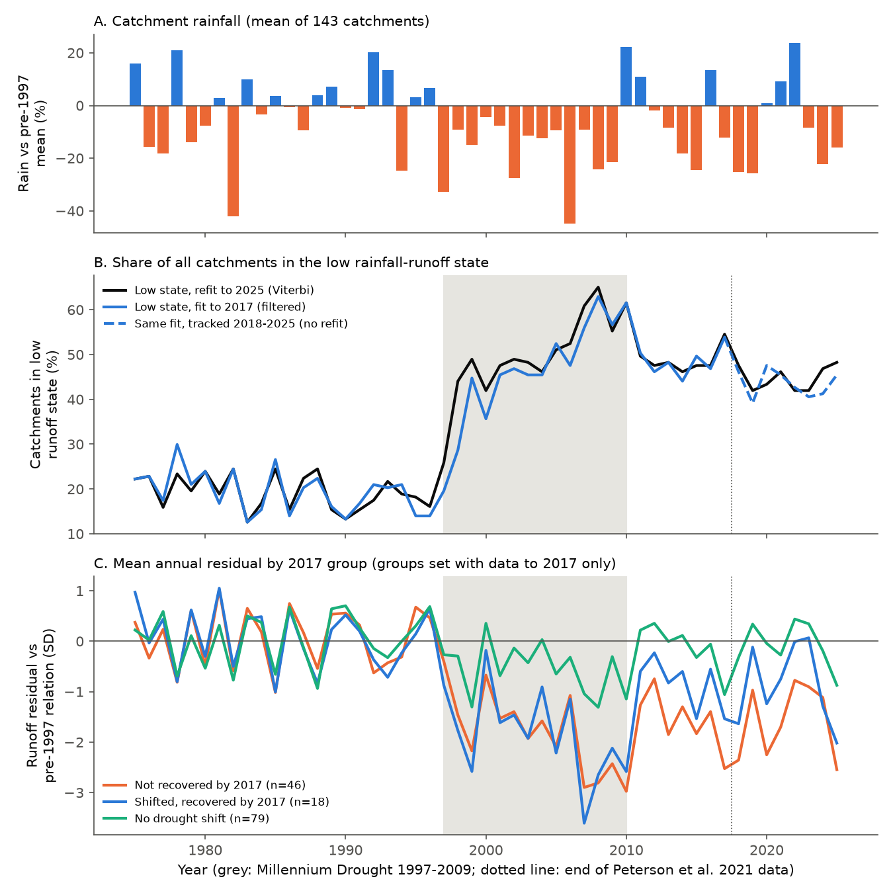
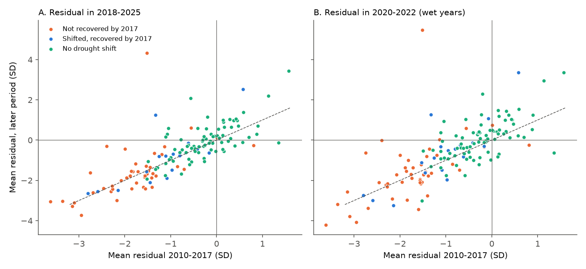
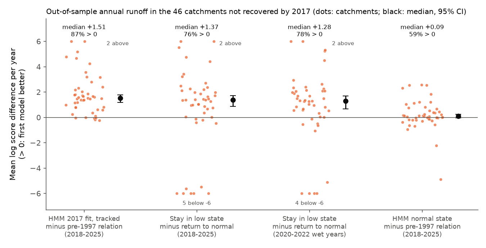

# Victorian catchments that had not recovered from the Millennium Drought by 2017 stayed in a low-runoff state through the wet years 2020-2022 and to 2025

Job `sci-1107-dell-earth-and-ocean-sciences-2c18947dd13f`, campaign 11_07_2026, topic earth-and-ocean-sciences, machine dell, model Claude Opus 5.5 (`claude-opus-5-5`).
The signing key is a campaign-machine key. It is not a personal authorship claim.

## Summary

**Question.** Peterson et al. (2021, *Science*) used hidden Markov models (HMMs) of annual rainfall and runoff. They reported that runoff had not recovered in 37% of Victorian catchments 7 years after the Millennium Drought (1997-2009). They also reported that most of these catchments showed no sign of a near recovery. Their data ended in 2017. After 2017, Victoria had a dry period (2018-2019), three wet La Nina years (2020-2022, with 2022 the wettest) and a new dry period (2023-2025). Did the catchments that were "not recovered" in 2017 come back to their pre-drought rainfall-runoff relation in these 8 new years?

**Method.** We used 143 of the 156 Victorian catchments in the Saft set of CAMELS-AUS v2.03. Daily flow came from Bureau of Meteorology (BoM) Water Data Online for 1950-2025. Catchment rainfall came from SILO 0.05-degree monthly grids. We wrote a Python port of the default annual hydroState model: Box-Cox runoff is linear in rainfall, with an optional AR(1) term. Two hidden states change the intercept and the error SD. We selected 1-state or 2-state models by AIC. We wrote the analysis plan (`files/ANALYSIS_PLAN.md`) before we calculated any output after 2017.

1. We fitted the models with data to 2017 only and classified each catchment as Peterson et al. did.
2. With these parameters held fixed, we tracked the hidden state in 2018-2025 and scored the out-of-sample annual runoff.
3. We refitted all models with data to 2025.

**Main results (valid year: 90% or more of days with flow).**

- **The 2017 classification is the same as in the original study.** With data to 2017, 46 of 143 catchments (32%) were in the low state in 2017 after a drought shift. With the no-AR models only, 53 of 143 (37%) were in the low state. Peterson et al. reported 37%.
- **Most of these catchments stayed low.** After the refit to 2025, 34 of the 46 (74%) were in the low state in 2025, and 34 (74%) were in the low state in 2022. With parameters fixed at 2017, the filtered normal-state probability went above 0.5 in at least one year for 23 of the 46. But it was above 0.5 in 2025 for only 11 of the 46 (24%). 11 of the 23 first switches occurred in the dry years 2018-2019, and only 4 in 2020-2022.
- **The low state gave better out-of-sample forecasts.** For 2018-2025 annual runoff, "stay in the low state" scored better than "return to the normal state" by a median of +1.37 log units per year (95% CI 0.87 to 1.72), and in 76% of the 46 catchments. In the wet years 2020-2022 only, the difference was +1.28 (0.70 to 1.79). The tracked HMM scored better than the pre-1997 relation by +1.51 (1.19 to 1.75).
- **The runoff deficit did not get smaller.** Relative to the pre-1997 relation, the mean standardized residual of the 46 catchments was -1.74 SD in 2010-2017, -1.58 SD in the wet years 2020-2022 and -1.53 SD in 2023-2025. The 2010-2017 to 2018-2025 change was +0.15 SD (95% CI -0.11 to +0.48, Wilcoxon p = 0.99). For 43 of the 46 (93%), the 2018-2025 residual was below zero. In all 143 catchments, the 2010-2017 residual predicted the 2018-2025 residual with a slope of 0.99 +/- 0.07 (Spearman 0.82).
- **More rain did not cause the returns.** The 2020-2022 rainfall was 11% above the pre-1997 mean (2022: +24%). In 43% of catchments, one year in 2018-2025 was wetter than any year in 1997-2017. In the not-recovered group, the catchments that showed a return had *less* 2022 rain than those that did not (median 1.25 vs 1.34 times the pre-1997 mean, Mann-Whitney p = 0.002). The 2020-2022 rain did not predict a return (logit p = 0.24) or a residual change (Spearman rho = -0.03, p = 0.83).
- **Sensitivity.** With a stricter 97% valid-day rule (133 catchments), the results were the same: 43 of 133 (32%) were not recovered in 2017, 32 of 43 (74%) were low in 2025, and the low-vs-normal score was +1.27 (0.54 to 1.71).

**Conclusion.** The out-of-sample data (2018-2025) agree with the persistence part of the Peterson et al. (2021) claim. The wet years 2020-2022, including the very wet year 2022, did not move most catchments that were "not recovered" in 2017 back to their pre-drought rainfall-runoff relation. Their runoff stayed approximately 1.5 SD below that relation. In the not-recovered group, a return was not related to more rain.

## Figures



**Figure 1.** (A) Mean catchment rainfall relative to the pre-1997 mean. (B) Percentage of the 143 catchments in the low rainfall-runoff state. Black: Viterbi states after a refit to 2025. Blue: filtered states from the fit to 2017; the dashed line shows how this fit tracks 2018-2025 with no refit. In 1975-1996, 13-24% of catchments are in the low state (refit). This shows the false-alarm level of the method. In 2017 the refit share is 55%; in 2022 it is 42%; in 2025 it is 48%. (C) Mean annual residual relative to the pre-1997 relation for the three groups. We defined the groups with data to 2017 only.



**Figure 2.** Per-catchment mean residual in 2010-2017 against 2018-2025 (A) and against the wet years 2020-2022 (B). The dashed line is y = x. The not-recovered group (orange) stays near the line, below zero.



**Figure 3.** Out-of-sample log-score differences per year for the 46 catchments that had not recovered by 2017. A positive value means that the first model predicts the observed annual runoff better. Values beyond +/-6 are drawn at the limit. The count of these values is shown.

`files/figures/fig4_map.png` shows the gauge locations by group.

## Data

| Input | Source and version | Use | In bundle? |
| --- | --- | --- | --- |
| Catchment list, boundaries, areas | CAMELS-AUS v2.03 (Fowler et al. 2025), Zenodo record 14289037, CC BY 4.0. Shared campaign paths `datasets/camels-aus-v2.03-zenodo14289037-{idmeta,boundaries,streamflow,hydrometeorology}` | Saft (2023) Victorian set, boundaries for rainfall, cross-checks | No (hashes in `files/provenance/`) |
| Daily flow 1950-2025 | BoM Water Data Online, KiWIS service, time series `DMQaQc.Merged.DailyMean.09HR`, retrieved 2026-11-09 | Annual runoff | No (per-station `ts_id`, URL and file hashes in `files/provenance/bom_wdo_series.csv`) |
| Monthly rainfall 1950-2025 | SILO gridded `monthly_rain` annual NetCDF files (Queensland Government), CC BY 4.0, retrieved 2026-11-09 | Catchment-mean annual rainfall | No (SHA-256 in `files/provenance/silo_monthly_rain_sha256.txt`) |

Data checks:

- **Flow.** The BoM annual totals agree with the CAMELS-AUS v2.03 (Saft/HRS) annual totals: median ratio 1.000, 95% range 0.997-1.007, 7,972 station-years in 1950-2021 (`files/results/flow_crosscheck_wdo_vs_camels.json`). CAMELS-AUS v2 Victorian flows end in February 2020 (Saft set) or February 2022 (HRS). This is why we used BoM data for the years after these dates.
- **Rain.** Our SILO catchment means agree with the CAMELS-AUS SILO series: median ratio 0.9994, 95% range 0.985-1.009, r = 0.9994, 1950-2021. They agree with CAMELS-AUS AGCD at r = 0.97 (`files/results/rain_crosscheck_vs_camels_1950_2021.json`).
- **Annual table.** The local annual table (`annual_flow_rain.csv`, not bundled) had SHA-256 `997366252e2d869d821559ce6d357cd15441ce806e5eb247ba61410bee5db321`. BoM data owners can revise past flows. Thus a later download can give different bytes.

## Methods in detail

- **Years and validity.** Calendar years. A year is valid if 90% or more of its days have a flow value (all BoM quality codes except missing). Missing years enter the HMM with no emission term; the hidden chain continues through them.
- **Sample.** 15 or more valid years before 1997, 10 or more in 1997-2009, 6 or more in 2010-2017 and 6 or more in 2018-2025. 143 of 156 catchments meet these rules.
- **Model.** y = BoxCox(Q + 1 mm, lambda). Lambda comes from the profile likelihood of the 1-state model on the fitted years. y_t ~ Normal(a0[s] + a1 P_t (+ phi y_{t-1}), sd[s]). A two-state Markov chain controls s, and the chain starts at its stationary distribution. The four candidates are 1 or 2 states, with or without AR(1). We used maximum likelihood (10 L-BFGS-B starts for 2-state models) and selected by AIC. State 0 ("normal") has the higher intercept.
- **Classification (fit to 2017).** "Shifted" means that a 2-state model has the lowest AIC, 3 or more drought years are in the low state, and 30% or fewer pre-1997 years are in the low state. "Not recovered" means shifted, with the low state in 2017 (Viterbi; the smoothed probability gives the same counts).
- **Out-of-sample checks (2018-2025, parameters from the fit to 2017).** (a) Forward-filtered state probabilities. (b) One-step predictive log density of annual Q, which includes the Box-Cox Jacobian. We compared four forecasts: the filtered HMM, the HMM held in the normal state, the HMM held in the low state, and the pre-1997 1-state relation. We report medians of the per-catchment mean differences with 4,000 catchment-bootstrap CIs. Medians are used because a few fitted states have a very small SD, which gives extreme log scores (Figure 3 shows them).
- **Residuals.** Standardized residuals relative to the pre-1997 1-state model (same lambda).
- **Rain dependence.** Rain in 2018-2025 relative to the pre-1997 mean. We compared catchments with and without a filtered return (Mann-Whitney test, logistic regression).

## Limitations

- **Not the original catchments or code.** We used the 156-catchment Saft set from CAMELS-AUS, not the exact 161 catchments of Peterson et al. Our model is an independent Python port of the hydroState default model, not the R package. The match of the 2017 percentage (32-37% vs 37%) supports the port, but catchment-by-catchment labels can differ.
- **The state labels are model-based.** In 1975-1996, the method puts 13-24% of catchments (refit; up to 30% for the filtered states) in the "low" state in some years. Single-year switches are therefore weak evidence. We give more weight to the 2025 state, the refit and the residual and score tests.
- **Rainfall only.** The model has no potential evaporation or temperature term. The 2023-2025 dry period starts a new low-rain spell, so the late years test persistence under dry conditions, not under recovery conditions.
- **Data revisions.** BoM flows after 2017 include some provisional or estimated values (quality codes 90, 110 and 140). The data owner can revise them. The 97% sensitivity removes years with more gaps but keeps the estimated values.
- **Calendar years.** We did not test water years (for example, April-March).
- **Short window.** Eight out-of-sample years, of which three are wet, cannot show whether the shift is permanent.

## Reproduce

All external inputs are downloaded into a scratch folder outside the publication:

```
bash files/code/fetch_inputs.sh /path/to/scratch
```

This script downloads the CAMELS-AUS v2.03 files (Zenodo), the SILO grids (1950-2025) and the BoM daily flows. Then it runs `build_annual.py` (annual table), `run_models.py` (model fits; approximately 20 s per catchment on one core), and `analyze.py` (summaries and figures). For the 97% sensitivity, run `run_models.py ANNUAL_CSV OUT 0.97` and then `analyze.py`. Python 3.12 with numpy, scipy, pandas, xarray, netCDF4, geopandas, shapely, statsmodels and matplotlib. Use `python -I` because the scripts read downloaded files.

## Files

- `files/ANALYSIS_PLAN.md`: the plan, written before any output after 2017.
- `files/code/`: `fetch_inputs.sh`, `fetch_bom_wdo.py`, `build_annual.py`, `hmm.py`, `run_models.py`, `analyze.py`.
- `files/results/summary_valid90.json`, `summary_valid97.json`: all summary numbers.
- `files/results/catchment_results_valid{90,97}.csv`: per-catchment model choice, classification, scores, period-mean residuals and rainfall ratios (no flow or rainfall series).
- `files/results/states_by_year_valid90.csv`: per-catchment, per-year hidden-state results (Viterbi, smoothed and filtered).
- `files/results/sample_valid_year_counts.csv`, `flow_crosscheck_wdo_vs_camels.json`, `rain_crosscheck_vs_camels_1950_2021.json`.
- `files/provenance/`: source hashes and BoM series identifiers.
- `files/figures/`: Figures 1-4.
- `files/DATA_NOTICE.md`: attribution and terms for the external data.

## References

- Peterson, T. J., Saft, M., Peel, M. C., John, A. (2021). Watersheds may not recover from drought. *Science* 372, 745-749. doi:10.1126/science.abd5085
- Fowler, K. J. A., Zhang, Z., Hou, X. (2025). CAMELS-AUS v2. *Earth Syst. Sci. Data* 17, 4079-4095. doi:10.5194/essd-17-4079-2025; data doi:10.5281/zenodo.14289037
- Fowler, K. et al. (2022). Explaining changes in rainfall-runoff relationships during and after Australia's Millennium Drought: a community perspective. *HESS* 26, 6073-6120. doi:10.5194/hess-26-6073-2022
- Saft, M., Western, A. W., Zhang, L., Peel, M. C., Potter, N. J. (2015). The influence of multiyear drought on the annual rainfall-runoff relationship: an Australian perspective. *Water Resour. Res.* 51, 2444-2463. doi:10.1002/2014WR015348
- Jeffrey, S. J., Carter, J. O., Moodie, K. B., Beswick, A. R. (2001). Using spatial interpolation to construct a comprehensive archive of Australian climate data. *Environ. Model. Softw.* 16, 309-330. doi:10.1016/S1364-8152(01)00008-1
- Related campaign work: US reference catchments did not stay low after multi-year droughts (sci:sha256:664b208cefa5e9bb1114a6ccf84255fc886f296b6f72198e385cbc30055fa7af).
