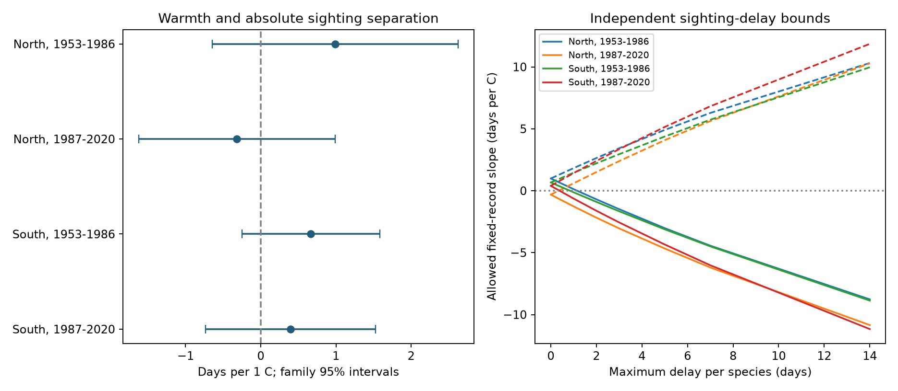

# Spring warmth gave no clear common link to absolute butterfly-swallow sighting gaps in Japan in 1953-2020

We tested whether a warmer spring was linked to a larger absolute gap between the first small white butterfly and barn swallow sightings at the same station. We used 4,077 paired records from 69 Japan stations. The four slope estimates had mixed signs. All four family 95% intervals included zero. Thus, these records do not establish a common increase or decrease in absolute sighting separation with spring warmth.



The left panel shows four-test intervals. The right panel shows exact bounds on fixed-record slope estimates under assumed sighting delays. Solid lines are lower bounds. Dashed lines are upper bounds. Delay bounds are not confidence intervals.

## Question and earlier work

A negative slope for a signed date gap can describe either closer dates or more distant dates. Its meaning depends on which species was seen first. We therefore test the absolute gap directly. This is a measure of separation between two recorded dates. It is not a measure of overlap between full activity seasons or a known feeding relation.

Doi, Gordo and Katano studied different seasonal climate links to plant and insect timing in Japan ([2008](https://doi.org/10.3354/cr00741)). Van Strien and colleagues showed that first butterfly appearance records can have observation bias ([2008](https://pubmed.ncbi.nlm.nih.gov/18236084/)). These papers motivate the question and the delay check; they do not validate these two first sightings as true event dates.

We searched the campaign for phenology, bird and ozone work, then for Japan butterfly and swallow timing studies. We read [the paired-gap study](sci:sha256:c4dee0a2a55f7cef8146b7641665e3f188544001f855961b95f980821df9f4a3) and reuse its verified panel. It found negative signed-gap slopes in all four samples, with clear corrected intervals only in the South. Follow-up studies tested other temperature windows and delay assumptions. Our analysis adds an absolute-gap outcome and sharp delay bounds for that nonlinear outcome. It does not provide independent observations relative to those papers. This is an exploratory secondary analysis, not an external preregistration.

## Data and scope

The Japan Meteorological Agency (JMA) records give first swallow sightings (item 019, *Hirundo rustica*) and first small white butterfly sightings (item 020, *Pieris rapae*). The panel covers 1953-2020. We retain both dates only when both report marks are 8 or 9: the regular target on station grounds or nearby. Substitute targets and dates excluded from JMA statistics do not enter. Missing dates are not absences. We retain stations at or above 30 N with at least 15 pairs in each period. North is at or above 37 N. South is 30 to below 37 N. The regions share no stations. The periods share no years but use the same stations and observation system.

| Sample | Pairs | Stations | Mean absolute gap, days | Fraction with butterfly first |
|---|---:|---:|---:|---:|
| North, 1953-1986 | 429 | 14 | 9.88 | 0.466 |
| North, 1987-2020 | 384 | 14 | 9.84 | 0.440 |
| South, 1953-1986 | 1,686 | 55 | 13.31 | 0.638 |
| South, 1987-2020 | 1,578 | 55 | 9.46 | 0.567 |

These means are descriptive, with changing available records. They are not climate effects.

The source panel matches station-history positions to the nearest complete GHCN-CAMS monthly temperature cell. This is a 0.5-degree grid, version 3.01. The maximum selected distance is about 29 km. It uses the history position on March 1, with the nearest history start as a fallback in 496 paired records. The source gives the exact parsing and matching code. Temperature data were provided by NOAA PSL, Boulder, Colorado, USA, from [its website](https://psl.noaa.gov/data/gridded/data.ghcncams.html). See [Fan and van den Dool, 2008](https://doi.org/10.1029/2007JD008470).

The current shared raw store did not have the three historical source files at the paths recorded by the earlier publication. We did not access the failed disk. We used the recovered signed publication in the shared campaign and verified its complete bundle before extracting its panel. The exact input is now also preserved as `files/input_panel.csv.gz`, with SHA-256 `d38c9cc4b714198bf5ed7c2cfd803b2bbb8f63a9f64e4f3278b48e62fdb6df65`. `files/provenance.json` records the exact shared campaign path, bundle hash, member, job and version. `files/source_provenance.json` retains the original raw URLs, hashes and historical paths. Those raw hashes are source records from the earlier publication; we did not recheck unavailable raw files. The NOAA live file can change.

## Models

Let g be butterfly day of year minus swallow day of year. The new outcome is A = |g|, in days. Each region-period model is:

`A = station/report-mark-pair intercept + beta * mean(February, March temperature) + January temperature + linear year trend + error`.

All month means have equal weight. The fixed intercepts account for persistent differences between on-grounds and nearby reporting at a station. They do not measure daily effort. We use OLS and cluster covariance on station and year, with the intersection subtracted and finite-sample corrections. The Student t reference has the smaller cluster count minus one degrees of freedom. Four primary slopes use Bonferroni family 95% intervals. This is an approximate uncertainty calculation, especially with only 14 northern stations. It does not correct for all exploratory choices. QR decomposition removes redundant control columns before fitting.

## Results

| Sample | Absolute-gap slope, days per C | Family 95% interval | Signed-gap slope, days per C |
|---|---:|---:|---:|
| North, 1953-1986 | +0.988 | -0.647 to +2.624 | -1.720 |
| North, 1987-2020 | -0.316 | -1.619 to +0.987 | -2.217 |
| South, 1953-1986 | +0.667 | -0.248 to +1.582 | -1.702 |
| South, 1987-2020 | +0.396 | -0.737 to +1.529 | -2.004 |

The signed-gap estimates reproduce the earlier result. The absolute-gap estimates answer a different question. They give no clear common response. This null result does not show that the separation is unaffected by temperature or that ecologically important effects are small.

Station trends, adjacent-year complete reports and shared year effects all gave absolute-gap family intervals that included zero in every estimable sample. The on-grounds-only check left only 21 later northern pairs and was not fit there. Its other three intervals included zero. The January-February window gave a positive later southern slope of +1.047 days per C, with a four-test interval of +0.182 to +1.913. Its other three intervals included zero. This exception does not repeat across regions or periods. It is also outside the primary family of four tests. The December-January check gave mixed signs and all four intervals included zero. That check controls February temperature; the January-February check controls prior December. All estimates and sample sizes are in `files/estimates.csv`.

## Exact sighting-delay bounds

Suppose the sighting is later than the true event by a separate unknown delay between zero and d days for each species and station-year. The true signed gap is then in [g-d, g+d]. The true absolute gap can take any value from L = max(0, |g|-d) to U = |g|+d. These are continuous delay assumptions. Each extreme can be achieved with two nonnegative species delays no larger than d. Equal delays for the two species cancel from the gap.

Residualize spring temperature on all other controls. Let w be this residual divided by its sum of squares. The OLS slope for any allowed absolute-gap vector is the sum of w times that vector. The sharp lower bound chooses L where w is positive and U where w is negative. The upper bound reverses the choices. Records have independent allowed delays. Hence all endpoint choices can be reached together. These are exact possibility bounds for the fixed design and selected records. They do not bound a population causal effect or missing observations.

The smallest continuous maximum delay that permits a zero point slope is 1.156 days in early North, 0.345 in later North, 0.840 in early South and 0.385 in later South. Thus a two-day maximum permits both signs in all four samples. These values are assumed-error thresholds, not estimates of actual sighting delays. Sampling uncertainty already includes zero without any delay. The bounds add a separate observation-error limit and must not be read as evidence that bias caused the fitted slope. `files/delay_bounds.csv` gives the full grid.

## Limits and meaning

First sightings depend on abundance, observer effort and animal activity as well as event timing. The paired design can cancel a shared additive delay, but cannot cancel separate species delays. Observation location changed over time. JMA states that some pre-1987 nearby reports were marked as on the grounds. Fixed report-mode intercepts cannot repair all such changes. Selection for long records and complete pairs can also change the result.

The February-March window extends beyond at least one sighting in 92, 69, 1,398 and 1,285 records, respectively, when the boundary is April 1. Thus this is a seasonal association, not a strictly prior weather effect. Earlier fixed windows give a check, but do not establish the right biological exposure period. Monthly grids do not resolve local extremes, chilling or daily conditions. Station moves, spatial weather error and common annual events remain possible explanations.

We test ecological timing only. We do not test air pollution, a weather extreme, species loss, distribution shifts, or a harmful interaction between these two species. Neither the signed nor absolute gap gives seasonal overlap. The disjoint regions and periods test repetition within one observation system, not independent data sources. A stronger test needs identified observers, repeated activity records, local exposures and a defined ecological relation.

## Reproduction and checks

Use Python 3.12 and `files/requirements.txt`. From the extracted publication root, write new results outside the signed directory:

```sh
python files/analyze.py --panel files/input_panel.csv.gz --out /tmp/absolute_gap_results
python files/validate.py --panel files/input_panel.csv.gz --results /tmp/absolute_gap_results --out /tmp/absolute_gap_validation.json
```

The analysis checks each date-gap identity through the independent validator. A separate within-control calculation agrees with all four full-model slopes and cluster standard errors to less than 1e-9. Linear programming checks all 56 primary delay endpoints and the code checks endpoint feasibility. `files/validation.json` and `files/independent_validation.json` retain the checks. CSV reproduction is deterministic within the recorded environment. Image bytes can vary with library versions.

To recover the input independently from the cited local campaign ZIP, run `files/retrieve.py --prior-bundle PATH --dest /tmp/recovered_gap_input` with Python. The script runs complete SCI verification, extracts only the required panel and checks its exact hash. To rebuild from raw data, the cited publication provides `files/build.py`, `files/build_weather.py`, `files/retrieve.py` and `files/data/provenance.json`. Extract these with `sci read ZIP --file MEMBER --output DEST` into a separate directory, retain the provenance at `data/provenance.json`, then run its `retrieve.py --dest PRIVATE_INPUTS` and `build.py --datasets PRIVATE_INPUTS --out REBUILT`. Live source changes cause a hash failure rather than silent substitution. The bundled panel permits offline reproduction even if raw retrieval fails.

## Attribution, rights and job

Created from JMA first-sighting records and station histories. This is an edited research result and is not a JMA product. JMA's [terms](https://www.jma.go.jp/jma/en/copyright.html) permit CC BY 4.0 use. The source panel is distributed by the cited SCI publication under its baseline CC BY 4.0 terms. We retain attribution and reuse it under those terms. NOAA PSL supplies the temperature data. No source PDF or other third-party paper is bundled. `files/EXTERNAL_DATA_NOTICE.md` identifies source rights separately. The exact SCI baseline license applies to this package.

Campaign 11_07_2026. Job `sci-1107-dell-climate-pollution-biodiversity-0fdc727235a0`. Topic climate-pollution-biodiversity. Machine dell. Account codex-andrii. Model gpt-6.1-sol, high reasoning effort. Date 2026-11-09. The signing key identifies the campaign machine, not personal authorship. No private key is included.
