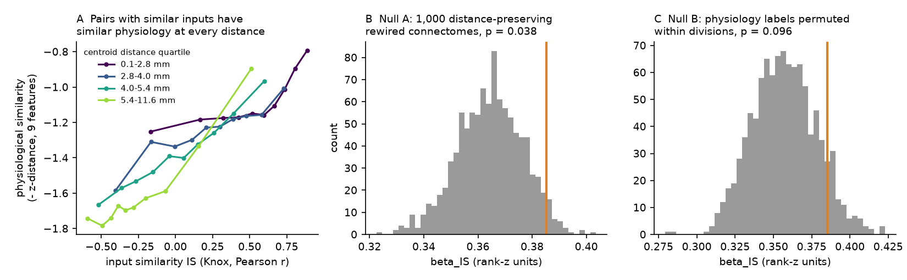
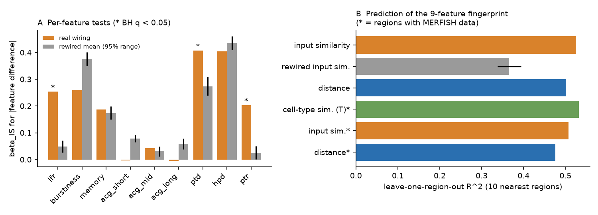
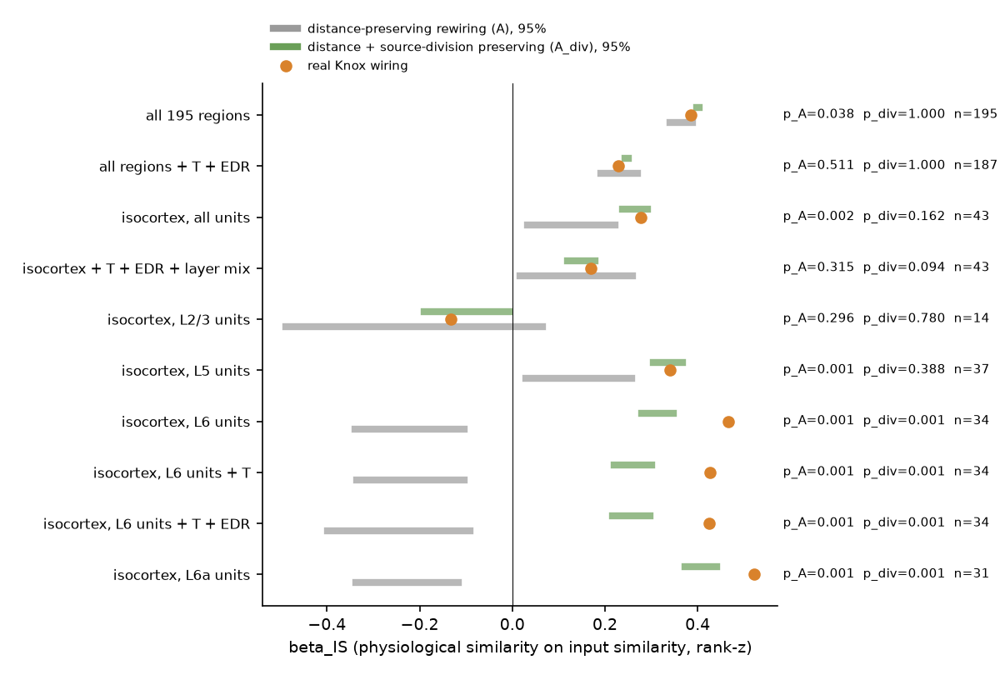

# Across 195 mouse brain regions, distance and source-division wiring rules and cell types explained the input-similarity link to spike physiology; specific wiring helped only for cortical layer 6 (exploratory)

Job `sci-1107-dell-neural-structure-and-computation-21c8ab683594`, campaign 11_07_2026, topic
neural-structure-and-computation, machine dell. Analysis and text: Claude Opus 5.5
(`claude-opus-5-5`) with the SCI CLI. The signing key is a campaign-machine key. It is not a
personal authorship claim. Date: 2026-11-10.

## Summary

Earlier campaign studies tested single physiological features against the mouse connectome.
Thalamic burst firing followed cortical input share; task-variable encoding followed the
encoding of input sources; visual reliability fell with connectome distance from the retina,
but distance-preserving rewired connectomes predicted it equally well. The open question was:
**does specific wiring, rather than geometry, set regional physiology?**

We asked this question for the whole brain and for a broad physiology fingerprint. For 195
Knox connectome regions with enough IBL Brain-Wide Map units (63,299 good units, 459 sessions,
139 mice, 12 labs), we computed nine amplitude-free unit features (firing rate, two ISI
statistics, three autocorrelogram shape measures, three waveform-shape measures). For each region
pair we compared physiological similarity with input similarity (IS): the correlation of the two
regions' input profiles across all source regions in the Knox et al. 2019 model. A pre-registered
pair regression controlled for centroid distance (spline) and same major division. The primary
null used 1,000 rewired connectomes that keep, for each target, its input weights within
distance deciles.

Main results:

1. **Input similarity predicted physiological similarity strongly** (Spearman rho 0.50 over
   18,915 pairs; beta_IS = 0.385 after distance and division controls).
2. **Distance-preserving rewired connectomes predicted almost the same amount** (null mean
   0.364, SD 0.012; p_A = 0.038). The within-division label-permutation null gave p_B = 0.096.
   **The pre-registered H1 criterion (both p < 0.05) was not met.** About 95% of the
   coefficient is reproduced by graphs with the same wiring-distance rule.
3. **Neuronal cell-type composition removed the remaining excess (H2).** With MERFISH
   supertype similarity T as a control (187 regions), beta_IS = 0.264 against a rewired null of
   0.259 (p = 0.33). T itself kept an effect beyond IS (beta_T = 0.23, label null 0.16,
   p = 0.002). An exponential-distance-rule (EDR) model connectome as a control also removed
   the excess (p = 0.61).
4. **A stricter null that also keeps each source's major division** (exploratory) reproduced
   the real coefficient for all regions (null 0.401 > real 0.385), for isocortex (p = 0.16) and
   for the Allen Visual Coding replication (p = 0.30). In this connectome, IS is almost fully set
   by distance and by the division mix of the inputs: division-preserving rewiring moved 78% of
   the weights but kept IS correlated r = 0.99 with the real IS.
5. **One exploratory exception: isocortical layer-6 units.** When the fingerprint of each
   cortical area used only its L6 units (34 areas), real IS beat both nulls (beta 0.47; division-
   preserving null 0.31 +- 0.02, p = 0.001; distance-only null -0.22, p = 0.001). This held with
   cell-type and EDR controls (0.43 vs 0.26), with firing-rate control, for L6a units only
   (0.52 vs 0.41), with a stricter unit threshold (0.57 vs 0.45) and in 18 of 20 lab-split halves
   (p < 0.05). L5 and L2/3 fingerprints did not show it (p_div 0.39 and 0.78).

Replications of the pre-registered test: in 20 random lab splits, beta_IS exceeded the
rewired-null mean in 90% (half A) and 100% (half B) of halves. In Allen Visual Coding
Neuropixels data (28 regions, 4 rate and waveform features) the excess over distance-preserving
rewiring was larger (0.197 vs 0.065, p = 0.001), but it disappeared with the cell-type control
(p = 0.91) and with the division-preserving null (p = 0.30).

**Interpretation.** At the mesoscale, regional spike physiology follows input similarity, but
this agrees with a simple model: physiology follows position, the wiring-distance rule, the mix
of source divisions, and the cell types of the region. We found no robust brain-wide evidence
that the specific identity of input regions, beyond these rules, sets regional physiology. The
layer-6 result is the one place where specific wiring added information. It is exploratory and
needs confirmation.

## 1. Question and prior work

Campaign publications 0b0f9e1c, cc71e4a4, 19f7eb8e, 6e6b5461 and e251a8ce tested single
features. In mouse, the retina-distance rule for reliability did not need the specific wiring
(19f7eb8e); in larval zebrafish it did (6e6b5461). Here we test the general form across the
whole mouse brain: do regions that get input from the same sources have the same physiology,
and is this more than what geometry, wiring-distance rules and cell types give?

## 2. Data

* IBL Brain-Wide Map 2026_Q2 aggregate tables: clusters (quality label, CCF location, firing
  rate, ISI and waveform metrics) and log-binned autocorrelograms (1 ms to 1.94 s). Lab and
  subject from the public OpenAlyx API.
* Knox et al. 2019 normalized connection density (291 x 291 regions, ipsi and contra).
* Allen CCF 2017 annotation (10 um, used at 40 um, one hemisphere) and structure graph 1.
* ABC Atlas MERFISH C57BL6J-638850 (one animal), neuronal supertype per cell (classes 01-29).
* Allen Visual Coding Neuropixels units, channels and probes tables (replication).

URLs, shared dataset paths, hashes and licences: `files/provenance/provenance.md`,
`files/provenance/input_sha256.txt`, `files/EXTERNAL_DATA_NOTICE.md`.

## 3. Methods

The plan `files/plan/PLAN.md` was written and hashed (`PLAN_hash_log.txt`,
2026-11-10T09:24:20Z) before any region-level physiology value was computed.

* **Units.** IBL label = 1, rate > 0.1 Hz. Each unit goes to its Knox region (own label or
  nearest Knox ancestor). Region inclusion: >= 20 units from >= 3 sessions.
* **Features.** log10 rate; IBL burstiness and memory; acg_short, acg_mid, acg_long =
  log10(mean ACG in 2-10, 10-100, 100-1000 ms / rate + 0.01); peak-trough duration;
  half-peak duration; log peak/trough ratio. Region value = median over units; z-scored across
  regions. Physiological similarity = minus the Euclidean distance of the 9-feature z-vectors.
* **Input similarity IS(i, j).** Pearson correlation over sources s (s not i, j) of
  log10(W[s,i] + f) and log10(W[s,j] + f), f = 1st percentile of positive W.
* **Pair model.** rank-z(physiological similarity) ~ natural cubic spline of centroid distance
  (5 df) + same division + rank-z(IS). Coefficient beta_IS by Frisch-Waugh-Lovell.
* **Null A (primary).** For each target, permute its input weights among sources in the same
  decile of source-target distance; 1,000 graphs; recompute IS; one-sided p.
* **Null B.** Permute physiology labels within major divisions (1,000).
* **H2.** Add T = Bhattacharyya coefficient of neuronal supertype proportions (regions with
  >= 200 MERFISH neurons).
* **Secondary (pre-planned).** S1 per-feature models; S2 leave-one-region-out prediction from
  the 10 most similar regions; S3 20 lab splits; S4 robustness variants; S5 Allen VCN.
* **Exploratory (added after the primary results; see Amendments).** E1 isocortex with layer-mix,
  T and EDR controls; E2 layer-matched fingerprints (units of one cortical layer only); E3 feature
  families; E4 all regions with T + EDR; E5 within thalamus, medulla, midbrain; E6 VCN with
  controls; E7 stress tests of the L6 result. All exploratory tests use null A and a second null,
  **A_div**, that permutes weights only among sources with the same distance decile *and* the
  same major division.

## 4. Results

### 4.1 Pre-registered tests

| Test | n regions | beta_IS | null mean (SD) | p |
|---|---|---|---|---|
| H1, null A (rewired, 1,000) | 195 | 0.385 | 0.364 (0.012) | 0.038 |
| H1, null B (labels in divisions, 1,000) | 195 | 0.385 | 0.357 (0.021) | 0.096 |
| H2, + cell-type similarity T, null A | 187 | 0.264 | 0.259 (0.011) | 0.33 |
| H2, beta_T, null B | 187 | 0.233 | 0.159 | 0.002 |

H1 decision: not supported (p_B > 0.05). H2: not supported. Descriptive: rho(physiology, IS)
0.50; rho(physiology, -distance) 0.37; rho(IS, -distance) 0.65; rho(T, IS) 0.70.

**S1 per feature (200 rewirings, BH q).** Real wiring beat rewired graphs for log rate (0.25 vs
0.05, q = 0.015), peak-trough duration (0.41 vs 0.27, q = 0.015) and peak/trough ratio (0.20 vs
0.03, q = 0.015). For burstiness, the ACG measures and half-peak duration, rewired graphs did as
well or better (Figure 2A).

**S2 prediction.** Leave-one-region-out R^2 of the 9-feature fingerprint from the 10 regions
with the highest IS: 0.525; from rewired IS: 0.366 (SD 0.014, p = 0.005); from the 10 nearest
regions: 0.502. In the MERFISH subset, T neighbours gave 0.532, IS 0.507, distance 0.476. Thus
plain spatial neighbours predict nearly as well as input-similar regions, and cell-type
neighbours predict best (Figure 2B).

**S3 lab split (20 splits into 6 + 6 labs).** Median beta_IS 0.415 and 0.397 against rewired
means 0.367 and 0.357; p < 0.05 in 70% and 85% of halves. Split-half reliability of the pair
similarity matrix: median rho 0.61; per feature 0.51 (memory) to 0.91 (peak-trough duration).

**S4 robustness (200 rewirings).** The excess over null A stayed (p 0.005-0.03) with spline df 3
or 8, log distance, Spearman IS, ipsi + contra inputs, and output similarity + direct link as
controls. It was absent with EDR input similarity as control (p = 0.61), within non-isocortex
pairs (p = 0.995) and between divisions (p = 0.985). It was strong within isocortex
(0.34 vs 0.12, p = 0.005).

**S5 Allen VCN** (28 regions, 36,732 units, 58 sessions; rate, waveform duration, halfwidth,
PT ratio). beta_IS 0.197 vs null A 0.065 (p = 0.001). Region values agreed with IBL in 27
shared regions (|rho| 0.77-0.88).

### 4.2 Exploratory tests (two nulls)

| Analysis | n | beta | null A mean | p_A | null A_div mean (SD) | p_A_div |
|---|---|---|---|---|---|---|
| all regions | 195 | 0.385 | 0.364 | 0.038 | 0.401 (0.001) | 1.00 |
| all regions + T + EDR | 187 | 0.230 | 0.231 | 0.51 | 0.247 | 1.00 |
| isocortex, all units | 43 | 0.278 | 0.128 | 0.002 | 0.265 (0.014) | 0.16 |
| isocortex + layer mix | 43 | 0.262 | 0.127 | 0.003 | 0.249 | 0.17 |
| isocortex + T | 43 | 0.176 | 0.085 | 0.025 | 0.157 | 0.10 |
| isocortex + EDR | 43 | 0.278 | 0.204 | 0.13 | 0.263 | 0.14 |
| isocortex + T + EDR + layer mix | 43 | 0.169 | 0.137 | 0.31 | 0.149 | 0.09 |
| isocortex, L2/3 units | 14 | -0.133 | -0.212 | 0.30 | -0.098 | 0.78 |
| isocortex, L5 units | 37 | 0.340 | 0.143 | 0.001 | 0.335 | 0.39 |
| **isocortex, L6 units** | 34 | **0.466** | -0.221 | 0.001 | 0.314 (0.017) | **0.001** |
| isocortex, L6 units + T | 34 | 0.426 | -0.220 | 0.001 | 0.260 | 0.001 |
| isocortex, L6 + T + EDR | 34 | 0.425 | -0.245 | 0.001 | 0.257 (0.021) | 0.001 |
| isocortex, L6 + rate control | 34 | 0.337 | -0.121 | 0.001 | 0.232 | 0.001 |
| isocortex, L6a units | 31 | 0.523 | -0.227 | 0.001 | 0.406 | 0.001 |
| isocortex, L6, >= 40 units, >= 4 sessions | 27 | 0.571 | -0.222 | 0.001 | 0.449 | 0.001 |
| all regions, rate + waveform features | 195 | 0.452 | 0.338 | 0.001 | 0.469 | 1.00 |
| all regions, spike-timing features | 195 | 0.166 | 0.242 | 1.00 | 0.176 | 1.00 |
| within TH / MY / MB | 29 / 25 / 19 | -0.04 / 0.14 / 0.08 | | 1.00 / 0.001 / 0.64 | | 1.00 / 0.92 / 0.06 |
| Allen VCN, 4 features | 28 | 0.197 | 0.066 | 0.002 | 0.193 | 0.30 |
| Allen VCN + T | 26 | 0.082 | 0.128 | 0.91 | 0.084 | 0.62 |

L6 lab splits (10 splits, 20 halves, 17-27 areas per half, 200 graphs per null): median beta
0.47 against median A_div null 0.35; p_A_div < 0.05 in 18 of 20 halves. L6 per feature
(200 graphs): real IS beat A_div for log rate, memory, acg_short, acg_long, peak-trough duration
and half-peak duration (p 0.005-0.01), not for burstiness, acg_mid or peak/trough ratio.

Null diagnostics (200 graphs): null A moved 97% of weights; its IS correlated r = 0.77 (all
pairs) and 0.60 (isocortex) with the real IS. Null A_div moved 78% of weights; its IS correlated
r = 0.99 and 0.91. A_div is therefore a strict null with little freedom outside isocortex. Its
small SD reflects this.

The robustness and replication forest plot is `files/figures/fig3_robustness.png`.

## 5. Discussion

The brain-wide relation between input similarity and physiological similarity is real and
replicates across labs and in a second data set. But nearly all of it is what one expects if
physiology follows location, the decay of wiring with distance, the division mix of a region's
inputs, and the region's cell types. When any of these are given (EDR model, division-
preserving rewiring, MERFISH composition), the specific Knox wiring adds no detectable
information across the brain. This extends the mouse retina-distance result (19f7eb8e) from one
feature to a 9-feature fingerprint and from the visual system to 195 regions. It also shows that
the axonal-input result for task encoding (cc71e4a4) does not have a counterpart for intrinsic
spike physiology at this level of analysis.

The layer-6 result differs. When only deep-layer units define the fingerprint of a cortical
area, areas with more similar inputs have more similar physiology beyond every null and control
that we tried. Layer 6 contains the corticothalamic cells that close the loop with the thalamic
nuclei that give the area its main input. A possible explanation is that L6 physiology follows
the specific thalamocortical and corticocortical input of each area, while the mixed or
superficial samples are dominated by area-independent factors. We did not test this mechanism.

## 6. Limitations

* **Correlational, region level.** Pair statistics are not independent; inference uses
  permutation nulls, not standard errors.
* **The connectome is a model.** Knox weights come from a spatially smoothed voxel model of
  wild-type tracer data (no layer or cell-type specificity). Area-level IS was used for L6
  fingerprints; layer-specific input data were not used.
* **The pre-registered H1 failed by its own criterion.** The small excess over null A is
  not significant against null B.
* **The L6 result is exploratory.** It came from about 50 exploratory tests. Its p values are at
  the resolution limit (1/1001), so the permutation p alone does not survive a Bonferroni
  correction for 50 tests (0.05 / 50 = 0.001). The observed value was about 9 null SDs above the
  A_div mean; under a normal approximation of the null it would survive. It needs confirmation in independent
  data with layer-resolved recordings. The negative mean of null A for L6 (about -0.22) is not
  explained.
* **Strict null with low freedom.** A_div changes IS little outside isocortex; failures to beat
  it there have low power to detect small specific effects.
* **Unit sampling.** Extracellular units are a biased sample (large, active cells). Laminar
  sampling differs between areas; layer-mix control and layer-matched fingerprints address this
  only in isocortex.
* **One MERFISH animal, one hemisphere of centroids, ipsilateral inputs in the primary model.**
* **VCN replication** has 28 regions and 4 features only.

## 7. Amendments to the plan (dated 2026-11-10)

1. The 25 um annotation could not be downloaded; the 10 um file was stream-decompressed and
   subsampled to the planned 40 um grid.
2. The first run of the tests was stopped by a wall-clock limit before any output; the
   rewiring code was vectorized (same algorithm, verified on synthetic data) and the run repeated
   from the start with the same seed. A partial first lab-split log is kept
   (`results/log_04_first_run_killed.txt`).
3. S5 used the Allen SDK default unit filters (ISI violations < 0.5, amplitude cutoff < 0.1,
   presence ratio > 0.9) and session ids from probes.csv. S5 found 28 regions.
4. Exploratory analyses E1-E7 and the A_div null were added after the pre-registered results
   were known. They are labelled as exploratory in all tables and figures.

## 8. Reproduce

1. `bash files/code/get_data.sh /path/to/scratch` downloads all inputs into `scratch/raw` and
   prints SHA-256 values; compare with `files/provenance/input_sha256.txt`. Inside the campaign,
   the same files are in `./datasets` (paths in `provenance.md`).
2. `bash files/code/run_all.sh /path/to/scratch` runs all steps (Python 3.12; versions in
   `files/provenance/software_versions.txt`; `pynrrd` is not needed). Outputs go to
   `scratch/derived` and `scratch/figures`. Seeds are fixed in each script.
3. The bundled `files/results/` tables are the outputs of this run. Logs are `log_*.txt`.

## 9. Files

* `files/plan/` pre-analysis plan and hash log.
* `files/code/` all scripts (`common.py`, `physlib.py`: helpers; `00`-`10`: pipeline steps).
* `files/results/` `main_results.json` (H1, H2, S2), `S1_per_feature.csv`, `S3_labsplit.csv`,
  `S4_robustness.csv`, `S5_vcn.json`, `E_exploratory.csv`, `E6_vcn_controls.csv`,
  `E7_L6_followup.csv`, `null_diagnostics.json`, null distributions (`H1_null.npz`,
  `S2_rewired_r2.npy`), and IBL-derived region tables (`region_physiology.csv`,
  `iso_L6_region_physiology_all.csv`, `iso_layermix.csv`).
* `files/figures/` four PNG figures.
* `files/provenance/`, `files/EXTERNAL_DATA_NOTICE.md` data sources, hashes, licences.
