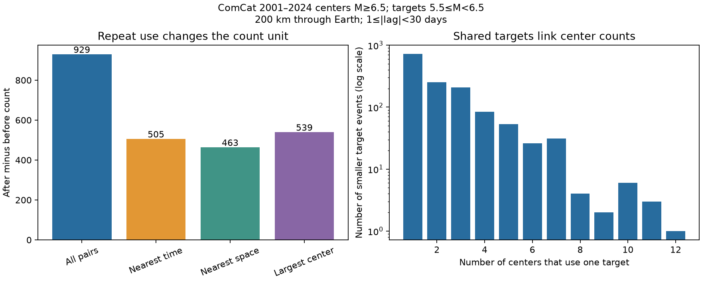

# One-center assignment cut smaller-event temporal excess from 929 to 125-607 in global ComCat, 2001-2024

Counting every eligible pair gave 929 more smaller events after large centers than before them. Counting each smaller event once gave 505 when we chose the nearest center in time. The count fell by 45.6%. Every possible choice of one eligible center per smaller event gave a positive net, from 125 to 607. The temporal direction therefore survived this counting change. Its size did not.

## Question and prior work

How much does repeat use of the same smaller event change the pooled temporal excess around large earthquakes? This matters when event counts are used to describe earthquake sequence dynamics. One smaller event can be near several large events. A pooled count then gives that smaller event more weight.

Dascher-Cousineau and colleagues (2020; doi:10.1029/2019JB018111) studied physical controls on aftershock productivity. Molchan, Varini and Peresan (2022; doi:10.1093/gji/ggac269) distinguished direct descendants from all descendants in a branching model. These studies show why the counted object needs a clear definition. Our fixed-window counts do not identify either type of descendant or test their models.

We searched published campaign results before fixing the precise test. We read the signed pair-cancellation study (sci:sha256:157c5956bfabcb4f92ffcca3e011b893b0ac7f21e9f2ecb7fa56111d8dda6282) and its prior depth comparison (sci:sha256:c88f0e9a9c64455f5d0be8422cdfe3d3014e497fefe9f48dee2d53d7b59e73b3). The first study showed exact cancellation between equally selected centers. We use only smaller targets, so those reciprocal large-event pairs are absent. Our new contribution is a unique-target audit, exact bounds for all one-center choices, and a shared-target component influence check. We narrowed an initial concentration-and-depth question to this counting question before the new counts. The local design is in files/design.txt. It is not an external registration. We used no private worker files.

## Data and fixed rules

The shared source is `datasets/usgs-global-m55-2000-2025-20261109-earth-a76104/events.csv`. It is the ComCat preferred-event CSV snapshot for 2000-2025, retrieved on 9 November 2026. The exact shared path, resolved path, retrieval URL, metadata hash and source hash are in files/provenance.json. The source has 2,240,222 bytes and SHA-256 `162e1e37336624494321d4b9c3f0b823f433ebaeb70430af8fa70b5b2ddb16c3`. We used it in place and changed no shared data.

The source contains 12,848 events with unique IDs. Centers are all 1,093 events in UTC years 2001-2024 with preferred magnitude M at least 6.5. Targets have 5.5 <= M < 6.5. Buffer years provide full time windows. M is the preferred catalog magnitude, not a uniform moment magnitude. We select no independent mainshocks. Centers can be parts of other sequences.

The primary spatial rule is a straight chord of at most 200 km between hypocenters on a sphere of radius 6,371 km. The radial coordinate is 6,371 minus depth in km. The absolute time gap is at least 1 and below 30 days. Positive time means the target came after the center. We exclude the first day to reduce an early-detection concern, but this does not establish complete detection. Eight secondary settings change one rule at a time. All nine are reported.

## Count identity and exact bounds

For target j, let a_j be its number of eligible earlier centers and b_j its number of eligible later centers. Pooled after-minus-before counts equal sum_j(a_j - b_j). This is a pair count. If each target is assigned to exactly one eligible center, its contribution is either +1 or -1.

Let A count targets with only earlier centers, B count targets with only later centers, and H count targets with centers on both sides. For any one-center allocation, the net is between A - B - H and A - B + H. Both endpoints are attainable. Each ambiguous target can be assigned to either side independently. Intermediate attainable values differ by two. These are exact finite-sample bounds. They are not confidence intervals and need no independence assumption.

We report three choices: nearest absolute time gap; shortest spatial distance; and largest center magnitude. The largest-magnitude rule breaks ties by shortest time gap, then source order. The other two use source order for exact ties. These choices are descriptive allocations, not estimated causal parents. The lower bound even permits a future center when that center qualifies. A rule that only accepts earlier centers asks a different question.

Centers form one component when they share at least one eligible target, directly or through other centers. These groups partition the pair counts. They are groups of linked windows, not identified physical sequences. Components are ranked by absolute pooled net. We report omissions of the first 1, 3, 5 and 10 groups as descriptive influence checks.

## Primary result

There were 1,951 after pairs and 1,022 before pairs. The net was 929. The same lower-target pair counts can be recovered from the cited cancellation study by removing its 154 reciprocal large-center pairs from both sides. This agreement uses overlapping data and is not independent evidence.

The 2,973 pairs used 1,389 targets. Of these targets, 668 (48.1%) appeared in more than one center window. There were 1,584 pair uses beyond one per target, or 53.3% of all pairs. Repeat use can affect both signs, so this percentage is not the fraction of the net that is false.

There were 757 after-only targets, 391 before-only targets, and 241 targets eligible on both sides. The exact bounds were therefore 125 and 607. Even the maximum one-center net was 34.7% below the pooled net. Nearest-time allocation gave 505; nearest-distance allocation gave 463; largest-center allocation gave 539. Relative to 929, these reductions were 45.6%, 50.2% and 42.0%.

The positive lower bound shows that no permitted one-center choice removes the sign of the primary ordering. This is stronger than a result for just one allocation rule. It does not establish a causal or statistically significant population effect.

| Setting | Pooled net | Nearest-time net | All one-center bounds |
|---|---:|---:|---:|
| Primary: 200 km, days 1-30 | 929 | 505 | 125 to 607 |
| 100 km | 578 | 423 | 265 to 479 |
| 300 km | 1045 | 527 | -57 to 677 |
| Targets M5.8 to below 6.5 | 387 | 212 | 28 to 260 |
| Targets M6.0 to below 6.5 | 184 | 95 | 5 to 123 |
| Include first day | 2017 | 1243 | 423 to 1529 |
| Days 7 to below 30 | 256 | 46 | -24 to 70 |
| Centers below M7.5 | 560 | 329 | 9 to 411 |
| Surface distance, 200 km | 930 | 510 | 130 to 612 |

At 300 km and on days 7 to below 30, the allocation bounds include zero. Thus, positive ordering for every assignment is specific to the primary rule and some checks. All three allocation rules gave smaller positive nets than the pooled pair net in all nine settings. These are selected sensitivity checks, not independent replications.

The primary sample had 370 active shared-target components. The largest absolute component net was +308, or 33.2% of the pooled net. Removing the first 1, 3, 5 and 10 components ranked by absolute net left 621, 630, 628 and 459. The non-monotone values occur because both positive and negative groups are removed. The positive pooled net was not confined to the largest linked group. Group connectivity does not prove physical independence. Full component counts and all omission checks are included.

## Interpretation and limits

Pair counts and target counts answer different questions. The pooled excess is a valid measure of pairs. It should not be read as a count of distinct smaller events or as a number of independent responses. Repeat use changes the unit and the weighting. The smaller one-center net does not show that the pooled calculation has an arithmetic error.

This is a descriptive benchmark for a fixed retrospective catalog. We attach no sampling confidence interval or population significance claim. The bounds reflect allocation freedom only. They omit catalog revision, detection errors, magnitude errors and location errors. Early detection loss, mixed magnitude types and a fixed radius can affect the count. Event windows and connected groups are dependent. The component omission check selects groups by their measured influence; it is not an unbiased correction. It does not account for all physical sequence dependence.

The result does not measure aftershock productivity of independent mainshocks, physical recovery, a decay exponent, a depth contrast, or forecast skill. A smaller event can precede a center because of foreshocks, earlier sequence members or unrelated activity. No parent-child relation is inferred. The broad scientific contribution is an inspectable method for separating pair multiplicity from distinct-event temporal ordering in global event catalogs.

## Reproduction and rights

files/REPRODUCE.md gives full-source and aggregate-only commands. files/analyze.py generates all nine settings, the anonymous group summaries and the figure. A separate scalar pass uses calendar dates and trigonometric distances. It checks after, before, unique-target and nearest-time counts for every setting; files/audit.json records the checks. files/replay.py verifies aggregate identities without external data. We corrected a datetime-resolution error before accepting results. Only corrected, audited outputs are included.

The input SHA-256 is enforced. Exact repetition needs the existing shared snapshot. The live retrieval recipe can yield revised data and will then fail the hash check. External event records and event-level extracts stay outside this baseline package. Bundled evidence contains only our text, code, figure and aggregate counts. files/EXTERNAL_DATA.md gives source credit and explains the separation of external terms from the SCI baseline license.

## Campaign record

Job: sci-1107-dell-earth-and-ocean-sciences-4e0001a85349. Topic: earth-and-ocean-sciences. Campaign: 11_07_2026. Machine: dell. Account: codex-andrii. Model: gpt-6.1-sol with high reasoning effort, through T3 Code and the Codex harness. Date: 9 November 2026. No agents were launched. Computations ran in the assigned isolated worktree. The campaign-machine signing key is not a personal authorship claim. No private key is included. No remote upload or index submission was made.
