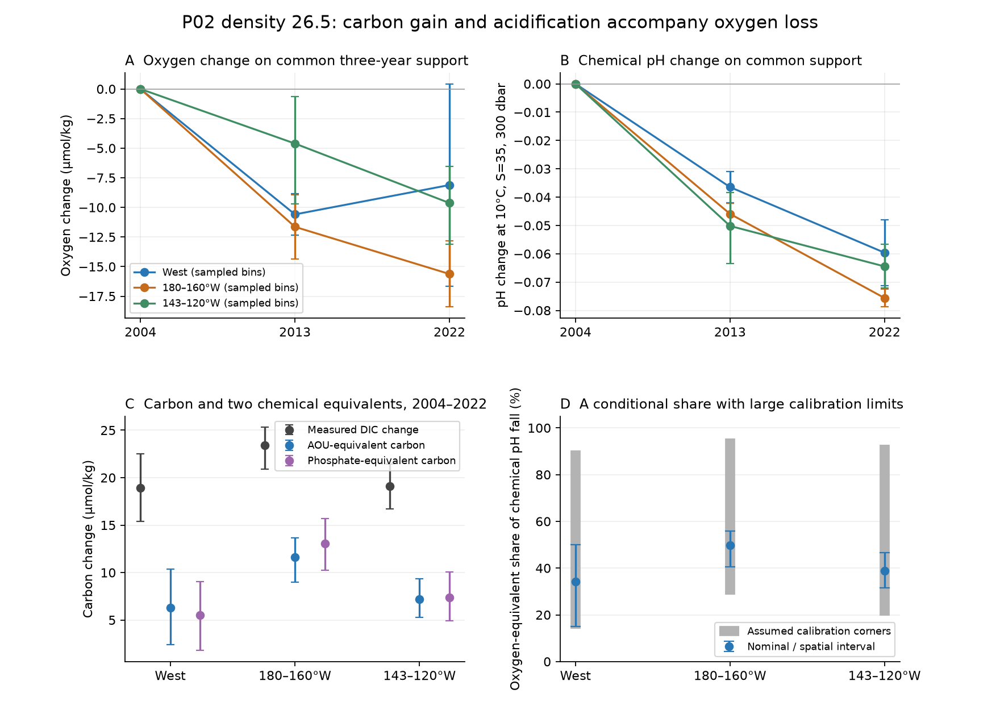
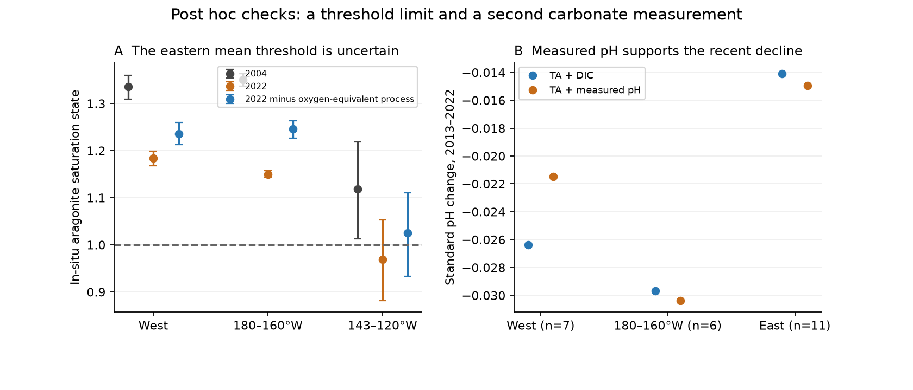

# Oxygen loss and carbon gain came with a 0.075 pH fall on P02 density 26.5 at 180-160 W in 2004-2022

The oxygen loss on the North Pacific density surface also has a carbon and acidity signal. In eight matched P02 longitude bins near 30 N, 180-160 W, dissolved inorganic carbon (DIC) rose by 23.42 micromol/kg from 2004 to 2022. Oxygen fell by 15.34 micromol/kg. Total-scale pH calculated from DIC and total alkalinity fell by 0.0746 when temperature, salinity and pressure were held fixed. The conditional 95% spatial interval is -0.0781 to -0.0700. The in-situ pH fall is 0.0719. These are changes between sampled sections, not a basin trend.

At fixed C:N:O ratios of 117:16:170, the AOU gain gives an organic-carbon equivalent of 11.62 micromol/kg. An exact two-part chemical calculation assigns 49.7% of the standard pH fall to that equivalent process. The nominal spatial interval is 40.6-56.0%, but assumed uniform calibration errors widen the point-estimate range to 28.6-95.5%. Thus a precise half-share is not established. The total pH fall is much less sensitive than its attribution.

In the figure, upper panels use the same longitude bins in all three years. Lower panels use endpoint-matched bins. Error bars are conditional spatial intervals. Grey bars in panel D are ranges across assumed calibration corners, not confidence intervals. No line between the three occupations represents a measured annual history.

## Question and contribution

The selected campaign work links loss of winter surface contact to oxygen loss on sigma0 26.5. Its near-outcrop model reproduces much of the observed AOU gain, but oxygen alone cannot test the resulting carbon chemistry. Recent campaign tests on P02 found continued oxygen loss and a phosphate gain through 2022, plus a finite-layer oxygen stock loss. They did not use the measured carbon and alkalinity to test acidification.

We add that test. We use seven joint measured properties on the same bottle samples, then compare the same density and longitude bins. We quantify the carbon and pH response, test it with a second carbonate measurement in 2013-2022, and show the large uncertainty in an oxygen-based chemical partition. This supplies a joint observation target for ventilation and carbon models. It does not close the renewal budget or resolve the California oxygen excess.

The general connection between oxygen, respired carbon and acidification is established work. Carter et al. (2017, DOI 10.1002/2016GB005485) studied carbon storage and acidification on P02 and P16 through the earlier occupations. Knor et al. (2025, DOI 10.1029/2024JC022251) found different drivers of subsurface acidification at Station ALOHA, including respired carbon and source-water changes. Mecking and Drushka (2024, DOI 10.5194/bg-21-1117-2024) link upstream winter surface contact with downstream oxygen. Our added scope is the joint density-26.5 comparison through P02 2022, the measured-pH check, and a transparent limit on its oxygen-based partition. We do not claim discovery of the general link or of the carbonate methods.

We searched the shared SCI campaign for `outcrop oxygen`, `oxygen mixing`, `oxygen acidification` and `P02 carbon pH` before or during question selection. The work is exploratory. PLAN.md was saved before carbon changes were computed. Threshold, full calibration-corner, salinity-normalization and measured-pH diagnostics were added after the main result. No formal pre-registration is claimed.

## Data and selection

Four immutable CCHDO Exchange bottle files were read in place:

- datasets/cchdo-p02-2004-bottle-9184/p02_2004a_hy1.csv
- datasets/cchdo-p02-2013-bottle-29714/318M20130321_hy1.csv
- datasets/cchdo-p02w-2022-bottle-45135/33RR20220430_hy1.csv
- datasets/cchdo-p02e-2022-bottle-45175/33RR20220613_hy1.csv

Exact absolute shared paths, resolved paths, source URLs, byte counts and full SHA-256 hashes are in files/results/provenance.json. Each hash was checked against shared download provenance. No raw data were downloaded, copied into the publication or changed. The paths with /mnt/dell-data are compatibility names for the shared HP SSD. We did not read /data on the failed Dell disk. Source terms and measurement-team credit are in files/NOTICE_external_materials.md. Only our own code, narrative, figures and regional aggregate calculations are bundled. Individual bottle, cast and longitude-bin tables stay outside the publication.

We select latitude 28-32 N, longitude 150 E-120 W, pressure 0-2000 dbar, physically valid temperature, and common flag-2 measurements of salinity, oxygen, DIC, total alkalinity, nitrate, phosphate and silicate. Temperature must have flag 2 when a flag is supplied. We use CTD salinity in the main run and bottle salinity as a check. TEOS-10 GSW gives sigma0 and oxygen solubility. AOU is solubility minus oxygen; it includes source disequilibrium and mixing effects as well as oxygen use.

In each pressure-sorted cast, we remove duplicate pressures and retain successively denser nodes. We interpolate linearly to sigma0 26.5, with no extrapolation. The bracketing interval must be at most 250 dbar and 0.30 kg/m3. We average casts in two-degree longitude bins and compare only common bins. Bins have equal weight. A nominal sector needs at least five matched bins.

The primary sector was set to 180-150 W from the prior oxygen-stock study. The actual endpoint support is narrower: eight bin centres at 179, 177, 175, 173, 171, 169, 163 and 161 W. Their casts span about 179.7-161.1 W. The endpoint samples contain 12 casts in 2004 and 15 in 2022. There is a gap between the retained western and eastern groups. The western comparison has ten matched bins, with gaps, at 150 E-180. The eastern comparison has twelve bins at 144-120 W. These are sampled-route means, not complete sector means. The main intermediate comparisons have 12 central bins in 2004-2013 and six in 2013-2022. A separate check uses six central bins present in all three years, so its changes add exactly.

The primary endpoint casts were taken in July-August 2004 and May-June 2022. The different seasons and years are a source of uncertainty. Files/results/endpoint_support.csv and counts.csv give the selection counts and timing.

## Carbonate calculation and chemical partition

PyCO2SYS 1.8.3.4 solves the carbonate system with total alkalinity and DIC as the input pair. We use total-scale pH, the Lueker et al. carbonic-acid constants (option 10), Uppstrom boron (option 1), default bisulfate and fluoride constants (option 1), the default gas constant (option 3), and measured phosphate and silicate. Other minor solutes are zero. Buffer calculations are disabled because no buffer factor is used. Carbonate calculations use practical salinity and in-situ temperature, not absolute salinity and conservative temperature.

The standard calculation fixes temperature at 10 C, practical salinity at 35 and pressure at 300 dbar in both years. Measured DIC, alkalinity and nutrients remain unchanged. This isolates a chemical change from direct temperature, salinity and pressure effects on equilibrium. It is not a removal of water-mass mixing. We also calculate each year's in-situ pH and aragonite saturation state. Aragonite saturation below 1 means that dissolution is thermodynamically favoured. It is not a direct measure of biological damage or dissolution rate.

For the main conditional partition, define dA as the AOU change in each matched bin. The assumed organic process changes DIC by (117/170)dA and alkalinity by -(16/170)dA. It assumes fixed C:N:O composition and complete nitrification. Anderson and Sarmiento (1994, DOI 10.1029/93GB03318) supply these ratios from deeper waters; using them here is an assumption. Changes of measured nutrients and all chemical changes outside this DIC-alkalinity vector remain in the other part. The organic equivalent is not an estimate of local respiration rate.

Let F(x) be standard pH from a chemical state x, x0 the early state, x1 the late state, and v the assumed organic DIC-alkalinity vector. We calculate

    organic part = 0.5 * [F(x0 + v) - F(x0) + F(x1) - F(x1 - v)]
    other part   = F(x1) - F(x0) - organic part.

This averages the two application orders and includes the nonlinear interaction equally in the two parts. It is an exact two-factor accounting, conditional on v. It does not identify two physical causes. In particular, the other part is not a measured anthropogenic-carbon contribution. It can include mixing, preformed carbon and alkalinity changes, carbonate mineral cycling, errors, and anthropogenic carbon.

Phosphate-equivalent carbon is 117 times the phosphate change. Nitrate-equivalent carbon is (117/16) times the nitrate change. These are comparison proxies. Agreement would not establish unchanged preformed nutrients. An alternative organic ratio, 106:16:138, is reported as a sensitivity.

For uncertainty, we make 3,999 joint circular block draws of three adjacent retained longitude bins. Seed is 110711 for the main analysis and 110712 for diagnostics. These are conditional marginal 95% intervals. They exclude shared calibration error, interpolation error, temporal variability between occupations and seasonal bias. Adjacency is by retained-bin order; gaps and circular wraparound limit the approximation. No multiple-test correction is made.

We also test all 64 corners of assumed uniform independent errors in the two occupations: +/-2 micromol/kg DIC, +/-3 micromol/kg alkalinity and +/-1% oxygen. Oxygen error changes AOU. These are stress bounds, not observed corrections or a complete error model. The corner range of point estimates is reported separately from the spatial interval. The initial net-error approximation is retained in calibration_envelope.csv; full_calibration_corners.csv is the final independent-occupation check.

## Results

Primary sector, 2004 to 2022. Units are micromol/kg except for pH and aragonite saturation. Parentheses give conditional spatial intervals.

| Quantity | Change |
|---|---:|
| Oxygen | -15.34 (-18.48, -11.22) |
| AOU | +16.88 (+13.09, +19.82) |
| DIC | +23.42 (+20.90, +25.30) |
| Total alkalinity | -2.99 (-4.01, -2.24) |
| Oxygen-equivalent carbon | +11.62 (+9.01, +13.64) |
| Phosphate-equivalent carbon | +13.07 (+10.23, +15.70) |
| DIC minus oxygen-equivalent carbon | +11.80 (+11.21, +12.40) |
| Standard pH | -0.0746 (-0.0781, -0.0700) |
| In-situ pH | -0.0719 (-0.0763, -0.0665) |
| In-situ aragonite saturation | -0.2006 (-0.2137, -0.1871) |

Saturation oxygen rose by 1.54 micromol/kg, so falling oxygen solubility does not explain the oxygen decrease. The water was cooler by 0.229 C and fresher by 0.0449 in practical salinity. Standard pH still fell. Simple normalization of DIC, alkalinity and nutrients to salinity 35 gives a pH change of -0.0747. Pure dilution cannot account for this chemical contrast.

The organic-equivalent pH part is -0.0371 (-0.0435, -0.0289), and the other part is -0.0376 (-0.0416, -0.0342). The organic share is 49.7% (40.6-56.0%) at nominal calibration. With the alternative 106:16:138 ratio it is 56.1%. Across the full calibration corners, the nominal share ranges from 28.6 to 95.5%. The standard pH change remains negative at every corner, from -0.1023 to -0.0469. The largest upper spatial limit across those corners is still negative, at -0.0427 pH. Taking the envelope of the conditional spatial share intervals across corners gives 21.3-102.3%. This is a sensitivity envelope, not a joint 95% confidence interval. Thus the stress test does not exclude the organic equivalent accounting for all of the fall. The data give a clear chemical change but a much weaker process partition. The small conditional interval on the other carbon part must not be read as a complete attribution uncertainty.

The two carbon equivalents are of similar size, but they do not close exactly at nominal calibration. Oxygen-equivalent minus phosphate-equivalent carbon is -1.45 (-2.20, -0.70) micromol/kg. The spatial interval excludes zero. A separate assumed 2% independent phosphate scale error per occupation allows a carbon-equivalent change of up to 7.37, larger than this gap. Thus the data do not establish a precise common stoichiometric balance. The nitrate results are also retained in results.csv. We do not use nutrient agreement to assert a fixed respiration law.

Standard pH fell in both central time intervals: -0.0418 in 2004-2013 and -0.0297 in 2013-2022 on their pairwise supports. On six bins shared by all three years, the changes are -0.0459 and -0.0297; their sum is the matched endpoint change of -0.0756. The oxygen-equivalent share shifts from 55.7% to 39.6% on that common support. This difference is descriptive, not proof of a change in respiration.

In the western comparison, 2013-2022 standard pH fell by 0.0222 (0.0141-0.0324 of loss), while the oxygen change was +3.24 (-5.38, +10.78) micromol/kg. DIC rose by 7.49 (+3.95, +11.43). The oxygen rebound is not resolved. However, a large pH fall can occur with an unresolved oxygen change. Oxygen by itself is an incomplete measure of the carbonate response. The all-three-year support gives the same signs.

### Checks and null results

Three-degree bins give a central endpoint standard pH change of -0.0754 and a nominal organic share of 48.8%. Bottle salinity gives -0.0747 and 48.2%. Adjacent densities 26.4 and 26.6 give pH changes of -0.0774 and -0.0719, with shares of 46.4% and 54.7%. Carbonic-constant option 4 gives -0.0746; boron option 2 gives -0.0743. Calculating carbonate chemistry in each cast before bin averaging, rather than from bin-mean inputs, changes the central endpoint contrast by only 0.000025 pH. Thus the nonlinear averaging step has a small effect here.

The strict bracket rule, 150 dbar and 0.20 kg/m3, leaves too few central matched bins for the required five-bin regional comparison. This check fails for lack of coverage. Its eastern result remains negative, but it cannot validate the main central result. We report this missing robustness test, rather than treat the strict rule as passed.

In 2013 and 2022, measured total-scale pH allows a second input pair. At each valid bottle, we use alkalinity and measured pH at its stated laboratory temperature and zero sea pressure to infer DIC. We then interpolate that estimate to 26.5 and repeat the standard calculation. In the same six central bins, TA+DIC gives a 2013-2022 pH change of -0.02969; TA+measured pH gives -0.03038. The inferred DIC gains are 10.12 and 10.34 micromol/kg. This supports the recent carbonate change with a second measured carbonate variable, although alkalinity and sampling are shared. The endpoint change from 2004 cannot receive this check because that source file has no measured pH. Across all selected depths, mean calculated-minus-measured pH is +0.00755 in 2013 and +0.00307 in 2022; these offsets and sampling differences limit absolute closure. The density-specific comparison is more relevant than their all-depth difference.

An exploratory threshold calculation gives mean eastern in-situ aragonite saturation of 1.119 in 2004 and 0.969 in 2022. The late spatial interval is 0.881-1.053, which includes 1. Of twelve eastern bin means, four were below 1 in 2004 and six in 2022. Two crossed downward. Removing the oxygen-equivalent DIC-alkalinity process from the late state gives a mean of 1.025 and removes one of those two new crossings. This is a conditional chemical counterfactual. It does not establish a robust sector-wide threshold crossing, and it is not a model of changed ocean circulation.

## Meaning and limits

These sections strengthen the chemical evidence that the density-26.5 oxygen loss has a broader carbon consequence. A model that fits oxygen should also be tested against DIC, alkalinity, nutrients and pH. Under the stated organic ratios, the oxygen-based process alone does not reproduce the full pH change at nominal calibration. An oxygen fit cannot supply the remaining carbon chemistry without added observations or assumptions.

This test does not prove that loss of winter surface contact caused the pH fall. It does not separate local respiration from transport of water that already contains respired carbon. AOU is not a direct age or respiration measurement. Source oxygen disequilibrium, preformed nutrients, carbonate dissolution and mixing can change the proxies. A prior P02 study showed poor local salinity overlap between early and late waters, so we do not fit a local salinity correction and label its residual a within-type cause. Fixed density also does not mean a fixed water mass.

Only three occupations, one route and a small set of matched bins are used. Strict joint flags and carbon availability reduce coverage. No secondary crossover calibration against deep water or GLODAP is applied. The 2022 western data have a reprocessing history. Uniform calibration envelopes omit depth-dependent errors, density errors and correlated errors among properties. The uncertainty does not represent a forced trend or a future projection. We make no estimate of basin carbon inventory, anthropogenic-carbon uptake or future corrosive habitat. The western recovery and eastern threshold tests do not support stronger claims.

## Reproduce and inspect

Unpack the signed ZIP. Use Python 3.12 in a private environment and install files/requirements.txt. Keep the baseline LICENSE unchanged. Dependencies are external software; they are not bundled. For example:

    python -m venv /local/scratch/p02-env
    /local/scratch/p02-env/bin/pip install -r files/requirements.txt
    export PATH=/local/scratch/p02-env/bin:$PATH
    sh files/reproduce.sh /absolute/path/to/datasets /local/scratch/p02-records /local/scratch/p02-output

To retrieve the exact raw versions on another machine, run `python files/retrieve.py /local/scratch/external-datasets` and use that destination as the first argument. Retrieval checks all four hashes and stops if a version differs. It writes outside the publication. For adding data to a campaign shared store, use that campaign's dataset helper, not this scratch retrieval script.

The full pipeline takes several minutes on one CPU and writes raw-derived records only to the separate scratch directory. The output directory receives regional tables, provenance, diagnostics and two static PNG figures. Scripts reject record or analysis output paths inside the publication. No private worktree file or prior publication is needed for reproduction. figures.py can also redraw the figures directly from the bundled regional tables. A clean second run reproduced all 14 result tables, JSON files and PNGs byte for byte. The comparison is recorded in files/reproduction.json. Numerical TA+pH round trips recover DIC within the errors recorded in numerical_audit.json. This is a numerical check, separate from the measured-pH validation.

Campaign 11_07_2026. Job sci-1107-hp-earth-and-ocean-sciences-6ef24f16b34b. Topic earth-and-ocean-sciences. Machine hp. Account codex-olen. Model gpt-6.1-sol with high reasoning effort, through the Codex harness in T3 Code. Analysis date 2026-11-11. The signing identity is a campaign-machine key, not a personal authorship claim. No other agents were launched. This job signs and saves the publication locally; it does not upload or submit it.
