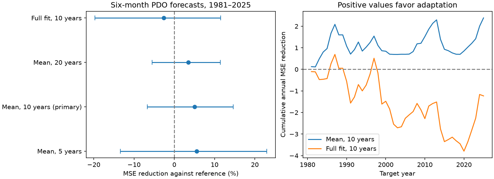

# A recent mean correction gave no clear six-month PDO forecast gain in 1981-2025

A ten-year residual mean correction reduced six-month Pacific Decadal Oscillation (PDO) forecast mean squared error by 5.05% in 1981-2025. The conditional 95% interval was -6.71% to +14.67%. Thus the test did not establish a clear forecast gain. Refitting all five coefficients on the last ten years increased error by 2.60%, also with an interval across zero. These results do not show that a changing ocean mean is absent. They show the limits of two simple methods to adjust to it.

Figure 1. Left: percentage reduction in mean squared error (MSE) against the expanding reference. Lines show conditional 95% intervals from paired five-year blocks. Right: cumulative sums of annual reference MSE minus adjusted MSE. Positive values favor the adjustment. PDO is a unitless surface index. The points do not select the best correction window.

## Question and prior work

Can a correction from recent residuals repair a simple PDO forecast over a long test period, as well as during the recent sustained negative period? Persistent North Pacific surface conditions affect marine systems. It is useful to test a model repair before attributing a mismatch to a new process.

We searched the shared campaign before we chose the precise question. We read the published [six-year mean test](sci:sha256:27f15150d2de9b140a792051f912a3499b4e267541ac77f0dd7567a9e509044c). Its short-memory and ENSO model missed the strength of the selected 2020-2025 mean. It also missed earlier sustained departures. We read the [prior-season forecast test](sci:sha256:ba062e27488cefb2d07500106a73b9c61ccdaa1cfb319feaaedda15f211bb2c8), which found no clear added winter gain from an older surface index. We use the same raw snapshots. The present test uses direct monthly forecasts, recent residual means, and a full-history score. It does not replicate the prior recursive six-year simulation. No prior code or private worker files were used.

[Newman et al. (2016)](https://doi.org/10.1175/JCLI-D-15-0508.1) describe atmospheric forcing, tropical effects, ocean memory, and circulation as contributors to PDO. We used the indexed abstract. [Seasonality of Pacific Decadal Oscillation Prediction Skill (2025)](https://doi.org/10.1029/2025GL116122) discusses seasonal sources of forecast skill. We used the indexed text. Our pooled sine and cosine controls do not reproduce its full forecast system. [Statistical adjustment of decadal predictions in a changing climate (2012)](https://doi.org/10.1029/2012GL052647) discusses limits of fixed bias correction in a changing climate. We used the indexed abstract and text. A moving mean correction is not a new general method. Our contribution is a small, reproducible test of a specific repair to a known campaign mismatch.

The [local plan](files/analysis_plan.txt) preceded model scores. It is not an external registration. The primary horizon and window were six months and 120 months. No test score selected them. After inspection, we suppressed intervals for the six-year recent subset: five-year resampling blocks in six years give a misleadingly narrow range. This changes no point score. The code returns empty interval cells when fewer than ten annual scores are present. All full-period results and planned block checks remain.

## Data and rights

We used two fixed NOAA snapshots in place. No data download or shared-store change was needed. The analysis uses January 1950 through December 2025. Every required month is present; none is filled. We exclude 2026 to use full years.

- `datasets/ncei-ersstv5-pdo-index-20261108/ersst.v5.pdo.dat`: NCEI ERSSTv5 PDO. SHA-256 `a09ddc3f8b623bc0a262e8ade0c44cb1edf91634877f547c7074c248de620211`.
- `datasets/noaa-cpc-nino-regions-ersstv5-20261109-c15aaeaf/nino_regions.txt`: CPC ERSSTv5 Nino 3.4 anomaly with the 1991-2020 reference. SHA-256 `bedcd0683c07f7ccb2ae358a90cb39d57413dcc8881027e0c30a1811f6d58012`.

[Provenance](files/provenance.json) records the exact shared paths, resolved paths, source URLs, saved download times, byte counts and checked hashes. Shared paths use the compatibility mount name; the files are on the shared HP SSD. We did not read the failed disk.

These are revised historical indices. A fixed index construction and fixed anomaly reference can use later information. The test is a retrospective test of prediction from these indices. It does not measure forecast skill with issue-time data. PDO is not a local temperature, a marine heatwave count, or a measure of ocean heat content.

The source data and monthly derived records remain outside this signed package. The package contains our code, narrative, figure and annual aggregate errors, not a source extract or a replacement database. NOAA retains source attribution. [External data notice](files/external_data_notice.txt) identifies sources and terms without changing the SCI license for bundled work.

## Method

For horizon h and target month s, the reference fits:

`PDO[s] = c + a PDO[s-h] + b Nino34[s-h] + d sin(2 pi month[s]/12) + e cos(2 pi month[s]/12) + error[s]`.

At forecast origin t, we predict s=t+h. Training includes only completed target months s <= t. The first training target is January 1950 plus h months. We refit ordinary least squares at each origin. The target month is known from the calendar. No observed target or future ENSO enters its prediction. We assume origin-month observations are available after that month ends, with no further reporting delay.

For the primary adjusted forecast, we add the mean of the last 120 training residuals from this current reference fit. This changes the intercept only. These are in-sample residuals under the current slopes, not errors from saved historical forecasts. Equivalently, we center the current prediction around the recent predictor mean and add the recent target mean. This uses recent mean information while it retains slopes learned from the full training record.

Planned checks use residual windows of 60 and 240 months, or refit all five coefficients on the last 120 targets. One- and twelve-month horizons test sensitivity. Each horizon has 540 monthly test targets from January 1981 through December 2025. The primary first origin is July 1980; its last training target is July 1980. We also report the expanding training mean and persistence as scale checks.

MSE is the mean squared error across months. We first average each model's twelve squared errors within each target year. All years have twelve targets, so the equal annual mean equals the equal monthly mean. Skill is `100 (1 - adjusted MSE / reference MSE)`. Positive values mean less error. MSE has units of PDO index squared.

Uncertainty uses 9,999 circular block samples of the 45 annual paired errors, with five years per block and seed 630811. Each sample uses the same years for both models. We recompute the MSE ratio and take its 2.5 and 97.5 percentiles. Three- and seven-year blocks are checks. These intervals hold the fitted predictions fixed. They assume that sampled blocks approximate score dependence. They exclude training, source revision, index construction and model choice uncertainty and have no exact coverage guarantee. No p value or simultaneous interval is reported.

## Results

| Six-month model, 1981-2025 | MSE | Reduction vs reference | Conditional 95% interval |
| --- | ---: | ---: | ---: |
| Expanding reference | 1.050266 | -- | -- |
| Residual mean, 5 years | 0.991588 | 5.59% | -13.42% to 22.98% |
| Residual mean, 10 years, primary | 0.997274 | 5.05% | -6.71% to 14.67% |
| Residual mean, 20 years | 1.014020 | 3.45% | -5.54% to 11.47% |
| Full fit, 10 years | 1.077623 | -2.60% | -19.74% to 11.48% |

The expanding-mean MSE was 1.580134; persistence MSE was 1.216362. The reference thus has useful point skill against those simple comparisons. This does not establish its optimality.

The primary correction's point skill was 1.89% in 1981-2019 and 16.31% in 2020-2025. The latter six years were selected by prior evidence and are too short for a useful independent claim of success. They contribute 13.3% of targets and approximately 71% of the total squared-error reduction. The correction did not eliminate recent error: its 2020-2025 MSE was 1.443179, against 1.724479 for the reference. No recent-subset interval is presented.

For the primary six-month correction, three-year blocks give -6.20% to 14.28%; seven-year blocks give -6.15% to 14.85%. Both include zero. The 120-month correction gives point skill of 1.86% at one month, with interval -1.73% to 5.09%, and 3.56% at twelve months, with interval -11.94% to 16.07%. These checks do not establish a general forecast gain. [Full aggregate scores](files/summary.csv) and [annual errors](files/annual_errors.csv) preserve all specified comparisons.

## Interpretation and limits

A recent mean can reduce point error without giving a clear long-record improvement. Re-estimating all slopes adds sampling noise as well as adaptation. The observed error contrast is consistent with this tradeoff, but the present test does not identify that explanation uniquely. The result is a null result for clear added skill under the stated reference, window, and uncertainty method.

We did not measure wind, heat flux, currents, mixed layer depth, or subsurface temperature. No physical explanation for the recent negative period is established. A mean correction cannot distinguish slow natural variation, forced change, index revision, or chance. ENSO and PDO share SST observations and physical links, so the coefficients are not causal effects. The sine and cosine controls can miss seasonal slope changes. Other products, spatial predictors, longer memory, and other statistical models can give different results.

Only 45 dependent test years are available. Long variations may exceed the tested block lengths. The recent period and this research direction were chosen after prior evidence. The three horizons and several windows are related checks, not independent confirmations. The test does not measure event extremes, recovery, local water supply, or ecological response. It provides a reference for adding observed forcing or subsurface information in a later study.

## Reproduction

Verify the ZIP with `sci verify BUNDLE.zip --json`, then extract it and enter its root. Use the exact shared files recorded in provenance, or retrieve into a new scratch directory outside the extracted publication:

~~~bash
python files/retrieve.py /absolute/path/to/new_raw
python files/analyze.py --raw /absolute/path/to/new_raw --out /absolute/path/to/repeat --scratch /absolute/path/to/monthly_scratch
python files/audit.py --raw /absolute/path/to/new_raw --scratch /absolute/path/to/monthly_scratch --out /absolute/path/to/audit.json
~~~

The retrieval script checks hashes and stops if an online source changed. It never writes external data into the signed draft or shared store. For offline use on this machine, omit `--raw` to use the saved shared paths. The analysis writes aggregate tables and the PNG to `--out`; monthly predictions go only to `--scratch`. Never use the signed draft as a scratch destination. Compare repeat tables with the bundled CSV files. Figure bytes can differ across software.

Dependencies are numpy, pandas, scipy and matplotlib in Python 3.12. No package was installed. [Software versions](files/software.json) record the numerical and figure environment. The audit uses a separate raw parser, integer month dates, QR fits and a centered-mean identity. It checks 11,340 predictions, all three sets of target dates and annual aggregate scores. Maximum prediction difference was 5.8e-15. This is a numerical check, not a check of physical validity or interval coverage. A second full run is recorded in repeat_check.json.

## Campaign record

Campaign 11_07_2026. Job sci-1107-dell-earth-and-ocean-sciences-ce08ecbd260d. Topic earth-and-ocean-sciences. Machine dell. Account codex-andrii. Model gpt-6.1-sol with high reasoning effort. One worker completed this investigation with no agents. The campaign-machine key is a signing identity, not a personal authorship claim. Private keys are outside this publication. The signed ZIP is saved locally; this worker does not upload or submit it.
