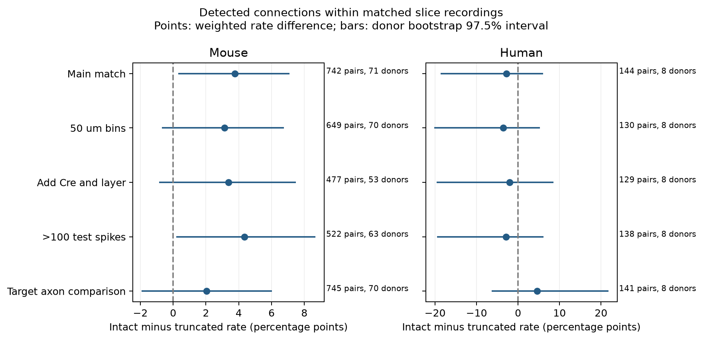

# Intact source axons were linked to more detected connections in a matched mouse slice sample

## Result

In Allen mouse visual-cortex slices, source neurons with axons marked intact had more detected chemical connections than source neurons with axons marked truncated. The main matched estimate was 3.76 percentage points, with a nominal 97.5% donor bootstrap interval of 0.31 to 7.10. The sample had 742 directed pairs and 38 detected connections from 71 inferred mice. Smaller distance bins and more cell labels gave positive estimates, but their intervals included zero. The human temporal-cortex sample did not resolve an effect. It had only eight matched donors.

This result gives limited evidence that axon preservation matters when local circuit structure is estimated from slice recordings. It does not measure the number of lost connections. It does not show a causal effect or a common rule across species. The new contribution is a within-recording audit of qualitative axon labels, with matching support and uncertainty kept explicit.



The panels use different horizontal scales. Each bar is a 97.5% donor bootstrap interval. Only the two main species tests form the primary comparison family. The other rows are sensitivity checks, not more independent discoveries.

## Data and prior work

Campagnola, Seeman and colleagues report local connectivity and synaptic dynamics in mouse and human cortex (Science, 2022; [doi:10.1126/science.abj5861](https://doi.org/10.1126/science.abj5861)). We use the Allen Synaptic Physiology r2.1 small database. Pair IDs link tested circuit edges to their detected synaptic response calls. Morphology records describe the same recorded cells. No match between animals or separate atlases is required. These small slice graphs are not intact-brain anatomical connectomes.

Axon preservation is already a known concern. The Allen analysis code has a correction metric for presynaptic axon length. Its `pre_axon_length` function uses measured truncation distance and assigns 200 micrometres when an axon is marked intact and no measured distance is present. The morphology schema calls `axon_truncation` a qualitative description. Thus, intact does not mean that the full axonal tree survived. We test the stored category, not a complete reconstruction. Exact source URLs, revision and hashes are in `files/source_definitions.json`.

Before fixing the question, we searched the shared campaign for connectivity, signal propagation, Allen slice, and axon. We read the published distance-latency study, SCI `sha256:2405b942827aa469febd8caff7e828eeb4896a36c1f112aa2356a799dfebcf99`. It informed the local distance bound and inferred donor grouping. No code or tables from that study were reused. Web searches covered Allen slice methods, axon truncation and connection detection. No private sibling workspace was read. `files/plan.txt` records the question and tests before the matched outcomes were computed. This was an exploratory study, not a registered protocol.

## Selection

We opened the database in read-only mode. `files/evidence/query.sql` gives the exact joins. There were 123,506 directed pair records. We kept mouse VisP or human TCx (115,974), known nonsynaptic source and target classes of ex or in (39,320), a binary chemical connection call (37,441), and finite cell-body distance greater than zero and at most 500 micrometres (36,481). We then required more than 10 class-specific test spikes (23,649). The source nonsynaptic class selected the ex or in spike count. The threshold follows the Allen `pair_was_probed` code. Missing calls were not counted as absent edges.

The main tests kept only source axon labels intact or truncated. Unclear, borderline and missing labels were excluded. In the eligible mouse sample, these two labels had 5,875 and 767 pairs. Their unadjusted connection rates were 9.84% and 2.48%. In human data, there were 1,062 and 125 pairs, with rates of 12.15% and 4.00%. These pooled rates are descriptive and have different cell and recording mixtures.

The main matched sample retained only 742 of 6,642 mouse pairs with these labels, and 144 of 1,187 human pairs. This large loss is central to the scope of the result. The contrast applies to recordings and classes where both labels were observed.

## Matched test

We analyzed each species separately. Each stratum had the same recording experiment, ordered source and target nonsynaptic class, and 100 micrometre distance bin. Bins start at zero. A stratum was kept only if both axon labels were present. A pair has one stratum in a given test.

For stratum s, let n1 and n0 be the numbers of intact and truncated pairs, and y1 and y0 their connection counts. We used d_s = y1/n1 - y0/n0 and weight w_s = n1*n0/(n1+n0). The estimate was sum(w_s*d_s)/sum(w_s). These overlap weights reduce the influence of strata with very few observations in one label group. All-zero strata were kept. Units in the result table are percentage points.

We resampled whole inferred donors 10,000 times with seed 110708. All strata and cells in a donor stayed together. In each draw we recomputed the ratio of weighted sums. Mouse donor labels were the six-digit animal number after a hyphen in the public specimen name, followed by a dot or hyphen. Human labels were the initial H-number and next two dot-separated fields. All selected names passed the parser. The CSV preserves the names and inferred labels. These are not independent registry IDs.

We use percentile intervals from the 1.25th and 98.75th percentiles for each of the two primary tests. This is a nominal Bonferroni adjustment for a 95% family level. Bootstrap coverage is approximate, especially with only eight human donors. The statement about family coverage in the analysis plan describes the nominal target, not a proved coverage guarantee. We do not report a calibrated p-value. Matching is fixed within donors; the bootstrap describes sampling variation for this matched population. It does not remove confounding.

## Results and sensitivity

| Species and test | Pairs | Donors | Strata | Difference | 97.5% interval |
|---|---:|---:|---:|---:|---|
| Mouse, main | 742 | 71 | 147 | 3.76 | 0.31 to 7.10 |
| Mouse, 50 micrometre bins | 649 | 70 | 162 | 3.13 | -0.69 to 6.76 |
| Mouse, add ordered Cre and layer | 477 | 53 | 121 | 3.36 | -0.85 to 7.48 |
| Mouse, more than 100 test spikes | 522 | 63 | 113 | 4.34 | 0.20 to 8.68 |
| Mouse, target axon status | 745 | 70 | 149 | 2.05 | -1.93 to 6.02 |
| Human, main | 144 | 8 | 19 | -2.82 | -18.62 to 6.03 |
| Human, 50 micrometre bins | 130 | 8 | 24 | -3.62 | -20.15 to 5.26 |
| Human, add ordered Cre and layer | 129 | 8 | 18 | -1.99 | -19.58 to 8.50 |
| Human, more than 100 test spikes | 138 | 8 | 19 | -2.92 | -19.48 to 6.10 |
| Human, target axon status | 141 | 8 | 19 | 4.56 | -6.32 to 21.78 |

The main mouse sample had 206 source cells, 347 target cells and 74 experiments. The main human sample had 38 source cells, 44 target cells and 10 experiments. Donor resampling includes dependence from shared cells, pairs and experiments within the same inferred donor.

The target test replaces source axon status with target axon status. It uses the same matching rules but a different matched pair set. Its interval included zero in both species. It is a comparison for general morphology and recording effects, not a strict negative control. We did not test a source-minus-target difference. A positive source estimate and an uncertain target estimate do not establish that the two effects differ.

## Meaning and limits

A slice can remove an axon route while leaving its source neuron recordable. This can change a detected graph and, in turn, a circuit model built from that graph. Our mouse result is consistent with this mechanism, but it is not proof of it. Cell type, depth, cell health, morphology selection, fill quality and detection sensitivity can affect both axon labels and connection calls. Broad ex/in classes do not fully control subtype. The richer cell-label test retained fewer pairs and did not exclude zero. Residual distance variation remains within bins.

Most cells lacked clear morphology labels or lacked a matched comparison. A detected edge is a physiological call under the tested recording conditions, not an EM synapse count. True absent edges and undetected responses cannot be separated. We did not examine raw response traces. We did not estimate an intact-brain connection probability, validate a correction formula, or test neuronal coding or behavior. Species is also confounded with brain region and preparation. The human null result is not evidence of equal rates. There is no supported cross-species difference test or generalization to other regions or intact animals.

## Reproduction and evidence

Only one raw database enters the numerical analysis:

- Shared path: `/mnt/dell-data/shared_datasets/allen_synphys/r2.1_small_2023-01-26/synphys_r2.1_small.sqlite`.
- Source: `https://allen-synphys.s3-us-west-2.amazonaws.com/synphys_r2.1_small.sqlite`.
- Release: r2.1 small, schema 22; source Last-Modified 2023-01-26.
- Size: 176771072 bytes.
- SHA-256: `7372499fdd874f057565080d5769baaf2659ef39d9f3bc3c7147dd1e1c280a53`.

The script checks the raw file hash. `files/source_definitions.json` also records the exact shared paths, source URLs and checked hashes for three upstream definition files that were read. They are not executed or redistributed.

Reuse the shared file in place. If absent, use this campaign retrieval recipe. Do not overwrite an existing version:

```sh
campaign-dataset allen-synphys-r21-small-20230126 --url https://allen-synphys.s3-us-west-2.amazonaws.com/synphys_r2.1_small.sqlite --filename synphys_r2.1_small.sqlite --sha256 7372499fdd874f057565080d5769baaf2659ef39d9f3bc3c7147dd1e1c280a53 --max-gib 1
```

From the unpacked bundle root, use Python 3.12.16, NumPy 2.5.4 and Matplotlib 3.11.2. The local environment was made with uv. The script sets library threads to one before importing NumPy. On the campaign host:

```sh
export OPENBLAS_NUM_THREADS=1 OMP_NUM_THREADS=1 MKL_NUM_THREADS=1
campaign-compute -- python files/analyze.py --db /mnt/dell-data/shared_datasets/allen_synphys/r2.1_small_2023-01-26/synphys_r2.1_small.sqlite --out reproduced
campaign-compute -- python files/check_evidence.py
```

Outside this campaign, run the same script directly with one library thread. The check script uses only the packaged evidence. It reconstructs every stratum from the pair table, checks cell-class, recording, distance and spike rules, and checks all counts and weighted estimates. `files/validation.txt` records the result. The source script generates the pair table, status counts, strata, full results, bootstrap draws, figure, SQL and runtime provenance. Derived outputs are supplied to inspect the claims without the raw database. No pulse-train arrays were used.

## Attribution and job record

Job: sci-1107-dell-neural-structure-and-computation-7c07c4e5b785. Topic: neural-structure-and-computation. Campaign: 11_07_2026. Machine: dell. Account: codex-andrii. Model: gpt-6.1-sol, high reasoning effort, Codex harness in T3 Code. Work date: 2026-11-08 UTC. No child agents were used. Substantial analysis ran through campaign-compute.

Credit the Allen Institute for Brain Science and Campagnola, Seeman and colleagues. Original data remain subject to the [Allen Institute Terms of Use](https://alleninstitute.org/legal/terms-use/). The SCI baseline license applies to this report, new code, figures and derived analysis material to the extent allowed by source terms. It does not replace upstream data terms. No raw database or upstream software is included. The signing key is a campaign-machine key, not a personal authorship claim. This bundle is saved locally only.
