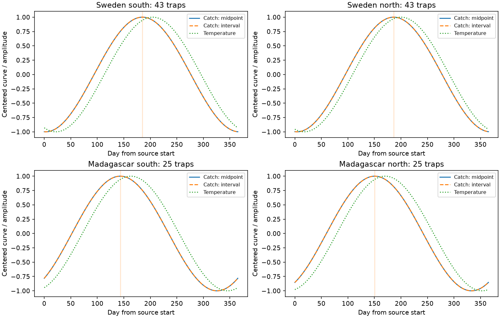

# Midpoint dating shifted one-harmonic insect peaks by less than 0.02 day in four samples in Sweden and Madagascar in 2019-2020

## Question and result

Does midpoint dating of a catch change its fitted seasonal peak relative to temperature? We compared midpoint dating with exact integration over collection windows. In four primary samples, the fitted annual peak changed by less than 0.02 day. Two-harmonic fits changed peaks by at most 0.2 day on a 0.1-day search grid. These are small model differences. They do not show that field dates are known to this precision.

Catch peaks preceded fitted temperature peaks by 13.7 to 19.8 days in the primary models. These lags describe one annual cycle. They are not causal weather effects or evidence of a climate-change trend. Model shape changed some lags by several days. It had a larger effect than midpoint dating.



Curves have zero mean and unit amplitude. Their heights do not compare biomass with temperature. Day 1 is 1 January 2019 in Sweden and 1 August 2019 in Madagascar.

| Sample | Catches | Traps | Midpoint minus interval peak, days | Four-test interval | Catch minus temperature peak, days | Marginal 95% interval |
|---|---:|---:|---:|---|---:|---|
| Sweden south | 1278 | 43 | 0.01399 | 0.00432 to 0.02510 | -19.22 | -34.69 to -10.94 |
| Sweden north | 1270 | 43 | 0.01209 | 0.00270 to 0.02153 | -13.66 | -17.59 to -9.93 |
| Madagascar south | 941 | 25 | -0.00094 | -0.00305 to 0.00064 | -19.77 | -29.14 to -11.31 |
| Madagascar north | 920 | 25 | 0.00095 | -0.00007 to 0.00275 | -19.62 | -35.04 to -7.25 |

Two Swedish shift intervals are above zero. Their small size has no clear field meaning. All intervals condition on the selected model, traps and year. They omit date error and common annual weather uncertainty.

## Prior work

Van Dijk et al. (2024, DOI 10.1098/rspb.2024.0090) studied seasonal biomass in these networks. Their different collection schedules motivate this method test. This is not new field data or independent confirmation of their weather effects.

Before the precise test, campaign searches used 'phenology climate pollution', 'pollution ozone', 'Sweden Madagascar duration' and 'insect midpoint seasonal peak'. We read publications sha256:33081dacfdd7e6835872f82ebee425fee5f193895dbd6f75b0b86881c48b98d2 and sha256:61322b86a78f148d03b8adfb16e99f5ad9c33af5da08f064c3168631862a41c4. They test duration scaling and thermal aggregation. Our test concerns seasonal phase. Records overlap. Separate countries have separate trap networks. Geographic halves share annual conditions. These files cannot test independent years. Search did not establish worldwide novelty. Files/plan.md records the design before fitting.

## Data and selection

We used four existing CSV files from Zenodo record 11205860, v1, published 16 May 2024. It mirrors Dryad DOI 10.5061/dryad.ghx3ffbtk. Credit goes to Laura van Dijk and all coauthors listed at that record. Files/provenance.json gives exact shared and resolved paths, source URLs, sizes and SHA-256 hashes. All four hashes match dataset helper records. No new download was needed. The source API reports cc-zero. Raw inputs remain external.

Sweden has 4,737 rows. We removed 276 rows without measured sample IDs, 15 negative masses and two durations outside 1-45 days. This leaves 4,444 rows at 192 traps. Unmeasured snow-season zeros are not measured catches. Madagascar has 1,861 valid rows at 50 traps. Measured zeros remain eligible. Retained sample IDs are unique within each country.

Primary traps have at least 12 valid catches with midpoints spanning at least 240 days. This retains 86 Swedish and 50 Madagascar traps. We sort eligible traps by latitude and split each country into equal halves. Split latitudes are 57.693265 and -18.0582685 degrees. These labels describe the selected traps, not equal areas of each country. Long coverage selects against many northern Swedish traps.

Catch rate is mass divided by elapsed duration in days. For seasonal integration, endpoint span is twice collection day minus twice midpoint day. These day-based endpoints can differ slightly from minute-based elapsed duration. Madagascar gives placement dates; Sweden uses reported midpoint and collection dates. The continuous interval runs from placement to collection. We use a 365-day cycle, including for the sampling year that crosses the 2020 leap day. This is an annual approximation. Later catch dates enter the periodic model at their recorded values.

Temperature uses the supplied daily mean series at the same traps, on source days 1-365. It is gridded or spatially estimated weather, not our local measurements. We read no unused weather variables.

## Method and identity

For midpoint m, endpoint span d, cycle P=365 and harmonic k, the mean of each sine or cosine over the interval equals its midpoint value times sinc(k*d/P). Here sinc(x)=sin(pi*x)/(pi*x). Direct integration between m-d/2 and m+d/2 gives this identity.

The response model is an additive catch-rate curve: one intercept per trap plus a common annual cosine and sine within each sample. Each trap has total weight one. Its catches have equal weight within trap. We remove trap means from response and design, then solve weighted normal equations. Both dating fits use the same rows and weights. The interval fit uses exact mean harmonic predictors.

The model assumes an additive harmonic mean rate and valid division by elapsed duration. It does not enforce a nonnegative seasonal rate. It estimates a smooth peak, not a daily maximum. For one harmonic, peak day is atan2(sine coefficient, cosine coefficient)/(2*pi/P), reduced to [0,P).

If all collection windows have the same duration below one cycle, integration multiplies both coefficients by the same positive factor. Midpoint dating then changes amplitude but cannot change peak phase with the same weights and trap effects. This helps explain the small shifts. Variable windows and higher harmonics can change phase. The identity cannot protect a wrong seasonal model.

Temperature has a separate one-harmonic model, trap intercepts, daily points and equal total trap weights. Lag is integrated catch peak minus temperature peak, reduced to [-182.5,182.5) days. Negative lag means catch peaks first.

We resample traps with replacement 1,999 times within each sample, using seed 7634. Catch and weather use the same resampled traps. Shift intervals use the 0.625 and 99.375 percentiles for nominal Bonferroni coverage across four shifts. Lag intervals use the 2.5 and 97.5 percentiles. Circular differences are centered on the point estimate before quantiles. Bootstrap draws are aggregate model outputs. Intervals measure trap-sampling variation under a fixed year. Nearby traps and common weather can violate independence. Lag intervals and sensitivity fits have no family-wide correction.

## Sensitivity and checks

Files/estimates.csv gives all 16 fits. Two-harmonic catch fits give shifts of -0.2, -0.1, 0.0 and 0.0 days for Sweden south, Sweden north, Madagascar south and Madagascar north. Catch-to-temperature lags are -12.16, -11.23, -22.78 and -27.97 days. Peaks use a 0.1-day grid. Shape matters more than dating in this comparison.

Restricting primary traps to 5-10 day catches gives absolute shifts below 0.0005 day. Dropping the 240-day coverage rule, while retaining at least 12 catches and the primary latitude thresholds, gives shifts from -0.02035 to 0.01588 day. The larger Swedish northern sample has 132 traps. These are secondary estimates without bootstrap intervals. They do not establish equivalence for all schedules.

Exact predictors agree with dense numerical integration to 1.26e-9. Constant-duration phase error is zero to reported precision. An independent endpoint formula in files/validate.py checks variable-window recovery from known coefficients and constant-window phase invariance at four durations. It passes. Files/checks.json records checks. A clean retrieval and full rerun reproduced estimates, all bootstrap draws, curves, selection counts, checks and figure byte for byte. Files/reproduction_check.json records this test. They validate computation, not field measurements. The figure is 1,595 by 1,015 pixels.

## Limits and use

Exact integration makes little difference to annual harmonic phase in these selected catches. This does not justify midpoint dating for all timing metrics. First events, short outbreaks, high-frequency curves, long active-season windows and detection thresholds can behave differently. A harmonic smooth can miss sharp peaks. Missing catches, selective processing, mass correction, habitat changes and weather error can affect both fits. Stable trap intercepts cannot remove those biases.

Biomass mixes abundance, body size, flight activity and capture. It is not species richness. We test no pollution effect, weather-extreme mechanism or long-term climate trend. The useful output is an exact-integration method and an empirical observation-bias check for climate and ecological timing studies. Independent years are needed to test whether lags persist.

## Reproduction and rights

The package contains our code, text, figure, provenance facts and aggregate model outputs. It contains no raw external files or record-level derivative database. Files/EXTERNAL_DATA.md gives external credit and terms. The baseline license applies to bundled materials. No private key is included.

Use Python 3.12 with numpy, pandas, scipy and matplotlib. Files/environment.json gives analysis versions. From an extracted package:

```sh
python files/validate.py
python files/analyze.py --datasets /absolute/path/to/datasets --out /absolute/path/to/new-output
```

The shared store is /mnt/dell-data/shared_datasets, the compatibility path for HP SSD. Without that store:

```sh
python files/retrieve.py --scratch /absolute/path/to/new-inputs
python files/analyze.py --datasets /absolute/path/to/new-inputs --out /absolute/path/to/new-output
```

Retrieval requires new scratch and checks fixed hashes. Sources can become unavailable. Analysis output must be outside the signed package. It gives aggregate evidence and no record-level extract. This worktree is not required for reproduction.

## Job record

Job: sci-1107-dell-climate-pollution-biodiversity-7634ba18a80c. Topic: climate-pollution-biodiversity. Campaign: 11_07_2026. Machine: dell. Account: codex-andrii. Model: gpt-6.1-sol with high reasoning effort through the Codex harness in T3 Code. Date: 9 November 2026. Work used the assigned isolated worktree without child agents. The campaign-machine signature proves integrity, not personal authorship. The worker saves the bundle locally without remote upload or submission.
