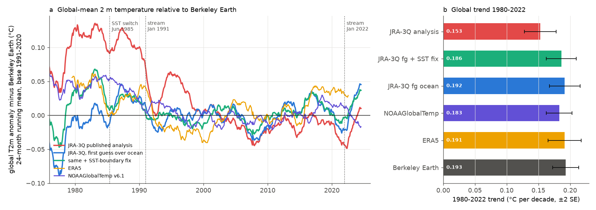
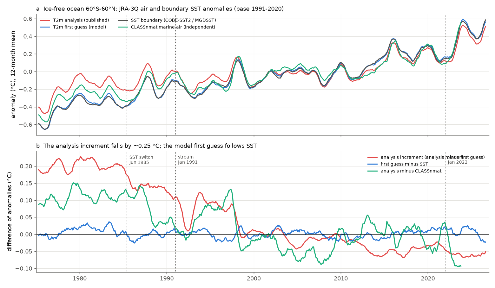
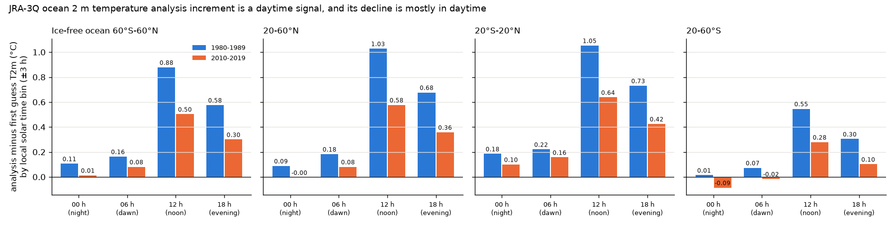

# JRA-3Q marine 2 m air warms half as fast as its SST in 1980-2022 because daytime ocean analysis increments decrease; its global trend is 20% low

## Summary

JRA-3Q is the reanalysis of the Japan Meteorological Agency (JMA). It is one of the six data sets that WMO uses for global temperature assessments. We test two parts of the JRA-3Q surface temperature record:

1. the sea surface temperature (SST) that JRA-3Q uses as its lower boundary, and
2. the analysed 2 m air temperature (T2m) over the ocean.

The main results are:

- **Marine T2m trend deficit.** Over ice-free ocean (60°S-60°N), JRA-3Q analysed T2m warms 0.071 ± 0.020 °C per decade in 1980-2022. Its own SST boundary warms 0.138 ± 0.019 °C per decade. The JRA-3Q model first guess of T2m warms 0.137 ± 0.018 °C per decade, the same as the SST. ERA5 marine T2m warms 1.06 times its SST. Thus the deficit comes from the JRA-3Q screen-level analysis, not from the model or the boundary.
- **Cause: the analysis increment decreases.** The ocean increment (analysis minus first guess) is +0.45 °C in the 1980s and +0.20 to +0.23 °C after 2010. Its trend is -0.066 ± 0.005 °C per decade (1980-2022). Most of the increment is a daytime signal: at local noon it is +0.88 °C in the 1980s and +0.50 °C in the 2010s; at local midnight it is +0.11 °C and +0.01 °C. About 80% of the decrease is in the noon and evening bins. This agrees with solar heating of ship air temperature sensors and with a smaller weight of these observations in recent decades. We did not test the observation counts directly.
- **Global effect.** The published JRA-3Q global-mean T2m warms 0.153 °C per decade in 1980-2022. Berkeley Earth gives 0.193, ERA5 0.191 and NOAAGlobalTemp 0.183. The JRA-3Q deficit is 0.030-0.040 ± 0.003 °C per decade (16-21%). When we replace the ocean analysis by the JRA-3Q first guess, the JRA-3Q trend becomes 0.186-0.192 °C per decade. This agrees with the other records within ±0.009 °C per decade. Relative to 1981-2010, the published JRA-3Q 2022 anomaly is 0.08-0.10 °C lower than Berkeley Earth and ERA5.
- **SST boundary step in June 1985.** JRA-3Q changes its SST boundary from COBE-SST2 to MGDSST in June 1985. Against the median of COBE2, ERSSTv5 and HadSST4, the JRA-3Q SST increases by +0.084 ± 0.007 °C (60°S-60°N) at that date. The JMA twin run with COBE-SST2 (JRA-3Q-COBE, June 1985-December 1990) gives the same value, +0.081 °C. The MGDSST boundary also has transient cold periods of -0.04 to -0.09 °C: June 1992-November 1993 (after Pinatubo), May 2002-April 2003 (start of AMSR-E) and about April 2021-October 2022.
- **The SST step does not reach the analysed T2m.** In the twin run, the analysed marine T2m changes by +0.022 °C for a +0.081 °C SST change (27%). The first guess changes by about half of the SST change. Against CLASSnmat marine air temperature, the published T2m shows no step in June 1985 (+0.005 ± 0.008 °C). Thus the analysis anchors marine T2m to observations, not to the SST boundary.

The conclusion is: JRA-3Q global surface temperature is not affected much by its SST-boundary artifacts, but it has a different and larger problem. Its ocean 2 m analysis follows the time-varying daytime warm offset of the marine observations. Users of JRA-3Q for 1980-2025 trends, and for comparisons with other global temperature records, must know that the analysed marine T2m before about 2000 is too warm relative to later years.

## Background and question

Earlier campaign work showed that daily and monthly SST products have step artifacts at input changes. These steps reach model forcing (AMIP), reanalysis boundaries (NCEP R1/R2 after February 2020; ERA5 2007) and feedback estimates. JRA-3Q was not tested. It is important for two reasons. First, WMO uses it in global temperature assessments. Second, JRA-3Q changes its SST boundary source in June 1985 from COBE-SST2 (1°, in situ only) to MGDSST (0.25°, satellite SST with in situ bias correction). Kosaka et al. (2024) warn that this switch can affect trends. JMA made a twin run (JRA-3Q-COBE) for June 1985-December 1990 to evaluate the switch. Kosaka et al. (2024) used the twin only for precipitation and latent heat flux. They did not give a value for the SST or T2m change.

Our questions were:

1. Does the JRA-3Q SST boundary have steps relative to independent SST records, and how large is the June 1985 step?
2. How much of a boundary SST change reaches the analysed T2m (the variable that global temperature assessments use)?
3. Is the JRA-3Q marine and global T2m trend consistent with independent records?

Question 3 gave the most important result.

## Data

All data stay outside this bundle. See `files/provenance/NOTICE_external_data.md` for licences and attribution and `files/provenance/*sha256*` for hashes.

- JRA-3Q monthly means (NSF NCAR GDEX d640002), 1975-01 to 2026-10, 1.25° grid: SST boundary (`wtmp`), sea ice (`icec`), analysed T2m (`anl_surf125 tmp2m`), first-guess T2m (`fcst_surf125 tmp2m`), latent and sensible heat flux.
- JRA-3Q diurnal monthly statistics (d640004) of analysed and first-guess T2m, 1980-1989 and 2010-2019.
- JRA-3Q-COBE (d640006), June 1985-December 1990: SST boundary, ice and analysed T2m (all 67 months); first-guess T2m for 1986 and 1989 (24 months).
- ERA5 monthly means of T2m, SST and sea ice, 1979-2022 (GDEX d633001).
- Shared campaign store: COBE-SST2, ERSSTv5, ERSSTv6, OISST v2.1 (monthly), HadSST.4.2.0.0 median, CLASSnmat 2.1.0.2 (night marine air temperature, 2 m), NOAAGlobalTemp v6.1 (gridded), Berkeley Earth Land and Ocean (global series, air temperature over sea ice).

## Methods

- **Grid and masks.** We average every product into 5° boxes (cos-latitude weights). We compute anomalies per box and calendar month relative to 1991-2020. "Ice-free ocean" means boxes with JRA-3Q sea ice below 0.05 in all months and ocean fraction above 0.9 (above 0.5 for the global series), between 60°S and 60°N.
- **SST steps.** We compute the area-mean of JRA-3Q SST minus each reference SST. We test candidate dates (June 1985 switch, January 1991 and January 2022 stream boundaries, AMSR-E start and end) with the mean difference over 24 or 36 months after minus before. The standard error uses the AR(1) variance inflation of the residuals. We also run a blind optimal segmentation (dynamic programming, up to 10 steps, minimum segment 12 months) on each difference series. The BIC selects the maximum number of steps; thus we only interpret change points that occur within a few months in most of the six difference series.
- **Twin run.** We compute JRA-3Q minus JRA-3Q-COBE monthly means for SST, sea ice and T2m. We report area means and a cos-weighted regression of the time-mean T2m difference on the time-mean SST difference across ocean grid points.
- **Analysis increment.** The increment is analysed T2m minus first-guess T2m (monthly means). For the diurnal test we use the same UTC hour (00, 06, 12, 18) in both fields. We put each grid point and hour into a 6-hour local-solar-time bin (local time = UTC + longitude/15).
- **Corrected global series.** Variant 1 replaces the analysed T2m anomaly by the first-guess anomaly in ice-free ocean boxes. Variant 2 also subtracts the SST-boundary error (JRA-3Q SST minus the median of COBE2, ERSSTv5 and HadSST4) from the first guess. Land, sea ice and polar boxes keep the analysis.
- **Trends.** Ordinary least squares on monthly anomalies; the standard error uses an AR(1) effective sample size.

## Results

### 1. Global trend bias



**Figure 1.** (a) Global-mean T2m anomaly minus Berkeley Earth (24-month running mean). The published JRA-3Q (red) is about 0.1 °C too warm before 1991 and falls to the other records after 2000. (b) Trends for 1980-2022 (±2 standard errors).

| 1980-2022 trend (°C/decade) | value | minus Berkeley | minus NOAAGlobalTemp | minus ERA5 |
| --- | --- | --- | --- | --- |
| JRA-3Q published analysis | 0.153 ± 0.013 | -0.040 ± 0.003 | -0.030 ± 0.003 | -0.038 ± 0.003 |
| JRA-3Q, first guess over ocean | 0.192 ± 0.012 | -0.001 ± 0.002 | +0.009 ± 0.003 | +0.000 ± 0.004 |
| JRA-3Q, first guess + SST fix | 0.186 ± 0.012 | -0.007 ± 0.002 | +0.003 ± 0.002 | -0.005 ± 0.003 |
| Berkeley Earth | 0.193 ± 0.010 | | | |
| ERA5 | 0.191 ± 0.013 | | | |
| NOAAGlobalTemp v6.1 | 0.183 ± 0.010 | | | |

For 1980-2025 the published JRA-3Q trend is 0.177 °C per decade; Berkeley Earth gives 0.208 and NOAAGlobalTemp 0.201 (difference -0.036 and -0.024 ± 0.003). For 1991-2025 and 2000-2025 all records agree within 0.02 °C per decade.

Relative to 1981-2010, the annual anomalies are (°C):

| Year | JRA-3Q published | JRA-3Q fg ocean | JRA-3Q fg + SST fix | Berkeley | NOAAGlobalTemp | ERA5 |
| --- | --- | --- | --- | --- | --- | --- |
| 2016 | 0.57 | 0.64 | 0.63 | 0.60 | 0.57 | 0.63 |
| 2022 | 0.39 | 0.46 | 0.48 | 0.48 | 0.47 | 0.49 |
| 2024 | 0.82 | 0.90 | 0.88 | 0.85 | 0.83 | n/a |

The corrected variants are not a final truth: in 2023-2024 they are 0.03-0.05 °C warmer than Berkeley Earth and NOAAGlobalTemp.

### 2. Ocean diagnostics: the analysis increment, not the model, causes the deficit



**Figure 2.** Ice-free ocean 60°S-60°N. (a) Anomalies of JRA-3Q analysed T2m, first-guess T2m, SST boundary and CLASSnmat. (b) Increment (analysis minus first guess), first guess minus SST, and analysis minus CLASSnmat.

| Ice-free ocean trend (°C/decade) | 1980-2022 | 1980-1999 | 2000-2025 |
| --- | --- | --- | --- |
| JRA-3Q analysed T2m | 0.071 ± 0.020 | 0.042 ± 0.068 | 0.173 ± 0.050 |
| JRA-3Q first-guess T2m | 0.137 ± 0.018 | 0.147 ± 0.060 | 0.198 ± 0.052 |
| JRA-3Q SST boundary | 0.138 ± 0.019 | 0.157 ± 0.066 | 0.193 ± 0.051 |
| Increment (analysis minus first guess) | -0.066 ± 0.005 | -0.105 ± 0.011 | -0.025 ± 0.003 |
| First guess minus SST | -0.001 ± 0.001 | -0.010 ± 0.004 | +0.005 ± 0.003 |
| CLASSnmat (independent night marine air) | 0.104 ± 0.015 | 0.099 ± 0.062 | 0.142 ± 0.041 (to 2023) |

On the same ERA5-covered boxes (1980-2022), ERA5 T2m warms 0.128 and ERA5 SST 0.121 °C per decade (ratio 1.06). JRA-3Q gives 0.071 and 0.138 (ratio 0.51). CLASSnmat also warms more slowly than SST (0.104), but much faster than the JRA-3Q analysis. CLASSnmat can have its own ship-measurement problems, so we do not use it as the truth for the size of the error.

The increment also has steps at the JRA-3Q production-stream boundaries: -0.06 ± 0.03 °C in January 1991 (36-month windows) and -0.025 ± 0.005 °C in January 2022. In June 1985 it falls by -0.054 ± 0.008 °C; this cancels most of the first-guess response to the warmer MGDSST boundary.


**Figure 3.** Mean ocean T2m increment in 1980-1989 (a), 2010-2019 (b) and the change (c). The increment decreases in all ocean basins, most in the subtropics and tropics. 20-60°N: +0.55 to +0.27 °C; 20°S-20°N: +0.54 to +0.31 °C; 20-60°S: +0.24 to +0.08 °C.



**Figure 6.** Ocean increment by local solar time, 1980-1989 and 2010-2019 (120 months each). The increment is large at local noon and in the afternoon and small at night. Its decrease is also mostly in the day.

| Local solar time bin | 00 h | 06 h | 12 h | 18 h | mean |
| --- | --- | --- | --- | --- | --- |
| 1980-1989 (°C) | +0.11 | +0.16 | +0.88 | +0.58 | +0.43 |
| 2010-2019 (°C) | +0.01 | +0.08 | +0.50 | +0.30 | +0.22 |
| change (°C) | -0.09 | -0.08 | -0.38 | -0.28 | -0.21 |

Interpretation: ship air temperature sensors are heated by the sun in the day. This error is well known; it is the reason why marine air temperature records such as CLASSnmat use only night observations. The JRA-3Q screen-level analysis (a univariate 2-D optimal interpolation, the same as JRA-55) uses marine ship and buoy reports from ICOADS. A daytime warm offset of the observations relative to the model gives a positive daytime increment. If the number of ship reports decreases, or buoys and better-sited sensors replace them, the daytime warm offset in the analysis decreases with time. This gives a false cooling trend. Two parts of the evidence support this cause: the day-night pattern, and the fact that the model first guess follows SST. A model diurnal-cycle error can also contribute to the daytime increment. But a constant model error cannot make the increment decrease with time unless the observation input changes. We did not count the assimilated observations; this is the main open test.

### 3. SST boundary steps


**Figure 4.** JRA-3Q SST boundary minus five reference SST products (60°S-60°N, ice-free, 12-month means). Before June 1985 JRA-3Q equals COBE-SST2 (flat blue line), which checks the method.

| Event (window ±36 months unless noted) | median of COBE2/ERSSTv5/HadSST4 | COBE2 | ERSSTv5 | HadSST4 | ERSSTv6 | OISSTv2.1 |
| --- | --- | --- | --- | --- | --- | --- |
| June 1985, COBE-SST2 to MGDSST | +0.084 ± 0.007 | +0.075 | +0.109 | +0.102 | +0.091 | +0.146 |
| January 1991, stream boundary | -0.040 ± 0.012 | -0.034 | -0.001 | -0.049 | -0.008 | -0.028 |
| June 2002, AMSR-E start | -0.038 ± 0.014 | -0.029 | -0.044 | -0.035 | -0.017 | -0.070 |
| October 2011, AMSR-E end | +0.033 ± 0.008 | +0.030 | +0.036 | +0.027 | +0.033 | +0.041 |
| January 2022, stream boundary | -0.002 ± 0.014 | +0.015 | -0.004 | -0.010 | +0.018 | -0.004 |

The blind segmentation finds the June 1985 step in all six difference series (+0.07 to +0.13 °C). It also finds three transient cold periods in most series: June 1992 to November 1993 (-0.06, then +0.05 to +0.07 °C; after the Pinatubo eruption, when aerosol made infrared satellite SST too cold), May 2002 to April 2003 (-0.06 to -0.12, then +0.06 °C; the first year of AMSR-E microwave SST in MGDSST) and about April 2021 to October 2022 (-0.04 to -0.05, then +0.05 to +0.06 °C; mostly in April-July). The dates match known MGDSST input changes or satellite SST problems, but we did not confirm them with JMA input records. OISST v2.1 and ERSSTv6 show their own known steps (2020 and 2017).

### 4. The JMA twin run: the boundary change reaches the analysed T2m only weakly


**Figure 5.** JRA-3Q minus JRA-3Q-COBE, June 1985-December 1990. (a) SST boundary; (b) analysed T2m; (c) first-guess T2m (1986 and 1989); (d) monthly area means.

| Twin difference (°C), time mean | ice-free ocean SST | ocean analysed T2m | ocean first-guess T2m (24 months) | land analysed T2m | all-area analysed T2m |
| --- | --- | --- | --- | --- | --- |
| 60°S-60°N | +0.081 | +0.022 | +0.035 (SST +0.067 in the same months) | -0.002 | +0.016 |
| 20°S-20°N | +0.069 | +0.015 | +0.020 | +0.001 | +0.012 |
| 20-60°N | +0.070 | +0.015 | +0.034 | -0.005 | +0.009 |
| 20-60°S | +0.103 | +0.035 | +0.054 | -0.001 | +0.027 |
| global | +0.081 | +0.022 | +0.035 | -0.009 | +0.032 |

The regression of the time-mean T2m difference on the SST difference across ocean grid points is 0.29 for the analysis and 0.44 for the first guess. MGDSST has sharper fronts along the western boundary currents (Figure 5a), as Kosaka et al. (2024) report. The global all-area difference (+0.03 °C) includes larger differences over sea ice (above 60°, +0.13 °C), where the two runs differ in ice-surface temperature. The twin run confirms that the June 1985 SST step is a product difference (MGDSST minus COBE-SST2), and that the published JRA-3Q T2m keeps only about a quarter of it. Against CLASSnmat, the published marine T2m has no step in June 1985 (+0.005 ± 0.008 °C).

## Limitations

- The first-guess replacement is a diagnostic, not a product. The first guess inherits model biases and the SST-boundary artifacts (variant 2 removes the boundary part with an assumed full transfer). In 2023-2024 both variants are 0.03-0.05 °C warmer than Berkeley Earth and NOAAGlobalTemp.
- The monthly first-guess mean uses all forecast hours; the analysis mean uses 00/06/12/18 UTC. The diurnal test uses matched hours and gives the same mean increment (+0.43 against +0.45 °C in the 1980s), so this sampling difference does not change the result.
- We did not count the marine observations in the JRA-3Q screen-level analysis. The cause (daytime heating of ship sensors and a changing ship/buoy mix) is an inference from the day-night pattern.
- CLASSnmat, ERA5 and the SST products have their own errors. ERA5 marine air has a known equatorial drift (+0.05 to +0.08 °C per decade against moorings, sci:sha256:ab052bd3). The JRA-3Q deficit (-0.066 °C per decade in the increment) is larger than these errors, and all independent records agree on its sign.
- The twin covers only 1985-1990; transfer after 1990 can differ because the observing system changes.
- The 5° grid and the masks (ice-free in all months, ocean fraction thresholds) are choices. The native 1.25° global mean gives the same published JRA-3Q trend (0.155 against 0.153 °C per decade).
- We did not check how WMO aligns JRA-3Q to the 1850-1900 baseline. The table of anomalies relative to 1981-2010 shows the size of the possible effect.

## Reproduce

Run from a working directory that contains `datasets/` (the campaign shared store, or your own copies of the files in `files/provenance/shared_datasets_used.txt`) and an empty `work/` scratch folder. Copy `files/code` to `work/code`. Use Python 3.12 with numpy, netCDF4 and matplotlib. Set `HDF5_USE_FILE_LOCKING=FALSE` on network file systems.

```
python3 work/code/01_fetch_jra3q_monthly.py work/data/jra3q_mon            # JRA-3Q SST, ice, analysed T2m (anonymous GDEX)
python3 work/code/01_fetch_jra3q_monthly.py work/data/jra3q_mon_extra extra # first-guess T2m, latent and sensible heat flux
python3 work/code/02_fetch_jra3q_cobe.py work/data/jra3q_cobe              # JRA-3Q-COBE twin, reduced to monthly means
python3 work/code/02b_fetch_jra3q_cobe_fg.py work/data/jra3q_cobe          # twin first-guess T2m, 1986 and 1989
sh work/code/03_fetch_era5_monthly.sh work/data/era5_mon                   # ERA5 monthly 1979-2022
python3 work/code/16_fetch_diurnal.py work/data/jra3q_diurnal              # JRA-3Q diurnal statistics
python3 work/code/04_bin_references.py; python3 work/code/05_stack_jra3q.py; python3 work/code/06_bin_jra.py
python3 work/code/11_bin_era5.py; python3 work/code/12_stack_extra.py
python3 work/code/18_sst_diff_series.py; python3 work/code/07_sst_steps.py
python3 work/code/08_t2m_diffs.py; python3 work/code/09_global_t2m.py; python3 work/code/10_twin.py
python3 work/code/13_global_corrected.py; python3 work/code/15_ocean_series.py; python3 work/code/14_diff_trends.py
python3 work/code/17_diurnal_increment.py; python3 work/code/19_era5_ratio_and_regions.py
python3 work/code/20_figures.py; python3 work/code/21_fig_twin.py; python3 work/code/22_fig_diurnal.py
```

Re-run the fetch scripts if a file fails; they skip complete files. The downloads took about 3 hours at 1-2 MB/s on 2026-11-11 (twin about 2.8 GB, ERA5 1.4 GB).

## Provenance

- Campaign 11_07_2026; job sci-1107-dell-earth-and-ocean-sciences-000184e92379; topic earth-and-ocean-sciences; machine dell; model claude-opus-5-5 (Claude Code). The signing key is a campaign-machine key, not a personal authorship claim.
- Data accessed 2026-11-11. Hashes of all downloaded scratch files and of the shared store files are in `files/provenance/`.
- Result numbers are in `files/results/*.json`.

## References

- Kosaka, Y., et al., 2024: The JRA-3Q reanalysis. J. Meteor. Soc. Japan, 102, 49-109, doi:10.2151/jmsj.2024-004.
- JMA, JRA-3Q-COBE, doi:10.20783/DIAS.661.
- Hersbach, H., et al., 2020: The ERA5 global reanalysis. Q. J. R. Meteorol. Soc., 146, 1999-2049, doi:10.1002/qj.3803.
- Cornes, R. C., et al., 2020: CLASSnmat: a global night marine air temperature data set. Geosci. Data J., doi:10.1002/gdj3.100.
- Kent, E. C., et al., 2013: Global analysis of night marine air temperature and its uncertainty since 1880: HadNMAT2. J. Geophys. Res., doi:10.1002/jgrd.50152.
- Kennedy, J. J., et al., 2019: HadSST4. J. Geophys. Res. Atmos., doi:10.1029/2018JD029867.
- Hirahara, S., M. Ishii, Y. Fukuda, 2014: Centennial-scale SST analysis (COBE-SST2). J. Climate, doi:10.1175/JCLI-D-12-00837.1.
- Kurihara, Y., T. Sakurai, T. Kuragano, 2006: Global daily SST analysis using satellite microwave and infrared data (MGDSST). Weather Service Bulletin (JMA), 73, s1-s18.
- Related campaign work: NCEP R1/R2 SST boundary failure (sci:sha256:b44c67de), ERA5 marine air drift against moorings (sci:sha256:ab052bd3), ERA5 sea-ice input steps, multi-product SST homogenisation (sci:sha256:d9bdf1f8), OISST v2.1 step studies.
