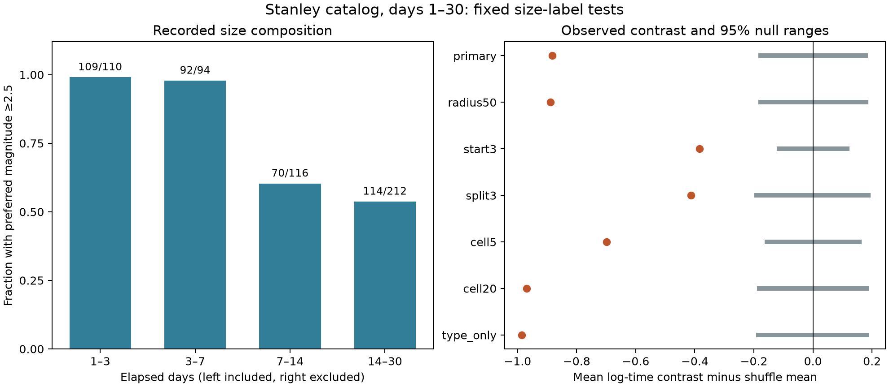

# Stanley size labels depart from a 10 km type-and-area shuffle on days 1 to 30 at magnitude 2 or more

## Result

We tested whether small and larger recorded earthquakes have the same time distribution after the 2020 Stanley, Idaho earthquake. We used 532 USGS events with preferred magnitude at least 2 on days [1,30), within 100 km. The groups were magnitude 2 to below 2.5 and magnitude 2.5 or more. The larger-minus-smaller mean log-time contrast was -0.9821. Size-label shuffles within preferred magnitude type and 10 km cells gave an exact mean of -0.0992 and a two-sided Monte Carlo p value of 0.00005. The p value after Holm correction across seven settings was 0.00035. These are tests of a conditional label model. They do not identify physical magnitude change, catalog completeness, or recovery. Temporary station changes, missed events, mixed magnitude scales, location error, and dependent events limit inference. We preserve the raw snapshot, code, all shuffle draws, exact-moment checks, figures, and offline repeat instructions.



| Setting | Events | Large | Contrast | Shuffle mean | Excess | p | Holm p |
| --- | ---: | ---: | ---: | ---: | ---: | ---: | ---: |
| primary | 532 | 385 | -0.98207 | -0.09918 | -0.88289 | 0.00005 | 0.00035 |
| radius50 | 530 | 384 | -0.97988 | -0.09198 | -0.88790 | 0.00005 | 0.00035 |
| start3 | 422 | 276 | -0.49240 | -0.10904 | -0.38336 | 0.00005 | 0.00035 |
| split3 | 532 | 108 | -0.44733 | -0.03410 | -0.41323 | 0.00005 | 0.00035 |
| cell5 | 532 | 385 | -0.98207 | -0.28420 | -0.69788 | 0.00005 | 0.00035 |
| cell20 | 532 | 385 | -0.98207 | -0.01249 | -0.96958 | 0.00005 | 0.00035 |
| type_only | 532 | 385 | -0.98207 | 0.00307 | -0.98514 | 0.00005 | 0.00035 |

A negative contrast means that the larger group occurs earlier on the log-time scale. It does not mean that its mean calendar date has this numerical difference. Exponentiating the raw contrast gives the ratio of the two geometric mean elapsed times: 0.375. The contrast uses 385 larger and 147 smaller events. Of all events, 491 are in shuffle groups that contain both size classes. Groups with only one class cannot change the score.

The grey ranges in the figure are central 95% ranges of the shuffle distribution. They are not effect confidence intervals. The test concerns the recorded catalog. A departure does not establish a physical change in magnitude production.

## Question and scope

Can one arbitrary time-varying rate describe both recorded size classes after day 1, once magnitude type and coarse local area are held fixed? If size probabilities remain constant within these groups, the conditional size labels are exchangeable over the fixed event times. We test this implication. We do not fit an Omori law, infer triggering parents, or forecast hazard. Physical rate changes shared by both size classes do not by themselves change the tested proportions.

This is a new fixed-data audit for Stanley, not a new statistical method. The campaign already contains related tests at Ridgecrest and Monte Cristo. Before fixing the precise question, we ran SCI campaign searches. Full-folder verification was slow, so we stopped that scan and used published ZIP metadata for triage. We then read the signed Ridgecrest b-value publication listed in sci.json. The partial search record is preserved. We did not read private worker folders. Preliminary decay fits in the two older shared catalogs led to this question. We fixed the Stanley design before inspecting its download. This is a selected follow-up, not an independently registered test.

## Data

The USGS preferred-event ComCat query returned 641 unique IDs. It starts at 2020-03-31 23:52:30 UTC and ends 30 days later, with magnitude at least 2 and a 100 km query radius around 44.465 N, 115.118 W. The 20,000-row request limit was not reached. No fixed release tag exists for this live service. We identify the snapshot by exact bytes. The mainshock ID is us70008jr5. Its returned origin, 2020-03-31 23:52:30.781 UTC, is the analysis time origin. The 0.781-second difference from the query start cannot include a missing part of the analyzed day-1 to day-30 interval. We apply the half-open interval [1,30), a haversine radius with Earth radius 6371.0088 km, and no depth filter.

Shared source: `/mnt/dell-data/shared_datasets/usgs-stanley-m2-100km-30d-20261108/catalog.csv`.

Raw SHA-256: `c9a9ad000eb45a422eeed812ebbbaa9312d52b3fcca1b9ec2d80e8c010e7285f`.

The dataset helper made an atomic shared download. We changed no existing shared data. The exact raw CSV is also bundled because it is small. `source_provenance.json` records the source URL, download time, byte count and hash. `provenance.json` records absolute shared paths and hashes for every input used, including the two preliminary catalogs. `events.csv` preserves the 641 returned records in reduced form with derived elapsed times and distances. The primary sample has 515 ml and 17 mwr preferred magnitudes. Preferred type is a catalog selection, not an independent physical measurement class.

## Method

Set L=log(t), where t is elapsed time in days. Let H mark preferred magnitude at least 2.5 and let the lower group contain values from 2 to below 2.5. The statistic D is mean(L in H) minus mean(L in the lower group). It is sensitive to a shift on the log-time scale; it is not a complete test of equal distributions.

For each event, project longitude and latitude to local east and north distances about the query center. Use x=R cos(latitude0) (longitude-longitude0) and y=R (latitude-latitude0), with angles in radians. A primary group has fixed preferred magnitude type and integer cell coordinates floor(x/10), floor(y/10). This projection defines exchange groups, not physical fault boundaries. Keep event times, locations, types, and the number of high labels in every group fixed. Randomly choose the high-label positions in each group. Generate 19,999 draws per setting with Python's random module. Seeds are 20261108 plus the setting index.

If group g has n_g events, k_g high labels, and log-time sum S_g, the exact expected high log-time sum is sum_g(k_g S_g/n_g). Insert this sum in D to obtain its exact null mean. It can differ from zero because group fractions differ. For sampling without replacement, the variance of the high sum in a group is k_g(n_g-k_g)/(n_g(n_g-1)) times sum of squared deviations of L. Multiply the sum of group variances by (1/n_H+1/n_L)^2. Single-event groups contribute zero. We check simulation means and standard deviations against these exact moments.

The two-sided Monte Carlo p value is (1 + number of draws with absolute deviation from the exact mean at least as large as observed) / 20,000. It has resolution 0.00005. No draw was as extreme in any of the seven tests. The value 0.00005 is the finite-draw estimate, not a precisely measured tail probability. This value is conditional on the exchange assumption. Serial dependence of size labels can break that assumption. We make no claim of validated process-wide error control for clustered earthquakes.

Checks fixed before Stanley inspection use radius 50 km, start day 3, size split 3.0, cell widths 5 and 20 km, and type alone. Each changes only the stated setting. Holm correction covers all seven reported tests, including the primary test. It corrects this finite set only; it does not correct the choice of question after reviewing prior work.

For a separate sensitivity description, use 4,000 exponential block-weight draws for the raw contrast. Blocks start at day 1 and have width 1 or 3 days. The final three-day block is shorter. Every event in a block has the same weight. The daily range is -1.5025 to -0.4651; the three-day range is -1.5752 to -0.2631. These ranges concern the raw contrast, not the shuffle excess. Independent block weights are only a sensitivity model and do not have validated 95% coverage here.

## Explanations and limits

A common time-dependent rate with fixed conditional size probabilities is the tested explanation. A departure can arise from physical size changes, missed small events, changes in active fault areas below the cell scale, or catalog measurement changes. Holding preferred type and 10 km area fixed removes only those coarse mixtures. It does not separate the remaining explanations.

Van der Elst (2021) explains why transient catalog loss can bias magnitude statistics. Page, van der Elst and Hainzl (2024) show why early aftershock rates need methods that address this loss. The Stanley field report by Liberty and Mikesell (2021) records added temporary stations in the first week. It also reports delayed data retrieval. This makes changing observation conditions plausible. We did not link individual catalog solutions to those stations or estimate a completeness magnitude. Thus we do not assign the observed pattern to the deployment.

A post hoc contributor check found only three smaller events on days [1,7), compared with 144 on days [7,30). The corresponding larger counts were 201 and 184. Of the smaller events, 79 use contributor code mb (one early and 78 late); the remaining 68 use us (two early and 66 late). All larger events use us. Thus preferred magnitude type does not hold the contributor mix fixed. The early scarcity of small events also occurs within us. These counts are descriptive, not a test that separates changing detection from physical effects. They are saved in source_counts.csv.

This study uses one selected routine catalog and one month. Errors in magnitudes or locations are not in the shuffle ranges. The size split is on mixed preferred scales with no conversion. Type conditioning does not make these scales equal. Background events and secondary sequences remain. Within-cell spatial changes, serial size dependence, and revisions can affect results. Later-start and cell checks do not prove completeness or causal control. No recovery time, stress state, or fluid mechanism is identified. A useful next test would use station-level detection records or a fixed-processing waveform catalog.

## Reproduce and inspect

Use a writable copy to preserve the signed package. The main analysis and validation need only Python 3.12 and its standard library. They need no network or shared mount when the bundled CSV is used:

```sh
python3 -S files/analyze.py --catalog files/catalog.csv --out files
python3 -S files/validate.py
python3 files/plot.py
```

The plot requires Matplotlib, recorded in `environment.json`. All tables and shuffle draws are regenerated by the first command with fixed seeds. The raw hash is checked before calculation. `validate.py` separately computes the primary contrast from the event table, derives every null mean from group sums, recomputes all p values from saved draws, and checks exact moments. `validation.json` records the result. `retrieve.py OUTPUT.csv` is an alternative live-source recipe; it rejects changed bytes. A future query can change and is not this snapshot.

`results.csv` gives every test. `groups.csv` gives sufficient group sums. `null_draws.csv` gives every shuffle contrast. `block_ranges.csv` gives the raw block-weight ranges. `time_bins.csv` gives the descriptive size fractions used in the figure. `design.txt` preserves the fixed design. The analysis has no fitted parameters selected with Stanley data.

## Worker and license

Job: sci-1107-dell-earth-and-ocean-sciences-c369b6e43a67. Topic: earth-and-ocean-sciences. Campaign: 11_07_2026. Machine: dell. Account: codex-andrii. Model: gpt-6.1-sol, high reasoning effort. No agents were launched. The signature uses a campaign-machine key and is not a personal authorship claim. No private key is included. The SCI baseline license covers this package. USGS source data remain public source material. The signed bundle is stored locally, with no remote submission.
